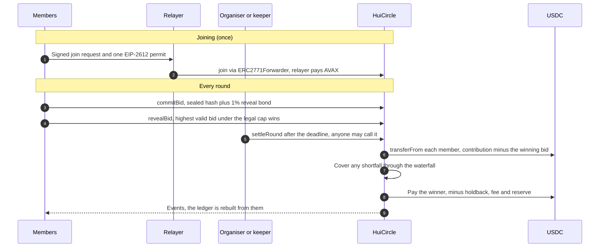
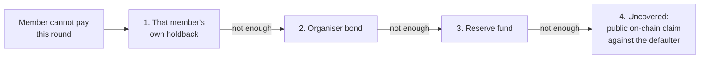
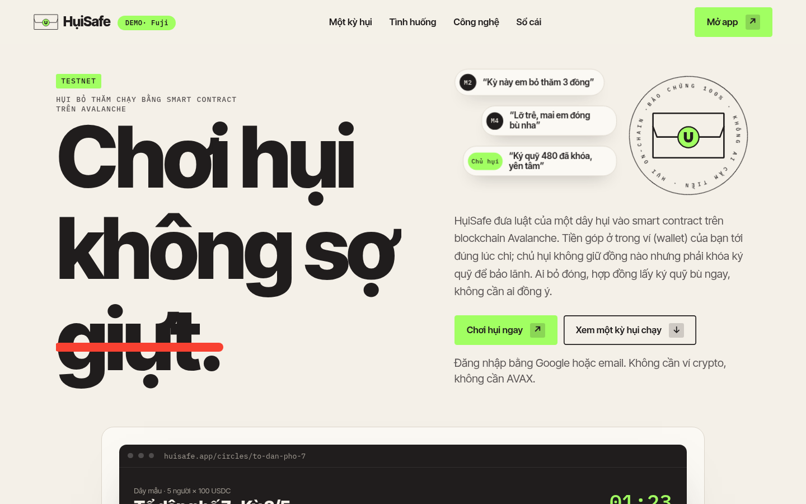
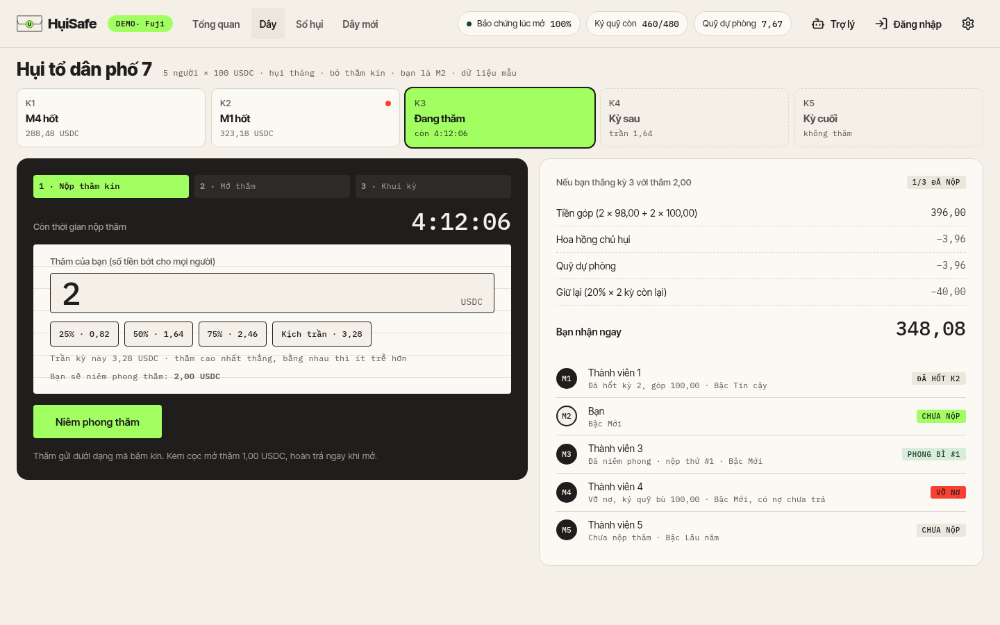
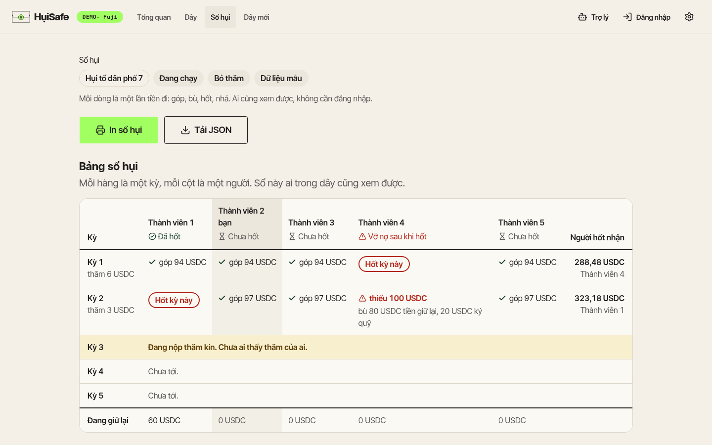
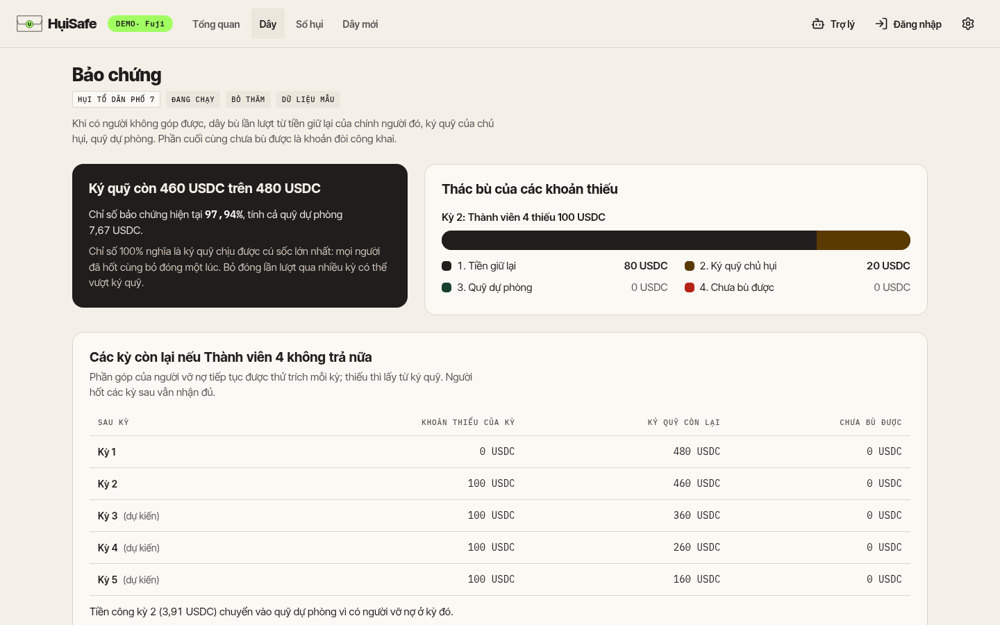
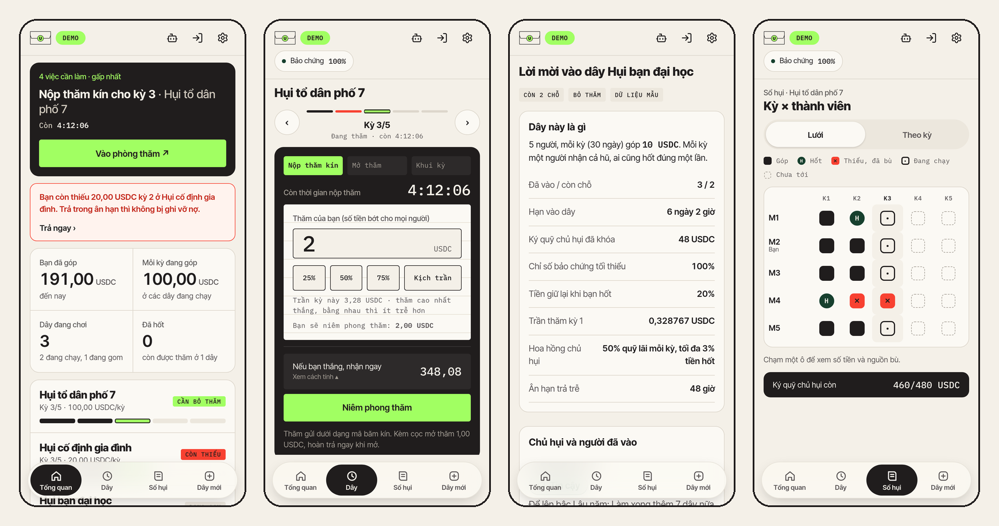
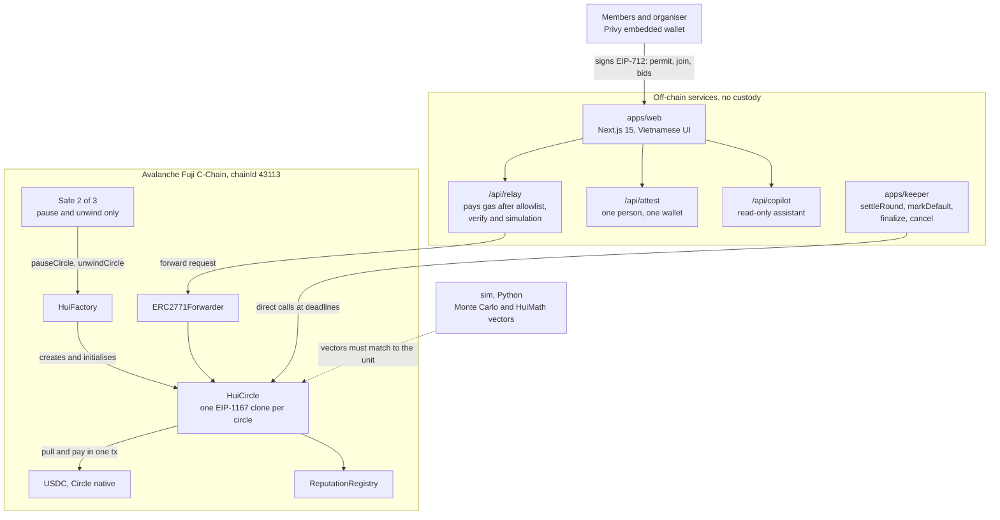

<p align="center">
  
</p>

<h1 align="center">HụiSafe</h1>

<p align="center">
  <strong>The organiser never holds the money, but still guarantees it.</strong><br />
  A sealed-bid <em>hụi</em> (Vietnamese ROSCA) run by smart contracts on Avalanche.
</p>

<p align="center">
  <strong>English</strong> | <a href="README.vi.md">Tiếng Việt</a>
</p>

<p align="center">
  
  
  
  
  
  
</p>

<p align="center">
  <a href="https://lamng.tail3abf4e.ts.net:8443"><strong>Live app</strong></a> ·
  <a href="docs/pitch/slides/HuiSafe-UniHack-2026.pdf"><strong>Pitch deck (PDF)</strong></a> ·
  <!-- DEMO_VIDEO_LINK -->
  <a href="https://testnet.snowtrace.io/address/0x5004477143F8Db65f80992A0BD79c1DAb75C8b21"><strong>HuiFactory on Snowtrace</strong></a> ·
  <a href="#documentation"><strong>Docs</strong></a>
</p>

---

> **Dev toggle declaration.** The demo runs in demo mode on Avalanche Fuji testnet. Time is fast-forwarded: one round lasts 2 minutes (75 s sealed bidding, 45 s reveal) instead of 30 days, and the grace period is 1 minute instead of 48 hours. The interest cap and the late fee are still computed on a 30-day period. All money is testnet USDC with no value; network fees are paid by the HụiSafe relayer; the product generates no yield and has no token. The two evidence circles run on 11/11/2026 used 3-minute rounds and a 2-minute grace period.

## Contents

[Why HụiSafe](#why-hụisafe) · [How it works](#how-it-works) · [Screenshots](#screenshots) · [Verified on Avalanche Fuji](#verified-on-avalanche-fuji) · [Judging criteria](#how-this-maps-to-the-judging-criteria) · [Mandatory questions and Vietnamese law](#the-three-mandatory-questions) · [Architecture](#architecture) · [Engineering quality](#engineering-quality) · [Quick start](#quick-start) · [Limitations](#known-limitations) · [Roadmap](#roadmap) · [Team](#team) · [Documentation](#documentation)

## Why HụiSafe

*Hụi* (also *họ*, *biêu*, *phường*) is how Vietnamese families, market traders and students save and lend to each other: every round each member contributes, and one member takes the whole pot. It is legal (Civil Code 2015, Article 471; Decree 19/2019/NĐ-CP) and it collapses in two ways.

<!-- SOURCES_BLOCK -->
**The organiser holds the pot and disappears, or invents members.** Five press-reported cases that were prosecuted or tried between 2023 and 2025 add up to more than 400 billion VND:

| Where | What the article reports | Source |
|---|---|---|
| Lâm Đồng | Life sentence; more than 156 billion VND taken from 203 victims | [Tuổi Trẻ, 19/09/2025](https://tuoitre.vn/chu-hui-lua-dao-hon-100-ti-dong-lanh-an-chung-than-20250919182451911.htm) |
| An Giang | 20 years; 99 billion VND through 134 circles, using fake accounts to take the pot | [VnExpress, 25/09/2025](https://vnexpress.net/chu-hui-chiem-doat-99-ty-dong-o-mien-tay-bi-phat-20-nam-tu-4943272.html) |
| Trà Vinh | 20 years; nearly 72 billion VND from more than 270 people; 1,607 shares taken under fake names | [VnExpress, 11/10/2023](https://vnexpress.net/chu-tiem-nail-giat-hui-72-ty-dong-cua-hang-tram-nguoi-4663654.html) |
| Đồng Nai | Organiser couple charged; more than 49 billion VND from 337 people (preliminary police figure) | [Thanh Niên, 01/02/2024](https://thanhnien.vn/vu-vo-hui-gan-50-ti-dong-cong-an-tinh-dong-nai-khoi-to-vo-chong-chu-hui-185240201092519765.htm) |
| Trà Vinh | 19 years; more than 35 billion VND from 160 members | [Dân trí, 04/06/2025](https://dantri.com.vn/phap-luat/nu-chu-hui-lua-dao-160-nan-nhan-chiem-doat-hon-35-ty-dong-20250604164857355.htm) |

The same pattern shows up at small scale and online: 157 fake shares in Zalo-run circles, more than 4 billion VND, 12 years in prison ([VOV, 13/03/2025](https://vov.vn/phap-luat/12-nam-tu-cho-doi-tuong-mo-day-hui-khong-chiem-doat-tai-san-post1161016.vov)); fake Zalo accounts used to bid and take the pot, nearly 500 million VND ([VietnamPlus, 06/10/2026](https://www.vietnamplus.vn/tay-ninh-khoi-to-chu-hui-dung-tai-khoan-ao-chiem-doat-gan-500-trieu-dong-post1140315.vnp)). Oversight barely exists: after five years of Decree 19, Ho Chi Minh City reported that not one organiser or member had notified the local authority as the decree requires ([Báo Đầu tư, 04/11/2024](https://baodautu.vn/tphcm-kien-nghi-sua-quy-dinh-de-tranh-vo-hui-day-chuyen-gay-hau-qua-lon-d229125.html)).

These are each article's own figures, opened on 21/11/2026; there is no national statistic on hụi collapses, and none on how many people play. The closest proxy is the World Bank Global Findex (2024 data): 71% of Vietnamese adults have an account, yet 34% borrowed from family or friends and 10% saved through a savings club or a person outside the family ([World Bank API](https://api.worldbank.org/v2/country/VNM/indicator/fin17c?source=28&format=json)).
<!-- /SOURCES_BLOCK -->

**Members who received early stop paying.** Even with an honest organiser, the people who receive last carry the risk. In chit-fund data from Chennai (India), 2.04% of early receivers and 0.59% of late receivers defaulted after receiving (Klonner & Rai, 2008; Indian data, not Vietnamese; see [docs/08](docs/08-phong-mo-phong.md)).

Moving the pot into a smart contract fixes the first problem and makes the second one worse: nobody is left to cover the member who stops paying.

## How it works

### The core insight

A traditional organiser does two jobs: **custody** (holding contributions) and **guarantee** (covering a member who received and then stops paying; Decree 19/2019, Article 18.4, puts this duty on the organiser). A naive on-chain ROSCA removes both. HụiSafe removes custody and keeps the guarantee, as a bond locked in the contract.

| | Traditional hụi | Naive on-chain ROSCA | HụiSafe |
|---|---|---|---|
| Who holds contributions | The organiser | A contract, between rounds | Each member's own wallet until the moment of payout |
| Who covers a member who received and stops paying | The organiser, if solvent | Nobody: late receivers absorb it | The organiser's bond, locked in the contract |
| Largest residual risk | Organiser absconds or invents members | Early receivers default | Receivers defaulting one after another across rounds, beyond the bond ([limitations](#known-limitations)) |

### One round



1. **Join with one signature.** A member signs a single bounded EIP-2612 `permit` (allowance `(N − 1) × (C + revealBond)`, 404 USDC in the 5 × 100 USDC example). The money stays in the member's wallet.
2. **Sealed bids, no randomness.** Commit-reveal bidding; the highest bid wins, ties are broken by fewer late payments and then by commit order. A bid above the Decree 19 Article 21 cap reverts with `BidTooHigh`.
3. **Pull and pay in one transaction.** `settleRound()` pulls every contribution with `transferFrom`, covers shortfalls, and pays the winner in the same transaction. Contributions never rest in the contract between rounds.
4. **Holdback.** An early receiver has part of the payout held back (20% in the examples) and released as they keep paying on time.

### When a member cannot pay



The round is never blocked by one member: the winner is paid from the waterfall in the same transaction, and the debtor has a grace period to repay (`payLate`) before `markDefault` records the default in `ReputationRegistry`. Repayments restore the sources in reverse priority.

### Coverage Index

Outstanding obligations after round `k` are `k(N − k)C`, peaking mid-circle. The Coverage Index compares protection with that peak:

```text
Coverage Index = holdback rate + (bond + reserve) / maximum exposure
Example: 5 members x 100 USDC  ->  maximum exposure = 2 x 3 x 100 = 600 USDC
         20% holdback + 480 USDC bond / 600 USDC = 100%
```

A circle on Fuji cannot start below 100% (`minCoverageBps = 10_000`, enforced in `activate()`), and every member sees the index before joining. The two commitments we make, and no others ([docs/03, section 7.3](docs/03-dac-ta-giao-thuc.md)):

- "A Coverage Index of 100% means the bond withstands the largest shock: every member who has already received stops paying at the same time."
- "A 100% bond stops an organiser from using one fake wallet: doing so loses the organiser money. Using several fake wallets is stopped by one-person-one-account verification (OTP, attestation), and every member sees their maximum risk up front."

### Organiser commission inside the legal interest cap

In commission-share mode the organiser's fee and the winning bid share one legal envelope: `fee + bid × payers ≤ room`, where `room` is the Article 21 cap for that round. A receiver can therefore never pay more than the cap once the commission is counted. The fee is at most 3% of the pot, is zero when the organiser's own seat wins, and is forfeited to the reserve for any round that ends in a default ([docs/03, section 2.7](docs/03-dac-ta-giao-thuc.md); invariant `INV-11`).

## Screenshots

Screens below show the sample circle of the specification's worked example (5 members × 100 USDC).

<table>
  <tr>
    <td width="50%"><br /><sub>Landing page: sign in with Google or email, no crypto wallet, no AVAX.</sub></td>
    <td width="50%"><br /><sub>Bidding room: sealed bid under the legal cap, and the exact payout if you win.</sub></td>
  </tr>
  <tr>
    <td><br /><sub>Ledger: one cell per member per round, rebuilt from on-chain events; printable and exportable as JSON.</sub></td>
    <td><br /><sub>Coverage: the shortfall waterfall and the bond remaining after each round.</sub></td>
  </tr>
  <tr>
    <td colspan="2"><br /><sub>Mobile-first: to-do overview, bidding room, invitation with circle terms, member × round grid.</sub></td>
  </tr>
</table>

## Verified on Avalanche Fuji

Deployed 10/11/2026 at block 60843937 from commit `494e923` ([`contracts/deployments/fuji.json`](contracts/deployments/fuji.json)). The source of all five contracts is verified on Routescan, the explorer behind Snowtrace (re-checked through the Routescan API on 21/11/2026).

| Contract | Address (Fuji, chainId 43113) |
|---|---|
| HuiFactory | [`0x5004477143F8Db65f80992A0BD79c1DAb75C8b21`](https://testnet.snowtrace.io/address/0x5004477143F8Db65f80992A0BD79c1DAb75C8b21) |
| HuiCircle (implementation; each circle is an EIP-1167 clone) | [`0x3A72591e0d451802F051789497eD5f2B2256673d`](https://testnet.snowtrace.io/address/0x3A72591e0d451802F051789497eD5f2B2256673d) |
| HuiCircleLens | [`0xb4Ebda56d43db9e629C1FD6b226ac828BE0637a6`](https://testnet.snowtrace.io/address/0xb4Ebda56d43db9e629C1FD6b226ac828BE0637a6) |
| ReputationRegistry | [`0xf8F05aa2804144F5aC71485614480f801927E5c3`](https://testnet.snowtrace.io/address/0xf8F05aa2804144F5aC71485614480f801927E5c3) |
| ERC2771Forwarder | [`0x789621cFD56Cc79ec47eF6C449B6C53c40516b2C`](https://testnet.snowtrace.io/address/0x789621cFD56Cc79ec47eF6C449B6C53c40516b2C) |
| Admin (Safe, 2 of 3) | [`0xc7BeE5Cc787833C8Fd76b9066d334Ab131E7c3F5`](https://testnet.snowtrace.io/address/0xc7BeE5Cc787833C8Fd76b9066d334Ab131E7c3F5) |
| USDC (Circle, native) | [`0x5425890298aed601595a70AB815c96711a31Bc65`](https://testnet.snowtrace.io/address/0x5425890298aed601595a70AB815c96711a31Bc65) |

### Circles that ran to completion

All three were run by the team with demo wallets and scripts, not by outside users. Each is `Completed` with a USDC balance of 0 (state re-read from Fuji on 21/11/2026).

| Circle | What it proves | Key transactions |
|---|---|---|
| [`0xABA8…2461`](https://testnet.snowtrace.io/address/0xABA89dFfA4e157927710419b01C32bD307bF2461)<br />Fixed order, 3 members, 11/11/2026 | The gasless path end to end: members join through the relayer with 0 AVAX, the keeper settles 3 rounds and finalises | [round 1](https://testnet.snowtrace.io/tx/0xecfcfaeb5378d44986b999b09d0c614c919b0f55289891906cefc55894bc4669) · [round 2](https://testnet.snowtrace.io/tx/0xc7e8f352dce95d40b4a9a1d529322d230f19f6b16029718e572bfe9fb106c4bb) · [round 3](https://testnet.snowtrace.io/tx/0xba1208d7cc0b3fcab176a31bee1c711e84977bb480f2e9d89ea004a6c79479d6) · [finalize](https://testnet.snowtrace.io/tx/0x7159ec482321ad9bb6f8fad699d4d259b11a63112b6e3a35f978b1d94568b290) |
| [`0xc628…5Bfc`](https://testnet.snowtrace.io/address/0xc62828b2f72D288298A6E2fFd0814D0Cb6e15Bfc)<br />Bidding, 5 × 10 USDC, bond 48, 11/11/2026 | The default cascade on a live network: member 4 wins round 1, then cannot pay round 2; 8 USDC comes from that member's holdback and 2 USDC from the bond, the round-2 winner still receives 32.318 USDC; `markDefault`, bond covers rounds 3 to 5, `finalize`. 104 scripted checks match the worked example of [docs/03, section 8](docs/03-dac-ta-giao-thuc.md) at one tenth scale | [round 2 with cover](https://testnet.snowtrace.io/tx/0x1cb02efe008f73e87ccb44b327e7fff0786eba5da95005df4916d6b23c010185) · [markDefault](https://testnet.snowtrace.io/tx/0x33886575dc944a9d66f25209b5e56096a1c0941247ac71c079a11961d6ab9b66) · [finalize](https://testnet.snowtrace.io/tx/0xf415cfb744bcd159657fe7be86ce9d32221b4bdf626742499b7efb2de649bc32) |
| [`0xa428…8f5a`](https://testnet.snowtrace.io/address/0xa42866012F1FbFE4507B87B2D2C9cc69D13F8f5a)<br />Bidding, 5 members, 20/11/2026 | The web flow: created in the web app by an organiser signed in with Google; 5 members joined (one on a physical phone, four demo wallets); the organiser settled all 5 rounds from the settle desk; winners received 31.20 to 39.20 USDC | See the circle's event log on the explorer |

Full transaction lists: [docs/DEPLOY-FUJI.md, sections 15 and 15b](docs/DEPLOY-FUJI.md).

## How this maps to the judging criteria

| Criterion (points) | Evidence in this repository |
|---|---|
| **Technical Implementation (25)** | 634 Foundry tests passing (20/11/2026): unit, 36 fuzz properties, 17 invariant functions over a stateful handler ([`Invariants.t.sol`](contracts/test/invariant/Invariants.t.sol)), a hand-computed integration example ([`WorkedExample.t.sol`](contracts/test/integration/WorkedExample.t.sol)), reentrancy and gas-budget suites. `HuiMath` exists in Solidity, TypeScript and Python and is held equal to the unit by shared vectors ([`Differential.t.sol`](contracts/test/fuzz/Differential.t.sol)). 98.68% line coverage (11/11/2026). See [Engineering quality](#engineering-quality). |
| **Avalanche Integration (25)** | |
| 1. Uses Avalanche meaningfully | The product's core action is one C-Chain transaction that pulls contributions from every member and pays the winner; the legal interest cap and late fee are enforced by the contract ([`HuiCircle.sol`](contracts/src/HuiCircle.sol)). |
| 2. Smart contract / on-chain implementation | Five contracts deployed and source-verified on Fuji; three circles run to completion with every balance back to 0 ([above](#verified-on-avalanche-fuji)). |
| 3. Appropriate use of Avalanche infrastructure | Circle's native USDC with EIP-2612 permit; ERC-2771 meta-transactions so members hold no AVAX ([`/api/relay`](apps/web/app/api/relay/route.ts)); `evm_version = "cancun"` per ACP-131; ERC-2771 instead of EIP-7702, which C-Chain does not accept, and no self-built ERC-4337, as the organisers advise ([docs/06](docs/06-avalanche-va-blockchain.md)). |
| 4. Technical quality of integration | USDC permit domain read from the token at run time; a blocked transfer becomes `claimable` instead of reverting the round; relayer allowlist, simulation and gas caps; keeper with fair scanning and idempotent sends ([`keeper.ts`](apps/keeper/src/keeper.ts)); event reads fall back from explorer to bounded RPC scans. |
| 5. Clear value from building on Avalanche | A 5-member settlement costs about 520,000 gas; a 30-member one stays under 3,000,000, roughly 0.065 USD at mainnet gas prices of 05/11/2026 ([docs/06, section 5](docs/06-avalanche-va-blockchain.md); [`GasBudget.t.sol`](contracts/test/gas/GasBudget.t.sol)). Low fees are what let a relayer pay for every member. |
| **Creativity & Innovation (15)** | Separating custody from guarantee; a Coverage Index with a proven bound and a stated counter-example; holdback for early receivers; organiser commission inside the statutory interest cap; a reserve fund shared by punctuality rather than equally ([docs/03](docs/03-dac-ta-giao-thuc.md), [docs/14](docs/14-nang-cap-v1.2.md)). |
| **Impact & Use Case (15)** | A real, legal and widespread Vietnamese practice with documented large collapses ([Why HụiSafe](#why-hụisafe)); Decree 19/2019 rules implemented in code; users are organisers and family, trader and student circles ([docs/02](docs/02-dac-ta-san-pham.md), [docs/01](docs/01-nghien-cuu-nen-tang.md)). |
| **Presentation & Pitching (10)** | Deck with a source for every figure ([PDF](docs/pitch/slides/HuiSafe-UniHack-2026.pdf)); dev toggle declared first; the three mandatory questions and the four Vietnamese-law points answered [below](#the-three-mandatory-questions); limitations stated before being asked. |
| **UI/UX & Demo (10)** | Vietnamese, mobile-first web app with Google or email login and no gas; every transaction shows Sign → Send → Confirm; public ledger; 556 Playwright checks including axe accessibility at 390, 768 and 1440 px (21/11/2026); design system in [`apps/web/DESIGN.md`](apps/web/DESIGN.md). [Live app](https://lamng.tail3abf4e.ts.net:8443). |

## The three mandatory questions

**Why on-chain?** The root failure of hụi is having to trust whoever holds the money. An app with a database only moves that trust from the organiser to the app operator. On-chain, contributions stay in each member's wallet until payout, the bond is locked by code the organiser cannot withdraw from, the circle's parameters are immutable after it starts, and anyone can audit the ledger.

**Why Avalanche?** C-Chain has Circle's native USDC with `permit`, so a member signs once when joining. Fees are low enough for a relayer to pay on behalf of every member, and transactions finalise in about a second, which suits a live bid-opening session. The organisers' own brief for this topic makes the same point: low fees mean a group paying weekly does not lose the pot to fees.

**Where does the money come from?** The pot is the members' own contributions. The bid premium is paid by early receivers to later receivers, under the Article 21 cap. The organiser's fee is at most 3% of the pot per round. There is no yield and no token. If yield on idle funds is ever offered on mainnet it would come from lending on Aave v3, never from token issuance ([ADR-10](docs/04-kien-truc.md)).

### Vietnamese law

The four points the organisers require every team to state:

| Point | HụiSafe |
|---|---|
| Crypto is not legal tender | Testnet USDC only, no real money accepted. Resolution 05/2025/NQ-CP (Art. 4.7) requires crypto-asset payments to be made in Vietnamese dong, so a real launch needs a VND mode. |
| Salaries must be paid in VND | Not applicable: HụiSafe pays no salaries (Labour Code 2019, Art. 95.2). Hụi is a civil transaction between members. |
| Paid legal or financial advice requires a licence | The assistant is free, computes with fixed formulas, cites the decree, and labels every answer as reference information, not legal or financial advice. |
| Tokenised stocks are geo-blocked by their issuers | Not applicable: no tokenised stocks; no token is issued or sold. |

Decree 19/2019/NĐ-CP in code ([docs/10](docs/10-phap-ly-va-tuan-thu.md)): Art. 5 and 6 (members and organiser aged 18 or over, self-declared through the attestation), Art. 12 and 13 (ledger and receipts, rebuilt from events), Art. 14 (prompt and draft notice to the commune People's Committee from 100 million VND per round or two circles), Art. 18.4 (the organiser's duty to pay for a member who does not contribute, as a locked bond), Art. 20 (highest bid wins; deterministic tie-break written into the circle terms), Art. 21 (bid cap of 20% per year), Art. 22.1 (late interest of 10% per year).

**Our reading, pending legal review.** The bid-cap formula under Article 21, the deterministic tie-break in place of drawing lots under Article 20, the commission counted inside the interest cap, and limiting the organiser's liability to the bond are the team's interpretation. No lawyer has confirmed them yet. Open questions are listed in [docs/10, section 7](docs/10-phap-ly-va-tuan-thu.md).

## Architecture



| Path | What lives there |
|---|---|
| [`contracts/`](contracts) | Foundry project: `HuiFactory`, `HuiCircle` (+ `Base`, `Views`, `Lens`), `ReputationRegistry`, `HuiMath`, deploy and demo scripts, tests |
| [`packages/sdk`](packages/sdk) | ABI generated with `@wagmi/cli`, chain reads and writes, EIP-712 typed data, `huiMath.ts`, ledger builder |
| [`packages/config`](packages/config) | Chain, addresses read from `fuji.json`, demo constants |
| [`apps/web`](apps/web) | Next.js 15 app and the three API routes `relay`, `attest`, `copilot` |
| [`apps/keeper`](apps/keeper) | Scheduled Node process that settles rounds, marks defaults, finalises and cancels |
| [`sim/`](sim) | Python Monte Carlo simulation and the shared `HuiMath` vectors |
| [`tools/hui-economics`](tools/hui-economics) | Independent cash-flow calculator used to cross-check the specification |
| [`docs/`](docs) | Specification, architecture, legal analysis, runbooks, pitch material |

Key design decisions (full list of ADRs in [docs/04, section 6](docs/04-kien-truc.md)):

- **ADR-04. ERC-2771 meta-transactions and one permit.** Members never need AVAX; the direct call path always remains, so the relayer cannot censor.
- **ADR-05. One EIP-1167 clone per circle.** Isolated state and funds per circle; creation costs about 405,000 gas.
- **ADR-06. No `Multicall` next to `ERC2771Context`.** Avoids the address-spoofing class disclosed by OpenZeppelin in December 2023; enforced by a CI check on the ABI.
- **ADR-07 and ADR-18. No database and no indexer.** The UI and the ledger are rebuilt from events, so there is nothing off-chain that can disagree with the chain.
- **ADR-12. The LLM never signs.** The assistant has only deterministic read-and-compute tools.
- **ADR-20. One formula, three languages.** `HuiMath` in Solidity, TypeScript and Python is tested against the same committed vectors.
- **ADR-22. Coverage floor of 100% on Fuji.** A half-covered circle would let an organiser profit from a single fake wallet.

## Engineering quality

### Tests

Results are local runs on the dates shown. The Vitest and pytest rows were re-run on the submission commit; the other rows are the latest figures recorded in [docs/TIEN-DO.md](docs/TIEN-DO.md) and the deck's source appendix.

| Command | Covers | Latest result |
|---|---|---|
| `cd contracts && forge test` | Unit, fuzz, invariant, integration, gas budgets, script tests | 634 passing (20/11/2026) |
| `forge test --match-path "test/invariant/*"` | 17 invariant functions over a stateful handler: `INV-01`…`INV-09`, `INV-11`…`INV-13`, liveness of `settleRound` and `finalize`, view parity | Passing (20/11/2026) |
| `forge coverage --ir-minimum` | Line coverage of `contracts/src` | 98.68% lines, 100% functions (11/11/2026) |
| `pnpm -r test` | Vitest: web 506, sdk 142, keeper 25, config 15 | All passing (21/11/2026, commit `9c0db3b`) |
| `pnpm --filter web test:e2e` | Playwright UI checks with axe, at 390, 768 and 1440 px | 556 passing (21/11/2026) |
| `pnpm --filter web e2e:anvil` | A full circle on a local chain: deploy, join through relay, bid, settle, default, late payment | 107 of 107 checks (20/11/2026) |
| `cd sim && pytest` | Simulation model and vector generator; `mypy --strict` clean | 71 passing (21/11/2026) |
| `pnpm --filter web eval:copilot -- --mode mock` | Assistant tools, output guard and scoring, against scripted cases | 33 of 33. Scripted cases, not a measurement of a live model |

### Money invariants

Each has its own invariant function ([docs/03, section 7.2](docs/03-dac-ta-giao-thuc.md)); `INV-10` is a static CI check.

| ID | Property |
|---|---|
| INV-01 | Ledger identity: the contract's USDC balance equals bond + reserve + holdbacks + fee escrow + reveal bonds + claimable |
| INV-02 | Every member receives exactly once; every round has exactly one receiver |
| INV-03 | No winning bid exceeds the legal cap or reaches the contribution |
| INV-04 | A member is never pulled for more than that round's due amount |
| INV-05 | `payout + fee + premium + holdback == pot` in every round |
| INV-06 | Holdback of each receiver stays within its schedule |
| INV-07 | USDC only ever moves to members, the organiser (bond and valid fee) and `claimable` holders, never to the admin |
| INV-08 | At 100% coverage, a simultaneous default of all receivers leaves `uncovered == 0` in every round |
| INV-09 | Round `k` settles only after round `k − 1` and after its deadline; parameters are immutable after `activate()` |
| INV-10 | No personal data on-chain: only addresses, hashes, amounts and timestamps |
| INV-11 | Commission plus bid premium stays inside the interest cap |
| INV-12 | The final reserve is fully distributed; defaulters receive 0; a later payer never receives more |
| INV-13 | A fee is paid immediately only for a round with no shortfall |

### Security posture

- **Internal review only.** 0 Critical and 0 High open after the team's own review of contracts, relay, attest and keeper ([docs/09](docs/09-kiem-thu-va-bao-mat.md)). There has been no independent audit.
- **Static analysis.** Slither 0.11.6 with `lib/`, `test/` and `script/` filtered: 0 High (11/11/2026); Medium findings are triaged in docs/09, section 7.1.
- **Admin cannot take funds.** The admin is a 2-of-3 Safe that can only act through the factory: pause, unpause and, after 48 hours of continuous pause, `emergencyUnwind`, which returns money according to the ledger. While paused, only `claim()` works.
- **Separated keys.** Deployer, relayer, attester and keeper each use their own key; the relayer and keeper hold only AVAX for gas and have no on-chain privileges (ADR-21).
- **Relayer guard.** Target and selector allowlist, `value = 0`, gas caps, rate limit, signature `verify` and simulation before sending (ADR-19).
- **Contract discipline.** Custom errors, an event for every state change and money movement, checks-effects-interactions, `SafeERC20`, `nonReentrant` on functions that pay out, no source of randomness.

### AI assistant guardrails

The organiser's assistant ([`/api/copilot`](apps/web/app/api/copilot/route.ts), [docs/07](docs/07-ai-agentic.md)) reads and computes; it never signs and never moves money. Every figure comes from a deterministic tool such as `max_bid_table`, `simulate_circle` or `draft_ubnd_notice`; an output guard rejects figures the tools did not produce; the only address it sees is the circle being viewed. The core flows work with the assistant switched off.

### Simulation

A seeded Monte Carlo model compares three designs under the same default assumptions (10,000 circles per design, N = 10, C = 100 USDC, seed 42; default rates read from Klonner & Rai, 2008). This is a comparison under stated assumptions, not a forecast ([`sim/outputs/baseline.json`](sim/outputs/baseline.json), [docs/08](docs/08-phong-mo-phong.md)).

| | Traditional | Naive on-chain | HụiSafe |
|---|---|---|---|
| Circles where a member is paid short or the organiser absconds | 23.33% | 62.46% | 0.01% |
| Expected loss of a late receiver | 4.99% | 6.37% | 0.0003% |

## Quick start

Prerequisites: Node 22+, pnpm 12, [Foundry](https://book.getfoundry.sh/), Python 3.11+.

```bash
git clone --recurse-submodules https://github.com/bminhnemhoi/T1VN_Unihack.git
cd T1VN_Unihack
pnpm install
pnpm -r build && pnpm -r lint && pnpm -r typecheck && pnpm -r test
```

**Contracts**

```bash
cd contracts
forge build
forge test                                   # all suites
forge test --match-path "test/invariant/*"   # money invariants only
```

**A full circle on a local chain** (no keys, no testnet funds):

```bash
pnpm --filter web e2e:anvil
```

**Web and keeper against Fuji.** Copy `.env.example` to `.env.local` and fill in your own testnet keys (never commit them). Each role uses a separate testnet wallet.

```bash
pnpm --filter web dev          # reads live circles from Fuji
pnpm --filter keeper start     # settles rounds, marks defaults, finalises
```

Without a deployment file the web app runs on clearly labelled sample data. Deployment is Fuji-only and human-approved; see [docs/DEPLOY-FUJI.md](docs/DEPLOY-FUJI.md) and [docs/HOSTING.md](docs/HOSTING.md).

**Simulation**

```bash
cd sim
pip install -e ".[dev]"
python -m huisim.cli run --scenario baseline --seed 42
python -m huisim.cli run --scenario organizer_economics --seed 42
python -m huisim.cli run --scenario organizer_sybil --seed 42
```

## Known limitations

- **Testnet only.** Everything runs on Fuji with test USDC. Crypto is not a legal means of payment in Vietnam, so a real launch needs a VND mode and legal advice ([docs/10](docs/10-phap-ly-va-tuan-thu.md)).
- **Sequential defaults can exceed the bond.** 100% coverage is proven for the simultaneous shock only. If receivers stop paying one after another, the total shortfall can exceed the bond: in the 5 × 100 USDC example the last receiver gets 94.08 instead of 392 USDC. This case is pinned by a test and stated in the UI ([docs/03, section 7.3](docs/03-dac-ta-giao-thuc.md)). Full sequential coverage needs a larger bond (800 instead of 480 USDC in the example) and is on the roadmap.
- **Several fake wallets.** A bond does not stop an organiser who controls several members. The defence is one person, one account; today the attestation binds one wallet to one login and collects no identity documents, so it does not stop someone who creates several accounts.
- **Legal interpretation is unreviewed.** See [Vietnamese law](#vietnamese-law).
- **Simulation is assumption-driven.** Default rates come from Indian chit-fund data; results compare designs and do not predict outcomes. Under the baseline assumptions the organiser's return on the bond can be negative ([docs/08](docs/08-phong-mo-phong.md)).
- **Not done yet.** Independent audit, mainnet, VND mode, yield on idle funds, passkeys, testing with users outside the team, and a live-model evaluation of the assistant.
- **Operational dependencies.** Login depends on Privy; gasless use depends on the relayer (the direct call path remains); the public demo is a single small VPS.

## Roadmap

Plans, not commitments.

1. Testnet trial with 3 to 5 real hụi groups; fix what they find (12/2026).
2. Legal opinion on Decree 19 Articles 14, 20 and 21 and on the commission; a VND mode in which money moves through banks while the chain keeps the rules and the ledger.
3. Independent audit, then mainnet behind the Safe; an Avalanche L1 per association; passkey wallets.

## Team

| Member | Role | GitHub |
|---|---|---|
| Ngô Bình Minh | Team lead. Product and protocol design (circle rules, v1.2 parameters), pitch | [bminhnemhoi](https://github.com/bminhnemhoi) |
| Ngô Lâm Tiến | Frontend and integration: web app, UX, Privy wallet and relayer, deployment | [Towfienes](https://github.com/Towfienes) |
| Ngô Đặng Trọng Hiếu | Backend and testing: keeper, SDK, test reviews | [yuutosolonely](https://github.com/yuutosolonely) |

## Documentation

The sources of truth are the protocol specification (docs/03) and the data and API reference (docs/05). If code and documentation disagree, the documentation wins. Documentation and UI are in Vietnamese; code, identifiers and commit messages are in English.

| Document | Content |
|---|---|
| [00 Overview](docs/00-tong-quan.md) · [02 Product spec](docs/02-dac-ta-san-pham.md) | What HụiSafe is, users, screens |
| [03 Protocol spec](docs/03-dac-ta-giao-thuc.md) | Rules, formulas, invariants, worked examples |
| [04 Architecture](docs/04-kien-truc.md) · [05 Data and API](docs/05-cau-truc-du-lieu-va-api.md) | Components, sequence diagrams, ADRs, gas, functions, events, errors |
| [06 Avalanche](docs/06-avalanche-va-blockchain.md) | Network facts, standards used, deployment |
| [07 AI assistant](docs/07-ai-agentic.md) · [08 Simulation](docs/08-phong-mo-phong.md) | Guardrails, evaluation, model and experiments |
| [09 Testing and security](docs/09-kiem-thu-va-bao-mat.md) · [10 Legal](docs/10-phap-ly-va-tuan-thu.md) | Test strategy, threat model, Decree 19 mapping, open legal questions |
| [01 Research](docs/01-nghien-cuu-nen-tang.md) · [13 References](docs/13-tai-lieu-tham-khao.md) | Economics of ROSCAs, collapse cases, prior projects, all sources |
| [DEPLOY-FUJI](docs/DEPLOY-FUJI.md) · [HOSTING](docs/HOSTING.md) | Deployment runbook with transaction hashes, hosting |
| [CHANGELOG](docs/CHANGELOG.md) · [TIEN-DO](docs/TIEN-DO.md) | User-visible changes, progress log |
| [docs/pitch](docs/pitch) | Deck, video script, Q&A, submission form text |

## Acknowledgements

Built for **Team1 Vietnam UniHack 2026** (Social finance track), organised by Team1 Vietnam on **Avalanche**, sponsored by **MEXC Ventures**. The embedded-wallet login follows the organisers' Privy starter code (ADR-03).

HụiSafe stands on [OpenZeppelin Contracts](https://github.com/OpenZeppelin/openzeppelin-contracts), [Foundry](https://github.com/foundry-rs/foundry), [Privy](https://www.privy.io/), [Circle USDC](https://www.circle.com/usdc), [viem](https://viem.sh/) and [Next.js](https://nextjs.org/).

## Disclaimer

HụiSafe is a hackathon project running on a test network with test tokens that have no value. It accepts no real money, issues no token, and is not financial or legal advice.
