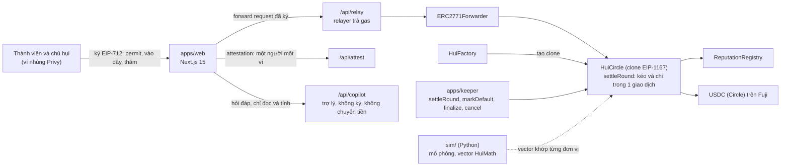

# HụiSafe

NHÁP chờ Towfienes duyệt (B14). Số liệu trong file này lấy từ lệnh đã chạy ngày 10 đến 11/11/2026 hoặc từ `contracts/deployments/fuji.json`; chỗ nào là giả định đều ghi rõ.

**Chủ hụi không cầm tiền, nhưng vẫn phải bảo lãnh.**

HụiSafe là hụi bỏ thăm (ROSCA đấu thăm) chạy bằng smart contract trên Avalanche Fuji C-Chain (chainId 43113), dự thi Team1 Vietnam UniHack 2026, track Social finance. Tiền nằm trong ví từng thành viên cho đến lúc chi: lúc vào dây thành viên ký một lần (EIP-2612 `permit`), đến hạn `settleRound()` kéo tiền góp bằng `transferFrom` và chi cho người hốt trong cùng một giao dịch. Chủ hụi không giữ tiền của ai, nhưng phải ký quỹ bảo lãnh; người hốt sớm bị giữ lại một phần tiền hốt; có quỹ dự phòng nhỏ. Các quy định của Nghị định 19/2019/NĐ-CP (trần lãi, lãi chậm góp, ngưỡng thông báo UBND cấp xã) chạy trong code. Người dùng đăng nhập bằng ví nhúng Privy và không trả gas nhờ meta-transaction ERC-2771 qua relayer.

Hai câu cam kết, đúng như đặc tả (docs/03 mục 7.3):

- "Chỉ số bảo chứng 100% nghĩa là ký quỹ chịu được cú sốc lớn nhất: mọi người đã hốt cùng bỏ đóng một lúc."
- "Cọc 100% chặn được chủ hụi dùng một ví ảo: làm vậy chủ hụi tự lỗ. Dùng nhiều ví ảo thì bị chặn bằng xác thực mỗi người một tài khoản (OTP, attestation), và mọi người thấy trước rủi ro tối đa của mình."

## Khai báo chế độ demo

Đọc ở đầu mọi buổi trình bày (docs/12 mục 1): "Trước khi bắt đầu, chúng em xin khai báo dev toggle: bản demo chạy ở chế độ demo trên Avalanche Fuji testnet. Thời gian được tua nhanh: mỗi kỳ hụi 3 phút thay vì 30 ngày, ân hạn 2 phút thay vì 48 giờ; trần lãi và lãi chậm góp vẫn tính như kỳ 30 ngày. Tiền trong demo là USDC thử nghiệm, không có giá trị, và sản phẩm không sinh lãi."

Chỉ có USDC testnet. Không nhận tiền thật, không có token, không có dữ liệu cá nhân trên chuỗi (chỉ địa chỉ ví và mã băm).

## Kiến trúc



Thư mục (pnpm workspaces): `contracts/` (Foundry), `packages/sdk` (ABI sinh bằng `@wagmi/cli`, đọc và ghi, typed data, `huiMath.ts`), `packages/config` (chain, địa chỉ, hằng số), `apps/web`, `apps/keeper`, `sim/`, `tools/hui-economics` (máy tính dòng tiền đối chiếu), `docs/`.

## Địa chỉ trên Avalanche Fuji

Đọc từ `contracts/deployments/fuji.json` (deploy 10/11/2026, commit `494e923`, block 60843937). Admin của factory là Safe 2/3, không có hàm rút tiền người dùng. Trang verify mã nguồn: `docs/DEPLOY-FUJI.md` ghi 5/5 contract đã verify trên Routescan; trạng thái hiển thị trên Snowtrace chưa kiểm lại.

| Thành phần | Địa chỉ |
|---|---|
| HuiFactory | [`0x5004477143F8Db65f80992A0BD79c1DAb75C8b21`](https://testnet.snowtrace.io/address/0x5004477143F8Db65f80992A0BD79c1DAb75C8b21) |
| ReputationRegistry | [`0xf8F05aa2804144F5aC71485614480f801927E5c3`](https://testnet.snowtrace.io/address/0xf8F05aa2804144F5aC71485614480f801927E5c3) |
| ERC2771Forwarder | [`0x789621cFD56Cc79ec47eF6C449B6C53c40516b2C`](https://testnet.snowtrace.io/address/0x789621cFD56Cc79ec47eF6C449B6C53c40516b2C) |
| HuiCircle (implementation) | [`0x3A72591e0d451802F051789497eD5f2B2256673d`](https://testnet.snowtrace.io/address/0x3A72591e0d451802F051789497eD5f2B2256673d) |
| HuiCircleLens | [`0xb4Ebda56d43db9e629C1FD6b226ac828BE0637a6`](https://testnet.snowtrace.io/address/0xb4Ebda56d43db9e629C1FD6b226ac828BE0637a6) |
| Admin (Safe 2/3) | [`0xc7BeE5Cc787833C8Fd76b9066d334Ab131E7c3F5`](https://testnet.snowtrace.io/address/0xc7BeE5Cc787833C8Fd76b9066d334Ab131E7c3F5) |
| Attester | [`0x112bda0e04AdB60E6e6d2039498aE1B66a1b95B9`](https://testnet.snowtrace.io/address/0x112bda0e04AdB60E6e6d2039498aE1B66a1b95B9) |
| Relayer | [`0x6C03fDfD5aB26Aea68878a62942E9E80811055DB`](https://testnet.snowtrace.io/address/0x6C03fDfD5aB26Aea68878a62942E9E80811055DB) |
| USDC (Circle) | [`0x5425890298aed601595a70AB815c96711a31Bc65`](https://testnet.snowtrace.io/address/0x5425890298aed601595a70AB815c96711a31Bc65) |

Mỗi dây là một clone riêng, địa chỉ lấy từ `HuiFactory.allCircles()`.

## Chạy thử

Yêu cầu: Node 22 hoặc mới hơn với pnpm, Foundry, Python 3.11 hoặc mới hơn. Biến môi trường chỉ cần cho web và keeper: chép `.env.example` thành `.env.local` rồi tự điền (không bao giờ commit; `.env.example` chỉ có tên biến).

```bash
pnpm install
pnpm -r build && pnpm -r lint && pnpm -r typecheck
```

**Trên anvil (máy mình, không tốn gì):**

```bash
# kiểm toàn bộ luồng bằng anvil: deploy, tạo dây, vào dây, thăm, chốt kỳ, trả trễ
pnpm --filter web e2e:anvil
# để tự bấm: dựng anvil và hai route API giả lập Privy, giữ chạy (đọc đầu file để biết cách nối web)
pnpm --filter web exec tsx scripts/anvil-playground.ts
HUISAFE_NETWORK=anvil pnpm --filter web exec next dev -p 3300
```

Chưa có `contracts/deployments/<mạng>.json` thì web chạy chế độ dữ liệu mẫu (có dải báo "dữ liệu mẫu").

**Trên Fuji (testnet thật):** đọc `docs/DEPLOY-FUJI.md`. Deploy và verify chỉ qua lệnh `forge script script/Deploy.s.sol --rpc-url fuji --broadcast --verify` với người duyệt từng lệnh broadcast; không bao giờ broadcast lên mainnet (43114). Sau khi đã có `fuji.json`:

```bash
pnpm --filter web dev          # web đọc dây thật từ Fuji (HUISAFE_NETWORK mặc định là fuji)
pnpm --filter keeper start     # keeper gọi settleRound, markDefault, finalize, cancel khi đến hạn
```

**Mô phỏng:**

```bash
cd sim
python -m huisim.cli run --scenario baseline --seed 42
python -m huisim.cli run --scenario organizer_economics --seed 42   # lời của chủ hụi theo hoa hồng (docs/08 mục 2.7)
python -m huisim.cli run --scenario organizer_sybil --seed 42       # chủ hụi dùng 1 hoặc 2 ví ảo
```

## Lệnh kiểm thử và kết quả

Số liệu đo ngày 10 đến 11/11/2026 trên nhánh `Towfienes/sim-ai` (sau B19 và A20; số test hợp đồng theo `docs/TIEN-DO.md`), máy của người làm.

| Lệnh | Kết quả |
|---|---|
| `cd contracts && forge test` | 632 test đạt, 0 lỗi (theo `docs/TIEN-DO.md` sau A20). Lần đo trước (617 test): 463 unit, 36 fuzz, 54 invariant, phần còn lại là integration, gas, fork; chưa đo lại phần chia theo loại |
| `forge test --match-path "test/invariant/*"` | 54 đạt (lần đo trước A20; bất biến tiền INV-01..INV-09, INV-11..INV-13; INV-10 kiểm tĩnh ở CI) |
| `pnpm -r test` | sdk 126, web 369, keeper 18, config 13: đều đạt |
| `pnpm -r lint` và `pnpm -r typecheck` | sạch |
| `pnpm --filter web test:e2e` (Playwright, gồm kiểm axe về khả năng truy cập; mobile 390, desktop 1440; tablet 768 chỉ cho spec bố cục) | 469 đạt, 7 bỏ qua có chủ đích (test bàn phím chỉ chạy trên desktop) |
| `pnpm --filter web test:e2e:chain` (build chế độ chuỗi với deployment GIẢ và RPC chết cục bộ: không gọi Fuji; kiểm menu và 404) | 6 đạt (3 kiểm × mobile 390 và desktop 1440) |
| `pnpm --filter web e2e:anvil` | 106 kiểm tra đạt |
| `cd sim && pytest` | 71 đạt; `mypy --strict` sạch |
| Eval trợ lý, chế độ mock (`lib/copilot/evals/run.ts --mode mock`) | 33/33 ca đạt. Đây là kịch bản viết tay để kiểm tool, bộ kiểm đầu ra và cách chấm, KHÔNG phải số đo mô hình thật; eval với mô hình thật chưa chạy |

**Bằng chứng chạy thật trên Fuji (11/11/2026).** Dây Fixed N = 3 `0xABA89dFfA4e157927710419b01C32bD307bF2461` chạy trọn trên Fuji ngày 11/11/2026: vào dây qua relay (thành viên không cần AVAX), keeper chốt 3 kỳ (`0xecfcfaeb…4669`, `0xc7e8f352…c4bb`, `0xba1208d7…79d6`) và `finalize` (`0x7159ec48…b290`); trạng thái Completed, 3 kỳ đã chi, số dư USDC của dây về 0 (đọc lại bằng lệnh chỉ đọc). Hash viết tắt trong đoạn này; hash đầy đủ ở `docs/DEPLOY-FUJI.md` mục 15, tra trên Snowtrace theo địa chỉ dây.

**Dây vỡ nợ thật trên Fuji (11/11/2026).** Dây Bidding N = 5, C = 10 USDC `0xc62828b2f72D288298A6E2fFd0814D0Cb6e15Bfc`: ví dụ nhánh B của docs/03 mục 8 chạy thật qua relay và keeper. M4 thu hồi allowance trước kỳ 2 nên thiếu 10 USDC, bù 8 từ tiền giữ lại của M4 và 2 từ ký quỹ (tx kỳ 2 `0x1cb02efe008f73e87ccb44b327e7fff0786eba5da95005df4916d6b23c010185`), rồi `markDefault(M4)`, ký quỹ bù kỳ 3 đến 5, `finalize`, dây về 0; 104 kiểm tra đạt. Số tiền là bản thu nhỏ 10 lần của ví dụ 100 USDC. Đây là ví dụ do script chạy bằng ví demo của đội, không phải người dùng thật bỏ đóng. Xem dây: https://testnet.snowtrace.io/address/0xc62828b2f72D288298A6E2fFd0814D0Cb6e15Bfc; tx kỳ 2: https://testnet.snowtrace.io/tx/0x1cb02efe008f73e87ccb44b327e7fff0786eba5da95005df4916d6b23c010185. Hash đầy đủ từng bước: `docs/DEPLOY-FUJI.md` mục 15b.

Slither mức cao và audit nội bộ: xem `docs/TIEN-DO.md` (0 Critical, High, Medium theo rà soát nội bộ của nhóm, không phải audit độc lập).

## Giới hạn đã biết

- Mọi thứ chỉ chạy trên Fuji testnet với USDC thử nghiệm. Tiền mã hóa không phải phương tiện thanh toán hợp pháp ở Việt Nam, nên bản thật cần chế độ VND và ý kiến luật sư (docs/10).
- Chỉ số bảo chứng 100% bảo vệ trước cú sốc đồng thời lớn nhất (mọi người đã hốt cùng bỏ đóng một lúc). Nếu người đã hốt bỏ đóng lần lượt, kỳ này sang kỳ khác, tổng khoản thiếu có thể vượt ký quỹ: đã khóa bằng test và mô phỏng (docs/03 mục 7.3).
- Một chủ hụi dùng nhiều ví ảo thì cọc không chặn được; phải chặn bằng xác thực mỗi người một tài khoản. Hiện attestation chỉ là một ví một tài khoản đăng nhập, chưa thu giấy tờ nên chưa chống được người tạo nhiều tài khoản.
- Công thức trần thăm (NĐ 19 Điều 21), chia hòa tất định thay bốc thăm (Điều 20) và việc hoa hồng nằm trong trần lãi là cách hiểu của HụiSafe, cần luật sư xác nhận.
- Kết quả mô phỏng dựa trên giả định về tỷ lệ bỏ đóng (lấy cảm hứng từ Klonner & Rai 2008) và thăm 50% trần; đó là so sánh giữa các thiết kế, không phải dự báo (docs/08 mục 9).
- Chưa có: lãi trên ký quỹ (sản phẩm không sinh lãi), passkey, chế độ VND, mainnet, thử nghiệm với người dùng thật, eval trợ lý với mô hình thật, audit độc lập.
- Giao diện B10 đến B12 chờ người duyệt (docs/TIEN-DO.md).

## Lộ trình (kế hoạch, chưa cam kết)

1. Thử testnet với 3 đến 5 nhóm, ghi lại phát hiện và sửa (12/2026).
2. Ý kiến luật sư về Điều 14, 20, 21 và vai trò hoa hồng; chế độ VND.
3. L1 riêng cho từng hội, ví passkey, mainnet sau Safe multisig; kiều bào chỉ sau khi có ý kiến pháp lý ở nước sở tại.

## Tài liệu

Nguồn sự thật: [docs/03-dac-ta-giao-thuc.md](docs/03-dac-ta-giao-thuc.md) (luật, công thức, bất biến) và [docs/05-cau-truc-du-lieu-va-api.md](docs/05-cau-truc-du-lieu-va-api.md) (tên hàm, event, lỗi, API). Code mâu thuẫn với tài liệu thì tài liệu thắng; muốn đổi luật thì sửa 03, rồi 05, rồi mới sửa code và test.

| File | Nội dung |
|---|---|
| `docs/00-tong-quan.md`, `docs/02-dac-ta-san-pham.md` | Tổng quan, PRD, các màn S01 đến S16 |
| `docs/04-kien-truc.md` | Kiến trúc, ADR, gas, biến môi trường, sự cố |
| `docs/06-avalanche-va-blockchain.md` | Fuji, USDC, phí, deploy |
| `docs/07-ai-agentic.md`, `docs/08-phong-mo-phong.md` | Trợ lý chủ hụi, eval, phòng mô phỏng |
| `docs/09-kiem-thu-va-bao-mat.md`, `docs/10-phap-ly-va-tuan-thu.md` | Kiểm thử, bảo mật, pháp lý |
| `docs/12-pitch-demo-nop-bai.md`, `docs/pitch/` | Pitch, kịch bản demo, bản nháp form nộp bài |
| `docs/DEPLOY-FUJI.md`, `docs/TIEN-DO.md` | Runbook deploy, tiến độ |
| `docs/CHANGELOG.md` | Nhật ký thay đổi: tính năng và sửa lỗi người dùng thấy được, mới nhất ở trên |
| `CLAUDE.md`, `.claude/` | Cấu hình cho Claude Code (luật cứng, subagent, hook) |

Quy ước: code, tên biến, commit message bằng tiếng Anh; tài liệu và giao diện bằng tiếng Việt. Commit theo Conventional Commits.
