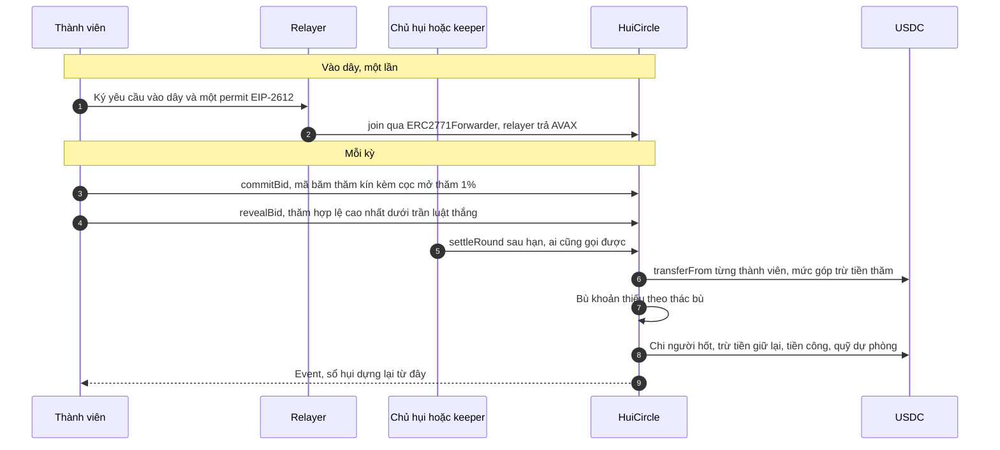
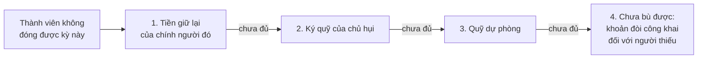
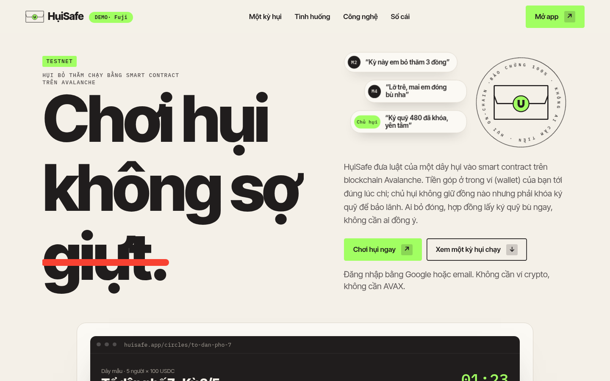
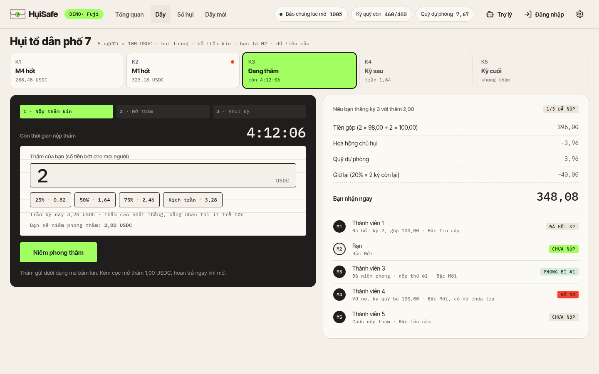
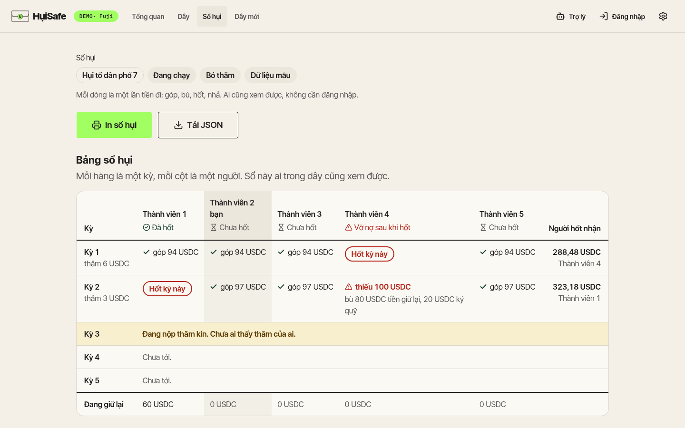
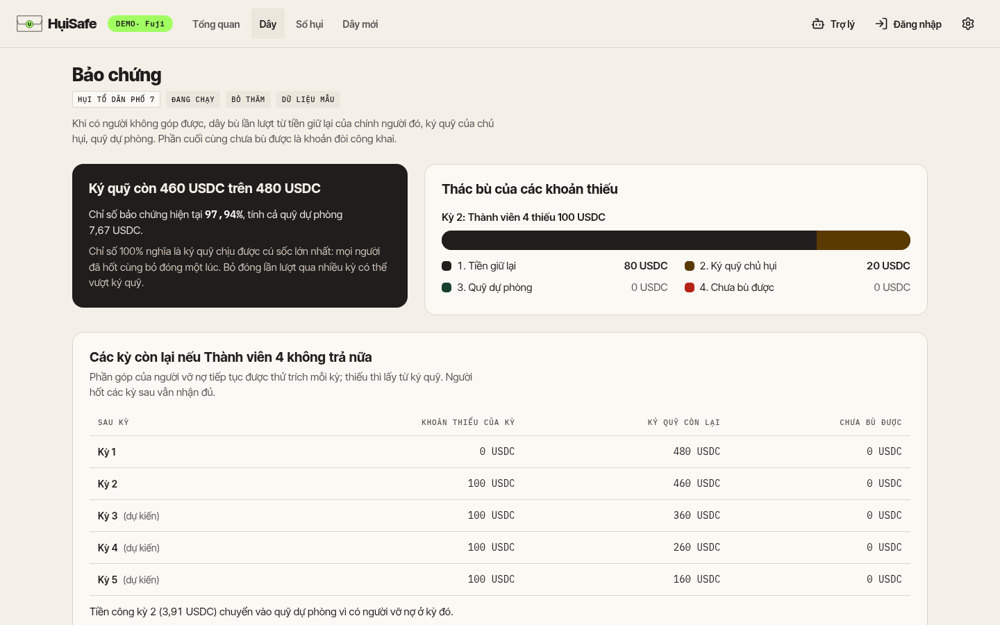
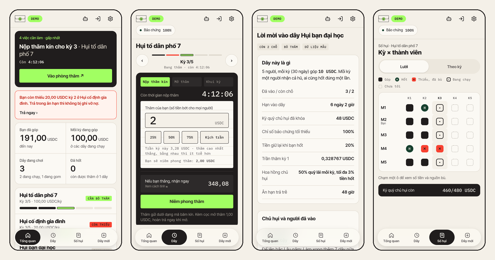
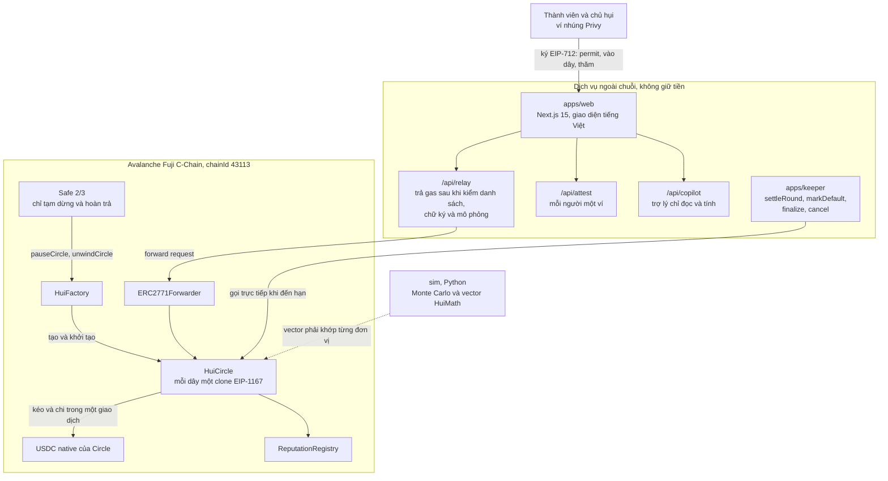

<p align="center">
  
</p>

<h1 align="center">HụiSafe</h1>

<p align="center">
  <strong>Chủ hụi không cầm tiền, nhưng vẫn phải bảo lãnh.</strong><br />
  Hụi bỏ thăm chạy bằng smart contract trên Avalanche.
</p>

<p align="center">
  <a href="README.md">English</a> | <strong>Tiếng Việt</strong>
</p>

<p align="center">
  
  
  
  
  
  
</p>

<p align="center">
  <a href="https://lamng.tail3abf4e.ts.net:8443"><strong>Chạy thử app</strong></a> ·
  <a href="docs/pitch/slides/HuiSafe-UniHack-2026.pdf"><strong>Slide pitch (PDF)</strong></a> ·
  <!-- DEMO_VIDEO_LINK -->
  <a href="https://testnet.snowtrace.io/address/0x5004477143F8Db65f80992A0BD79c1DAb75C8b21"><strong>HuiFactory trên Snowtrace</strong></a> ·
  <a href="#tài-liệu"><strong>Tài liệu</strong></a>
</p>

---

> **Khai báo dev toggle.** Bản demo chạy ở chế độ demo trên Avalanche Fuji testnet. Thời gian được tua nhanh: mỗi kỳ hụi 2 phút (75 giây nộp thăm kín, 45 giây mở thăm) thay vì 30 ngày, ân hạn 1 phút thay vì 48 giờ. Trần lãi và lãi chậm góp vẫn tính như kỳ 30 ngày. Tiền trong demo là USDC thử nghiệm, không có giá trị; phí mạng do relayer của HụiSafe trả; sản phẩm không sinh lãi và không có token. Hai dây bằng chứng chạy ngày 11/11/2026 dùng kỳ 3 phút và ân hạn 2 phút.

## Mục lục

[Vì sao có HụiSafe](#vì-sao-có-hụisafe) · [Cách hoạt động](#cách-hoạt-động) · [Ảnh giao diện](#ảnh-giao-diện) · [Đã kiểm chứng trên Avalanche Fuji](#đã-kiểm-chứng-trên-avalanche-fuji) · [Đối chiếu với thang điểm](#đối-chiếu-với-thang-điểm) · [Ba câu hỏi bắt buộc và pháp luật](#ba-câu-hỏi-bắt-buộc) · [Kiến trúc](#kiến-trúc) · [Chất lượng kỹ thuật](#chất-lượng-kỹ-thuật) · [Chạy thử](#chạy-thử) · [Giới hạn đã biết](#giới-hạn-đã-biết) · [Lộ trình](#lộ-trình) · [Đội thực hiện](#đội-thực-hiện) · [Tài liệu](#tài-liệu)

## Vì sao có HụiSafe

Hụi (họ, biêu, phường) là cách các gia đình, tiểu thương và sinh viên Việt Nam tiết kiệm và cho nhau vay: mỗi kỳ ai cũng góp, và một người hốt cả phần góp của dây. Hụi hợp pháp (Bộ luật Dân sự 2015 Điều 471; Nghị định 19/2019/NĐ-CP), và hụi vỡ theo hai cách.

<!-- SOURCES_BLOCK -->
**Chủ hụi cầm tiền rồi bỏ trốn, hoặc dựng hụi viên khống.** Năm vụ đã khởi tố hoặc xét xử mà báo chí đưa tin từ 2023 đến 2025 cộng lại hơn 400 tỷ đồng:

| Ở đâu | Bài báo ghi gì | Nguồn |
|---|---|---|
| Lâm Đồng | Án chung thân; chiếm đoạt hơn 156 tỉ đồng của 203 bị hại | [Tuổi Trẻ, 19/09/2025](https://tuoitre.vn/chu-hui-lua-dao-hon-100-ti-dong-lanh-an-chung-than-20250919182451911.htm) |
| An Giang | 20 năm tù; 99 tỷ đồng qua 134 dây hụi, dùng tài khoản ảo để hốt | [VnExpress, 25/09/2025](https://vnexpress.net/chu-hui-chiem-doat-99-ty-dong-o-mien-tay-bi-phat-20-nam-tu-4943272.html) |
| Trà Vinh | 20 năm tù; gần 72 tỷ đồng của hơn 270 người; hốt khống 1.607 phần bằng tên giả | [VnExpress, 11/10/2023](https://vnexpress.net/chu-tiem-nail-giat-hui-72-ty-dong-cua-hang-tram-nguoi-4663654.html) |
| Đồng Nai | Khởi tố vợ chồng chủ hụi; hơn 49 tỉ đồng của 337 người (thống kê sơ bộ của công an) | [Thanh Niên, 01/02/2024](https://thanhnien.vn/vu-vo-hui-gan-50-ti-dong-cong-an-tinh-dong-nai-khoi-to-vo-chong-chu-hui-185240201092519765.htm) |
| Trà Vinh | 19 năm tù; hơn 35 tỷ đồng của 160 hụi viên | [Dân trí, 04/06/2025](https://dantri.com.vn/phap-luat/nu-chu-hui-lua-dao-160-nan-nhan-chiem-doat-hon-35-ty-dong-20250604164857355.htm) |

Thủ đoạn lặp lại ở quy mô nhỏ và trên mạng: 157 phần hụi khống trong các dây lập trên Zalo, trên 4 tỷ đồng, án 12 năm tù ([VOV, 13/03/2025](https://vov.vn/phap-luat/12-nam-tu-cho-doi-tuong-mo-day-hui-khong-chiem-doat-tai-san-post1161016.vov)); dùng tài khoản Zalo ảo để bỏ thăm và hốt, gần 500 triệu đồng ([VietnamPlus, 06/10/2026](https://www.vietnamplus.vn/tay-ninh-khoi-to-chu-hui-dung-tai-khoan-ao-chiem-doat-gan-500-trieu-dong-post1140315.vnp)). Việc giám sát gần như không có: sau 5 năm thi hành Nghị định 19, TP.HCM báo cáo không có một chủ hụi hay thành viên nào thông báo với chính quyền địa phương theo quy định ([Báo Đầu tư, 04/11/2024](https://baodautu.vn/tphcm-kien-nghi-sua-quy-dinh-de-tranh-vo-hui-day-chuyen-gay-hau-qua-lon-d229125.html)).

Đây là số của từng bài báo, mở lại ngày 21/11/2026; chưa có thống kê toàn quốc về vỡ hụi, cũng chưa có thống kê về số người chơi hụi. Chỉ báo gần nhất là Global Findex của Ngân hàng Thế giới (dữ liệu 2024): 71% người lớn Việt Nam có tài khoản, nhưng 34% vẫn vay từ gia đình, bạn bè và 10% tiết kiệm qua hội nhóm hoặc người ngoài gia đình ([World Bank API](https://api.worldbank.org/v2/country/VNM/indicator/fin17c?source=28&format=json)).
<!-- /SOURCES_BLOCK -->

**Người đã hốt bỏ đóng.** Ngay cả khi chủ hụi tử tế, người hốt sau vẫn là người gánh rủi ro. Ở dữ liệu hụi (chit fund) tại Chennai, Ấn Độ, 2,04% người hốt sớm và 0,59% người hốt muộn bỏ đóng sau khi đã hốt (Klonner & Rai, 2008; dữ liệu Ấn Độ, không phải hụi Việt Nam; xem [docs/08](docs/08-phong-mo-phong.md)).

Đưa tiền hụi vào smart contract giải quyết được chuyện thứ nhất và làm chuyện thứ hai nặng hơn: không còn ai đứng ra bù cho người bỏ đóng.

## Cách hoạt động

### Phát hiện then chốt

Chủ hụi truyền thống làm hai việc: **giữ tiền** và **bảo lãnh** (bù cho người đã hốt mà bỏ đóng; Nghị định 19/2019 Điều 18 khoản 4 giao đúng nghĩa vụ này cho chủ hụi). Hụi on-chain thông thường bỏ cả hai. HụiSafe bỏ việc giữ tiền và giữ lại việc bảo lãnh, bằng ký quỹ khóa trong smart contract.

| | Hụi truyền thống | Hụi on-chain thông thường | HụiSafe |
|---|---|---|---|
| Ai giữ tiền góp | Chủ hụi | Smart contract, giữa các kỳ | Ví của từng người, tới đúng lúc chi |
| Ai bù khi người đã hốt bỏ đóng | Chủ hụi, nếu còn tiền | Không ai: người hốt sau chịu | Ký quỹ của chủ hụi, khóa trong contract |
| Rủi ro lớn nhất còn lại | Chủ hụi ôm tiền, lập hụi viên khống | Người đã hốt bỏ đóng | Người đã hốt bỏ đóng lần lượt qua nhiều kỳ, vượt ký quỹ ([giới hạn](#giới-hạn-đã-biết)) |

### Một kỳ hụi



1. **Vào dây bằng một chữ ký.** Thành viên ký một `permit` EIP-2612 có giới hạn (quyền trích `(N − 1) × (C + cọc mở thăm)`, tức 404 USDC ở dây ví dụ 5 người × 100 USDC). Tiền vẫn nằm trong ví của chính họ.
2. **Thăm kín, không ngẫu nhiên.** Bỏ thăm theo commit-reveal; thăm cao nhất thắng, bằng nhau thì ai ít trễ hơn thắng, rồi tới ai nộp trước. Thăm vượt trần Điều 21 Nghị định 19 bị contract từ chối (`BidTooHigh`).
3. **Kéo và chi trong một giao dịch.** `settleRound()` kéo tiền góp của mọi người bằng `transferFrom`, bù khoản thiếu và chi cho người hốt ngay trong giao dịch đó. Tiền góp không nằm lại trong contract giữa các kỳ.
4. **Tiền giữ lại.** Người hốt sớm bị giữ lại một phần tiền hốt (20% ở các ví dụ), nhả dần mỗi kỳ họ đóng đúng hạn.

### Khi có người không đóng được



Một người thiếu tiền không làm kẹt cả kỳ: người hốt vẫn được chi từ thác bù ngay trong giao dịch khui kỳ. Người thiếu có ân hạn để trả (`payLate`); quá ân hạn thì `markDefault` ghi vỡ nợ vào `ReputationRegistry`. Tiền trả lại được hoàn về các nguồn theo thứ tự ngược với thác bù.

### Chỉ số bảo chứng

Tiền chưa đóng sau kỳ `k` là `k(N − k)C`, cao nhất ở giữa dây. Chỉ số bảo chứng so phần bảo vệ với mức đỉnh đó:

```text
Chỉ số bảo chứng = tỷ lệ giữ lại + (ký quỹ + quỹ dự phòng) / rủi ro lớn nhất
Ví dụ: 5 người x 100 USDC  ->  rủi ro lớn nhất = 2 x 3 x 100 = 600 USDC
       giữ lại 20% + ký quỹ 480 USDC / 600 USDC = 100%
```

Trên Fuji, dây không bắt đầu được khi chỉ số dưới 100% (`minCoverageBps = 10_000`, kiểm trong `activate()`), và ai cũng thấy chỉ số này trước khi vào dây. Hai câu cam kết của HụiSafe, đúng nguyên văn và không hơn ([docs/03 mục 7.3](docs/03-dac-ta-giao-thuc.md)):

- "Chỉ số bảo chứng 100% nghĩa là ký quỹ chịu được cú sốc lớn nhất: mọi người đã hốt cùng bỏ đóng một lúc."
- "Cọc 100% chặn được chủ hụi dùng một ví ảo: làm vậy chủ hụi tự lỗ. Dùng nhiều ví ảo thì bị chặn bằng xác thực mỗi người một tài khoản (OTP, attestation), và mọi người thấy trước rủi ro tối đa của mình."

### Hoa hồng của chủ hụi nằm trong trần lãi

Ở chế độ chia hoa hồng, tiền công của chủ hụi và tiền thăm dùng chung một trần luật: `tiền công + thăm × số người trả ≤ quỹ lãi`, trong đó quỹ lãi là mức tối đa Điều 21 cho phép ở kỳ đó. Vì vậy, kể cả khi tính gộp hoa hồng vào lãi, người hốt không phải trả quá trần. Tiền công tối đa 3% mỗi lần hốt, bằng 0 khi chính chân của chủ hụi hốt, và chuyển vào quỹ dự phòng nếu kỳ đó kết thúc bằng một vụ vỡ nợ ([docs/03 mục 2.7](docs/03-dac-ta-giao-thuc.md); bất biến `INV-11`).

## Ảnh giao diện

Các màn hình dưới đây hiển thị dây mẫu của ví dụ trong đặc tả (5 người × 100 USDC).

<table>
  <tr>
    <td width="50%"><br /><sub>Trang giới thiệu: đăng nhập bằng Google hoặc email, không cần ví crypto, không cần AVAX.</sub></td>
    <td width="50%"><br /><sub>Phòng bỏ thăm: nộp thăm kín dưới trần luật, thấy trước số tiền nhận nếu thắng.</sub></td>
  </tr>
  <tr>
    <td><br /><sub>Sổ hụi: mỗi ô là một người ở một kỳ, dựng lại từ event on-chain; in được và tải JSON được.</sub></td>
    <td><br /><sub>Bảo chứng: thác bù của từng khoản thiếu và ký quỹ còn lại sau mỗi kỳ.</sub></td>
  </tr>
  <tr>
    <td colspan="2"><br /><sub>Ưu tiên điện thoại: việc cần làm, phòng bỏ thăm, lời mời kèm thỏa thuận dây, lưới kỳ × thành viên.</sub></td>
  </tr>
</table>

## Đã kiểm chứng trên Avalanche Fuji

Triển khai ngày 10/11/2026 tại block 60843937, từ commit `494e923` ([`contracts/deployments/fuji.json`](contracts/deployments/fuji.json)). Mã nguồn của cả năm contract đã được xác minh trên Routescan, explorer đứng sau Snowtrace (kiểm lại qua API Routescan ngày 21/11/2026).

| Contract | Địa chỉ (Fuji, chainId 43113) |
|---|---|
| HuiFactory | [`0x5004477143F8Db65f80992A0BD79c1DAb75C8b21`](https://testnet.snowtrace.io/address/0x5004477143F8Db65f80992A0BD79c1DAb75C8b21) |
| HuiCircle (implementation; mỗi dây là một clone EIP-1167) | [`0x3A72591e0d451802F051789497eD5f2B2256673d`](https://testnet.snowtrace.io/address/0x3A72591e0d451802F051789497eD5f2B2256673d) |
| HuiCircleLens | [`0xb4Ebda56d43db9e629C1FD6b226ac828BE0637a6`](https://testnet.snowtrace.io/address/0xb4Ebda56d43db9e629C1FD6b226ac828BE0637a6) |
| ReputationRegistry | [`0xf8F05aa2804144F5aC71485614480f801927E5c3`](https://testnet.snowtrace.io/address/0xf8F05aa2804144F5aC71485614480f801927E5c3) |
| ERC2771Forwarder | [`0x789621cFD56Cc79ec47eF6C449B6C53c40516b2C`](https://testnet.snowtrace.io/address/0x789621cFD56Cc79ec47eF6C449B6C53c40516b2C) |
| Admin (Safe 2/3) | [`0xc7BeE5Cc787833C8Fd76b9066d334Ab131E7c3F5`](https://testnet.snowtrace.io/address/0xc7BeE5Cc787833C8Fd76b9066d334Ab131E7c3F5) |
| USDC (Circle, native) | [`0x5425890298aed601595a70AB815c96711a31Bc65`](https://testnet.snowtrace.io/address/0x5425890298aed601595a70AB815c96711a31Bc65) |

### Các dây đã chạy trọn

Cả ba dây do đội chạy bằng ví demo và script, không phải người dùng bên ngoài. Dây nào cũng ở trạng thái `Completed` và số dư USDC bằng 0 (đọc lại trên Fuji ngày 21/11/2026).

| Dây | Chứng minh điều gì | Giao dịch chính |
|---|---|---|
| [`0xABA8…2461`](https://testnet.snowtrace.io/address/0xABA89dFfA4e157927710419b01C32bD307bF2461)<br />Hụi cố định, 3 người, 11/11/2026 | Trọn luồng không tốn gas: thành viên vào dây qua relayer với 0 AVAX, keeper khui 3 kỳ rồi tất toán | [kỳ 1](https://testnet.snowtrace.io/tx/0xecfcfaeb5378d44986b999b09d0c614c919b0f55289891906cefc55894bc4669) · [kỳ 2](https://testnet.snowtrace.io/tx/0xc7e8f352dce95d40b4a9a1d529322d230f19f6b16029718e572bfe9fb106c4bb) · [kỳ 3](https://testnet.snowtrace.io/tx/0xba1208d7cc0b3fcab176a31bee1c711e84977bb480f2e9d89ea004a6c79479d6) · [tất toán](https://testnet.snowtrace.io/tx/0x7159ec482321ad9bb6f8fad699d4d259b11a63112b6e3a35f978b1d94568b290) |
| [`0xc628…5Bfc`](https://testnet.snowtrace.io/address/0xc62828b2f72D288298A6E2fFd0814D0Cb6e15Bfc)<br />Hụi bỏ thăm, 5 × 10 USDC, ký quỹ 48, 11/11/2026 | Thác bù trên mạng thật: thành viên 4 hốt kỳ 1 rồi không đóng được kỳ 2; bù 8 USDC từ tiền giữ lại của chính người đó và 2 USDC từ ký quỹ, người hốt kỳ 2 vẫn nhận đủ 32,318 USDC; `markDefault`, ký quỹ bù kỳ 3 đến 5, `finalize`. 104 kiểm tra của script khớp ví dụ ở [docs/03 mục 8](docs/03-dac-ta-giao-thuc.md) thu nhỏ 10 lần | [kỳ 2 có bù](https://testnet.snowtrace.io/tx/0x1cb02efe008f73e87ccb44b327e7fff0786eba5da95005df4916d6b23c010185) · [markDefault](https://testnet.snowtrace.io/tx/0x33886575dc944a9d66f25209b5e56096a1c0941247ac71c079a11961d6ab9b66) · [tất toán](https://testnet.snowtrace.io/tx/0xf415cfb744bcd159657fe7be86ce9d32221b4bdf626742499b7efb2de649bc32) |
| [`0xa428…8f5a`](https://testnet.snowtrace.io/address/0xa42866012F1FbFE4507B87B2D2C9cc69D13F8f5a)<br />Hụi bỏ thăm, 5 người, 20/11/2026 | Luồng trên web: chủ hụi đăng nhập Google và tạo dây ngay trên web; 5 người vào dây (một điện thoại thật, bốn ví demo); chủ hụi tự khui đủ 5 kỳ ở bàn khui kỳ; người hốt nhận từ 31,20 đến 39,20 USDC | Xem nhật ký event của dây trên explorer |

Danh sách giao dịch đầy đủ: [docs/DEPLOY-FUJI.md mục 15 và 15b](docs/DEPLOY-FUJI.md).

## Đối chiếu với thang điểm

| Tiêu chí (điểm) | Bằng chứng trong repo |
|---|---|
| **Technical Implementation (25)** | 634 test Foundry đều đạt (20/11/2026): unit, 36 thuộc tính fuzz, 17 hàm invariant chạy trên handler có trạng thái ([`Invariants.t.sol`](contracts/test/invariant/Invariants.t.sol)), một ví dụ tính tay làm test tích hợp ([`WorkedExample.t.sol`](contracts/test/integration/WorkedExample.t.sol)), bộ test reentrancy và ngân sách gas. `HuiMath` có ba bản Solidity, TypeScript, Python và phải khớp nhau từng đơn vị qua bộ vector chung ([`Differential.t.sol`](contracts/test/fuzz/Differential.t.sol)). Coverage 98,68% số dòng (11/11/2026). Xem [Chất lượng kỹ thuật](#chất-lượng-kỹ-thuật). |
| **Avalanche Integration (25)** | |
| 1. Dùng Avalanche có ý nghĩa | Hành động cốt lõi của sản phẩm là một giao dịch trên C-Chain: kéo tiền góp của mọi người và chi cho người hốt; trần lãi và lãi chậm góp do contract thực thi ([`HuiCircle.sol`](contracts/src/HuiCircle.sol)). |
| 2. Smart contract / triển khai on-chain | Năm contract đã triển khai và xác minh mã nguồn trên Fuji; ba dây chạy trọn, số dư đều về 0 ([ở trên](#đã-kiểm-chứng-trên-avalanche-fuji)). |
| 3. Dùng đúng hạ tầng Avalanche | USDC native của Circle có permit EIP-2612; meta-transaction ERC-2771 để thành viên không cần AVAX ([`/api/relay`](apps/web/app/api/relay/route.ts)); `evm_version = "cancun"` theo ACP-131; không dùng ERC-4337 hay EIP-7702 vì C-Chain chưa nhận ([docs/06](docs/06-avalanche-va-blockchain.md)). |
| 4. Chất lượng tích hợp | Domain permit của USDC đọc từ chính token lúc chạy; ví bị chặn chuyển tiền thì ghi `claimable`, kỳ hụi vẫn chạy; relayer có danh sách cho phép, mô phỏng trước và trần gas; keeper quét công bằng, gửi lệnh idempotent ([`keeper.ts`](apps/keeper/src/keeper.ts)); đọc event qua explorer, lỗi thì quay về quét RPC có giới hạn. |
| 5. Giá trị rõ ràng khi xây trên Avalanche | Khui một kỳ của dây 5 người tốn khoảng 520.000 gas; dây 30 người dưới 3.000.000 gas, khoảng 0,065 USD theo giá gas mainnet ngày 05/11/2026 ([docs/06 mục 5](docs/06-avalanche-va-blockchain.md); [`GasBudget.t.sol`](contracts/test/gas/GasBudget.t.sol)). Phí thấp mới cho phép relayer trả thay mọi thành viên. |
| **Creativity & Innovation (15)** | Tách việc giữ tiền khỏi việc bảo lãnh; chỉ số bảo chứng có chứng minh và có cả phản ví dụ nói rõ; tiền giữ lại của người hốt sớm; hoa hồng chủ hụi nằm trong trần lãi; quỹ dự phòng chia theo mức đóng đúng hạn thay vì chia đều ([docs/03](docs/03-dac-ta-giao-thuc.md), [docs/14](docs/14-nang-cap-v1.2.md)). |
| **Impact & Use Case (15)** | Một tập quán có thật, hợp pháp và phổ biến ở Việt Nam, với những vụ vỡ lớn đã lên báo ([Vì sao có HụiSafe](#vì-sao-có-hụisafe)); các quy định của Nghị định 19/2019 chạy trong code; người dùng là chủ hụi và các dây hụi gia đình, tiểu thương, sinh viên ([docs/02](docs/02-dac-ta-san-pham.md), [docs/01](docs/01-nghien-cuu-nen-tang.md)). |
| **Presentation & Pitching (10)** | Slide ghi nguồn cho từng con số ([PDF](docs/pitch/slides/HuiSafe-UniHack-2026.pdf)); khai báo dev toggle ngay đầu; ba câu hỏi bắt buộc và bốn điểm pháp luật Việt Nam trả lời [bên dưới](#ba-câu-hỏi-bắt-buộc); giới hạn được nói trước khi bị hỏi. |
| **UI/UX & Demo (10)** | Web app tiếng Việt, ưu tiên điện thoại, đăng nhập Google hoặc email, không tốn gas; mọi giao dịch hiện Ký → Gửi → Xác nhận; sổ hụi công khai; 556 kiểm thử Playwright kèm kiểm khả năng truy cập bằng axe ở 390, 768 và 1440 px (21/11/2026); hệ thống thiết kế ở [`apps/web/DESIGN.md`](apps/web/DESIGN.md). [Chạy thử app](https://lamng.tail3abf4e.ts.net:8443). |

## Ba câu hỏi bắt buộc

**Vì sao on-chain?** Gốc rễ của vỡ hụi là phải tin người giữ tiền. Một app dùng cơ sở dữ liệu chỉ chuyển niềm tin đó từ chủ hụi sang người vận hành app. Trên chuỗi, tiền góp nằm trong ví từng người tới lúc chi, ký quỹ bị khóa bằng code mà chính chủ hụi không rút được, luật của dây không đổi sau khi bắt đầu, và ai cũng kiểm được sổ hụi.

**Vì sao Avalanche?** C-Chain có USDC native của Circle với `permit`, nên thành viên chỉ ký một lần lúc vào dây. Phí đủ thấp để relayer trả thay cho mọi thành viên, và giao dịch chốt trong khoảng một giây, hợp với buổi mở thăm trực tiếp. Chính đề bài của ban tổ chức cũng nêu ý này: phí thấp thì nhóm góp hàng tuần không mất tiền hụi vào phí.

**Tiền đến từ đâu?** Tiền hốt là tiền góp của chính các thành viên. Tiền thăm do người hốt sớm trả cho người hốt sau, dưới trần Điều 21. Tiền công của chủ hụi tối đa 3% mỗi lần hốt. Không sinh lãi, không có token. Nếu sau này có lãi trên phần tiền chưa chi ở mainnet thì lãi đến từ cho vay trên Aave v3, không đến từ việc phát hành token ([ADR-10](docs/04-kien-truc.md)).

### Pháp luật Việt Nam

Bốn điểm ban tổ chức yêu cầu mọi đội nêu rõ:

| Điểm | HụiSafe |
|---|---|
| Tiền mã hóa không phải phương tiện thanh toán hợp pháp | Chỉ dùng USDC testnet, không nhận tiền thật. Nghị quyết 05/2025/NQ-CP (Điều 4 khoản 7) yêu cầu thanh toán tài sản mã hóa bằng Đồng Việt Nam, nên bản thật cần chế độ VND. |
| Lương phải trả bằng VND | Không áp dụng: HụiSafe không trả lương (Bộ luật Lao động 2019 Điều 95 khoản 2). Hụi là giao dịch dân sự giữa các thành viên. |
| Tư vấn pháp lý, tài chính có thu phí cần giấy phép | Trợ lý miễn phí, tính bằng công thức cố định, có dẫn điều luật, và câu trả lời nào cũng ghi đây là thông tin tham khảo, không phải tư vấn tài chính hay pháp lý. |
| Cổ phiếu token hóa bị đơn vị phát hành chặn theo khu vực | Không áp dụng: không có cổ phiếu token hóa; không phát hành, không bán token. |

Nghị định 19/2019/NĐ-CP trong code ([docs/10](docs/10-phap-ly-va-tuan-thu.md)): Điều 5, 6 (thành viên và chủ hụi đủ 18 tuổi, tự xác nhận khi lấy attestation), Điều 12, 13 (sổ họ và biên nhận, dựng từ event), Điều 14 (nhắc và soạn nháp thông báo UBND cấp xã khi một kỳ từ 100 triệu đồng hoặc tổ chức từ hai dây), Điều 18 khoản 4 (nghĩa vụ nộp thay của chủ hụi, dưới dạng ký quỹ bị khóa), Điều 20 (thăm cao nhất hốt; chia hòa theo luật cố định ghi trong thỏa thuận dây), Điều 21 (trần thăm 20%/năm), Điều 22 khoản 1 (lãi chậm góp 10%/năm).

**Cách hiểu của nhóm, chờ luật sư xác nhận.** Công thức trần thăm theo Điều 21, việc chia hòa bằng luật cố định thay cho bốc thăm ở Điều 20, việc tính hoa hồng nằm trong trần lãi, và việc giới hạn trách nhiệm của chủ hụi ở mức ký quỹ đều là cách hiểu của nhóm. Chưa có luật sư nào xác nhận. Các câu hỏi mở nằm ở [docs/10 mục 7](docs/10-phap-ly-va-tuan-thu.md).

## Kiến trúc



| Thư mục | Nội dung |
|---|---|
| [`contracts/`](contracts) | Dự án Foundry: `HuiFactory`, `HuiCircle` (+ `Base`, `Views`, `Lens`), `ReputationRegistry`, `HuiMath`, script deploy và demo, test |
| [`packages/sdk`](packages/sdk) | ABI sinh bằng `@wagmi/cli`, đọc và ghi chuỗi, typed data EIP-712, `huiMath.ts`, dựng sổ hụi |
| [`packages/config`](packages/config) | Chain, địa chỉ đọc từ `fuji.json`, hằng số demo |
| [`apps/web`](apps/web) | Web Next.js 15 và ba API route `relay`, `attest`, `copilot` |
| [`apps/keeper`](apps/keeper) | Tiến trình Node chạy theo lịch: khui kỳ, đánh dấu vỡ nợ, tất toán, hủy dây |
| [`sim/`](sim) | Mô phỏng Monte Carlo bằng Python và bộ vector `HuiMath` dùng chung |
| [`tools/hui-economics`](tools/hui-economics) | Máy tính dòng tiền độc lập, dùng để đối chiếu đặc tả |
| [`docs/`](docs) | Đặc tả, kiến trúc, phân tích pháp lý, runbook, tài liệu pitch |

Các quyết định thiết kế chính (đủ danh sách ADR ở [docs/04 mục 6](docs/04-kien-truc.md)):

- **ADR-04. Meta-transaction ERC-2771 và một permit.** Thành viên không bao giờ cần AVAX; đường gọi trực tiếp luôn còn đó nên relayer không kiểm duyệt được.
- **ADR-05. Mỗi dây một clone EIP-1167.** Trạng thái và tiền của từng dây tách riêng; tạo dây tốn khoảng 405.000 gas.
- **ADR-06. Không dùng `Multicall` cùng `ERC2771Context`.** Tránh lớp lỗi giả mạo địa chỉ OpenZeppelin công bố tháng 12/2023; CI kiểm ABI.
- **ADR-07 và ADR-18. Không database, không indexer.** Giao diện và sổ hụi dựng lại từ event, nên không có gì ngoài chuỗi có thể lệch với chuỗi.
- **ADR-12. LLM không bao giờ ký.** Trợ lý chỉ có các công cụ đọc và tính tất định.
- **ADR-20. Một công thức, ba ngôn ngữ.** `HuiMath` bản Solidity, TypeScript và Python cùng được kiểm trên một bộ vector đã commit.
- **ADR-22. Sàn bảo chứng 100% trên Fuji.** Dây bảo chứng nửa vời cho phép chủ hụi kiếm lời chỉ bằng một ví ảo.

## Chất lượng kỹ thuật

### Kiểm thử

Kết quả là các lần chạy trên máy, vào ngày ghi bên cạnh. Hai dòng Vitest và pytest được chạy lại trên commit nộp bài; các dòng còn lại là số mới nhất ghi trong [docs/TIEN-DO.md](docs/TIEN-DO.md) và phụ lục nguồn của slide.

| Lệnh | Kiểm cái gì | Kết quả mới nhất |
|---|---|---|
| `cd contracts && forge test` | Unit, fuzz, invariant, tích hợp, ngân sách gas, test script | 634 đạt (20/11/2026) |
| `forge test --match-path "test/invariant/*"` | 17 hàm invariant trên handler có trạng thái: `INV-01`…`INV-09`, `INV-11`…`INV-13`, `settleRound` và `finalize` không bị kẹt, view khớp đặc tả | Đạt (20/11/2026) |
| `forge coverage --ir-minimum` | Coverage theo dòng của `contracts/src` | 98,68% dòng, 100% hàm (11/11/2026) |
| `pnpm -r test` | Vitest: web 506, sdk 142, keeper 25, config 15 | Đều đạt (21/11/2026, commit `9c0db3b`) |
| `pnpm --filter web test:e2e` | Kiểm thử giao diện Playwright kèm axe, ở 390, 768 và 1440 px | 556 đạt (21/11/2026) |
| `pnpm --filter web e2e:anvil` | Trọn một dây trên chuỗi cục bộ: deploy, vào dây qua relay, bỏ thăm, khui kỳ, vỡ nợ, trả trễ | 107/107 kiểm tra (20/11/2026) |
| `cd sim && pytest` | Mô hình mô phỏng và bộ sinh vector; `mypy --strict` sạch | 71 đạt (21/11/2026) |
| `pnpm --filter web eval:copilot -- --mode mock` | Công cụ của trợ lý, bộ kiểm đầu ra và cách chấm, trên kịch bản viết tay | 33/33. Kịch bản viết tay, không phải số đo mô hình thật |

### Bất biến về tiền

Mỗi bất biến có một hàm invariant riêng ([docs/03 mục 7.2](docs/03-dac-ta-giao-thuc.md)); `INV-10` được kiểm tĩnh trong CI.

| Mã | Tính chất |
|---|---|
| INV-01 | Đẳng thức sổ cái: số dư USDC của contract bằng ký quỹ + quỹ dự phòng + tiền giữ lại + tiền công đang giữ + cọc mở thăm + khoản chờ nhận |
| INV-02 | Mỗi thành viên hốt đúng một lần; mỗi kỳ đúng một người hốt |
| INV-03 | Không thăm thắng nào vượt trần luật hoặc chạm mức góp |
| INV-04 | Không bao giờ kéo của một thành viên nhiều hơn phần phải góp của kỳ đó |
| INV-05 | `tiền chi + tiền công + quỹ dự phòng + tiền giữ lại == pot` ở mọi kỳ |
| INV-06 | Tiền giữ lại của từng người đã hốt luôn nằm trong lịch nhả |
| INV-07 | USDC chỉ tới thành viên, chủ hụi (ký quỹ và tiền công hợp lệ) và người có `claimable`; không bao giờ tới admin |
| INV-08 | Ở bảo chứng 100%, mọi người đã hốt cùng bỏ đóng một lúc thì `uncovered == 0` ở mọi kỳ |
| INV-09 | Kỳ `k` chỉ khui sau kỳ `k − 1` và sau hạn; tham số không đổi sau `activate()` |
| INV-10 | Không có dữ liệu cá nhân trên chuỗi: chỉ địa chỉ ví, mã băm, số tiền, mốc thời gian |
| INV-11 | Hoa hồng cộng tiền thăm luôn nằm trong trần lãi |
| INV-12 | Quỹ dự phòng cuối dây được chia hết; người vỡ nợ nhận 0; người trễ nhiều hơn không nhận nhiều hơn |
| INV-13 | Tiền công chỉ được trả ngay ở kỳ không có khoản thiếu |

### Bảo mật

- **Chỉ mới rà soát nội bộ.** Sau khi đội tự rà soát contract, relay, attest và keeper: 0 lỗi Critical, 0 lỗi High còn mở ([docs/09](docs/09-kiem-thu-va-bao-mat.md)). Chưa có audit độc lập.
- **Phân tích tĩnh.** Slither 0.11.6, lọc `lib/`, `test/`, `script/`: 0 High (11/11/2026); các phát hiện Medium được phân loại ở docs/09 mục 7.1.
- **Admin không lấy được tiền.** Admin là Safe 2/3, chỉ thao tác qua factory: tạm dừng, mở lại, và sau 48 giờ tạm dừng liên tục thì `emergencyUnwind` trả tiền theo sổ. Khi dây tạm dừng, chỉ `claim()` chạy được.
- **Tách khóa theo vai.** Deployer, relayer, attester, keeper mỗi vai một khóa; relayer và keeper chỉ giữ AVAX trả gas, không có quyền gì trên chuỗi (ADR-21).
- **Chốt chặn ở relayer.** Danh sách cho phép theo đích và hàm, `value = 0`, trần gas, giới hạn tần suất, kiểm chữ ký và mô phỏng trước khi gửi (ADR-19).
- **Kỷ luật viết contract.** Custom error, mỗi thay đổi trạng thái và mỗi dòng tiền một event, checks-effects-interactions, `SafeERC20`, `nonReentrant` ở hàm chi tiền, không có nguồn ngẫu nhiên nào.

### Hàng rào cho trợ lý AI

Trợ lý chủ hụi ([`/api/copilot`](apps/web/app/api/copilot/route.ts), [docs/07](docs/07-ai-agentic.md)) chỉ đọc và tính; không ký, không chuyển tiền. Mọi con số đến từ công cụ tất định như `max_bid_table`, `simulate_circle`, `draft_ubnd_notice`; bộ kiểm đầu ra loại bỏ con số không do công cụ sinh ra; địa chỉ ví duy nhất trợ lý thấy là dây đang xem. Tắt trợ lý thì các luồng chính vẫn chạy.

### Mô phỏng

Mô hình Monte Carlo có seed so ba thiết kế dưới cùng một giả định bỏ đóng (10.000 dây mỗi thiết kế, N = 10, C = 100 USDC, seed 42; tỷ lệ bỏ đóng đọc từ Klonner & Rai, 2008). Đây là so sánh dưới giả định đã nêu, không phải dự báo ([`sim/outputs/baseline.json`](sim/outputs/baseline.json), [docs/08](docs/08-phong-mo-phong.md)).

| | Truyền thống | On-chain thông thường | HụiSafe |
|---|---|---|---|
| Dây có người nhận thiếu hoặc chủ hụi bỏ trốn | 23,33% | 62,46% | 0,01% |
| Mức mất trung bình của người hốt sau | 4,99% | 6,37% | 0,0003% |

## Chạy thử

Yêu cầu: Node 22 trở lên, pnpm 12, [Foundry](https://book.getfoundry.sh/), Python 3.11 trở lên.

```bash
git clone --recurse-submodules https://github.com/bminhnemhoi/T1VN_Unihack.git
cd T1VN_Unihack
pnpm install
pnpm -r build && pnpm -r lint && pnpm -r typecheck && pnpm -r test
```

**Contract**

```bash
cd contracts
forge build
forge test                                   # mọi bộ test
forge test --match-path "test/invariant/*"   # chỉ bất biến về tiền
```

**Trọn một dây trên chuỗi cục bộ** (không cần khóa, không cần tiền testnet):

```bash
pnpm --filter web e2e:anvil
```

**Web và keeper đọc Fuji.** Chép `.env.example` thành `.env.local` rồi tự điền khóa testnet của bạn (không bao giờ commit). Mỗi vai dùng một ví testnet riêng.

```bash
pnpm --filter web dev          # đọc dây thật trên Fuji
pnpm --filter keeper start     # khui kỳ, đánh dấu vỡ nợ, tất toán
```

Chưa có file triển khai thì web chạy bằng dữ liệu mẫu, có nhãn rõ. Việc deploy chỉ thực hiện trên Fuji và phải có người duyệt; xem [docs/DEPLOY-FUJI.md](docs/DEPLOY-FUJI.md) và [docs/HOSTING.md](docs/HOSTING.md).

**Mô phỏng**

```bash
cd sim
pip install -e ".[dev]"
python -m huisim.cli run --scenario baseline --seed 42
python -m huisim.cli run --scenario organizer_economics --seed 42
python -m huisim.cli run --scenario organizer_sybil --seed 42
```

## Giới hạn đã biết

- **Chỉ chạy testnet.** Mọi thứ chạy trên Fuji với USDC thử nghiệm. Tiền mã hóa không phải phương tiện thanh toán hợp pháp ở Việt Nam, nên bản thật cần chế độ VND và ý kiến luật sư ([docs/10](docs/10-phap-ly-va-tuan-thu.md)).
- **Bỏ đóng lần lượt có thể vượt ký quỹ.** Bảo chứng 100% chỉ được chứng minh cho cú sốc đồng thời. Nếu những người đã hốt bỏ đóng lần lượt, kỳ này sang kỳ khác, tổng khoản thiếu có thể vượt ký quỹ: ở dây ví dụ 5 người × 100 USDC, người hốt cuối nhận 94,08 thay vì 392 USDC. Trường hợp này đã được khóa bằng test và nói rõ trên giao diện ([docs/03 mục 7.3](docs/03-dac-ta-giao-thuc.md)). Muốn bù đủ cả trường hợp này cần ký quỹ lớn hơn (800 thay vì 480 USDC ở ví dụ); đây là việc trong lộ trình.
- **Nhiều ví ảo.** Ký quỹ không chặn được chủ hụi điều khiển nhiều chân trong dây. Cách chặn là mỗi người một tài khoản; hiện attestation chỉ gắn một ví với một tài khoản đăng nhập, chưa thu giấy tờ, nên chưa chặn được người tạo nhiều tài khoản.
- **Cách hiểu luật chưa được xác nhận.** Xem [Pháp luật Việt Nam](#pháp-luật-việt-nam).
- **Mô phỏng dựa trên giả định.** Tỷ lệ bỏ đóng lấy từ dữ liệu chit fund Ấn Độ; kết quả để so sánh các thiết kế, không dự báo thực tế. Dưới giả định cơ sở, lợi nhuận của chủ hụi trên ký quỹ có thể âm ([docs/08](docs/08-phong-mo-phong.md)).
- **Chưa làm.** Audit độc lập, mainnet, chế độ VND, lãi trên phần tiền chưa chi, passkey, thử với người dùng ngoài đội, và đánh giá trợ lý với mô hình thật.
- **Phụ thuộc vận hành.** Đăng nhập phụ thuộc Privy; dùng không tốn gas phụ thuộc relayer (đường gọi trực tiếp vẫn còn); bản demo công khai chạy trên một VPS nhỏ.

## Lộ trình

Đây là kế hoạch, chưa phải cam kết.

1. Thử trên testnet với 3 đến 5 nhóm hụi thật, sửa theo những gì họ phát hiện (12/2026).
2. Xin ý kiến luật sư về Điều 14, 20, 21 của Nghị định 19 và về hoa hồng; làm chế độ VND, trong đó tiền đi qua ngân hàng còn chuỗi giữ luật và sổ hụi.
3. Audit độc lập, rồi mainnet sau Safe multisig; L1 riêng trên Avalanche cho từng hội; ví passkey.

## Đội thực hiện

| Thành viên | Vai trò | GitHub |
|---|---|---|
| Ngô Bình Minh | Trưởng nhóm. Thiết kế sản phẩm và giao thức (luật dây hụi, tham số v1.2), pitch | [bminhnemhoi](https://github.com/bminhnemhoi) |
| Ngô Lâm Tiến | Frontend và tích hợp: web app, trải nghiệm người dùng, ví Privy và relayer, triển khai | [Towfienes](https://github.com/Towfienes) |
| Ngô Đặng Trọng Hiếu | Backend và kiểm thử: keeper, SDK, rà soát và viết test | [yuutosolonely](https://github.com/yuutosolonely) |

## Tài liệu

Nguồn sự thật là đặc tả giao thức (docs/03) và tài liệu dữ liệu, API (docs/05). Code mâu thuẫn với tài liệu thì tài liệu thắng. Tài liệu và giao diện viết bằng tiếng Việt; code, tên biến và commit message bằng tiếng Anh.

| Tài liệu | Nội dung |
|---|---|
| [00 Tổng quan](docs/00-tong-quan.md) · [02 Đặc tả sản phẩm](docs/02-dac-ta-san-pham.md) | HụiSafe là gì, người dùng, các màn hình |
| [03 Đặc tả giao thức](docs/03-dac-ta-giao-thuc.md) | Luật, công thức, bất biến, ví dụ số |
| [04 Kiến trúc](docs/04-kien-truc.md) · [05 Dữ liệu và API](docs/05-cau-truc-du-lieu-va-api.md) | Thành phần, sơ đồ tuần tự, ADR, gas, hàm, event, lỗi |
| [06 Avalanche](docs/06-avalanche-va-blockchain.md) | Số liệu mạng, các chuẩn đã dùng, triển khai |
| [07 Trợ lý AI](docs/07-ai-agentic.md) · [08 Phòng mô phỏng](docs/08-phong-mo-phong.md) | Hàng rào, đánh giá, mô hình và thí nghiệm |
| [09 Kiểm thử và bảo mật](docs/09-kiem-thu-va-bao-mat.md) · [10 Pháp lý](docs/10-phap-ly-va-tuan-thu.md) | Chiến lược test, threat model, đối chiếu Nghị định 19, câu hỏi pháp lý còn mở |
| [01 Nghiên cứu](docs/01-nghien-cuu-nen-tang.md) · [13 Tài liệu tham khảo](docs/13-tai-lieu-tham-khao.md) | Kinh tế học của hụi, các vụ vỡ hụi, dự án đi trước, toàn bộ nguồn |
| [DEPLOY-FUJI](docs/DEPLOY-FUJI.md) · [HOSTING](docs/HOSTING.md) | Runbook triển khai kèm mã giao dịch, nơi chạy web |
| [CHANGELOG](docs/CHANGELOG.md) · [TIEN-DO](docs/TIEN-DO.md) | Thay đổi người dùng thấy được, nhật ký tiến độ |
| [docs/pitch](docs/pitch) | Slide, kịch bản video, hỏi đáp, chữ cho form nộp bài |

## Ghi nhận

Dự án làm cho **Team1 Vietnam UniHack 2026** (track Social finance), do Team1 Vietnam tổ chức trên **Avalanche**, **MEXC Ventures** tài trợ. Phần đăng nhập bằng ví nhúng làm theo starter code Privy của ban tổ chức (ADR-03).

HụiSafe dựa trên [OpenZeppelin Contracts](https://github.com/OpenZeppelin/openzeppelin-contracts), [Foundry](https://github.com/foundry-rs/foundry), [Privy](https://www.privy.io/), [Circle USDC](https://www.circle.com/usdc), [viem](https://viem.sh/) và [Next.js](https://nextjs.org/).

## Miễn trừ

HụiSafe là dự án hackathon chạy trên mạng thử nghiệm với token thử nghiệm không có giá trị. Dự án không nhận tiền thật, không phát hành token, và không phải tư vấn tài chính hay pháp lý.
