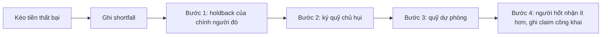

# Nghiên cứu nền tảng

## Mục đích và đọc khi nào

File này gom cơ sở nghiên cứu cho HụiSafe: hụi ở Việt Nam, kinh tế học ROSCA (rotating savings and credit association, hội tiết kiệm và tín dụng luân phiên), hụi on-chain trước đây, bộ công cụ cơ chế, phương pháp kỹ thuật, an toàn AI agent và hướng viết paper.

Đọc trước khi sửa công thức, luật vận hành hoặc test của `HuiCircle`, `HuiFactory`, `ReputationRegistry`, `HuiMath`; khi viết pitch và cần trích nguồn; khi bắt đầu `sim/` hoặc paper. Tên, công thức, hằng số tóm tắt từ `docs/03` và `docs/05`; nếu lệch thì 03 và 05 thắng. Số liệu kiểm tra ngày 06/11/2026. Pháp lý ở `docs/10-phap-ly-va-tuan-thu.md`, nguồn ở `docs/13-tai-lieu-tham-khao.md`. "Suy luận" là lập luận của nhóm, không phải dữ kiện có nguồn.

## 1. Hụi ở Việt Nam

### 1.1. Cơ chế hụi bỏ thăm

Hụi (họ, biêu, phường) là giao dịch dân sự hợp pháp theo Điều 471 Bộ luật Dân sự 2015 ([Luật Long Phan, 16/01/2026](https://luatlongphan.vn/?p=54121)) và [Nghị định 19/2019/NĐ-CP](https://caselaw.vn/van-ban-phap-luat/339092-nghi-dinh-so-19-2019-nd-cp-ngay-19-02-2019-cua-chinh-phu-ve-ho-hui-bieu-phuong). Mỗi kỳ, thành viên góp một phần hụi và đúng một người hốt. Trong hụi bỏ thăm, người chưa hốt (hụi sống) bỏ thăm kín một khoản bớt; thăm cao nhất thắng. Hụi sống khác góp phần hụi trừ tiền thăm; người đã hốt (hụi chết) góp đủ. Nghiên cứu thực địa gọi dạng này ở miền Nam là "discount bidding ROSCA" ([Tanaka, Camerer & Nguyen, 2005](https://igier.unibocconi.eu/sites/default/files/media/attach/231105a.pdf)).

Ví dụ thật: [Bản án 48/2024/DS-ST](https://static3.luatvietnam.vn/uploaded/LawJudgs/2024/07/31/ban-an-48-2024-ds-st-103207.pdf), TAND huyện D, Tây Ninh, 26/4/2024.

| Dữ kiện | Giá trị |
|---|---|
| Dây hụi | 25 phần × 2.000.000 đ, mở 10/9/2019, hụi bỏ thăm |
| Kỳ bị đơn hốt | Kỳ 5, thăm 450.000 đ |
| Phiếu chi | "20 phần sống và 04 phần chết, trừ thảo còn tổng số tiền 38.000.000 (ba mươi tám triệu) đồng" |
| Bỏ đóng | 11 kỳ phần chết; Tòa buộc trả 22.000.000 đ |

Tính lại theo ký hiệu HụiSafe (N = 25, k = 5, C = 2.000.000 đ, b = 450.000 đ, L = N − k = 20):
1. Hụi sống góp 20 × (2.000.000 − 450.000) = 31.000.000 đ.
2. Hụi chết góp 4 × 2.000.000 = 8.000.000 đ.
3. Tổng 39.000.000 đ, phiếu chi 38.000.000 đ, nên thảo là 1.000.000 đ (suy luận; bản án không ghi mức thảo).
4. Lãi người hốt trả: I = b·L = 9.000.000 đ.

Theo trình bày ghi trong bản án, kỳ đó có một lá thăm 450.000 đ đề tên V, rồi "bỏ thêm 01 thăm hụi ghi tên G cùng số tiền 450.000 đồng", và khi mở "thăm đề tên G ra trước": hòa thăm xảy ra thật, và một bên có thể bỏ nhiều lá thăm. Ở Châu Đốc, 14 người hòa ngay ngày đầu của một dây 91 người (Tanaka và cộng sự).

### 1.2. Quy mô tài chính phi chính thức

Global Findex 2025, Việt Nam năm 2024 ([BBW, 20/07/2025](https://bbw.vn/viet-nam-tang-gap-doi-ti-le-tiep-can-tai-chinh-sau-10-nam-53844.html)): 71% người trưởng thành có tài khoản (31% năm 2014; thế giới 79% theo [World Bank](https://www.worldbank.org/en/publication/globalfindex)); chỉ 16% tiết kiệm chính thức và 13% vay chính thức; 61% đã thanh toán số.

Suy luận: khoảng cách giữa "có tài khoản" và "tiết kiệm, vay chính thức" là chỗ của kênh phi chính thức như hụi. Đây không phải số đo tỷ lệ chơi hụi; chưa có khảo sát quốc gia (cần kiểm tra). Theo ghi chú nghiên cứu, tòa án 5 tỉnh, thành đã thụ lý "hơn 8000 vụ việc" về họ từ 2006 ([Dân chủ & Pháp luật, 31/10/2017](https://danchuphapluat.vn/thuc-trang-va-kien-nghi-hoan-thien-mot-so-quy-dinh-ve-ho-hui-bieu-phuong-1671.html)).

### 1.3. Các vụ vỡ hụi có số liệu

| Đưa tin | Nơi | Cách làm | Số tiền, kết quả | Nguồn |
|---|---|---|---|---|
| 06/10/2026 | Tây Ninh | Hụi qua Zalo; tài khoản ảo đóng vai thành viên để thăm và hốt; tuyên bố vỡ 11/12/2025 | Gần 500 triệu đ; khởi tố, tạm giam | [VietnamPlus](https://www.vietnamplus.vn/tay-ninh-khoi-to-chu-hui-dung-tai-khoan-ao-chiem-doat-gan-500-trieu-dong-post1140315.amp) |
| 13/03/2025 | Trà Vinh | Hụi Zalo, 36 dây, 157 phần đứng tên người không biết | Hơn 4 tỷ đ; 12 năm tù | [VOV](https://vov.vn/phap-luat/12-nam-tu-cho-doi-tuong-mo-day-hui-khong-chiem-doat-tai-san-post1161016.vov) |
| 20/09/2024 | Bình Thuận | Dây 937 người; nói dối có người bán phần rồi bán 15.671 phần cho 295 người | Hơn 100 tỷ đ của 167 người; thu hơn 156 tỷ từ bán phần | [Báo Pháp luật](https://baophapluat.vn/khoi-to-bat-tam-giam-loat-chu-hui-chiem-doat-tai-san-post526051.html) |
| 20/09/2024 | Bắc Ninh | Nhiều dây hụi | Chiếm đoạt gần 4,8 tỷ; tranh chấp hơn 40 tỷ | [Báo Pháp luật](https://baophapluat.vn/khoi-to-bat-tam-giam-loat-chu-hui-chiem-doat-tai-san-post526051.html) |
| 11/09/2023 | Bắc Giang | 19 dây, 21–24 người/dây, 5 triệu/tháng | Gần 9 tỷ đ; hơn 100 bị hại | [Tuổi Trẻ](https://tuoitre.vn/bat-chu-hui-u60-vo-no-lua-dao-hon-100-nguoi-20230911201103105.htm) |
| 28/09/2025 | TP.HCM | Nhiều dây qua mạng xã hội; hứa lãi tới 10%/tháng | Hơn 70 tỷ đ (khoảng 2,9 triệu USD), hơn 50 người khiếu nại; đang điều tra | [VietNamNet](https://vietnamnet.vn/en/rotating-savings-scheme-collapses-in-hcmc-victims-demand-justice-2446829.html) |

Mẫu gian lận → tính năng: thành viên ảo → một người một ví, attestation EIP-712, mỗi suất một lá thăm; nhiều dây, bán phần ảo → mỗi dây một contract, `activeCirclesOf` công khai, cảnh báo NĐ 19 Điều 14; chủ hụi giữ tiền → `settleRound()` kéo và chi trong một giao dịch; hứa lãi cao → `maxBid(k)`; người đã hốt bỏ đóng → holdback, ký quỹ, quỹ dự phòng.

## 2. Kinh tế học ROSCA

| Phát hiện | Nguồn | Hệ quả thiết kế cho HụiSafe |
|---|---|---|
| ROSCA ngẫu nhiên và đấu thăm đều tăng phúc lợi cho người thiếu tín dụng; ngẫu nhiên tốt hơn khi mọi người giống nhau, có thể đảo khi khác nhau | [Besley, Coate & Loury 1993, AER 83(4)](https://researchonline.lse.ac.uk/id/eprint/1613) | Chọn đấu thăm: đúng tập quán, hợp người cần tiền gấp. Luật cuộc thi cấm ngẫu nhiên |
| Không có chế tài bên ngoài thì ROSCA không bền, kể cả khi loại người bỏ đóng khỏi mọi dây sau. Bản working paper: người hốt đầu có động cơ bỏ đóng mạnh nhất | [Anderson, Baland & Moene 2009, JDE 90(1)](https://ideas.repec.org/a/eee/deveco/v90y2009i1p14-23.html); [WP](https://core.ac.uk/download/326258978.pdf) (ghi chú) | `ReputationRegistry` một mình không đủ; holdback tỷ lệ với nghĩa vụ còn lại (N − k)·C |
| Chit fund Chennai: hốt sớm vỡ nợ 2,04%, hốt muộn 0,59%. Chủ hụi góp thay người thiếu, lấy pot đầu với thăm 0, thu 5–6% mỗi pot; 39,3% người hốt có người bảo lãnh | [Klonner & Rai, 9/2008](https://web.williams.edu/Economics/rai/adverse-08-9-1.pdf) | Chủ hụi bảo lãnh có thù lao: ký quỹ B; `feeBps` chỉ trả cho kỳ không vỡ nợ |
| Trần thăm 30% pot (Ấn Độ, 9/1993): vỡ nợ hốt sớm 2,04% → 1,64%, hốt muộn 0,59% → 0,74%; người rủi ro cao trả thăm cao để hốt sớm | [Klonner & Rai](https://web.williams.edu/Economics/rai/adverse-08-9-1.pdf) | Trần 20%/năm sẽ gây hòa ở trần; chia hòa ưu tiên người ít trễ để lọc rủi ro |
| Sau trần: lãi ngầm 19% → 14%, tham gia giảm 20%; tỷ lệ thành viên doanh nghiệp (người đi vay) ở dây lớn 0,12 → 0,24 | [Eeckhout & Munshi 2010, JEEA 8(5)](https://pmc.ncbi.nlm.nih.gov/articles/PMC3766900) | `capBps` là tham số trong `HuiMath`; mô phỏng tác động lên tham gia |
| Biểu quyết loại người góp thấp làm tăng góp; luật áp từ ngoài thì không | [Koike và cộng sự 2018, PLoS ONE](https://doaj.org/article/eb7c80fac86348e4ba4b8034619389ad) | Lịch sử đúng hạn công khai trong dây; biểu quyết loại để roadmap |
| Benin: 45% người trả lời gặp vấn đề, nổi bật là cố ý bỏ đóng; 42% thích hốt cuối; ROSCA đấu thăm dưới 3% ở Benin, Cameroon | [Baland, Guirkinger & Hartwig 2019, JDE 140](https://pure.unamur.be/ws/files/42088084/NowOrLaterNov2018.pdf) | Người hốt cuối là bên cho vay, cần được bảo vệ nhất; hiện CI trước khi vào dây |
| Người chơi ROSCA đấu thăm ở Việt Nam kém kiên nhẫn, thiên lệch hiện tại hơn người chơi ROSCA ngẫu nhiên | [Tanaka, Camerer & Nguyen 2005](https://igier.unibocconi.eu/sites/default/files/media/attach/231105a.pdf) | UI quy đổi thăm ra lãi suất năm trước khi commit |
| Cận phúc lợi tệ nhất: đấu tuần tự giá thứ hai ≤ 3, giá thứ nhất ≤ 3e/(e − 1) ≈ 4,75 (giả định không trả quá); đổi suất ≤ 2 | [Abebe và cộng sự 2022, arXiv](https://arxiv.org/abs/2203.12486) | Giữ giá thứ nhất (NĐ 19, tập quán); giá thứ hai và đổi suất để paper |

Rút ra: rủi ro chính là người đã hốt bỏ đóng; nghĩa vụ chưa đóng đạt đỉnh giữa dây; chủ hụi bảo lãnh là chuẩn mực ở chit fund và trong NĐ 19 Điều 18 khoản 4.

## 3. Hụi on-chain trước đây và vì sao chưa giải được bài toán

| Dự án | Chọn người hốt | Xử lý bỏ đóng | Vấn đề | Nguồn |
|---|---|---|---|---|
| WeTrust (2017) | Đấu thăm; cho phép bốc thăm | Phí foreperson 0–5% quy ra token TRST, giữ tới cuối chu kỳ, giảm nếu có người trễ; ký quỹ TRST tùy chọn | MVP chỉ ETH; bảo đảm bằng token biến động; launch kế tiếp (10/2018) là gây quỹ từ thiện | [Whitepaper](https://bravenewcoin.com/assets/Whitepapers/WeTrustWhitePaper.pdf); [Product Hunt](https://www.producthunt.com/products/wetrust/launches) (ghi chú) |
| Esusu trên Celo (báo cáo 20/01/2026) | Thứ tự cấu hình | Khóa tiền theo thời gian; "automated collateral management" không mô tả | Nâng cấp được sau multisig 5/5; 3.370+ lượt kết nối ví nhưng 25+ người tham gia | [Celo forum](https://forum.celo.org/t/project-complete-esusu-almond-2025-grant-completion-report/12939) |
| Starosca (Chainlink Convergence) | Chainlink VRF | Ký quỹ N × mức góp | Ngẫu nhiên bị cấm; ký quỹ N× xóa vai trò tín dụng | [Chainlink](https://chain.link/hack-26/projects/starosca) |
| Saving Circles (ETHGlobal Buenos Aires) | Xổ số VRF, đặt token tăng xác suất | Không mô tả | Ngẫu nhiên; phụ thuộc token | [ETHGlobal](https://ethglobal.com/showcase/saving-circles-bmgxr) |
| B-ROSCA (IEEE DAPPS 2023) | Không rõ | Chọn cộng đồng bằng ký quỹ | Chưa đọc được tóm tắt (cần kiểm tra) | [ÉTS](https://espace2.etsmtl.ca/id/eprint/27898) |
| Sharma 2025 (IJIT) | Không áp dụng | Chỉ số tin cậy cho người vận hành, chuỗi permissioned | Không xử lý bỏ đóng của thành viên | [SRM AP](https://www.srmap.edu.in/?p=150822) |
| Muchapireyi 2025 (preprint) | Ngẫu nhiên có trọng số | Ký quỹ theo xác suất vỡ nợ | Chưa bình duyệt; dùng ngẫu nhiên | [Preprints.org](https://www.preprints.org/manuscript/202511.1427) |

Bài học từ tín dụng DeFi không đủ bảo đảm:
- Maple: Orthogonal Trading vỡ nợ 36 triệu USD (12/2022); từ 2023 mọi pool mới thế chấp vượt mức ([DL News, 25/09/2023](https://www.dlnews.com/articles/defi/crypto-lender-maple-ditches-under-collateralised-lending)).
- Goldfinch: lỗ lũy kế hơn 18 triệu USD, GFI giảm 99,8% ([Protos, 22/06/2026](https://protos.com/goldfinch-africa-lending-dream-ends-in-defaults-and-99-8-token-crash/)). Kết luận của bài: "Underwriting, not crypto, is almost always the reason a loan book goes bad."

Hệ quả: HụiSafe không cho vay không bảo đảm. Rủi ro bị chặn bởi O(k), phủ bằng holdback và ký quỹ USDC, hiện bằng CI trước khi vào dây. Khoảng trống: chưa hệ nào kết hợp đấu thăm kín có trần pháp lý, không giữ tiền góp, chủ hụi ký quỹ, holdback theo vị trí và không ngẫu nhiên.

## 4. Bộ công cụ thiết kế cơ chế HụiSafe dùng

Tóm tắt từ `docs/03` (mục 2, 3, 6). Đặc tả hàm đầy đủ ở `docs/03`, `docs/05`.

### 4.1. Ký hiệu, nghĩa vụ, holdback, ký quỹ, CI

- N = số phần hụi, 3 ≤ N ≤ 30. C = mức góp mỗi kỳ (USDC, 6 decimals). k = kỳ, 1..N. Mỗi kỳ đúng 1 người hốt, nhận tiền góp của N − 1 người còn lại; mệnh giá dây N(N − 1)C.
- P = `periodSeconds`: kỳ danh nghĩa, dùng cho trần lãi và lãi chậm góp. `roundDuration`: thời gian thật giữa hai kỳ; bản thật `roundDuration = periodSeconds`.
- Kỳ k, thăm thắng b: mỗi hụi sống (trừ người thắng) góp C − b; mỗi hụi chết góp C.

```text
O(k)  = k(N − k)C                     nghĩa vụ chưa đóng sau kỳ k
O_max = ⌊N/2⌋·⌈N/2⌉·C  (≈ N²C/4)       đỉnh tại k = ⌊N/2⌋
H     = α·(N − k)·C                   holdback của người hốt kỳ k; nhả α·C mỗi kỳ người đó đóng đúng hạn
Σ holdback = α·O(k)                   tại mọi thời điểm (khi chưa có vỡ nợ dùng đến holdback)
B (bảo chứng 100%) = O_max khi không holdback; (1 − α)·O_max khi có holdback α
CI = min(100%, α + (B + R)/O_max)     R = quỹ dự phòng; con số "bảo đảm tối thiểu" dùng R = 0
```

- Ví dụ: N = 10, C = 2 triệu → O_max = 50 triệu. N = 5, C = 100 USDC → O_max = 600 USDC.
- `alphaBps = 2000` (α = 20%) nên B cho 100% là 0,8·O_max (ví dụ thứ hai: 480 USDC).
- `activate()` chỉ chạy khi `coverageIndexBps ≥ minCoverageBps` (bản nghiên cứu ban đầu: 5000; từ v1.2 Fuji ép 10000, ADR-22). Ví dụ thứ hai với B = 180 USDC: CI = 20% + 30% = 50%, chỉ vừa đủ ở mức sàn cũ 5000, nay chưa đủ trên Fuji.
- CI 100% cam kết cho rủi ro chính là người đã hốt bỏ đóng. Người chưa hốt bỏ đóng không gây lỗ ròng vì nợ trừ vào pot của chính họ; ký quỹ chỉ ứng trước.

### 4.2. Thác bù, ân hạn, lãi chậm góp



- Ân hạn G mặc định 48 giờ (demo 120 giây). `payLate()` trả shortfall + lateFee và hoàn theo thứ tự ngược với thác: phần "không được bù" trả thẳng người hốt kỳ đó trước, rồi quỹ dự phòng → ký quỹ → holdback của chính người đó; lateFee vào quỹ dự phòng; người trả đã hốt thì được nhả phần holdback α·C của kỳ đó như khi đóng đúng hạn (`docs/03` mục 6.8).
- `lateFee = amount · lateRateBps · elapsedSeconds · timeScale / (10_000 · 365 days)` với `lateRateBps = 1000`, tức 50% trần (NĐ 19 Điều 22 khoản 1); bản thật `timeScale = 1`, demo `timeScale = periodSeconds / roundDuration` (`HuiMath.lateFee`, `docs/03` mục 2.5).
- Quá ân hạn: `markDefault()`, ai gọi cũng được. `DefaultedDead` (đã hốt): mọi kỳ sau bù theo thác, dùng holdback còn lại trước. `Frozen` (chưa hốt): không được thăm; mỗi kỳ sau, phần góp danh nghĩa (C − b) bù theo thác và cộng vào `debt`; hốt sau cùng (theo joinIndex); pot trả gốc nợ trước theo thứ tự hoàn (phần "không được bù" cho người hốt các kỳ đó, rồi quỹ dự phòng, rồi ký quỹ), sau đó trừ lãi chậm góp, còn lại mới trả họ (`docs/03` mục 6.6).

### 4.3. Quỹ dự phòng, tiền công, chi tiền an toàn

- `reserveBps = 100` (1% mỗi pot). Quỹ còn nhận lateFee, cọc mở thăm bị mất, tiền công của kỳ có vỡ nợ.
- `feeBps = 100` (1% mỗi pot), chỉ khi dây chọn "họ hưởng hoa hồng" (NĐ 19 Điều 4 khoản 8). Giữ escrow; có người bị `markDefault` vì khoản thiếu của kỳ k thì tiền công kỳ k vào quỹ dự phòng.
- `finalize()`: trả ký quỹ còn lại; holdback của người vỡ nợ trả nợ trước, dư trả họ; trả tiền công hợp lệ; chia đều quỹ dự phòng cho người không vỡ nợ; phần chưa bù ghi thành khoản đòi công khai.
- Mọi khoản chi thử chuyển thẳng; thất bại (ví dụ địa chỉ bị Circle chặn) thì ghi `claimable[addr]` để người nhận tự `claim()`.

### 4.4. Đấu thăm kín commit-reveal

- `roundStart(k) = startTime + (k−1)·roundDuration + pausedTotal`. Commit trong `[roundStart, roundStart + commitWindow)`, reveal ngay sau đó trong `revealWindow`, `settleRound()` khi `now ≥ roundStart + roundDuration`.
- Bản thật: `commitWindow = roundDuration − 2 ngày`, `revealWindow = 1 ngày`. Demo (dev toggle, khai báo đầu pitch): kỳ 180 s, commit 90 s, reveal 60 s, ân hạn 120 s; `periodSeconds` vẫn 30 ngày.
- `commitHash = keccak256(abi.encode(circle, round, member, bid, salt))`: ràng buộc dây, kỳ, người nên không chép được sang nơi khác. Salt sinh bằng `crypto.getRandomValues`, lưu IndexedDB, chỉ để giữ bí mật thăm, không dùng chọn người hốt.
- `revealBond = revealBondBps·C/10_000`, mặc định 100 bps (1% C): kéo lúc commit, trả khi reveal hợp lệ, mất vào quỹ dự phòng nếu không reveal, kèm +1 lần trễ. Allowance khi vào dây: `(N−1)·(C + revealBond)`.
- Được thăm: hụi sống, không bị đóng băng, không còn khoản thiếu. Thăm hợp lệ: `0 ≤ b ≤ maxBid(k)` và `b < C`; thăm sai làm `revealBid` revert nên mất cọc.

| Cạm bẫy | Bằng chứng | Cách xử lý |
|---|---|---|
| Xem người khác mở rồi mới quyết có mở không | [Riggs, CCS 2023](https://eprint.iacr.org/2023/1336); [ZeroAuction, WTSC 2024](https://eprint.iacr.org/2024/189) | Cọc 1% C + 1 lần trễ; thăm trả từ pot nên không cần "fund binding" |
| Một người bỏ nhiều thăm, chỉ mở thăm có lợi | ZeroAuction; Bản án 48 | Mỗi suất một commit; một người một ví + attestation |
| Cọc theo giá trị thăm làm lộ thăm tối đa | [Chin và cộng sự, arXiv](https://arxiv.org/abs/2207.10823) | Cọc cố định theo C |
| Tắc nghẽn hoặc kiểm duyệt làm lỡ reveal | ZeroAuction; [Alpos và cộng sự 2026, arXiv](https://arxiv.org/abs/2606.14939) | Reveal 1 ngày; gọi thẳng contract nếu relayer lỗi; keeper nhắc |
| Chạy đua commit sớm vì commit sớm thắng khi hòa | Suy luận | Commit ẩn mức thăm; relayer xử lý theo thứ tự nhận, ghi log; "ít trễ hơn" xét trước |

### 4.5. Chia hòa tất định

- Không có yếu tố ngẫu nhiên. Hòa thăm: (1) ít lần trễ hơn (trong dây + toàn cục trong `ReputationRegistry`); (2) commit sớm hơn (chỉ số commit tăng dần).
- Không ai thăm: hụi sống có joinIndex nhỏ nhất hốt với b = 0. Kỳ cuối: hụi sống duy nhất còn lại hốt với b = 0.
- NĐ 19 Điều 20 khoản 2 cho bốc thăm khi hòa "trừ trường hợp có thoả thuận khác"; quy tắc chia hòa phải ghi trong thỏa thuận dây hụi (`docs/10`).

### 4.6. Trần lãi và lựa chọn bất lợi

Diễn giải đề xuất của NĐ 19 Điều 21, cần luật sư xác nhận:

```text
I = b·L                 L = số hụi sống trả tiền kỳ đó, không tính người thắng
D = (N − k)·C           T = (N − k)·P / 365 days
I ≤ capRate·D·T  ⇒  maxBid(k) = capBps·D·(N−k)·P / (10_000·365 days·L)
L = N − k (không ai bị đóng băng):  maxBid(k) = capBps·C·(N−k)·P / (10_000·365 days)
Đồng thời b < C. capBps mặc định 2000 (20%/năm), đặt trong HuiMath để thay được.
```

Kiểm chứng Bản án 48, hụi tháng (P = 30 ngày): maxBid(5) = 2000 × 2.000.000 × 20 × 30 / (10.000 × 365) ≈ 657.534 đ > 450.000 đ, nên hợp lệ.

Lựa chọn bất lợi: trần 30% ở Chennai biến nhiều kỳ đầu thành bốc thăm giữa người chạm trần ([Klonner & Rai](https://web.williams.edu/Economics/rai/adverse-08-9-1.pdf)). maxBid(k) giảm theo k vì tỷ lệ với (N − k). Suy luận: hòa ở trần sẽ hay gặp ở kỳ đầu; holdback và ký quỹ phủ đúng rủi ro đó; chia hòa theo lịch sử đúng hạn biến trần thành bộ lọc; mô phỏng phải đo tác động của `capBps`.

## 5. Phương pháp kỹ thuật SOTA và cách dùng trong dự án

| Phương pháp | Công cụ | Dùng ở đâu | Link |
|---|---|---|---|
| Unit test | Foundry `forge test` | `test/unit`: mọi hàm, nhánh revert, event | [Foundry Testing](https://www.getfoundry.sh/forge/testing) |
| Fuzz test | Foundry fuzz: 256 lần mặc định, `bound()`, tái lập bằng `--fuzz-seed` | `test/fuzz`: `HuiMath`, số 6 decimals | [Foundry Testing](https://www.getfoundry.sh/forge/testing) |
| Invariant test | Foundry invariant: `Handler.sol`, ghost variable, `runs`, `depth`, `fail_on_revert` | `test/invariant`: bắt buộc cho mọi luồng tiền (ADR-13) | [Invariant Testing](https://www.getfoundry.sh/guides/invariant-testing) |
| Fuzz bổ trợ | Echidna (property, assertion, corpus; chạy dự án Foundry); Medusa (đa worker, coverage-guided) | Bonus, chạy đêm trên CI | [Echidna](https://github.com/crytic/echidna); [Medusa](https://github.com/crytic/medusa) |
| Symbolic testing | Halmos (a16z; frontend Foundry; chưa audit) | `HuiMath`: trần và không tràn số trên toàn miền đầu vào | [Halmos](https://github.com/a16z/halmos) |
| Phân tích tĩnh | Slither (100 detector; `slither .` sau `forge build`) | CI; M5 sạch mức cao | [Slither](https://github.com/crytic/slither) |
| Differential testing | `HuiMath.sol` vs `HuiMath.ts` (`bigint`) vs Python (`int`) trên cùng bộ vector JSON | `test/vectors/huimath.json` do `sim/` sinh, Solidity đọc bằng `vm.readFile` (`docs/04` ADR-20), TS đọc bằng vitest | [Foundry Testing](https://www.getfoundry.sh/forge/testing) |
| Meta-transaction | ERC-2771 (Final); OZ `ERC2771Forwarder` + `ERC2771Context` | `/api/relay` (ADR-04) | [ERC-2771](https://eips.ethereum.org/EIPS/eip-2771); [OZ metatx](https://docs.openzeppelin.com/contracts/5.x/api/metatx) |
| Cấm Multicall cùng ERC-2771 | Lỗ hổng giả mạo địa chỉ công bố 07/12/2023; OZ sửa ở 4.9.4 và 5.0.1 | ADR-06 | [OZ advisory](https://www.openzeppelin.com/news/arbitrary-address-spoofing-vulnerability-erc2771context-multicall-public-disclosure) |
| Permit | EIP-2612 (Final), USDC có sẵn | `join()`, `depositBond()` | [ERC-2612](https://eips.ethereum.org/EIPS/eip-2612) |
| Chữ ký có kiểu | EIP-712 (Final); OZ `EIP712`, `SignatureChecker` (EOA và ERC-1271) | `MemberAttestation`, ForwardRequest; domain "HuiSafe", "1" | [EIP-712](https://eips.ethereum.org/EIPS/eip-712); [OZ cryptography](https://docs.openzeppelin.com/contracts/5.x/api/utils/cryptography) |
| Chuyển có ủy quyền | EIP-3009 (Draft); `receiveWithAuthorization` chặn front-run | `MockUSDC`; phương án sau MVP | [ERC-3009](https://eips.ethereum.org/EIPS/eip-3009) |
| Clone | EIP-1167 (Final); OZ `Clones` | `HuiFactory.createCircle` | [ERC-1167](https://eips.ethereum.org/EIPS/eip-1167); [OZ proxy](https://docs.openzeppelin.com/contracts/5.x/api/proxy) |
| Chuyển token an toàn | OZ `SafeERC20.trySafeTransferFrom`, `trySafeTransfer` (từ 5.3.0; trả `false` thay vì revert) | Kéo tiền trong `settleRound()`; chi tiền rơi về `claimable` | [CHANGELOG](https://github.com/OpenZeppelin/openzeppelin-contracts/blob/master/CHANGELOG.md) |
| Tạm dừng, chống reentrancy | OZ `Pausable`; `ReentrancyGuard` hoặc `ReentrancyGuardTransient` (EIP-1153; C-Chain đã bật EIP Cancun qua ACP-131) | Mọi hàm đổi trạng thái; `claim()` chạy cả khi pause | [OZ utils](https://docs.openzeppelin.com/contracts/5.x/api/utils); [ACP-131](https://build.avax.network/docs/acps/131-cancun-eips) |
| Vault (bonus) | ERC-4626 (Final); làm tròn có lợi cho vault | `MockYieldVault` (ADR-10) | [ERC-4626](https://eips.ethereum.org/EIPS/eip-4626) |
| Token không chuyển nhượng | ERC-5192 (Final) | Tham khảo; MVP dùng mapping trong `ReputationRegistry` | [ERC-5192](https://eips.ethereum.org/EIPS/eip-5192) |
| Mô phỏng cơ chế | numpy/pandas Monte Carlo; tùy chọn Mesa 3.5.2 (28/10/2026, Python ≥ 3.12). cadCAD 0.5.3 (19/04/2024), radCAD 0.14.0 (05/09/2024, Python < 3.13) không cập nhật từ 2024 | `sim/` (ADR-11); Python 3.12 nếu cần Mesa | [Mesa](https://pypi.org/project/Mesa/); [cadCAD](https://pypi.org/project/cadCAD/); [radCAD](https://pypi.org/project/radcad/) |

Ghi chú khi code:
1. OpenZeppelin: CHANGELOG ghi bản mới nhất 5.7.0 (29/07/2026), trang API 5.x trỏ v5.6.1. Pin một tag cụ thể; biên dịch với EVM `cancun`.
2. `trustedForwarder` của `ERC2771Context` là immutable trong implementation, nên mọi clone dùng chung một forwarder (suy luận). OZ khuyên relayer giới hạn contract đích và selector, vì relayer có thể trả tới 100% gas yêu cầu.
3. `Clones` không tự initialize: clone và `initialize` trong cùng giao dịch; implementation khóa initializer.
4. Permit có thể bị người khác gửi trước, kết quả cho người ký không đổi (ERC-2612): bọc `permit` trong try/catch rồi kiểm tra allowance. Đọc `name()`, `version()` của USDC lúc chạy.
5. Differential test dùng số nguyên ở cả ba bản, làm tròn xuống như Solidity, không dùng float.

Bất biến cho `test/invariant` là danh sách INV-01 đến INV-10 ở `docs/03` mục 7.2; quan trọng nhất là đẳng thức sổ cái (số dư USDC của dây bằng ký quỹ + quỹ dự phòng + holdback + tiền công escrow + cọc mở thăm + `claimable`) và "không hàm nào chuyển tiền người dùng cho admin".

## 6. Nghiên cứu an toàn AI agent liên quan và nguyên tắc cho Trợ lý chủ hụi

| Công trình | Kết quả đo được | Áp dụng |
|---|---|---|
| CaMeL ([arXiv:2503.18813](https://arxiv.org/abs/2503.18813), v2 24/06/2025) | 77% tác vụ AgentDojo với bảo đảm an toàn chứng minh được, so với 84% khi không phòng thủ | Luồng điều khiển chỉ lấy từ yêu cầu người dùng; dữ liệu không tin cậy không đổi được kế hoạch gọi tool |
| Progent ([arXiv:2504.11703](https://arxiv.org/html/2504.11703v3), v3 14/05/2026) | Tỷ lệ tấn công thành công 39,9% → 1,0% (AgentDojo), 70,3% → 3,9% (ASB) | Policy tất định: danh sách trắng tool, schema tham số chặt |
| PACE ([arXiv:2608.17220](https://arxiv.org/abs/2608.17220), 18/08/2026) | Thực thi không an toàn 0,80 → 0,00, dương tính giả 0,00 qua 2.800 lượt; kiểm tra on-chain khoảng 30.000 gas; tác giả nói đây là an toàn mức logic trong benchmark | Mẫu cho "đấu thăm hộ": intent có kiểu, bộ kiểm tra tất định, giới hạn on-chain |
| Nasr và cộng sự ([arXiv:2510.09023](https://arxiv.org/abs/2510.09023), 10/10/2025) | Vượt 12 phòng thủ, tỷ lệ tấn công thành công trên 90% với đa số | Không dựa vào lọc prompt |
| Patlan và cộng sự ([arXiv:2503.16248](https://arxiv.org/abs/2503.16248), v3 09/07/2025) | Memory injection hiệu quả hơn prompt injection; CrAIBench 150+ tác vụ, 500+ ca tấn công | Không có bộ nhớ dài hạn trong đường quyết định |

| Sự cố | Chuyện gì xảy ra | Kiểm soát chặn được |
|---|---|---|
| Freysa, 11/2024 | Tin nhắn thứ 482 giả "[NEW SESSION]" admin, định nghĩa lại `approveTransfer`; mất 13,19 ETH, khoảng 47.000 USD ([Bitcoinist](https://bitcoinist.com/only-in-crypto-user-outsmarts-ai-ethereum-bonanza)) | LLM không có tool chuyển tiền |
| Lobstar Wilde, 22/02/2026 | Người xin 4 SOL; bot gửi khoảng 52,4 triệu token (khoảng 441.788 USD); nghi lỗi 6 decimals, chưa xác nhận ([HodlFM](https://news.hodlfm.io/tech/ai-bot-441k-tokens-to-user-by-mistake)) | Số tiền do hàm tất định tính, có test 6 decimals |
| Grok/Bankrbot, 04/05/2026 | Prompt bằng mã Morse khiến chuyển 3 tỷ DRB (150.000–200.000 USD) trên Base ([OECD.AI](https://oecd.ai/en/incidents/2026-05-04-4a73)) | Trợ lý không có ví; dữ liệu ngoài chỉ là dữ liệu |

Nguyên tắc cho Trợ lý chủ hụi (ADR-12 ở `docs/04`; chi tiết ở `docs/07`):
1. Không ký, không chuyển tiền, không giữ khóa ví; chỉ đọc và tính.
2. Chỉ dùng tool tất định trong danh sách trắng ở `docs/05` mục 12 (`compute_exposure`, `recommend_bond`, `simulate_circle`, `explain_rule`, `draft_ubnd_notice`, ...); tham số theo JSON schema.
3. Mọi con số lấy từ `HuiMath.ts`; LLM chỉ chọn tool và diễn giải.
4. Tên dây, mô tả, tin nhắn, trang web là dữ liệu không tin cậy, không đổi được kế hoạch gọi tool; không có bộ nhớ dài hạn ảnh hưởng câu trả lời về tiền.
5. Không đưa dữ liệu cá nhân vào prompt; mẫu thông báo UBND để trống, người dùng tự điền trên máy.
6. Gắn nhãn AI và câu "Đây là thông tin tham khảo, không phải tư vấn tài chính hay pháp lý" (Luật AI Điều 11 khoản 1, xem `docs/10`).
7. Bộ eval 30 tình huống tiếng Việt gồm prompt injection, nhầm decimals, câu hỏi ngoài phạm vi. Đo: hành động không an toàn (phải bằng 0), độ khớp số với `HuiMath`, từ chối đúng, trích đúng điều luật.
8. "Đấu thăm hộ" (stretch): luật do người dùng ký giới hạn, không LLM, có kill switch.

## 7. Khoảng trống nghiên cứu và cơ hội viết paper

Khoảng trống: (1) không có số liệu vỡ nợ hụi ở Việt Nam, số tốt nhất là chit fund Chennai 1992–1994; (2) chưa có hụi on-chain kết hợp đấu thăm có trần pháp lý, không giữ tiền, chủ hụi ký quỹ, holdback theo vị trí; (3) chưa có mô phỏng so sánh lỗ của người hốt muộn giữa các thiết kế bảo đảm; (4) chưa có số liệu tỷ lệ không mở thăm trong commit-reveal thực tế; (5) chia hòa theo uy tín dưới trần lãi chưa có phân tích lý thuyết.

Công trình liên quan nên trích thêm: đấu giá kín dùng timed commitment thuê giải mã ([Li và cộng sự, arXiv:2410.10607, 2024](https://arxiv.org/abs/2410.10607)); điểm uy tín ví từ dữ liệu on-chain ([zScore, arXiv:2503.05718, 2025](https://arxiv.org/abs/2503.05718)); tổng quan blockchain cho tài chính toàn diện ([Mhlanga, Frontiers in Blockchain, 2023](https://frontiersin.org/journals/blockchain/articles/10.3389/fbloc.2023.1035405/full)); thí điểm tín dụng stablecoin dựa trên uy tín cho 122 người vay trong 20 nhóm chama ở Nairobi (29/5 đến 25/8/2024), 97% khoản vay của người có vốn xã hội cao trả đúng hạn hoặc sớm ([Haraka, Medium, số liệu tự công bố, ngày đăng không rõ](https://medium.com/@haraka_xyz/insights-from-a-reputation-based-stablecoin-credit-pilot-in-kenya-48fd60e22bd3)).

Nơi nộp: [DeFi'27](https://fc27.ifca.ai/defi/), 6th Workshop on Decentralized Finance tại FC 2027, 12/02/2027, Barbados.
- Đăng ký abstract 16/11/2026 và bài đầy đủ 23/11/2026, đều 23:59 AoE (UTC−12), tức 18:59 ngày 17/11 và 24/11 giờ Việt Nam; thông báo 18/12/2026; camera-ready 15/01/2027. Trang không in năm cho hạn tháng 11, 12, nhưng thứ trong tuần chỉ khớp năm 2026.
- Tối đa 15 trang không tính tài liệu tham khảo và phụ lục; LNCS; ẩn danh hai chiều; nộp qua EasyChair. Chủ đề khớp: "Auctions, ordering and MEV", "Credit, leverage and stablecoins", "design under regulatory constraints".
- Hạn trùng tuần nộp UniHack (20–21/11): quyết định trước 10/11. Phương án sau (theo ghi chú, hạn 2027 cần kiểm tra): IEEE DAPPS 2027, ACM AFT 2027, RIVF 2027.

Đề cương paper:
- Tên (ẩn tên hệ thống khi nộp): "Bonded, Not Custodial: Securing Early-Receiver Default in On-Chain Bidding ROSCAs under a Legal Interest Cap".
- Câu hỏi: RQ1, holdback α và ký quỹ B giảm lỗ của người hốt muộn bao nhiêu so với hợp đồng thô và ký quỹ N×, trên mỗi đơn vị vốn khóa? RQ2, trần `capBps` thay đổi thăm, tần suất hòa và người hốt sớm thế nào; chia hòa theo uy tín có lọc được rủi ro không? RQ3, chi phí gas và kiểu lỗi của thanh toán kéo có cọc mở thăm trên Fuji?
- Mô hình: N thành viên khác nhau về rủi ro và độ thiếu kiên nhẫn; xác suất bỏ đóng sau khi hốt phụ thuộc vị trí; thăm bị chặn bởi maxBid. Mở rộng ba thiết kế của `sim/` (`traditional`, `naive_onchain`, `huisafe`, xem `docs/05` mục 11) thêm ba nhánh: ký quỹ N× (kiểu Starosca), chỉ holdback, holdback + ký quỹ không có quỹ dự phòng.
- Thí nghiệm (có seed): (1) lưới N ∈ {5, 10, 20, 30}, α ∈ {0; 0,1; 0,2; 0,3}, B/O_max từ 0 đến 1, xác suất bỏ đóng hốt sớm từ 0,59% (Klonner & Rai) đến 10% (kịch bản giả định); (2) cú sốc tương quan; (3) quét `capBps` ∈ {1000, 2000, 3000, không trần}; (4) cố ý không mở thăm với các mức `revealBondBps`; (5) đo gas `settleRound()` với N = 30 trên Fuji.
- Chỉ số: lỗ kỳ vọng và P95 của người hốt cuối (khớp `lateReceiverP95LossPct`, `docs/05` mục 11.2); thiếu hụt không được bù; vốn khóa mỗi thành viên; CI; tần suất hòa; lãi suất năm hiệu dụng; gas mỗi thành viên mỗi kỳ; lợi suất của chủ hụi so với rủi ro ký quỹ.
- Đóng góp dự kiến: tách hai vai trò của chủ hụi (giữ tiền, bảo lãnh) và thiết kế "bảo lãnh mà không giữ tiền"; công thức O(k), đẳng thức Σholdback = α·O(k), chỉ số CI; kết quả mô phỏng; mã nguồn mở có invariant và differential test; ánh xạ NĐ 19 vào code.
- Mối đe dọa tính hợp lệ: tham số vỡ nợ từ Chennai thập niên 1990 chưa chắc đúng với hụi online; mô hình bỏ thăm đơn giản; gas testnet khác mainnet; cách hiểu Điều 21 chưa có luật sư xác nhận; thử nghiệm 5–10 người không đại diện; repo công khai có thể lộ danh tính khi bình duyệt ẩn danh, cần link mã nguồn ẩn danh.
