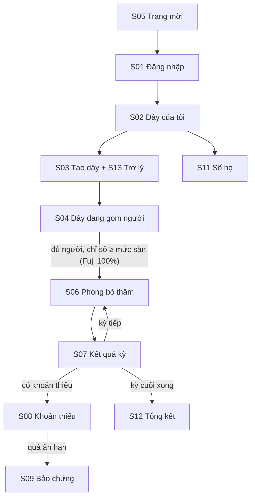

# 02. Đặc tả sản phẩm HụiSafe (PRD)

**Mục đích và đọc khi nào.** File này nói HụiSafe giải quyết vấn đề gì, cho ai, người dùng làm gì trên từng màn hình và thế nào là "xong". Đọc trước khi làm frontend, viết test E2E, chuẩn bị thử nghiệm người dùng hoặc viết pitch. Luật vận hành và mọi con số: [03-dac-ta-giao-thuc.md](03-dac-ta-giao-thuc.md). Kiểu dữ liệu, API, tool của trợ lý: [05-cau-truc-du-lieu-va-api.md](05-cau-truc-du-lieu-va-api.md). Nếu file này mâu thuẫn với 03 hoặc 05 thì 03 và 05 thắng.

Ví dụ số dùng **dây demo** của 03 mục 8: N = 5, C = 100 USDC, kỳ danh nghĩa 30 ngày, tiền giữ lại 20%, ký quỹ 480 USDC, tiền công 1%, quỹ dự phòng 1%, cọc mở thăm 1 USDC, thành viên M1..M5.

---

## 1. Mục đích sản phẩm

HụiSafe là hụi bỏ thăm on-chain trên Avalanche. Tiền nằm trong ví từng người cho đến lúc chi. Chủ hụi không cầm tiền nhưng ký quỹ để bảo lãnh. Người hốt sớm bị giữ lại một phần. Có quỹ dự phòng nhỏ. Luật Nghị định 19/2019 chạy trong code. Khẩu hiệu: "Chơi hụi không sợ vỡ".

## 2. Vấn đề

### 2.1. Vỡ hụi có thật, và đều bắt đầu từ chỗ một người cầm tiền

| Vụ | Chuyện gì xảy ra | Quy mô | HụiSafe trả lời bằng | Nguồn |
|---|---|---|---|---|
| Bình Thuận, xã Hàm Mỹ | Một chủ hụi chạy nhiều dây; một dây mở 05/11/2020 có 937 người chơi | Hơn 100 tỷ đồng, 167 người bị hại | Không ai cầm tiền giữa các kỳ; sổ họ riêng từng dây; đếm số dây (Điều 14) | [Báo Pháp luật, 20/09/2024](https://baophapluat.vn/khoi-to-bat-tam-giam-loat-chu-hui-chiem-doat-tai-san-post526051.html) |
| Bắc Ninh, xã Tam Giang | Nhiều dây 25–30 người, vỡ dây chuyền ở thôn Vọng Nguyệt | Gần 4,8 tỷ đồng (người bị khởi tố); cả vụ hơn 40 tỷ | Như trên | [Báo Pháp luật, 20/09/2024](https://baophapluat.vn/khoi-to-bat-tam-giam-loat-chu-hui-chiem-doat-tai-san-post526051.html) |
| Trà Vinh, huyện Cầu Ngang | Hụi trên Zalo; người hốt không đóng, chủ hụi lập dây mới, khống 157 phần hụi bằng tên hụi viên | Hơn 4 tỷ đồng, 36 dây; 12 năm tù (xử 13/03/2025) | Một người một ví có xác nhận; ký quỹ bù người bỏ đóng | [VOV, 13/03/2025](https://vov.vn/phap-luat/12-nam-tu-cho-doi-tuong-mo-day-hui-khong-chiem-doat-tai-san-post1161016.vov) |
| Tây Ninh, xã Tân Thạnh | Hụi Zalo từ 06/2024; tài khoản ảo đóng vai hụi viên để bỏ thăm và hốt; tuyên bố vỡ hụi 11/12/2025 | Gần 500 triệu đồng | Một người một ví; thăm kín có cọc; sổ họ công khai | [VietnamPlus, 06/10/2026](https://www.vietnamplus.vn/tay-ninh-khoi-to-chu-hui-dung-tai-khoan-ao-chiem-doat-gan-500-trieu-dong-post1140315.amp) |

### 2.2. Rủi ro phía thành viên và luận điểm

Rủi ro còn lại là **người đã hốt bỏ đóng**. Ở chit fund Chennai, người hốt sớm bỏ đóng 2,04%, người hốt muộn 0,59% ([Klonner & Rai 2008](https://web.williams.edu/Economics/rai/adverse-08-9-1.pdf)). Người hốt sau chịu lỗ.

Chủ hụi truyền thống có hai vai trò: **giữ tiền** (gốc của ôm tiền, hụi ảo, hụi chồng hụi) và **bảo lãnh** (bù khi người đã hốt bỏ đóng; NĐ 19 Điều 18 khoản 4). Bản on-chain thông thường bỏ cả hai. HụiSafe bỏ vai trò giữ tiền, giữ vai trò bảo lãnh bằng ký quỹ khóa trong contract. Hụi là giao dịch hợp pháp (Bộ luật Dân sự 2015 Điều 471; NĐ 19/2019 hiệu lực từ 05/04/2019).

## 3. Mục tiêu và không-mục-tiêu

| Mục tiêu | Đo bằng |
|---|---|
| G1. Người góp trung thực nhận đủ pot khi mọi người đã hốt cùng bỏ đóng trong một kỳ (cú sốc đồng thời lớn nhất), nếu chỉ số bảo chứng 100%; bỏ đóng lần lượt thì có thể vượt ký quỹ (03 mục 7.3) | INV-08 (dạng cú sốc đồng thời); dây demo nhánh B có `uncovered = 0` |
| G2. Không ai cầm tiền góp giữa các kỳ | INV-01, INV-07 |
| G3. Luật NĐ 19 chạy trong code: trần lãi, lãi chậm góp, hoa hồng, sổ họ, ngưỡng thông báo | US-01, US-08, INV-03 |
| G4. Người lớn tuổi dùng được: đăng nhập Google, không cần AVAX, chữ to | Số đo thử nghiệm (mục 10) |
| G5. Demo trọn trên Fuji, 5–10 người dùng thật thử | Mốc M3, M4 ở [11-ke-hoach-trien-khai.md](11-ke-hoach-trien-khai.md) |
| G6. Trợ lý giúp chủ hụi định ký quỹ, không bao giờ chuyển tiền | Eval ở [07-ai-agentic.md](07-ai-agentic.md) |

**Không làm:** nhận tiền thật; phát hành, bán token; sinh lãi cho người dùng trong MVP; yếu tố ngẫu nhiên; dữ liệu cá nhân on-chain; mainnet; tư vấn pháp lý, tài chính; HụiSafe giữ tiền hộ; nạp rút VND; chủ hụi chọn người hốt; LLM trong đường đi của tiền.

## 4. Personas

| | Cô Tư, chủ hụi, 54 tuổi | Thư, sinh viên năm 3, 20 tuổi | Anh Khoa, kiều bào ở Melbourne, 36 tuổi |
|---|---|---|---|
| Bối cảnh | Bán vải ở chợ Bình Tây (TP.HCM), làm chủ hụi 15 năm cho tiểu thương; dây 10–20 phần, ghi sổ tay | Làm thêm, chi dưới 5 triệu/tháng; chơi hụi với bạn và người nhà để có tiền học phí | Chơi hụi trong cộng đồng người Việt; kiều bào từng có vụ vỡ lớn, như Sydney 2007 ([Albanese, 12/06/2007](https://anthonyalbanese.com.au/statement-hui-fraud)) |
| Mục tiêu | Nhận tiền công đúng; không phải đi đòi; không bị nghi ăn chặn; sổ rõ khi tranh chấp | Hốt sớm khi cần với tiền thăm có trần; chưa cần thì hốt sau, nhận lãi | Góp đúng hạn dù không dự buổi khui hụi; xem sổ bất cứ lúc nào |
| Nỗi sợ | Người hốt bỏ trốn, cô bù không giới hạn; dính pháp luật; bấm nhầm | Là người hốt cuối và mất tiền; seed phrase, phí gas; lộ thông tin | Chủ hụi ôm tiền; không có giấy tờ khi kiện |
| Công nghệ | Zalo, app ngân hàng, VietQR; chưa dùng crypto; cần chữ to | Cao với điện thoại, thấp với ví crypto | Trung bình đến cao; từng dùng sàn |
| HụiSafe phải | Cho thấy trước ký quỹ tối đa; tự trừ, tự bù, tự ghi sổ | Một chạm đăng nhập; hiện "thắng thì nhận bao nhiêu"; cảnh báo mất thăm | Sổ họ công khai có bằng chứng; giờ theo múi giờ máy. MVP chỉ là testnet; bản tiền thật cho kiều bào cần ý kiến pháp lý |

## 5. Jobs-to-be-done

1. Khi cần một khoản lớn sớm, tôi muốn hốt với tiền thăm minh bạch, có trần, để khỏi vay nóng.
2. Khi làm chủ hụi, tôi muốn mọi người tự góp đúng hạn mà tôi không cầm tiền, để khỏi bị nghi và khỏi đi đòi.
3. Khi là người hốt sau, tôi muốn biết trước mình được bảo vệ bao nhiêu, để quyết định vào dây.
4. Khi có người bỏ đóng, tôi muốn phần thiếu được bù ngay theo luật đã biết, để kỳ của tôi không hụt.
5. Khi có tranh chấp, tôi muốn sổ họ không sửa được, để hòa giải hoặc ra tòa (NĐ 19 Điều 25).

## 6. User stories và tiêu chí nghiệm thu

Mỗi tiêu chí là một ca test E2E. Giao dịch người dùng đi qua relayer ERC-2771 (không cần AVAX), trừ khi ghi khác.

### US-01. Tạo dây (chủ hụi)
Là chủ hụi, tôi muốn tạo dây và thấy ngay mức bảo chứng, để mời người khác bằng con số rõ ràng.
- **AC-01.1** Given form mặc định (Bỏ thăm, N = 5, C = 100, kỳ 30 ngày, giữ lại 20%, tiền công 1%, quỹ dự phòng 1%, cọc 1%), When nhập ký quỹ 480, Then đồng hồ "Chỉ số bảo chứng" hiện **100%** (rủi ro đỉnh 600 USDC), tính bằng `huiMath` trong trình duyệt, cập nhật ngay khi sửa.
- **AC-01.2** Given ký quỹ 0, Then hiện 20% và "Chưa đủ để bắt đầu dây (tối thiểu 100%). Cần thêm 480 USDC ký quỹ." Vẫn tạo được dây; nút "Bắt đầu dây" (`activate`) khóa tới khi đạt mức sàn của factory (Fuji: 100% bắt buộc, ADR-22; 50% chỉ ở anvil và test, docs/03 mục 2.3). Giao diện đọc mức sàn từ factory, không ghi cứng.
- **AC-01.3** Then bảng "Trần thăm từng kỳ" hiện: 6,575342 / 4,931506 / 3,287671 / 1,643835 / 0 USDC, kèm "Trần lãi 20%/năm theo NĐ 19 Điều 21 (cách hiểu của HụiSafe, cần luật sư xác nhận)".
- **AC-01.4** Then khung "Nghị định 19" hiện: (a) ô tự xác nhận đủ 18 tuổi (Điều 6); (b) giá trị một kỳ = N × C quy đổi theo tỷ giá cấu hình (mặc định 26.000): 500 USDC ≈ 13.000.000 đ; (c) nếu chủ hụi đã có ≥ 1 dây đang chạy (`activeCirclesOf`) hoặc giá trị một kỳ ≥ 100.000.000 đ (≈ 3.846 USDC): cảnh báo "Cần thông báo bằng văn bản cho UBND cấp xã (NĐ 19 Điều 14)" và nút "Soạn thông báo"; (d) ô tiền công chỉ bật khi chọn "Họ hưởng hoa hồng" (Điều 4 khoản 8); (e) lãi chậm góp 10%/năm (Điều 22 khoản 1).
- **AC-01.5** Given tham số sai, Then form chặn trước khi gửi, báo lỗi tiếng Việt theo mã `InvalidParams` 1..13 (05 mục 4.3), ví dụ mã 1: "Số phần phải từ 3 đến 30."
- **AC-01.5b** Given tiền giữ lại α > 50% (form hoặc bản nháp gửi trợ lý), Then form chặn trước khi gửi với lời giải thích tiếng Việt ngắn (giữ lại quá nhiều thì người hốt nhận quá ít và chỉ số bảo chứng mất ý nghĩa; α = 100% với ký quỹ 0 vẫn hiện CI 100% nhưng holdback bị cắt theo pot, audit A16 L-02). Mặc định vẫn 20%. Đây là giới hạn của giao diện và trợ lý; contract còn nhận tới 100% (roadmap).
- **AC-01.6** When "Tạo dây", Then hiện "Đang tạo…" rồi "Đã tạo" kèm link Snowtrace. When nạp ký quỹ, Then ký một lần (permit) rồi gửi `depositBond`; số liệu cập nhật từ event `BondDeposited`.

### US-02. Mời và vào dây
Là thành viên, tôi muốn vào dây bằng tài khoản Google, không phải hiểu ví.
- **AC-02.1** Given link mời, When mở khi chưa đăng nhập, Then thấy mức góp, số phần, kỳ, chỉ số bảo chứng tối thiểu (quỹ dự phòng tính bằng 0), ký quỹ đã nạp, chỗ còn, hạn vào dây, trần thăm, tiền giữ lại, ân hạn.
- **AC-02.2** When đăng nhập Google hoặc email (Privy), Then ví tự tạo (`embeddedWallets.ethereum.createOnLogin = 'users-without-wallets'`), không seed phrase, không đòi AVAX.
- **AC-02.3** When tick "Tôi đủ 18 tuổi và đồng ý luật dây", bấm "Vào dây", Then app: (1) gọi `/api/attest`; (2) xin **một** chữ ký cho phép dây trích tối đa (N − 1)·(C + cọc), dây demo là 404 USDC, hiện kèm ≈ VND trước khi ký; (3) gửi `join`. Then thấy "Đã vào dây, thứ tự số k".
- **AC-02.4** Trên chuỗi chỉ có địa chỉ ví và `attestationId` (INV-10).
- **AC-02.5** Lỗi rõ ràng: "Dây đã đủ người"; "Đã hết hạn vào dây"; xác nhận hết hạn (1 giờ) thì app tự xin lại; "Mỗi người chỉ dùng một ví"; permit bị gửi trước thì vẫn vào được nếu quyền trích đủ.
- **AC-02.6** Số dư thấp hơn phần góp kỳ 1: cảnh báo, không chặn, kèm cách lấy USDC thử. Trước khi dây bắt đầu có nút "Rời dây" (`leave`), kèm cảnh báo "Rời rồi thì không vào lại được dây này" và lời nhắc thu hồi quyền trích. Relayer lỗi mà ví có AVAX thì đề nghị gửi trực tiếp (ADR-04).

### US-03. Phòng bỏ thăm
Là hụi sống, tôi muốn bỏ thăm kín và biết trước mình nhận bao nhiêu nếu thắng.
- **AC-03.1** Given kỳ k đang nhận thăm và tôi đủ điều kiện (chưa hốt, không đóng băng, không còn khoản thiếu), Then hiện đếm ngược; "Trần thăm kỳ này" = `maxBid(k)` (kỳ 1: 6,575342 USDC); "Thắng với thăm 6 thì nhận khoảng 288,48 USDC, giữ lại 80 USDC" (ước tính khi mọi người đóng đủ); cọc 1 USDC.
- **AC-03.2** When nhập thăm vượt trần hoặc ≥ C, Then nút nộp khóa: "Thăm vượt trần sẽ không mở được và mất cọc."
- **AC-03.3** When "Nộp thăm kín", Then salt 32 byte sinh bằng `crypto.getRandomValues`, lưu IndexedDB `huisafe/salts`, gửi `commitBid`; ngay sau đó hiện hộp không tự đóng: "Thăm của bạn được khóa bằng một mã bí mật chỉ lưu trên máy này. Đổi máy hoặc xóa dữ liệu trình duyệt mà chưa sao lưu thì không mở được thăm và mất cọc 1 USDC." Nút "Sao lưu thăm" (file mã hóa bằng mật khẩu) và "Tôi hiểu".
- **AC-03.4** Sửa thăm trước giờ đóng được, kèm "Sửa thăm làm bạn xếp sau nếu bằng thăm."
- **AC-03.5** Given giờ mở thăm, Then máy có salt hiện "Mở thăm" (hợp lệ thì trả cọc); máy không có salt hiện "Nhập file sao lưu". App nhắc hai lần trước khi hết giờ.
- **AC-03.6** Luật chọn người hốt viết bằng lời: thăm cao nhất; bằng nhau thì ít lần trễ hơn; vẫn bằng thì ai nộp trước. "Không có bốc thăm ngẫu nhiên." Người không đủ điều kiện thấy lý do ("Bạn đã hốt kỳ 1", "Bạn còn thiếu kỳ 2").

### US-04. Kết quả kỳ
- **AC-04.1** Given kỳ đã chi, Then hiện người hốt, thăm, tổng tiền góp, tiền công (giữ chờ), quỹ dự phòng, tiền giữ lại, thực nhận, phần không bù được, link Snowtrace. Kỳ 1 dây demo: 376,00 / 3,76 / 3,76 / 80,00 / **288,48**.
- **AC-04.2** Từng thành viên: "Đã góp" hoặc "Thiếu" kèm nguồn bù. Dòng kiểm: thực nhận + tiền công + quỹ dự phòng + giữ lại = tổng (INV-05).
- **AC-04.3** Chuyển cho người hốt thất bại thì người đó thấy "Có X USDC chờ bạn nhận" và nút "Nhận tiền" (`claim`).
- **AC-04.4** Quá giờ chốt 60 giây mà chưa chi: hiện "Kỳ đang chờ chốt"; ví có AVAX thấy nút "Chốt kỳ" gọi `settleRound` (ai gọi cũng được).

### US-05. Khoản thiếu, trả trễ, ân hạn
- **AC-05.1** Given kéo tiền của tôi thất bại ở kỳ 2, Then biểu ngữ đỏ: "Bạn còn thiếu 100 USDC kỳ 2. Hạn trả [giờ], còn [đếm ngược]" (bản thật 48 giờ, demo 2 phút), lãi chậm góp đang cộng (10%/năm theo ngày danh nghĩa; demo 1 ngày danh nghĩa = 6 giây).
- **AC-05.2** When "Trả ngay" trong ân hạn, Then `payLate(2)`: trả 100 + lãi (sau 1 ngày danh nghĩa ≈ 0,027397 USDC); nguồn đã bù được hoàn theo thứ tự quỹ dự phòng → ký quỹ → tiền giữ lại; trạng thái "Đã trả trễ" (+1 lần trễ, không vỡ nợ). Quyền trích còn lại không đủ thì app xin ký permit mới.
- **AC-05.3** Người khác thấy: "Kỳ 2: M4 thiếu 100 USDC, đã bù 80 từ tiền giữ lại của M4 và 20 từ ký quỹ. Người hốt kỳ 2 vẫn nhận đủ 323,18 USDC."

### US-06. Vỡ nợ và bảo chứng
- **AC-06.1** Given quá ân hạn chưa trả, When ai đó (thường là keeper) gọi `markDefault`, Then người đã hốt mang nhãn "Vỡ nợ sau khi hốt"; người chưa hốt mang nhãn "Đóng băng: không bỏ thăm, không phải góp, hốt cuối cùng".
- **AC-06.2** Trang "Bảo chứng" vẽ thác bù: tiền giữ lại → ký quỹ → quỹ dự phòng → không bù được. Dây demo nhánh B: ký quỹ 480 → 460 (kỳ 2) → 360 → 260 → 160 (kỳ 3–5); M4 gây thiếu 400 = 80 từ tiền giữ lại + 320 từ ký quỹ. Hiện "Tiền công kỳ 2 (3,91 USDC) chuyển vào quỹ dự phòng" (`FeeForfeited`).
- **AC-06.3** Phần không bù được (nếu có) là "Khoản đòi công khai": địa chỉ ví và tx hash, không tên thật, lời lẽ trung tính. Người vỡ nợ có nút "Trả nợ" (`repayDebt`).

### US-07. Tiền giữ lại
- **AC-07.1** Given M4 hốt kỳ 1, Then trang "Tiền giữ lại của tôi" hiện 80 USDC: "Nhả 20 USDC sau mỗi kỳ bạn đóng đủ, đúng hạn. Còn 4 kỳ." When đóng đúng hạn kỳ sau, Then nhả 20 (`HoldbackReleased`), còn 60.
- **AC-07.2** Kỳ trả trễ thì không nhả phần kỳ đó; phần còn lại trả khi kết thúc dây. Câu giải thích: "Tiền giữ lại dùng để bù nếu bạn ngừng đóng sau khi hốt. Đóng đủ thì nhận lại hết."

### US-08. Xuất sổ họ
- **AC-08.1** Ai cũng xem được, không cần đăng nhập; xuất JSON hoặc PDF qua `GET /api/circles/[address]/so-ho`. Nội dung đúng 05 mục 10, mỗi dòng có tx hash, VND ghi "(quy đổi tham khảo)", cuối có cảnh báo Điều 14 nếu có.
- **AC-08.2** PDF từ server không có biệt danh. "In kèm biệt danh" thì trình duyệt của chủ hụi ghép lúc in, không gửi lên server. PDF của dây demo có dòng chế độ demo.

### US-09. Kết thúc và nhận tiền
- **AC-09.1** Given kỳ N đã chi, qua ân hạn, khoản thiếu đã trả hoặc đã đánh dấu vỡ nợ, When ai đó gọi `finalize`, Then trang "Tổng kết" hiện mỗi người: đã góp, đã nhận, tiền giữ lại được trả, phần quỹ dự phòng; chủ hụi: ký quỹ trả lại, tiền công được trả và bị mất.
- **AC-09.2** Dây demo nhánh B: chủ hụi nhận lại 160 USDC ký quỹ cùng tiền công các kỳ không bị mất; quỹ dự phòng chia đều cho M1, M2, M3, M5; M4 ghi vỡ nợ ở ReputationRegistry. Khoản chuyển thất bại thành nút "Nhận tiền"; `claim` chạy cả khi dây tạm dừng.

### US-10. Banner chế độ demo
- **AC-10.1** Given `huisafe.demoMode = true` hoặc dây đang xem có `roundDuration < periodSeconds`, Then mọi màn hình có dải băng cố định, không tắt được: "Chế độ demo: 1 kỳ = 3 phút, lãi tính như hụi tháng. Ân hạn 2 phút. Tiền là USDC thử nghiệm trên Fuji, không có giá trị." Bản dựng với `NEXT_PUBLIC_HUISAFE_DEMO=true` luôn hiện dải này; khi chưa triển khai (số liệu mẫu) dải cũng hiện, thêm câu "Màn hình này dùng số liệu mẫu."
- **AC-10.2** `role="status"`, tương phản ≥ 4,5:1, không che nút chính. Bật lãi giả lập (bonus) thì thêm "Lãi hiển thị là giả lập."

### US-11. Trợ lý chủ hụi
- **AC-11.1** Given bản nháp N = 5, C = 100, giữ lại 20%, When hỏi "Ký quỹ bao nhiêu để bảo chứng 100%?", Then trợ lý gọi `recommend_bond`, trả lời 480 USDC đúng như tool trả, trích NĐ 19 Điều 18 khoản 4 qua `explain_rule`, kết bằng "Đây là thông tin tham khảo, không phải tư vấn tài chính hay pháp lý."
- **AC-11.2** When nhờ chuyển tiền, ký, bỏ thăm hộ hay gọi `markDefault`, Then từ chối và chỉ chỗ bấm trong app.
- **AC-11.3** Mọi con số trong câu trả lời có trong kết quả tool hoặc số tính sẵn của bản nháp; có số lạ thì thay bằng bảng kết quả tool. Nút "Điền vào form" để chủ hụi tự áp dụng; trợ lý không tự sửa form.
- **AC-11.4** API lỗi: hiện "Trợ lý tạm nghỉ" và các máy tính tất định; tạo dây vẫn chạy. Nhãn "Trợ lý AI" luôn hiện; không gửi địa chỉ ví thành viên, biệt danh, dữ liệu cá nhân cho mô hình.

## 7. Màn hình

| Mã | Màn hình | Thành phần chính |
|---|---|---|
| S01 | Đăng nhập | Ba câu giới thiệu; nút Google, email; "Không cần ví, không cần AVAX" |
| S02 | Dây của tôi | Thẻ từng dây: trạng thái, kỳ, việc cần làm, đếm ngược |
| S03 | Tạo dây | Form từng bước; đồng hồ chỉ số bảo chứng; bảng trần thăm; khung NĐ 19; nút trợ lý |
| S04 | Dây đang gom người | Link mời, QR; người đã vào; nạp ký quỹ; "Bắt đầu dây" |
| S05 | Trang mời | Tóm tắt dây, luật chính, "Vào dây" |
| S06 | Phòng bỏ thăm | Pha, đếm ngược, trần thăm, ước tính thực nhận, nộp/sửa/mở thăm, sao lưu |
| S07 | Kết quả kỳ | Bảng số của kỳ, trạng thái từng người, Snowtrace, "Nhận tiền" |
| S08 | Khoản thiếu | Số thiếu, lãi đang cộng, hạn trả, "Trả ngay" |
| S09 | Bảo chứng | Thác bù dạng thanh, ký quỹ còn lại, khoản đòi công khai |
| S10 | Tiền giữ lại | Số đang giữ, lịch nhả |
| S11 | Sổ họ | Bảng dòng, lọc theo kỳ, xuất JSON, PDF |
| S12 | Tổng kết | Góp, nhận, ròng, tiền trả lại, "Nhận tiền" |
| S13 | Trợ lý chủ hụi | Ngăn kéo chat, câu gợi ý, bảng số từ tool, "Điền vào form" |
| S14 | Cài đặt | Cỡ chữ, sao lưu thăm, nhắc hụi Telegram (bonus, tự chọn) |
| S15 | Mẫu thông báo UBND | Bản nháp từ `draft_ubnd_notice`, chỗ trống tự điền họ tên, địa chỉ |
| S16 | Phòng mô phỏng (`/lab`) | Biểu đồ so sánh 3 thiết kế từ `sim/outputs`, ghi rõ giả định; chưa chạy thì ghi "chưa có kết quả" |

**Yêu cầu chung:**
1. Mobile-first, chuẩn bề rộng 360 px, `lang="vi"`, một hành động chính mỗi màn hình.
2. Chữ thân tối thiểu 18 px, tùy chọn "Chữ lớn" 22 px; nút tối thiểu 48 × 48 px.
3. Tương phản WCAG 2.2 AA (≥ 4,5:1); không truyền đạt chỉ bằng màu; trình đọc màn hình đọc được nút và đếm ngược; tôn trọng `prefers-reduced-motion`.
4. Số theo vi-VN ("288,48 USDC", "13.000.000 đ"), giờ 24 giờ theo múi giờ máy, địa chỉ rút gọn `0x12…ab`, ưu tiên biệt danh.
5. Thao tác có tiền hiện số to kèm ≈ VND trước khi ký; trạng thái chờ có chữ ("Đang gửi…").

## 8. Quy tắc viết chữ

1. Câu dưới 20 chữ, lời đời thường.
2. Màn hình chính không dùng: gas, smart contract, on-chain, allowance, permit, commit, reveal, token, APY.
3. Không hứa: không "lợi nhuận", "đầu tư", "an toàn tuyệt đối", "không bao giờ mất tiền", "bảo hiểm". Nói "được bảo chứng X%" và nêu điều kiện: ký quỹ chịu được cú sốc lớn nhất, mọi người đã hốt cùng bỏ đóng một lúc (bỏ đóng lần lượt có thể vượt ký quỹ; 03 mục 7.3).
4. Không gọi trợ lý là "luật sư AI", không dùng chữ "tư vấn".
5. Mọi con số kèm đơn vị; VND luôn ghi "quy đổi tham khảo".

| Trong code | Trên màn hình | Giải thích khi chạm "?" |
|---|---|---|
| holdback | tiền giữ lại | Phần tiền hốt giữ để bù nếu bạn ngừng đóng; đóng đủ thì nhận lại hết |
| bond | ký quỹ | Tiền chủ hụi khóa để bù khi người đã hốt bỏ đóng |
| Coverage Index | chỉ số bảo chứng | Phần rủi ro lớn nhất đã có tiền khóa sẵn để bù |
| reserve | quỹ dự phòng | Trích 1% mỗi kỳ, cuối dây chia đều cho người không vỡ nợ |
| fee | tiền công chủ hụi | Hoa hồng theo NĐ 19, chỉ trả cho kỳ không bị mất |
| commit / reveal | nộp thăm kín / mở thăm | Thăm được niêm phong, hết giờ thì mở |
| revealBond | cọc mở thăm | 1% mức góp, trả lại khi bạn mở thăm |
| maxBid | trần thăm | Thăm cao nhất được phép theo trần lãi 20%/năm |
| permit | cho phép trích tiền | Dây chỉ trích đúng phần góp từng kỳ |
| shortfall, grace | khoản thiếu, ân hạn | Phần chưa góp được; thời gian được trả bù |
| default, Frozen | vỡ nợ, đóng băng | Quá ân hạn chưa trả |
| claim | nhận tiền | Tiền chuyển chưa tới, bấm để nhận |
| relayer | miễn phí giao dịch | HụiSafe trả phí mạng thay bạn |

## 9. Phạm vi

Khớp 03 mục 11 và các ADR ở 04 mục 6.

| Hạng mục | MVP (bắt buộc) | Bonus (chỉ khi xong MVP, trước M5) | Roadmap |
|---|---|---|---|
| Hợp đồng | Factory; dây Fixed và Bỏ thăm; kéo tiền bằng permit; thác bù; ân hạn; vỡ nợ; đóng băng; kết thúc; `claim`; tạm dừng, `emergencyUnwind`; ReputationRegistry | Huy hiệu ERC-5192; EIP-3009 | Tài sản bảo đảm của thành viên; giảm tỷ lệ giữ lại theo uy tín |
| Lãi | Không sinh lãi (`NoYield`) | `MockYieldVault` trên Fuji, khai báo là giả lập | Adapter Aave v3 trên mainnet |
| Ví | Privy (Google, email), relayer ERC-2771, attestation | Passkey P-256 (ACP-204) | |
| Hạ tầng | Fuji, đọc bằng viem, keeper | Ponder | L1 riêng từng hội; mainnet với Safe multisig |
| Pháp lý | Trần lãi, lãi chậm góp, hoa hồng, cảnh báo Điều 14, sổ họ JSON và PDF | | Chế độ VND; bản cho kiều bào sau khi có ý kiến pháp lý |
| AI | Trợ lý chủ hụi 6 tool, eval 30 ca | Bot nhắc hụi Telegram | |
| Stretch | | "Đấu thăm hộ" (phải đổi giao thức trước, xem 07) | |

## 10. Chỉ số thành công

**Trong hackathon** (mục tiêu, chưa phải kết quả):

| Chỉ số | Mục tiêu |
|---|---|
| Người dùng thật thử trên Fuji, có đồng ý | 5–10 người |
| Dây hoàn tất do người dùng thật chạy trên Fuji | ≥ 2 |
| Dây demo nhánh B chạy trọn trên Fuji | ≥ 3 lần trước 20/11 |
| Trung vị thời gian từ mở link mời tới "Đã vào dây" | < 3 phút |
| Người thử tự vào dây không cần giúp | ≥ 80% |
| Người thử giải thích đúng "tiền giữ lại" và "chỉ số bảo chứng" | ≥ 4/5 |
| Test luồng tiền, INV-01..INV-10 | Xanh 100% |
| Slither mức cao | 0 |
| Eval trợ lý | Đạt ngưỡng ở 07 |

**North-star:** số kỳ hụi được chi đủ, đúng hạn mà không ai cầm tiền hộ (`uncovered = 0`) mỗi tháng. Chỉ số phụ: chỉ số bảo chứng trung bình lúc bắt đầu dây; tỷ lệ khoản thiếu trả trong ân hạn; số chủ hụi mở dây thứ hai.

## 11. Câu hỏi mở

| # | Câu hỏi | Ai trả lời, hạn |
|---|---|---|
| Q1 | Cách hiểu trần lãi Điều 21 (`maxBid`) có đúng không? | Luật sư, mentor; office hours 19/11 |
| Q2 | "Giá trị các phần họ tại một kỳ" (Điều 14) là N·C hay (N − 1)·C? UI đang dùng N·C, thận trọng hơn | Luật sư; 19/11 |
| Q3 | Chia hòa tất định thay bốc thăm (Điều 20) có cần ghi vào thỏa thuận dây họ không? | Luật sư; 19/11 |
| Q4 | Chữ ký ví có thay chữ ký tay trong sổ họ (Điều 12) không? | Luật sư; sau hackathon ([10-phap-ly-va-tuan-thu.md](10-phap-ly-va-tuan-thu.md)) |
| Q5 | Phần mềm HụiSafe có bị coi là bên tổ chức họ không? | Luật sư; sau hackathon |
| Q6 | Privy hiện được tiếng Việt tới đâu? Tài liệu chỉ cho đặt `landingHeader`, `loginMessage` (cần kiểm tra) | P2; M3 |
| Q7 | Nhiều người chưa hốt cùng đóng băng thì thiếu thanh khoản tạm thời bao lâu? | P3, phòng mô phỏng; M4 |
| Q8 | Thành viên có xem biệt danh của nhau không, hay chỉ chủ hụi? | Cả đội, sau thử nghiệm; M4 |
