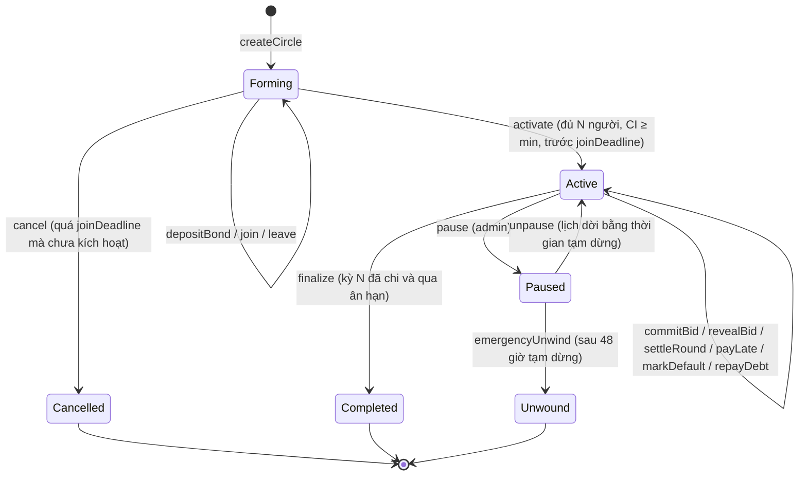

# 03. Đặc tả giao thức HụiSafe (v1.1)

**Mục đích và đọc khi nào.** Đây là nguồn sự thật cho mọi luật vận hành của HụiSafe: ký hiệu, công thức, vòng đời dây hụi, từng bước của một kỳ, cách bù khi có người bỏ đóng, kế toán và bất biến. Viết smart contract, viết test, viết frontend hay viết pitch đều phải khớp file này. Interface, struct, event, lỗi và API nằm ở [05-cau-truc-du-lieu-va-api.md](05-cau-truc-du-lieu-va-api.md). Nếu hai file mâu thuẫn, sửa cả hai cho khớp rồi mới code.

> Luận điểm thiết kế: chủ hụi truyền thống có hai vai trò, giữ tiền và bảo lãnh. Bản on-chain thông thường bỏ cả hai, nên người hốt sau gánh rủi ro người đã hốt bỏ đóng. HụiSafe bỏ vai trò giữ tiền nhưng giữ vai trò bảo lãnh, bằng ký quỹ khóa trong contract. Đây cũng là điều Nghị định 19/2019 Điều 18 khoản 4 đã giao cho chủ hụi.

---

## 1. Ký hiệu và đơn vị

| Ký hiệu | Tên trong code | Ý nghĩa | Đơn vị, miền giá trị |
|---|---|---|---|
| N | `memberCount` | Số phần hụi (mỗi thành viên một phần) | 3 ≤ N ≤ 30 |
| C | `contribution` | Mức góp mỗi kỳ (mệnh giá một phần) | USDC, 6 chữ số thập phân (1 USDC = 1_000_000) |
| k | `round` | Số thứ tự kỳ | 1..N |
| P | `periodSeconds` | Kỳ danh nghĩa theo thỏa thuận hụi (dùng cho trần lãi, lãi chậm góp) | giây, 1 ngày đến 31 ngày |
| D_r | `roundDuration` | Thời gian thật giữa hai kỳ trên chuỗi | giây; bản thật = P; demo = 180 |
| W_c, W_r | `commitWindow`, `revealWindow` | Cửa sổ nộp thăm kín và mở thăm | giây, W_c + W_r ≤ D_r |
| G | `graceSeconds` | Ân hạn trả trễ | giây; bản thật 172_800 (48 giờ); demo 120 |
| α | `alphaBps` | Tỷ lệ giữ lại (holdback) của người hốt | basis point, 0..10_000; mặc định 2000 |
| B | `bond` | Ký quỹ của chủ hụi | USDC |
| R | `reserve` | Quỹ dự phòng hiện có | USDC |
| b | `bid` | Tiền thăm mỗi phần hụi sống trả bớt | USDC |
| L_k | `payers` | Số hụi sống phải trả tiền ở kỳ k, không tính người hốt | số nguyên |
| — | `feeBps` | Tiền công chủ hụi trên mỗi pot (chỉ dây "họ hưởng hoa hồng") | mặc định 100, tối đa 300 |
| — | `reserveBps` | Phần trích vào quỹ dự phòng trên mỗi pot | mặc định 100, tối đa 300 |
| — | `revealBondBps` | Cọc mở thăm, tính trên C | mặc định 100 |
| — | `capBps` | Trần lãi năm (NĐ 19 Điều 21) | mặc định 2000 (20%/năm) |
| — | `lateRateBps` | Lãi chậm góp năm (NĐ 19 Điều 22 khoản 1: 50% trần) | mặc định 1000 |
| — | `minCoverageBps` | Chỉ số bảo chứng tối thiểu để được kích hoạt dây | mặc định 5000 |

Thuật ngữ trạng thái thành viên:

- **Hụi sống (Live):** đã vào dây, chưa hốt, chưa vỡ nợ.
- **Hụi chết (Dead):** đã hốt, chưa vỡ nợ.
- **Đóng băng (Frozen):** chưa hốt nhưng đã vỡ nợ (quá ân hạn mà chưa trả).
- **Vỡ nợ sau khi hốt (DefaultedDead):** đã hốt rồi vỡ nợ.

Trong code, các trạng thái này suy ra từ hai cờ `received` và `defaulted` (xem 05, mục 2).

Mọi phép chia là chia nguyên làm tròn xuống, trừ khi ghi khác. Phần dư lẻ (dust) luôn đi về người hốt của kỳ đó, không bao giờ mắc kẹt trong contract.

---

## 2. Công thức chuẩn (thư viện `HuiMath`)

### 2.1. Rủi ro (exposure)

Sau khi kỳ k được chi, k người đã hốt, mỗi người còn phải góp N − k kỳ. Tổng nghĩa vụ chưa đóng:

```
O(k) = k · (N − k) · C
O_max = ⌊N/2⌋ · ⌈N/2⌉ · C          (đỉnh tại k = ⌊N/2⌋, xấp xỉ N²C/4)
```

Ví dụ: N = 10, C = 2.000.000 VND quy đổi, O_max = 5·5·2 triệu = 50 triệu, bằng 27,8% tổng tiền góp N(N−1)C = 180 triệu. N = 5, C = 100 USDC, O_max = 2·3·100 = 600 USDC.

### 2.2. Tiền giữ lại (holdback)

```
holdback(k)        = α · (N − k) · C / 10_000          (giữ lại từ pot của người hốt kỳ k)
releasePerRound    = α · C / 10_000                    (nhả sau mỗi kỳ người đó đóng đủ, đúng hạn)
```

Hệ quả quan trọng: sau kỳ m, mỗi người đã hốt đang bị giữ đúng α·(N − m)·C, nên **tổng holdback luôn bằng α·O(m)**. Holdback tự động che một tỷ lệ α của rủi ro tại mọi thời điểm.

### 2.3. Chỉ số bảo chứng (Coverage Index)

```
CI_bps = min(10_000, alphaBps + (B + R) · 10_000 / O_max)
```

- Con số hiển thị trước khi tham gia dùng R = 0 (mức bảo đảm tối thiểu). Khi dây chạy, R tăng dần nên CI thực tế cao hơn.
- CI = 100% nghĩa là người góp trung thực không lỗ đồng nào kể cả khi mọi người đã hốt cùng bỏ đóng vào lúc rủi ro đỉnh (chứng minh ở mục 7).
- Ký quỹ để đạt 100%: `B = (1 − α) · O_max`. Với α mặc định 20%: B = 0,8·O_max.
- `activate()` chỉ thành công khi `CI_bps ≥ minCoverageBps` (mặc định 50%).

### 2.4. Trần tiền thăm (NĐ 19 Điều 21)

Diễn giải đề xuất (**cần luật sư xác nhận**; tách riêng trong `HuiMath.maxBid` để thay được):

- Lãi người hốt trả: I = b · L_k.
- Dư nợ của người hốt: D = (N − k) · C.
- Thời hạn còn lại tính theo năm: T = (N − k) · P / 365 ngày.
- Ràng buộc: I ≤ capRate · D · T.

```
maxBid(k) = capBps · (N − k) · C · (N − k) · P / (10_000 · 365 days · L_k)
            và đồng thời b < C;  nếu L_k = 0 thì maxBid = 0
```

Khi không có ai bị đóng băng thì L_k = N − k, nên `maxBid(k) = capBps · C · (N − k) · P / (10_000 · 365 days)`.

Kiểm tra với [Bản án 48/2024/DS-ST](https://static3.luatvietnam.vn/uploaded/LawJudgs/2024/07/31/ban-an-48-2024-ds-st-103207.pdf) (Tây Ninh): 25 phần × 2 triệu, kỳ có 20 phần sống và 4 phần chết, thăm 450.000. Giả sử hụi tháng: maxBid ≈ 0,2 · 2.000.000 · 20 · 30/365 ≈ 657.534, lớn hơn 450.000, nên thăm này hợp lệ.

Trần lãi theo tuần thì nhỏ (dây 5 người × 100 USDC, P = 7 ngày, kỳ 1: maxBid ≈ 1,53 USDC). Vì vậy demo luôn để P = 30 ngày (xem mục 3.3).

### 2.5. Lãi chậm góp (NĐ 19 Điều 22 khoản 1)

```
timeScale = periodSeconds / roundDuration                 (bản thật = 1)
lateFee   = amount · lateRateBps · elapsedSeconds · timeScale / (10_000 · 365 days)
```

`elapsedSeconds` tính từ lúc kỳ có khoản thiếu được chi (`settledAt`) đến lúc trả.

### 2.6. Tiền công, quỹ dự phòng, cọc mở thăm

```
fee        = commissionMode ? pot · feeBps / 10_000 : 0       → giữ trong escrow theo kỳ
premium    = pot · reserveBps / 10_000                         → cộng vào quỹ dự phòng
revealBond = revealBondBps · C / 10_000                        → kéo lúc commit, trả lúc reveal
requiredAllowance = (N − 1) · (C + revealBond)                 → allowance ký permit khi vào dây
```

---

## 3. Tham số và lịch

### 3.1. Tham số khi tạo dây (`CircleParams`)

| Trường | Ràng buộc | Mặc định gợi ý |
|---|---|---|
| `mode` | `Fixed` (họ không lãi) hoặc `Bidding` (họ có lãi, bỏ thăm) | `Bidding` |
| `memberCount` | 3..30 | 5 cho demo |
| `contribution` | ≥ 1 USDC; testnet ≤ 10.000 USDC | 100 USDC |
| `periodSeconds` | 1..31 ngày | 30 ngày |
| `roundDuration` | ≥ 120 giây; bản thật = `periodSeconds` | demo 180 giây |
| `commitWindow`, `revealWindow` | ≥ 30 giây mỗi cửa sổ; tổng ≤ `roundDuration` (Fixed: cả hai = 0) | demo 90 / 60 giây |
| `graceSeconds` | ≥ 60 giây và < `roundDuration` (để khoản trả trễ của kỳ k luôn hết ân hạn trước khi kỳ k + 1 chi, giữ INV-06) | 172.800 (demo 120) |
| `alphaBps` | 0..10_000 | 2000 |
| `commissionMode`, `feeBps` | `feeBps` ≤ 300; = 0 nếu không phải họ hưởng hoa hồng | true, 100 |
| `reserveBps` | ≤ 300 | 100 |
| `revealBondBps` | ≤ 500 | 100 |
| `capBps` | ≤ giá trị của factory (2000) | 2000 |
| `joinDeadline` | > thời điểm tạo | tạo + 7 ngày (demo + 30 phút) |
| `organizerIsMember` | bool | false |
| `label` | `bytes32`, tên ngắn của dây; giao diện nhắc không ghi tên người | — |

Sau `activate()`, không tham số nào thay đổi được.

### 3.2. Mốc thời gian của kỳ k

```
roundStart(1) = startTime + pausedTotal
roundStart(k) = max(startTime + (k − 1) · roundDuration, settledAt(k − 1) − pausedAtSettle(k − 1)) + pausedTotal     với k ≥ 2
commit  : [roundStart(k), roundStart(k) + commitWindow)
reveal  : [roundStart(k) + commitWindow, roundStart(k) + commitWindow + revealWindow)
settle  : được gọi khi now ≥ roundStart(k) + roundDuration   (= deadline(k))
```

Kỳ k chỉ được chi sau khi kỳ k − 1 đã chi. `startTime` = thời điểm `activate()`. Mốc bắt đầu kỳ "trôi" theo lúc chi: kỳ k − 1 chi trễ thì kỳ k chỉ bị dời lại, không bao giờ mất cửa sổ commit hay reveal (cả hai, cùng `deadline(k)`, đều đo từ `roundStart(k)`). Với kỳ chưa tới lượt (kỳ k − 1 chưa chi) `settledAt(k − 1)` và `pausedAtSettle(k − 1)` coi là 0, nên `roundStart(k)` là mốc dự kiến theo lịch danh nghĩa và có thể còn dời nếu các kỳ trước chi trễ.

`pausedAtSettle(j)` là giá trị `pausedTotal` tại lúc kỳ j được chi (contract lưu theo kỳ). Trừ nó khỏi `settledAt(k − 1)` rồi cộng lại `pausedTotal` hiện tại làm cho thời gian tạm dừng xảy ra SAU lúc chi kỳ k − 1 luôn dời trọn vẹn `roundStart(k)`; nếu không, kỳ k − 1 chi trễ rồi dừng sẽ làm dừng bị "nuốt" một phần và cắt cửa sổ commit và reveal. Nếu không có lần dừng nào sau lúc chi thì công thức cho đúng `settledAt(k − 1)`.

### 3.3. Chế độ demo (dev toggle, phải khai báo đầu buổi pitch)

`roundDuration = 180 s`, `commitWindow = 90 s`, `revealWindow = 60 s`, `graceSeconds = 120 s`, `periodSeconds` vẫn là 30 ngày. Nhờ vậy trần lãi và lãi chậm góp vẫn có nghĩa như hụi tháng, còn cả dây 5 người chạy xong trong khoảng 15 phút. Lãi trên ký quỹ nếu có hiển thị cũng là giả lập. Câu khai báo mẫu ở [12-pitch-demo-nop-bai.md](12-pitch-demo-nop-bai.md).

---

## 4. Vai trò và quyền

| Vai trò | Được làm | Không bao giờ được làm |
|---|---|---|
| Chủ hụi (organizer) | Tạo dây, nạp và nạp thêm ký quỹ trước khi kích hoạt, kích hoạt, nhận tiền công hợp lệ, nhận lại ký quỹ còn lại khi kết thúc | Chạm vào tiền góp của thành viên, đổi tham số sau kích hoạt, chọn người hốt |
| Thành viên | Vào dây (permit + attestation), rời dây trước kích hoạt, nộp và mở thăm, trả trễ, trả nợ, nhận tiền | Bỏ thăm khi đang thiếu tiền hoặc đã hốt hoặc bị đóng băng |
| Relayer (dịch vụ HụiSafe) | Chuyển tiếp meta-transaction ERC-2771 đã được người dùng ký, tự trả gas | Thay đổi nội dung yêu cầu (chữ ký sẽ sai), cầm tiền |
| Keeper (bất kỳ ai) | Gọi `settleRound`, `markDefault`, `finalize`, `cancel` khi đến hạn | Không có quyền gì đặc biệt |
| Attester (khóa của HụiSafe) | Ký `MemberAttestation`: một người một ví, đã đăng nhập và tự xác nhận đủ 18 tuổi | Ghi dữ liệu cá nhân lên chuỗi |
| Admin (Safe multisig; testnet là ví deployer) | Tạm dừng và mở lại dây (`factory.pauseCircle`, `unpauseCircle`); gọi `factory.unwindCircle` để chạy `emergencyUnwind` khi dây đã tạm dừng liên tục 48 giờ; đổi cấu hình factory cho dây MỚI | Rút tiền người dùng, đổi tham số dây đang chạy |

---

## 5. Vòng đời dây hụi



### 5.1. Forming (đang gom người)

1. `HuiFactory.createCircle(params)` tạo một clone EIP-1167 của `HuiCircle`, gọi `initialize`, ghi danh bạ, phát `CircleCreated`. Người gọi là chủ hụi.
2. `depositBond(amount, permit)`: chỉ chủ hụi. Kéo USDC bằng permit rồi `transferFrom`. Nạp thêm nhiều lần được cho đến khi kích hoạt.
3. `join(att, attSig, permit)`:
   - Kiểm `att.member == _msgSender()`, `att.circle == address(this)`, `att.expiry ≥ now`, chữ ký của attester hợp lệ, `attestationId` chưa dùng.
   - Thành viên chưa có trong dây và dây chưa đủ N người.
   - Gọi `USDC.permit(member, this, requiredAllowance, deadline, v, r, s)` trong `try`. Nếu permit revert (ví dụ đã bị ai đó gửi trước) thì vẫn chấp nhận khi `allowance(member, this) ≥ requiredAllowance`; nếu không thì revert.
   - Ghi `joinIndex` theo thứ tự vào dây.
4. `leave()`: thành viên rời trước kích hoạt. Không có tiền bị giữ; giao diện nhắc thu hồi allowance. Những người vào sau lùi lên một bậc, giữ nguyên thứ tự tương đối, nên `joinIndex` luôn liên tục từ 0 (quan trọng với dây `Fixed`, nơi thứ tự vào dây là thứ tự hốt). Rời rồi thì không vào lại được chính dây đó: contract ghi cờ `hasLeft[member]` và `join` revert `AlreadyLeft()` với ví đó (bất kể attestation), ngoài ra `attestationId` tính theo cặp (người dùng, dây) và đã bị đánh dấu dùng; luật này cũng chặn trò vào ra liên tục để quấy.
5. `activate()`: chỉ chủ hụi. Điều kiện: đủ N người, `now ≤ joinDeadline`, `CI_bps ≥ minCoverageBps`. Đặt `startTime = now`, trạng thái `Active`, factory tăng `activeCirclesOf[organizer]`.
6. `cancel()`: bất kỳ ai, khi `now > joinDeadline` và dây chưa kích hoạt. Chủ hụi rút ký quỹ bằng `withdrawBond()`.

### 5.2. Active (đang chạy)

Kỳ 1..N chạy theo lịch ở mục 3.2. Chi tiết ở mục 6.

### 5.3. Completed (kết thúc)

`finalize()` (bất kỳ ai) khi kỳ N đã chi, `now ≥ settledAt(N) + G` (cộng thời gian tạm dừng, mục 6.8), và mọi khoản thiếu hoặc đã trả, hoặc đã bị `markDefault`. Thành viên chưa bị đánh dấu mà còn khoản thiếu đã quá ân hạn thì `finalize` tự đánh dấu vỡ nợ (cùng hiệu ứng `markDefault`, mục 6.8) ngay đầu giao dịch; còn khoản thiếu trong ân hạn thì `finalize` revert `GraceNotOver`. Các bước:

1. Holdback còn lại của người không vỡ nợ: trả cho chính họ.
2. Holdback còn lại của người vỡ nợ: trả gốc còn nợ của họ theo thứ tự hoàn ở mục 6.8 (`uncovered`, quỹ dự phòng, ký quỹ), rồi lãi chậm góp; phần dư trả lại họ. Phần gốc đã được bù từ chính holdback của họ coi là đã tự trả (không chuyển tiền, chỉ xóa nợ). Lãi không đủ tiền để trả thì phát `LateFeeUnpaid` (mục 6.8).
3. Tiền công escrow của các kỳ không bị mất: trả chủ hụi. Kỳ bị mất đã chuyển vào quỹ dự phòng từ trước.
4. Ký quỹ còn lại (đã cộng các khoản được hoàn): trả chủ hụi.
5. Quỹ dự phòng còn lại: chia đều cho các thành viên không vỡ nợ. Phần dư lẻ cho thành viên có `joinIndex` nhỏ nhất. Nếu mọi thành viên đều vỡ nợ thì quỹ dự phòng còn lại trả chủ hụi (không bao giờ tới admin).
6. Ghi `recordCompleted` vào ReputationRegistry cho thành viên không vỡ nợ.
7. Factory giảm `activeCirclesOf[organizer]`.
8. Khoản "không được bù" còn tồn tại (nếu có) giữ nguyên trong sổ làm khoản đòi công khai.

Mọi khoản trả ở đây dùng cơ chế chi an toàn ở mục 6.7.

### 5.4. Paused và Unwound

- Chỉ dây `Active` mới tạm dừng được. Khi `Paused`, mọi hàm thay đổi trạng thái của dây bị chặn, trừ `claim()`. Khi `unpause`, thời gian đã tạm dừng cộng vào `pausedTotal` để lịch không lệch; ân hạn của mọi khoản thiếu cũng dài thêm đúng thời gian dừng sau lúc khoản đó phát sinh (mục 6.8), để không ai bị vỡ nợ chỉ vì dây đang dừng.
- `emergencyUnwind()` chỉ factory gọi được (admin dùng `factory.unwindCircle(circle)`), và chỉ sau 48 giờ tạm dừng liên tục. Trả tiền theo sổ: ký quỹ còn lại về chủ hụi, holdback về chủ của nó, tiền công escrow về quỹ dự phòng, quỹ dự phòng chia đều cho thành viên không vỡ nợ, cọc mở thăm về người nộp. Không có nhánh nào chuyển tiền cho admin.

---

## 6. Một kỳ hụi, từng bước

### 6.1. Ai được bỏ thăm (chỉ dây `Bidding`)

Thành viên đang sống (chưa hốt, không bị đóng băng) và không còn khoản thiếu chưa trả ở kỳ trước. Nếu chỉ còn đúng một thành viên sống thì người đó không được commit (`NotEligibleToBid`): họ sẽ hốt với b = 0 (mục 6.4), commit chỉ làm họ mất cọc nếu không mở.

### 6.2. `commitBid(commitHash)`

- Chỉ trong cửa sổ commit của kỳ hiện tại, người gọi đủ điều kiện ở 6.1.
- `commitHash = keccak256(abi.encode(address(circle), round, member, bid, salt))`.
- Kéo `revealBond` từ người gọi. Được ghi đè thăm trước khi hết cửa sổ commit; ghi đè thì giữ nguyên cọc nhưng nhận `commitIndex` mới (muộn hơn).
- `commitIndex` là bộ đếm tăng dần trong kỳ, dùng để chia hòa.

### 6.3. `revealBid(bid, salt)`

- Chỉ trong cửa sổ reveal. Hash phải khớp commit của người gọi ở kỳ này.
- Revert nếu `bid > maxBid(k)` hoặc `bid ≥ C`. Vì vậy người commit thăm sai sẽ không mở được và mất cọc; giao diện phải chặn trước.
- Thăm hợp lệ: trả lại cọc, cập nhật thăm dẫn đầu theo thứ tự so sánh ở 6.4.
- Salt sinh ngẫu nhiên phía người dùng để giữ bí mật thăm. Salt không dùng để chọn người hốt.

### 6.4. Chọn người hốt (tất định, không ngẫu nhiên)

So sánh hai thăm hợp lệ theo thứ tự:

1. Tiền thăm cao hơn thắng.
2. Bằng nhau: ít lần trễ hơn thắng. Số lần trễ = `late` của ví đó ở ReputationRegistry (số này đã gồm cả các lần trễ trong dây này vì `recordLate` được ghi ngay lúc trễ). Chỉ khi gọi registry thất bại thì dùng bộ đếm trễ cục bộ của dây; không bao giờ cộng hai số, để khỏi đếm đôi.
3. Vẫn bằng: `commitIndex` nhỏ hơn (commit sớm hơn) thắng.

Trường hợp đặc biệt:

- Dây `Fixed`: người hốt kỳ k là người có `joinIndex = k − 1` nếu người đó còn sống. Người bị đóng băng bị đẩy xuống cuối hàng, các người sau lùi lên giữ nguyên thứ tự.
- Dây `Bidding` không có thăm hợp lệ: người sống có `joinIndex` nhỏ nhất hốt với b = 0.
- Chỉ còn một người sống (thường là kỳ N): người đó hốt với b = 0, không bỏ thăm.
- Không còn ai sống mà vẫn còn người bị đóng băng chưa hốt: người bị đóng băng có `joinIndex` nhỏ nhất hốt (mục 6.6).

### 6.5. `settleRound()`

Bất kỳ ai gọi được khi `now ≥ deadline(k)`, kỳ k chưa chi, kỳ k − 1 đã chi, dây `Active`. Toàn bộ chạy trong một giao dịch, `nonReentrant`.

1. **Chọn người hốt** w và tiền thăm b theo 6.4. Cọc của ai commit mà không reveal: chuyển vào quỹ dự phòng, ghi +1 lần trễ.
2. **Tính phần phải góp** của từng thành viên j ≠ w:
   - j sống: `due = C − b`.
   - j đã hốt (kể cả đã vỡ nợ): `due = C`.
   - j bị đóng băng: `due = C − b` nhưng **không kéo tiền**, coi như thiếu toàn phần và cộng vào `debt[j]`.
3. **Kéo tiền.** Với mỗi j còn lại, gọi `transferFrom(j, circle, due)` trong `try`. Thành công: ghi đã đóng đúng hạn. Thất bại: ghi khoản thiếu `s_j = due`, `lateSince = now`.
4. **Bù khoản thiếu ngay** theo thác, cho từng s_j:
   1. holdback của chính j (nếu j đã hốt và còn holdback),
   2. ký quỹ còn lại của chủ hụi,
   3. quỹ dự phòng,
   4. phần còn lại không bù được: `uncovered`. Người hốt nhận ít hơn đúng phần này và được ghi khoản đòi đối với j.

   Ghi rõ nguồn bù của từng khoản thiếu (`fromHoldback`, `fromBond`, `fromReserve`, `uncovered`) để hoàn lại chính xác sau này.
5. **Pot** = tổng tiền kéo được + tổng tiền đã bù.
6. **Trích:** `fee` vào escrow của kỳ k; `premium` vào quỹ dự phòng.
7. **Holdback của người hốt:** nếu w là người sống bình thường thì `H = min(holdback(k), pot − fee − premium)` và cộng vào holdback của w. Nếu w là người bị đóng băng thì H = 0 và áp dụng mục 6.6.
8. **Chi tiền:** `payout = pot − fee − premium − H` (người bị đóng băng thì trừ thêm phần trả nợ). Chi theo cơ chế an toàn ở 6.7.
9. **Nhả holdback:** với mỗi người đã hốt d ≠ w vừa đóng đủ và đúng hạn ở kỳ này, nhả `min(holdback[d], α·C/10_000)` cho d.
10. **Cập nhật:** đánh dấu w đã hốt, lưu kết quả kỳ (`RoundInfo`), ghi ReputationRegistry (`recordOnTime` hoặc `recordLate`), phát event (05, mục 4).

Chi phí gas: một vòng lặp tối đa 30 thành viên, mỗi người một `transferFrom`. Nằm trong giới hạn gas của C-Chain; relayer hoặc keeper trả.

### 6.6. Người bị đóng băng nhận phần của mình

Khi pot rơi vào người bị đóng băng f (H = 0), lấy từ `pot − fee − premium`:

1. Trả gốc mọi khoản thiếu còn mở của f theo **thứ tự hoàn** ở mục 6.8: phần `uncovered` trả cho người hốt các kỳ đó trước, rồi hoàn quỹ dự phòng, rồi hoàn ký quỹ (f chưa hốt nên không có holdback).
2. Hết gốc mới trừ lãi chậm góp của từng khoản (mục 2.5, `elapsedSeconds` từ `since` của khoản đó tới lúc chi kỳ này); số này vào quỹ dự phòng.
3. Phần còn lại mới chi cho f. Nếu không đủ tiền thì trả theo đúng thứ tự trên tới khi hết; f nhận 0 và phần nợ còn lại giữ trong sổ như khoản đòi công khai.

Vì pot của f do những người khác góp, f không lấy được tiền của ai. Ký quỹ chỉ ứng trước rồi được hoàn.

Người hốt còn sống (chưa bị đánh dấu) mà đang có khoản thiếu mở, ví dụ khoản kỳ trước chưa trả và ân hạn đã hết nhưng chưa ai gọi `markDefault`: áp dụng cùng quy tắc nhưng vẫn bị giữ holdback. Thứ tự: trừ `fee` và `premium`, trả gốc rồi lãi các khoản thiếu mở của người đó theo thứ tự hoàn ở mục 6.8 từ phần còn lại, rồi mới giữ `H = min(holdback(k), phần còn lại)` và chi phần cuối. Người đó rời tập hợp hụi sống như mọi người hốt.

### 6.7. Chi tiền an toàn

Mọi khoản trả (tiền hốt, nhả holdback, hoàn cọc, kết thúc dây) đều thử `transfer` trực tiếp. Nếu thất bại (ví dụ địa chỉ bị Circle chặn), ghi vào `claimable[addr]` và phát event; người nhận tự gọi `claim()` sau. Một người thất bại không làm hỏng cả kỳ.

### 6.8. Trả trễ, vỡ nợ, trả nợ

- **Thứ tự hoàn** (dùng chung cho `payLate`, `repayDebt`, pot của người bị đóng băng ở 6.6 và bước 2 của `finalize`). Đi qua các khoản thiếu còn mở của người đó từ kỳ cũ đến kỳ mới. Trong mỗi khoản, hoàn ngược với thác bù: phần `uncovered` trả thẳng cho người hốt kỳ đó trước, rồi tới quỹ dự phòng, rồi ký quỹ, cuối cùng là holdback của chính người đó. Thành viên trung thực bị nhận thiếu vì vậy được trả trước mọi nguồn bù. Các trường `uncovered`, `fromReserve`, `fromBond`, `fromHoldback` của `Shortfall` là số **còn phải hoàn**, giảm dần khi trả; khoản đóng (`resolved = true`) khi cả bốn bằng 0. Mỗi phần gốc p trả cho khoản của kỳ r kèm lãi chậm góp `lateFee(p, now − since_r)` theo mục 2.5, vào quỹ dự phòng. Nhờ vậy lãi chỉ tính trên phần gốc thực sự còn nợ và đúng khoảng thời gian nợ. Khi người nợ tự trả (`payLate`, `repayDebt`) thì lãi kéo thêm trên phần gốc; khi nguồn trả có hạn (pot của người bị đóng băng hoặc của người hốt có nợ, holdback lúc `finalize`) thì trả hết gốc trước rồi mới tới lãi. Phần lãi không đủ tiền để trả KHÔNG được ghi nợ: contract phát event `LateFeeUnpaid(member, amount)` với số lãi chưa thu, và đó là khoản đòi công khai ngoài chuỗi (người trả thêm lãi vẫn có thể tự nguyện qua `repayDebt`, nhưng sổ on-chain không giữ khoản này).

**Ân hạn và tạm dừng.** Ân hạn của khoản thiếu kỳ r kết thúc ở `graceEnd(r) = settledAt(r) + G + (pausedTotal − pausedAtSettle(r))`, tức là dài thêm đúng thời gian dây đã tạm dừng sau lúc kỳ r được chi. `payLate` cần `now ≤ graceEnd(r)`; `markDefault` và `finalize` cần `now > graceEnd(r)`.
- **`payLate(round)`** (chỉ khi `now ≤ settledAt(round) + G`):
  1. Người gọi trả toàn bộ gốc còn lại `s` của khoản kỳ đó cộng `lateFee`.
  2. Áp phần gốc theo thứ tự hoàn ở trên.
  3. `lateFee` vào quỹ dự phòng.
  4. Nếu người trả là người đã hốt và chưa vỡ nợ: nhả phần holdback α·C/10_000 của kỳ đó (phần đã bị bỏ qua lúc chi kỳ vì họ chưa đóng), giống như khi đóng đúng hạn. Nhờ vậy INV-06 đúng trở lại.
  5. Ghi trễ nhưng không vỡ nợ.
- **`markDefault(member)`** (bất kỳ ai, khi member còn khoản thiếu của kỳ r và `now > graceEnd(r)`; r là kỳ cũ nhất thỏa điều kiện; member đã bị đánh dấu thì revert `AlreadyDefaulted`, không có khoản thiếu mở thì `NoShortfall`, có nhưng chưa quá ân hạn thì `GraceNotOver`):
  - Nếu member đã hốt: chuyển sang DefaultedDead. Các kỳ sau, phần C của họ vẫn được thử kéo; thiếu thì bù theo thác.
  - Nếu member chưa hốt: chuyển sang Frozen (mục 6.6).
  - Nếu member chưa hốt thì rời tập hợp hụi sống.
  - Tiền công escrow của kỳ r bị chuyển vào quỹ dự phòng (`FeeForfeited`).
  - Ghi `recordDefault`.
- **`repayDebt(amount)`**: người đã bị đánh dấu vỡ nợ trả dần nợ bất cứ lúc nào (người chưa bị đánh dấu dùng `payLate` trong ân hạn). `amount` là phần gốc muốn trả (tối đa bằng tổng gốc còn nợ). Contract áp gốc theo thứ tự hoàn và kéo `amount + Σ lateFee` của các phần gốc đó; allowance không đủ thì revert. Không nhả holdback (người vỡ nợ không còn được nhả theo kỳ). Trạng thái vỡ nợ không đổi, nhưng lịch sử ghi nhận đã trả (`recordRepaid` khi hết nợ).

---

## 7. Kế toán, bất biến và bảo đảm

### 7.1. Sổ cái trong contract

```
USDC.balanceOf(circle) == bondRemaining + reserve + Σ holdback[m] + Σ feeEscrow[k]
                          + Σ revealBondHeld + Σ claimable[a]
```

Sau mỗi giao dịch `settleRound`, không có USDC nào khác nằm lại. Tiền góp chỉ đi qua contract trong cùng một giao dịch.

### 7.2. Bất biến phải có test invariant (xem [09-kiem-thu-va-bao-mat.md](09-kiem-thu-va-bao-mat.md))

| Mã | Bất biến |
|---|---|
| INV-01 | Đẳng thức sổ cái ở 7.1 luôn đúng. |
| INV-02 | Mỗi thành viên hốt đúng một lần; dây Completed thì đã có đúng N kỳ đã chi, mỗi kỳ đúng một người hốt. |
| INV-03 | Không kỳ nào có thăm thắng vượt `maxBid(k)` hoặc ≥ C. |
| INV-04 | Không bao giờ kéo của một thành viên nhiều hơn `due` của kỳ đó cộng cọc và lãi chậm góp họ tự trả. |
| INV-05 | `payout + fee + premium + H (+ trả nợ) == pot` ở mọi kỳ. |
| INV-06 | Sau m kỳ đã chi, mọi người đã hốt chưa vỡ nợ d có `holdback[d] ≤ α·(N − m)·C/10_000 + N` (sai số làm tròn ≤ N đơn vị, khớp docs/09). Dấu bằng (sai số làm tròn ≤ N đơn vị) khi d không có khoản thiếu đang mở và lúc hốt d nhận đủ H = `holdbackFor(α, N, r_d, C)`. Hệ quả: khi mọi người đóng đúng hạn, tổng holdback = m·α·(N − m)·C = α·O(m). |
| INV-07 | Không hàm nào chuyển USDC tới admin hay tới bất kỳ địa chỉ nào ngoài thành viên, chủ hụi (ký quỹ và tiền công) và người có `claimable`. |
| INV-08 | Nếu `alphaBps + B·10_000/O_max ≥ 10_000` và chỉ người đã hốt bỏ đóng, thì mọi thành viên trung thực nhận đủ pot của mình (`uncovered == 0` ở mọi kỳ). |
| INV-09 | Kỳ k chỉ được chi sau kỳ k − 1 và sau `deadline(k)`, với `roundStart(k) ≥ settledAt(k − 1)` và một lần dừng sau lúc chi kỳ k − 1 dời `roundStart(k)` đúng bằng thời gian dừng (kỳ chi trễ chỉ làm dời lịch kỳ sau, kỳ sau luôn có đủ cửa sổ commit và reveal). Tham số không đổi sau `activate()`. |
| INV-10 | Không có thông tin cá nhân nào trên chuỗi: chỉ địa chỉ ví, mã băm attestation, số tiền, mốc thời gian. |

### 7.3. Vì sao CI = 100% thì người trung thực an toàn

Gọi m là kỳ có rủi ro lớn nhất. Giả sử mọi người đã hốt cùng ngừng đóng ngay sau kỳ m. Tổng phần thiếu từ kỳ m + 1 đến N là O(m) ≤ O_max. Theo 2.2, holdback của họ lúc đó là α·O(m), dùng trước. Phần còn lại (1 − α)·O(m) ≤ (1 − α)·O_max ≤ B. Vậy mọi khoản thiếu đều được bù và `uncovered = 0`. Quỹ dự phòng chỉ làm biên an toàn dày thêm. Người chưa hốt mà bỏ đóng không gây lỗ ròng (mục 6.6). Họ chỉ dùng tạm thanh khoản của ký quỹ, nên khi nhiều người chưa hốt cùng bị đóng băng thì vẫn có thể thiếu thanh khoản tạm thời. Phòng mô phỏng ([08-phong-mo-phong.md](08-phong-mo-phong.md)) đo xác suất này.

---

## 8. Ví dụ số chạy tay (dùng làm test tích hợp)

Dây N = 5, C = 100 USDC, `Bidding`, P = 30 ngày, α = 20%, ký quỹ B = 480 USDC (O_max = 600, nên CI = 20% + 480/600 = 100%), `commissionMode` bật với `feeBps = 100`, `reserveBps = 100`, cọc mở thăm 1 USDC. Thành viên M1..M5 theo thứ tự vào dây.

Trần thăm theo kỳ (USDC, 6 chữ số thập phân, làm tròn xuống):

| Kỳ k | N − k | maxBid(k) |
|---|---|---|
| 1 | 4 | 6,575342 |
| 2 | 3 | 4,931506 |
| 3 | 2 | 3,287671 |
| 4 | 1 | 1,643835 |
| 5 | 0 | 0 (một người còn lại, không bỏ thăm) |

**Kỳ 1.** M2 thăm 4, M4 thăm 6. M4 thắng với b = 6.

| Mục | Tính | Kết quả |
|---|---|---|
| Tiền góp | 4 người sống × (100 − 6) | 376,00 |
| Tiền công (escrow) | 1% × 376 | 3,76 |
| Quỹ dự phòng | 1% × 376 | 3,76 |
| Holdback của M4 | 20% × 4 × 100 | 80,00 |
| M4 nhận | 376 − 3,76 − 3,76 − 80 | 288,48 |

**Kỳ 2.** M1 và M2 cùng thăm 3, không ai trễ; M1 commit trước nên M1 thắng với b = 3. M4 (đã hốt) không đủ tiền, kéo thất bại 100 USDC. Bù khoản này: 80 từ holdback của M4, 20 từ ký quỹ (còn 460).

| Mục | Tính | Kết quả |
|---|---|---|
| Tiền góp | 3 người sống × 97 + 100 đã bù cho M4 | 391,00 |
| Tiền công (escrow) | 1% | 3,91 |
| Quỹ dự phòng | 1% (cộng dồn 7,67) | 3,91 |
| Holdback của M1 | 20% × 3 × 100 | 60,00 |
| M1 nhận | 391 − 3,91 − 3,91 − 60 | 323,18 |

Từ đây có hai nhánh:

- **Nhánh A, M4 trả trong ân hạn** (ví dụ sau 1 ngày danh nghĩa). M4 trả 100 + lãi chậm góp 100 × 10% × 1/365 ≈ 0,027397. Ký quỹ được hoàn 20 (về lại 480), holdback của M4 được hoàn 80. Lãi chậm góp vào quỹ dự phòng. Sau đó M4 được nhả 20 USDC holdback của kỳ 2 (phần bị bỏ qua lúc chi kỳ vì M4 chưa đóng), holdback của M4 còn 60, đúng như khi đóng đúng hạn. Tổng holdback lúc này là 60 (M4) + 60 (M1) = 120 = α·O(2).
- **Nhánh B, M4 không trả**, có người gọi `markDefault(M4)` sau ân hạn:
  - Tiền công kỳ 2 (3,91) bị chuyển vào quỹ dự phòng.
  - Ở các kỳ 3, 4, 5, phần 100 USDC của M4 được bù bằng ký quỹ: 460 → 360 → 260 → 160. Người hốt các kỳ này vẫn nhận đủ.
  - Kết thúc dây: chủ hụi nhận lại 160 USDC ký quỹ cùng tiền công các kỳ không bị mất. Quỹ dự phòng chia đều cho M1, M2, M3, M5. M4 bị ghi vỡ nợ trong ReputationRegistry.
  - Tổng M4 gây thiếu là 400 USDC (4 kỳ × 100): 80 bù từ holdback của chính M4, 320 từ ký quỹ.

Hai nhánh này là kịch bản demo chính và là test tích hợp `test/integration/WorkedExample.t.sol`.

**Thu nhỏ để chạy trên Fuji.** Faucet USDC của Circle chỉ cấp 20 USDC mỗi 2 giờ cho mỗi ví ([faucet.circle.com](https://faucet.circle.com/)), trong khi dây 100 USDC/kỳ cần khoảng 2.500 USDC testnet. Mọi số tiền trong ví dụ tỷ lệ thuận với C, vì trần thăm, holdback, ký quỹ, tiền công và quỹ dự phòng đều tuyến tính theo C. Vì vậy demo live chạy cùng kịch bản với C = 10 USDC và mọi số chia 10:

- ký quỹ 48 USDC;
- thăm thắng kỳ 1 là 0,6 USDC;
- M4 nhận 28,848 USDC;
- M1 nhận 32,318 USDC;
- ký quỹ còn 16 USDC ở nhánh B.

Slide giữ bản 100 USDC cho dễ đọc và ghi rõ demo đã thu nhỏ. Test tích hợp chạy cả hai mức.

---

## 9. Trường hợp biên

| Tình huống | Xử lý |
|---|---|
| Hết `joinDeadline` mà chưa đủ người | `cancel()`, chủ hụi `withdrawBond()`; thành viên nên thu hồi allowance |
| Thành viên thu hồi allowance hoặc rút hết tiền | Kéo thất bại, đi luồng khoản thiếu (6.5, 6.8) |
| Permit bị người khác gửi trước (front-run) | `join` bắt lỗi permit, kiểm allowance đủ thì vẫn cho vào |
| Không ai bỏ thăm | Người sống `joinIndex` nhỏ nhất hốt với b = 0 |
| Commit mà không reveal | Mất cọc vào quỹ dự phòng, +1 lần trễ |
| Thăm vượt trần hoặc ≥ C | `revealBid` revert; giao diện chặn khi commit |
| Địa chỉ người nhận bị chặn chuyển | Ghi `claimable`, `claim()` sau |
| Keeper không chạy | Ai cũng gọi được `settleRound`; chỉ chậm, không mất tiền |
| Chủ hụi cũng là thành viên | Cho phép. Nghĩa vụ thành viên và ký quỹ tách biệt; nếu chủ hụi bỏ đóng thì ký quỹ của chính họ bù |
| Tạm dừng giữa kỳ | Lịch dời bằng `pausedTotal` (kể cả khi kỳ trước chi trễ rồi mới dừng, mục 3.2); ân hạn dài thêm đúng thời gian dừng; chỉ `claim()` chạy được |
| Kỳ k − 1 chi trễ | `roundStart(k) = settledAt(k − 1)` (mục 3.2): kỳ k vẫn đủ cửa sổ commit và reveal, chỉ dời lại |
| Nhiều người chưa hốt cùng bị đóng băng | Ký quỹ ứng thanh khoản; nếu cạn thì phần thiếu thành `uncovered` và được trả lại khi người bị đóng băng hốt. Phòng mô phỏng đo xác suất |
| Lệch timestamp | Avalanche cho phép lệch vài giây; mọi cửa sổ ≥ 30 giây nên không đáng kể |
| Làm tròn | Chia xuống; phần dư về người hốt kỳ đó; kết thúc dây quét phần dư vào quỹ dự phòng trước khi chia |

---

## 10. Chữ ký và meta-transaction

- **ERC-2771.** Triển khai một `ERC2771Forwarder` (OpenZeppelin 5.x). Implementation `HuiCircle` nhận địa chỉ forwarder trong constructor (`ERC2771Context`). Mọi hàm người dùng dùng `_msgSender()`. **Không dùng `Multicall`** trong contract có `ERC2771Context` (lỗ hổng giả mạo địa chỉ công bố tháng 12/2023).
- **Domain EIP-712 của HụiSafe:** `name = "HuiSafe"`, `version = "1"`, `chainId`, `verifyingContract = địa chỉ clone của dây` (OpenZeppelin `EIP712` tự dựng lại domain cho clone).
- **`MemberAttestation(address member, address circle, bytes32 attestationId, uint64 expiry)`** do attester ký.
- **Permit USDC (EIP-2612):** domain lấy từ chính hợp đồng USDC (đọc `name()` và `version()` lúc chạy; USDC của Circle dùng version "2").
- **Forward request:** theo `ERC2771Forwarder` của OpenZeppelin 5.x (`from, to, value, gas, nonce, deadline, data`; domain tên do lúc deploy đặt, ví dụ "HuiSafeForwarder").
- **Commit hash:** `keccak256(abi.encode(circle, round, member, bid, salt))`. Salt 32 byte sinh bằng `crypto.getRandomValues`, lưu IndexedDB, có nút sao lưu.

Định nghĩa đầy đủ các typed data ở [05-cau-truc-du-lieu-va-api.md](05-cau-truc-du-lieu-va-api.md), mục 5.

---

## 11. Ngoài phạm vi MVP (để roadmap hoặc bonus)

- Sinh lãi trên ký quỹ, holdback và quỹ dự phòng (bonus `MockYieldVault` ERC-4626 trên Fuji; mainnet: adapter Aave v3).
- Tài sản bảo đảm riêng của thành viên; giảm α theo uy tín.
- "Đấu thăm hộ" theo luật do người dùng ký giới hạn.
- L1 riêng cho từng hội, ví passkey P-256, chế độ VND, mainnet.

Mọi thay đổi với giao thức phải cập nhật file này trước, rồi đến 05, test, code.
