# 04. Kiến trúc

**Mục đích và đọc khi nào.** File này mô tả HụiSafe gồm những thành phần nào, mỗi thành phần làm gì, tiền và dữ liệu đi qua đâu, và vì sao chọn như vậy. Đọc trước khi dựng repo, trước khi thêm thành phần mới, và khi cần biết "hỏng chỗ này thì hệ thống còn làm được gì". Luật vận hành ở [03](03-dac-ta-giao-thuc.md). Kiểu dữ liệu, event, lỗi và API ở [05](05-cau-truc-du-lieu-va-api.md). Mạng và triển khai ở [06](06-avalanche-va-blockchain.md). Kiểm thử và mối đe dọa ở [09](09-kiem-thu-va-bao-mat.md). Nếu file này mâu thuẫn với 03 hoặc 05 thì 03 và 05 thắng; sửa file này cho khớp.

---

## 1. Bức tranh tổng thể

Năm nguyên tắc:

1. **Tiền chỉ nằm trong contract.** Không server nào giữ USDC hay khóa của người dùng. Tiền góp đi từ ví thành viên tới người hốt trong cùng một giao dịch `settleRound()`.
2. **Mọi thứ ngoài chuỗi đều thay thế được.** Relayer, keeper, attester và trợ lý chỉ là tiện ích. Hỏng thứ nào thì chậm hoặc bất tiện, không mất tiền.
3. **Một nguồn dữ liệu.** UI, sổ họ và keeper đọc state và event trên chuỗi. Không có database.
4. **Tất định trong sản phẩm.** Ngẫu nhiên chỉ có trong phòng mô phỏng ngoại tuyến (có seed) và trong salt giữ bí mật thăm.
5. **Ít thành phần nhất cho 15 ngày.** Một monorepo pnpm, một app Next.js, một keeper, ba contract của mình cộng forwarder của OpenZeppelin, một thư viện toán ba ngôn ngữ.

### 1.1. Context (C4 mức 1)

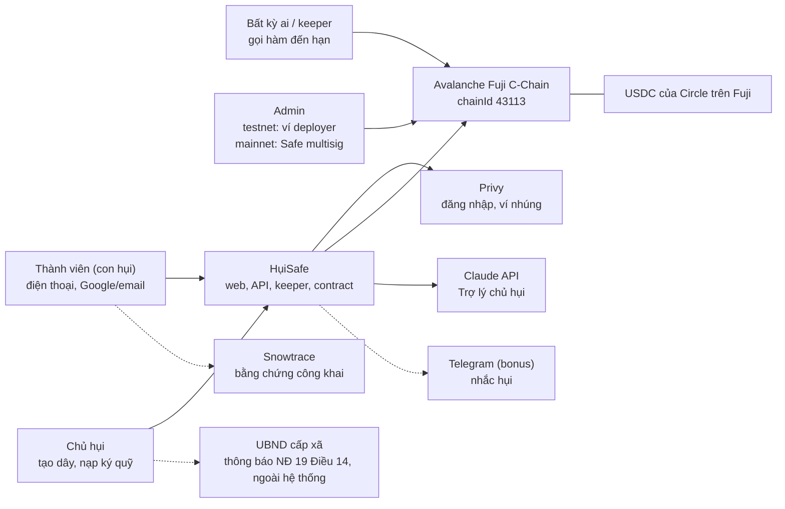

### 1.2. Containers (C4 mức 2)

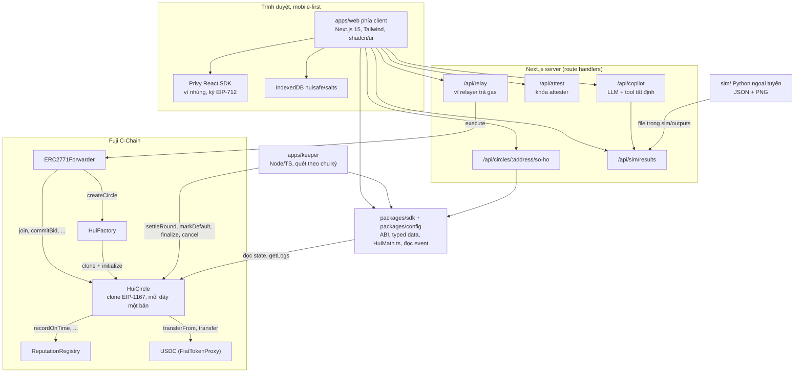

Hai đường ghi lên chuỗi:

- **Đường không tốn gas (mặc định):** người dùng ký `ForwardRequest` (EIP-712), `/api/relay` kiểm rồi gửi `ERC2771Forwarder.execute`. Contract đọc người gọi bằng `_msgSender()`.
- **Đường trực tiếp (dự phòng):** ví có AVAX gọi thẳng contract. Kết quả giống hệt. Keeper luôn đi đường này bằng ví riêng.

---

## 2. Thành phần và trách nhiệm

| Thành phần | Vị trí | Trách nhiệm | Không bao giờ | Quyền, bí mật |
|---|---|---|---|---|
| `HuiFactory` | `contracts/src/HuiFactory.sol` | Tạo clone `HuiCircle`, gọi `initialize`, giữ danh bạ (`allCircles`, `circlesOf`, `isCircle`), đếm `activeCirclesOf`, giữ `FactoryConfig`, chuyển lệnh `pauseCircle`/`unpauseCircle`/`unwindCircle`. Dùng `ERC2771Context` để `createCircle` đi qua relayer | Giữ USDC; đổi tham số dây đã tạo | `admin`: `setConfig`, pause, unwind (sau 48 giờ dừng) |
| `HuiCircle` | `contracts/src/HuiCircle.sol` | Một dây từ Forming tới Completed: ký quỹ, vào dây, thăm kín, `settleRound` kéo-bù-chi, `payLate`, `markDefault`, `repayDebt`, `finalize`, `claim`, `emergencyUnwind`. Phát đúng một event cho mỗi thay đổi | Chuyển tiền cho admin; dùng `Multicall`; ngẫu nhiên | Không có khóa. Chỉ factory gọi `initialize`, `pause`, `unpause`, `emergencyUnwind` |
| `ReputationRegistry` | `contracts/src/ReputationRegistry.sol` | Đếm đúng hạn, trễ, vỡ nợ, trả nợ, hoàn thành theo địa chỉ ví. Chỉ nhận lệnh từ circle có `factory.isCircle(msg.sender)`; biết factory qua `setFactory` gọi một lần lúc deploy | Lưu dữ liệu cá nhân | `admin`: chỉ `setFactory` một lần |
| `HuiMath` | `contracts/src/libraries/HuiMath.sol` | Công thức thuần: `exposure`, `maxExposure`, `holdbackFor`, `releasePerRound`, `coverageIndexBps`, `maxBid`, `lateFee`, `bpsOf`. Bản TS và Python khớp từng đơn vị | Đọc state | Không |
| `ERC2771Forwarder` | OpenZeppelin 5.x, deploy với tên `"HuiSafeForwarder"` | Kiểm chữ ký, nonce, deadline của `ForwardRequest`; gọi đích với địa chỉ người ký nối cuối calldata; chỉ gọi đích tin nó (`isTrustedForwarder`) | Sửa nội dung yêu cầu | Không |
| Relayer API | `apps/web/app/api/relay` | Kiểm đích, selector, `value`, gas, rate limit, `verify`, mô phỏng, rồi gửi bằng ví relayer (05, mục 8.2) | Cầm tiền; tự tạo yêu cầu thay người dùng | `RELAYER_PRIVATE_KEY`, chỉ giữ AVAX trả gas |
| Attest API | `apps/web/app/api/attest` | Xác minh token Privy, một người một ví, tự xác nhận 18+, ký `MemberAttestation` (05, mục 8.1) | Ghi dữ liệu cá nhân lên chuỗi; lưu email | `ATTESTER_PRIVATE_KEY`, secret tạo `attestationId` |
| Copilot API | `apps/web/app/api/copilot` | Gọi Claude API với 6 tool tất định (05, mục 12); trả lời có dẫn điều luật và câu miễn trừ | Ký, chuyển tiền, tự tính số | `ANTHROPIC_API_KEY` |
| Sổ họ, kết quả mô phỏng | `app/api/circles/[address]/so-ho`, `app/api/sim/results` | Dựng sổ họ JSON/PDF từ event; trả file JSON có sẵn của phòng mô phỏng | Ghi dữ liệu | Không |
| Keeper | `apps/keeper` | Quét dây Active; gọi `settleRound`, `markDefault`, `finalize`, `cancel` khi đến hạn; nhắc hụi (bonus). Mô phỏng `eth_call` trước, idempotent | Có quyền đặc biệt | Khóa keeper riêng, chỉ giữ AVAX |
| SDK | `packages/sdk` | ABI sinh tự động; đọc state + event thành `CircleView`; typed data; ký permit; `relay`; salt; `huiMath`; sổ họ; quy đổi NĐ 19 | Giữ khóa | Không |
| Config | `packages/config` | Chain Fuji, địa chỉ đọc từ `fuji.json`, hằng số demo | | Không |
| Web | `apps/web` | Giao diện tiếng Việt: tạo dây, vào dây, thăm, theo dõi kỳ, trả trễ, sổ họ, `/lab`; nhãn "Chế độ demo" | Gửi salt lên server | `NEXT_PUBLIC_PRIVY_APP_ID` |
| Phòng mô phỏng | `sim/` | Monte Carlo ngoại tuyến có seed; sinh JSON/PNG cho `/lab`, trợ lý, pitch ([08](08-phong-mo-phong.md)) | Chạy trong luồng tiền thật | Không |

---

## 3. Sơ đồ tuần tự

Ký hiệu: "qua relayer" nghĩa là người dùng ký `ForwardRequest`, `/api/relay` kiểm tra, mô phỏng, rồi gửi `ERC2771Forwarder.execute`.

### 3.1. Tạo dây và nạp ký quỹ

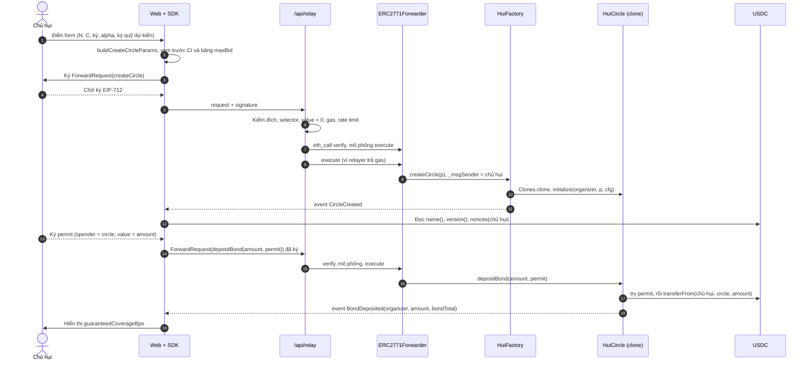

### 3.2. Vào dây (Privy → attest → permit → relay)

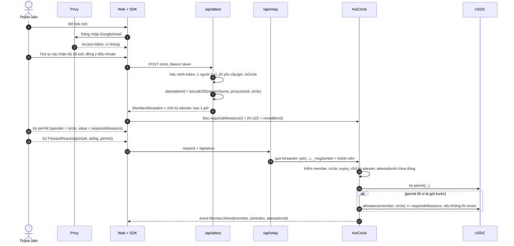

### 3.3. Bỏ thăm kín (commit) và mở thăm (reveal)

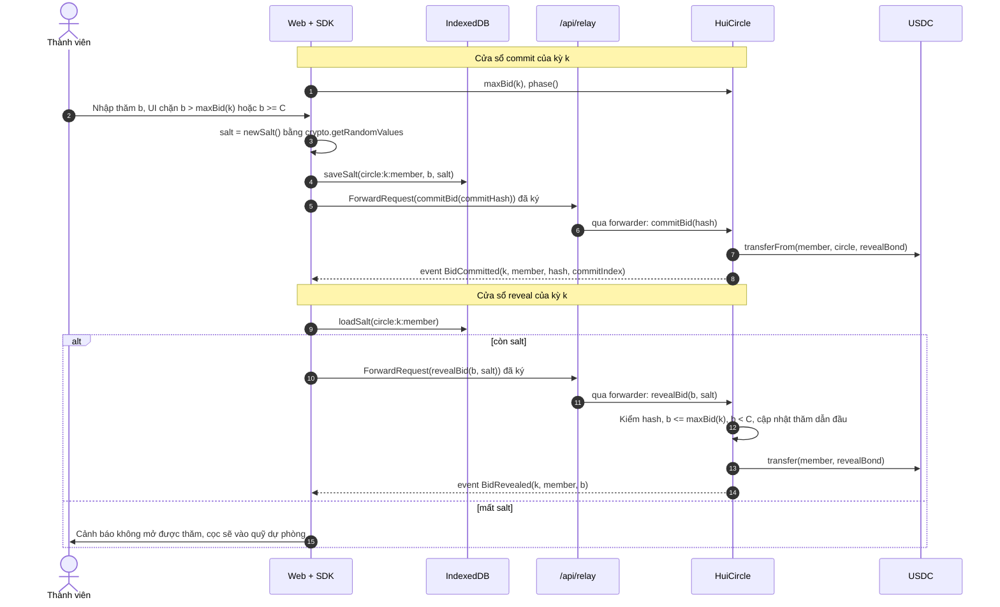

### 3.4. Chi kỳ có khoản thiếu và thác bù

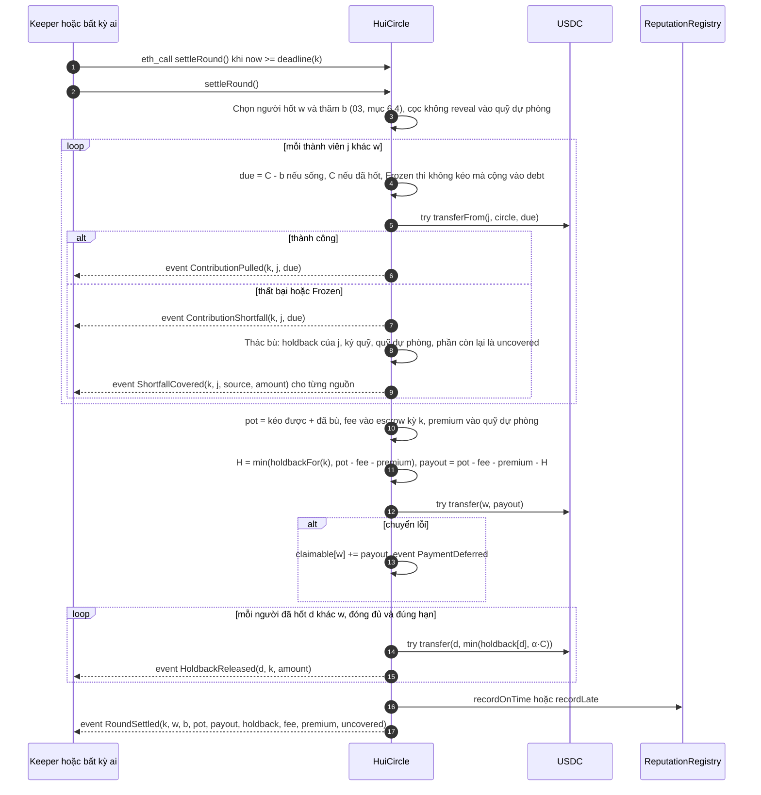

### 3.5. Trả trễ trong ân hạn (`payLate`)

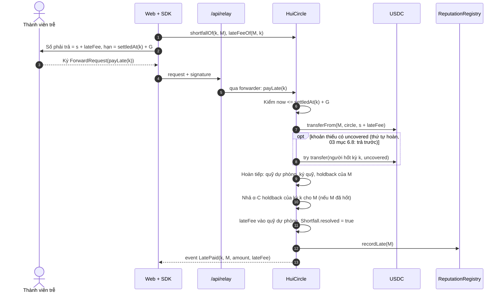

### 3.6. Đánh dấu vỡ nợ (`markDefault`)

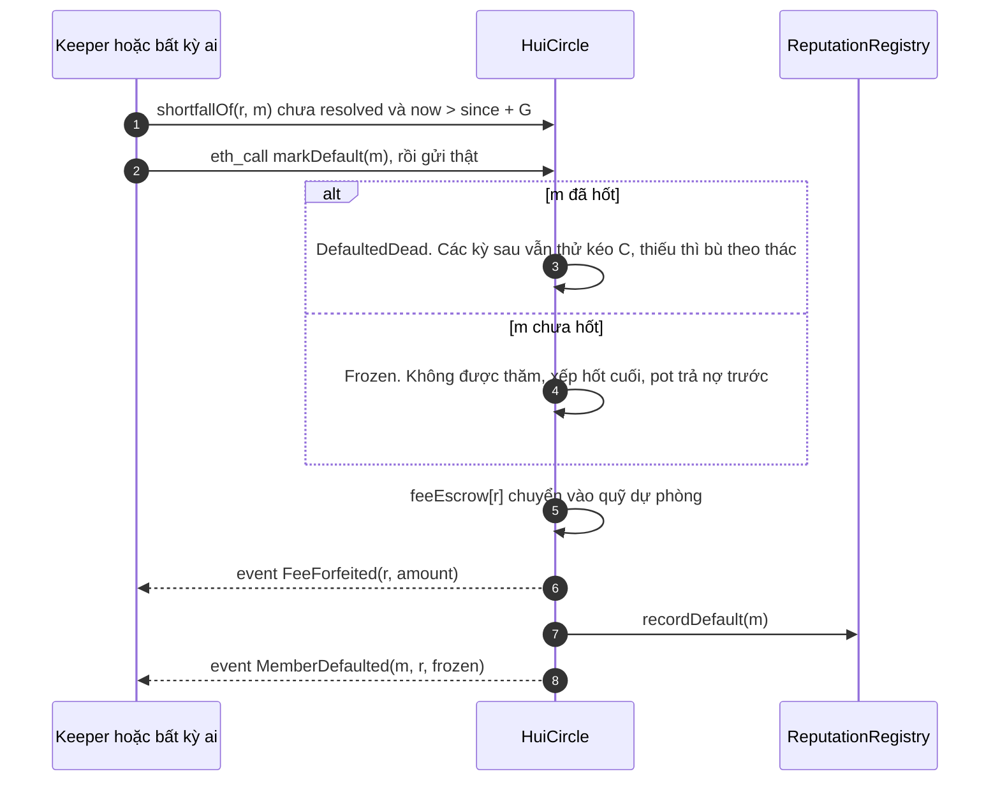

### 3.7. Kết thúc dây (`finalize`)

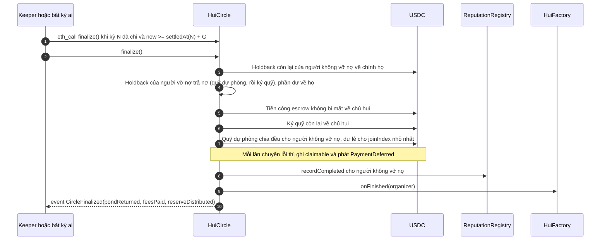

### 3.8. Chi tiền dự phòng (`claim`)

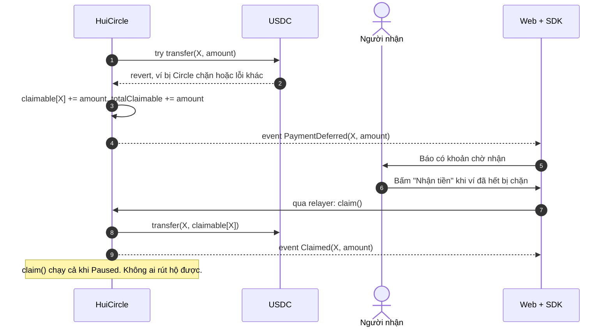

Một giới hạn cần nói rõ: nếu ví bị chặn vĩnh viễn thì tiền nằm trong `claimable` mãi. Không có đường nào cho admin chuyển hộ, đó là chủ ý (INV-07).

---

## 4. Cấu trúc thư mục

Tên khớp 05. Các file đánh dấu "(thêm)" là bổ sung so với bản cấu trúc đầu tiên trong `CLAUDE.md`, không mâu thuẫn với nó.

```
T1VN_Unihack/
├── CLAUDE.md                          # luật cho Claude Code: lệnh chuẩn, tên chuẩn, điều cấm
├── README.md                          # bài toán, cách chạy, địa chỉ Fuji, link demo và Snowtrace
├── package.json                       # script gốc, trường packageManager (pnpm)
├── pnpm-workspace.yaml                # packages/*, apps/*
├── .env.example                       # (thêm) tên biến môi trường, không có giá trị
├── .gitignore                         # bỏ .env*, out/, cache/, broadcast/ của local, node_modules/
├── .claude/
│   ├── settings.json                  # quyền, đăng ký hooks
│   ├── hooks/                         # chặn đọc/ghi file bí mật, chặn broadcast ngoài Fuji, fmt/build sau khi sửa .sol
│   ├── agents/                        # solidity-engineer, test-engineer, security-auditor, frontend-engineer, simulation-analyst, pitch-writer
│   ├── skills/                        # hui-protocol, foundry-fuji, web3-frontend, vn-legal-pitch
│   └── commands/                      # /plan-milestone, /implement, /audit, /deploy-fuji, /demo-check, /sync-abi
├── .github/workflows/ci.yml           # các job ở mục 5.2
├── docs/
│   ├── 00-tong-quan.md                # tổng quan một trang
│   ├── 01-nghien-cuu-nen-tang.md      # nghiên cứu nền: hụi, chit fund, on-chain ROSCA
│   ├── 02-dac-ta-san-pham.md          # PRD, màn hình S01..S15, tiêu chí chấp nhận
│   ├── 03-dac-ta-giao-thuc.md         # luật vận hành, nguồn sự thật
│   ├── 04-kien-truc.md                # file này
│   ├── 05-cau-truc-du-lieu-va-api.md  # kiểu, interface, event, lỗi, API
│   ├── 06-avalanche-va-blockchain.md  # mạng, triển khai, xác minh, L1 bonus
│   ├── 07-ai-agentic.md               # Trợ lý chủ hụi, bộ eval
│   ├── 08-phong-mo-phong.md           # mô hình và thí nghiệm mô phỏng
│   ├── 09-kiem-thu-va-bao-mat.md      # chiến lược test, threat model, runbook
│   ├── 10-phap-ly-va-tuan-thu.md      # NĐ 19/2019, luật Việt Nam
│   ├── 11-ke-hoach-trien-khai.md      # mốc M0..M7, phân vai
│   ├── 12-pitch-demo-nop-bai.md       # pitch, demo, nộp bài
│   ├── 13-tai-lieu-tham-khao.md       # danh mục nguồn
│   └── ai-workflow/                   # 01..03: cách làm việc với Claude Code
├── contracts/
│   ├── foundry.toml                   # solc ghim, evm_version cancun, fuzz/invariant, rpc, etherscan (Routescan)
│   ├── remappings.txt                 # @openzeppelin/contracts/ và forge-std/
│   ├── slither.config.json            # (thêm) filter_paths, exclude_dependencies, detector đã phân loại
│   ├── .gas-snapshot                  # kết quả forge snapshot, CI so sánh
│   ├── snapshots/                     # (thêm) gas theo nhóm do cheatcode ghi
│   ├── lib/                           # forge-std, openzeppelin-contracts 5.x (submodule, ghim tag)
│   ├── src/
│   │   ├── HuiFactory.sol             # clone, danh bạ, cấu hình, pause qua admin, đếm dây theo chủ hụi
│   │   ├── HuiCircle.sol              # một dây hụi: mọi luồng tiền của 03
│   │   ├── HuiCircleBase.sol          # bố cục lưu trữ + hàm chung (chung cho HuiCircle và HuiCircleViews)
│   │   ├── HuiCircleViews.sol         # các hàm view của 05 mục 3.2, chạy qua lens (abstract)
│   │   ├── HuiCircleLens.sol          # triển khai một lần; HuiCircle DELEGATECALL tới đây cho mọi selector view
│   │   ├── ReputationRegistry.sol     # lịch sử đúng hạn, trễ, vỡ nợ, trả nợ, hoàn thành
│   │   ├── libraries/HuiMath.sol      # công thức thuần, có bản TS và Python
│   │   ├── libraries/HuiTypes.sol     # enum, struct dùng chung (05, mục 2)
│   │   ├── interfaces/IHuiFactory.sol
│   │   ├── interfaces/IHuiCircle.sol
│   │   ├── interfaces/IReputationRegistry.sol
│   │   ├── interfaces/IYieldAdapter.sol
│   │   ├── interfaces/IUSDCPermit.sol
│   │   ├── yield/NoYield.sol          # MVP: không sinh lãi
│   │   ├── yield/MockYieldVault.sol   # bonus ERC-4626, lãi giả lập phải khai báo
│   │   └── mocks/MockUSDC.sol         # 6 decimals, EIP-2612, EIP-3009, blacklist giả lập cho test
│   ├── test/
│   │   ├── utils/BaseTest.sol         # (thêm) dựng hệ thống, helper ký attestation, permit, ForwardRequest
│   │   ├── utils/RecordingUSDC.sol    # (thêm) MockUSDC ghi lại mọi lần chuyển, dùng cho INV-04, INV-07
│   │   ├── utils/ReentrantToken.sol   # (thêm) token độc gọi ngược để chứng minh nonReentrant
│   │   ├── unit/HuiMath.t.sol         # từng hàm HuiMath, bảng maxBid, Bản án 48/2024
│   │   ├── unit/HuiFactory.t.sol      # createCircle, InvalidParams 1..13, setConfig, pause
│   │   ├── unit/HuiCircleForming.t.sol # depositBond, join, leave, activate, cancel, withdrawBond
│   │   ├── unit/HuiCircleBidding.t.sol # commitBid, revealBid, chia hòa, biên cửa sổ
│   │   ├── unit/HuiCircleSettle.t.sol # settleRound, thác bù, Frozen, Fixed, claimable
│   │   ├── unit/HuiCircleLate.t.sol   # payLate, markDefault, repayDebt, lateFee với timeScale
│   │   ├── unit/HuiCircleEnd.t.sol    # finalize, claim, pause, emergencyUnwind
│   │   ├── unit/ReputationRegistry.t.sol # chỉ circle hợp lệ được ghi
│   │   ├── unit/Forwarder.t.sol       # _msgSender đúng, sửa data thì chữ ký hỏng, không có multicall
│   │   ├── fuzz/HuiMath.fuzz.t.sol    # biên, đơn điệu, không tràn
│   │   ├── fuzz/Settle.fuzz.t.sol     # thăm và người thiếu tiền ngẫu nhiên, kiểm INV-05
│   │   ├── fuzz/Differential.t.sol    # đọc test/vectors/huimath.json, so với HuiMath
│   │   ├── invariant/Handler.sol      # tác nhân, hành động, biến ghost
│   │   ├── invariant/Invariants.t.sol # INV-01..INV-09
│   │   ├── integration/WorkedExample.t.sol # số của 03, mục 8, nhánh A và B
│   │   ├── integration/GasBudget.t.sol # (thêm) gas settleRound và finalize ở N = 30
│   │   └── vectors/huimath.json       # (thêm) vector differential do sim sinh, có commit
│   ├── script/Deploy.s.sol            # forwarder, registry, implementation, factory; ghi deployments
│   ├── script/CreateDemoCircle.s.sol  # dây demo 5 người, tham số demo
│   ├── script/EmergencyPause.s.sol    # (thêm) pause, unpause, unwind qua factory; khóa đọc bằng vm.envUint (09 mục 13)
│   └── deployments/fuji.json          # địa chỉ đã deploy (05, mục 6.2); local.json không commit
├── packages/
│   ├── sdk/
│   │   ├── package.json               # script generate = wagmi generate
│   │   ├── wagmi.config.ts            # plugin foundry, đọc contracts/out
│   │   ├── src/generated.ts           # ABI sinh tự động, không sửa tay
│   │   ├── src/client.ts              # readCircle, listCircles
│   │   ├── src/events.ts              # getCircleEvents, getLogs theo đoạn block
│   │   ├── src/views.ts               # CircleView, RoundView, MemberView, ShortfallView
│   │   ├── src/typedData.ts           # attestationTypes, permitTypes, forwardRequestTypes, huiSafeDomain
│   │   ├── src/permit.ts              # signPermit, domain đọc name()/version() lúc chạy
│   │   ├── src/relay.ts               # relay, requestAttestation
│   │   ├── src/commit.ts              # commitHash, newSalt, saveSalt, loadSalt
│   │   ├── src/huiMath.ts             # HuiMath bằng bigint
│   │   ├── src/soHo.ts                # dựng sổ họ từ event (05, mục 10)
│   │   ├── src/ndc19.ts               # vndPerRound, cờ NĐ 19 Điều 14
│   │   ├── src/index.ts               # export công khai
│   │   └── test/                      # vitest: vector HuiMath, commitHash, dựng view
│   └── config/
│       ├── src/chains.ts              # FUJI (05, mục 6.1), RPC dự phòng
│       ├── src/addresses.ts           # đọc contracts/deployments/fuji.json
│       ├── src/constants.ts           # tham số demo, tỷ giá 26.000, ngưỡng 100 triệu
│       └── src/index.ts
├── apps/
│   ├── web/
│   │   ├── next.config.ts             # header bảo mật, CSP
│   │   ├── app/layout.tsx             # PrivyProvider, WagmiProvider, QueryClientProvider, DemoModeBanner
│   │   ├── app/page.tsx               # S01 đăng nhập, S02 dây của tôi
│   │   ├── app/circles/new/page.tsx   # S03 tạo dây, S13 trợ lý
│   │   ├── app/circles/[address]/page.tsx       # S04, S06..S10, S12 theo trạng thái dây và kỳ
│   │   ├── app/circles/[address]/join/page.tsx  # S05 trang mời, vào dây
│   │   ├── app/circles/[address]/so-ho/page.tsx # S11 sổ họ
│   │   ├── app/settings/page.tsx      # S14 cỡ chữ, sao lưu thăm, nhắc hụi
│   │   ├── app/lab/page.tsx           # phòng mô phỏng
│   │   ├── app/api/relay/route.ts     # 05, mục 8.2
│   │   ├── app/api/attest/route.ts    # 05, mục 8.1
│   │   ├── app/api/copilot/route.ts   # 05, mục 8.4
│   │   ├── app/api/circles/[address]/so-ho/route.ts # 05, mục 8.3
│   │   ├── app/api/sim/results/route.ts # 05, mục 8.5
│   │   ├── components/CoverageBadge.tsx    # Chỉ số bảo chứng kèm lời giải thích
│   │   ├── components/CreateCircleForm.tsx # form tạo dây, báo lỗi theo mã InvalidParams
│   │   ├── components/RoundTimeline.tsx    # mốc commit, reveal, settle, đếm ngược
│   │   ├── components/BidPanel.tsx         # nhập thăm, chặn vượt trần, sao lưu thăm
│   │   ├── components/MemberTable.tsx      # live, dead, frozen, defaultedDead, uy tín
│   │   ├── components/WaterfallView.tsx    # nguồn bù của từng khoản thiếu
│   │   ├── components/LatePayCard.tsx      # số phải trả, hạn ân hạn
│   │   ├── components/SettleButton.tsx     # chi kỳ thủ công khi keeper chậm
│   │   ├── components/ClaimCard.tsx        # khoản chờ nhận
│   │   ├── components/DemoModeBanner.tsx   # nhãn "Chế độ demo"
│   │   ├── components/Nd19Notice.tsx       # cảnh báo Điều 14, mẫu thông báo UBND
│   │   ├── components/CopilotPanel.tsx     # khung chat trợ lý
│   │   ├── lib/env.ts                 # đọc và kiểm biến môi trường, tách server/client
│   │   ├── lib/wagmi.ts               # cấu hình wagmi, transport fallback
│   │   ├── lib/privy.ts               # cấu hình Privy, chain Fuji
│   │   ├── lib/server/relayer.ts      # ví relayer, allowlist, mô phỏng
│   │   ├── lib/server/attester.ts     # ký MemberAttestation
│   │   ├── lib/server/rateLimit.ts    # hạn mức theo người, IP, tổng gas ngày
│   │   ├── lib/server/log.ts          # log JSON có requestId, che bí mật
│   │   ├── lib/copilot/tools.ts       # 6 tool tất định
│   │   ├── lib/i18n/vi.ts             # chuỗi giao diện tiếng Việt
│   │   └── tests/e2e/                 # (tùy chọn) Playwright
│   └── keeper/
│       ├── src/index.ts               # vòng quét: 15 giây demo, 5 phút bản thật
│       ├── src/chain.ts               # viem client, transport fallback, ví keeper
│       ├── src/jobs/settle.ts         # settleRound khi now >= deadline
│       ├── src/jobs/markDefault.ts    # markDefault khi quá ân hạn
│       ├── src/jobs/finalize.ts       # finalize khi kỳ N xong và qua ân hạn
│       ├── src/jobs/cancel.ts         # cancel khi Forming quá joinDeadline
│       ├── src/jobs/reminders.ts      # bonus: nhắc hụi qua Telegram
│       └── src/log.ts                 # log JSON từng hành động
└── sim/
    ├── pyproject.toml                 # Python 3.11+ (3.12 nếu dùng Mesa), numpy, pandas, matplotlib, pytest
    ├── huisim/__init__.py
    ├── huisim/math.py                 # HuiMath bằng int, khớp Solidity
    ├── huisim/model.py                # mô phỏng một dây, vòng lặp kỳ
    ├── huisim/policies.py             # ba thiết kế, mô hình thăm, hành vi chủ hụi
    ├── huisim/scenarios.py            # đọc và kiểm cấu hình, sinh lưới quét
    ├── huisim/metrics.py              # sáu chỉ số (05, mục 11.2)
    ├── huisim/cli.py                  # run, sweep, vectors; ghi JSON và PNG
    ├── scenarios/                     # baseline.json và các kịch bản ở 08
    ├── tests/                         # pytest: toán, ví dụ chạy tay, kiểm tra hợp lý
    └── outputs/                       # <id>.json, <id>.meta.json, *.png
```

---

## 5. Pipeline

### 5.1. Vòng làm việc hằng ngày

1. Đổi luật thì sửa theo thứ tự: 03, rồi 05, rồi test, rồi code (03, cuối file).
2. Viết test trước cho đường tiền. Không merge đường tiền thiếu test (09).
3. Sửa `.sol` xong, hook chạy `forge fmt` và `forge build`.
4. Chạy `forge test -vvv`, rồi `forge test --match-path "test/invariant/*"`.
5. Đổi interface thì chạy `pnpm --filter sdk generate` (lệnh `/sync-abi`).
6. Chạy `pnpm -r lint` và `pnpm -r typecheck`.
7. Thử tay trên máy:

```bash
anvil --block-time 1
cd contracts && forge script script/Deploy.s.sol --rpc-url http://127.0.0.1:8545 --broadcast
pnpm --filter web dev
pnpm --filter keeper start
```

`Deploy.s.sol` thấy `block.chainid == 31337` thì deploy `MockUSDC` và ghi `deployments/local.json`. Trên 43113 thì dùng USDC của Circle và ghi `fuji.json`.

8. Mở PR. CI xanh. Thay đổi đường tiền phải qua `/audit` (subagent security-auditor, 09 mục 14). Rồi mới merge.

### 5.2. CI (GitHub Actions)

| Job | Việc | Chặn merge khi |
|---|---|---|
| `contracts` | `forge fmt --check`, `forge build --sizes --skip "test/**" --skip "script/**"` (harness test vượt 24.576 byte là bình thường), test trừ invariant, `forge snapshot --check`, `forge coverage --report summary --ir-minimum` (cần vì `via_ir`) | fmt sai, contract quá 24.576 byte, test đỏ, gas tăng |
| `invariant` | `forge test --match-path "test/invariant/*"` với profile `ci` | invariant hỏng |
| `slither` | `crytic/slither-action` với `fail-on: high` | có phát hiện mức cao |
| `web` | build contracts, `pnpm --filter sdk generate`, kiểm ABI không lệch, lint, typecheck, test, build | ABI chép tay lệch, lỗi kiểu |
| `sim` | `pytest`, chạy thử baseline nhỏ, sinh lại vector và so với bản commit | vector lệch với HuiMath |
| `privacy` | Quét ABI: không có tham số `string` trong event và hàm ghi | xuất hiện chỗ có thể chứa dữ liệu cá nhân |

Chi tiết từng job:

- `contracts` và `invariant` chạy với `FOUNDRY_PROFILE=ci` trong `contracts/`; checkout kèm `submodules: recursive`. Lệnh của `contracts`: `forge fmt --check`, `forge build --sizes --skip "test/**" --skip "script/**"`, `forge test -vvv --no-match-path "test/invariant/*"`, `forge snapshot --check`, `forge coverage --report summary --ir-minimum`.
- `web` tự chạy `forge build` để có `contracts/out`, rồi `pnpm install --frozen-lockfile`, `pnpm --filter sdk generate && git diff --exit-code packages/sdk/src/generated.ts`, `pnpm -r lint`, `pnpm -r typecheck`, `pnpm -r test`, `pnpm -r build`. Node 22; phiên bản pnpm lấy từ trường `packageManager`.
- `sim` dùng Python 3.12: `pip install -e ".[dev]"`, `pytest -q`, `python -m huisim.cli run --scenario baseline --seed 42 --circles 500 --out-dir outputs/ci`, rồi sinh lại vector và `git diff --exit-code contracts/test/vectors/huimath.json`.
- `privacy`: lệnh quét ABI ở 09, mục 8.3.
- Action dùng (theo README từng action, xem 06/11/2026): `actions/checkout@v7`, `actions/setup-node@v7`, `actions/setup-python@v7`, `pnpm/action-setup@v6`, `foundry-rs/foundry-toolchain@v1`, `crytic/slither-action@v0.4.2` (phát hành 16/01/2026) với `target: contracts/`, `fail-on: high`. File YAML đầy đủ đặt ở `.github/workflows/ci.yml`; nếu `docs/ai-workflow/` cũng mô tả CI thì hai nơi phải khớp.

### 5.3. Triển khai lên Fuji

Lệnh, cờ verifier Routescan và checklist ở [06](06-avalanche-va-blockchain.md), mục 6. Luồng:

1. Bốn ví testnet tách vai (ADR-21), nạp AVAX.
2. `Deploy.s.sol` deploy theo thứ tự cố định ở 05 mục 3.3: `ERC2771Forwarder("HuiSafeForwarder")` → `ReputationRegistry(admin)` → implementation `HuiCircle(forwarder)` (constructor gọi `_disableInitializers()`) → `HuiFactory(admin, implementation, config)` → `registry.setFactory(factory)` (chỉ admin, đúng một lần). Sau đó verify (Routescan, ADR-16) và ghi `contracts/deployments/fuji.json` (05 mục 6.2).
3. `pnpm --filter sdk generate`. `packages/config` đọc `fuji.json`, nên web không cần biến môi trường cho địa chỉ.
4. Đặt bí mật cho nền tảng chạy web (mục 7.4), deploy web, chạy keeper, tạo dây demo bằng `CreateDemoCircle.s.sol`, commit `fuji.json`, cập nhật README.

### 5.4. Pipeline dữ liệu: event → SDK → UI và sổ họ

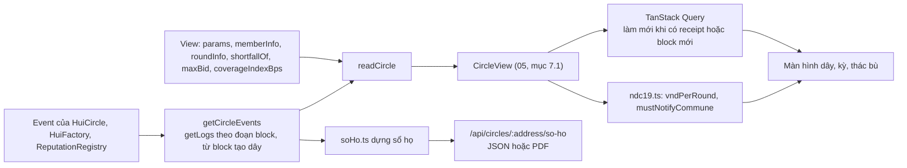

Quy tắc:

- State cho số hiện tại. Event cho lịch sử, sổ họ và giải thích "vì sao". Hai nguồn phải khớp; lệch thì tin state và ghi log cảnh báo.
- Tìm block bắt đầu từ event `CircleCreated`. Chia khoảng block theo giới hạn `eth_getLogs` của RPC đang dùng (cần kiểm tra giới hạn từng nhà cung cấp).
- Coi giao dịch xong khi có receipt đã thực thi. Không chờ tag `finalized` (sau Helicon, tag này trễ khoảng 5 giây, xem 06).
- Số tiền là USDC, kèm quy đổi VND ghi "quy đổi tham khảo".

### 5.5. Pipeline mô phỏng

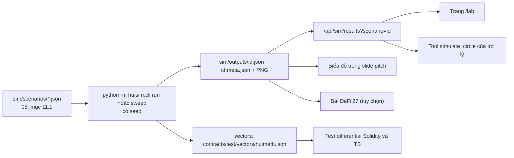

Kết quả mô phỏng là file tĩnh có commit. Web chỉ đọc. Không chạy mô phỏng lúc người dùng đang dùng. Chi tiết ở [08](08-phong-mo-phong.md).

---

## 6. Quyết định kiến trúc (ADR)

ADR-01 đến ADR-15 là các quyết định gốc của thiết kế. ADR-16 trở đi được thêm khi viết kiến trúc.

| Mã | Bối cảnh | Quyết định | Hệ quả |
|---|---|---|---|
| ADR-01 | Luật cuộc thi cấm nhận tiền thật. Giám khảo cần link explorer | Fuji C-Chain, chainId 43113. Mainnet chỉ ở roadmap | Chỉ USDC testnet. AVAX từ faucet là nút thắt cho relayer và keeper |
| ADR-02 | Cần stablecoin native có permit | USDC của Circle trên Fuji `0x5425890298aed601595a70AB815c96711a31Bc65`; test dùng `MockUSDC` | USDC là proxy nâng cấp được, nên domain permit đọc lúc chạy. Có blacklist, nên cần `claimable` |
| ADR-03 | Người chơi hụi không quen ví. BTC dặn không tự build ERC-4337. C-Chain chưa có EIP-7702 | Privy embedded wallet theo starter code của BTC | Đăng nhập phụ thuộc Privy (mục 8). Passkey P-256 là bonus |
| ADR-04 | Người dùng không có AVAX | Meta-transaction ERC-2771 với `ERC2771Forwarder`; góp tiền bằng permit ký một lần | Relayer thành điểm tập trung có thể kiểm duyệt, nên luôn giữ đường gọi trực tiếp. Relayer trả gas, cần hạn mức |
| ADR-05 | Mỗi dây cần state riêng, tạo phải rẻ | Solidity 0.8.x ghim, Foundry, OpenZeppelin 5.x, clone EIP-1167 | Clone dùng `initialize`; implementation phải khóa initializer. Forwarder và tên EIP-712 là immutable nằm trong code implementation, mọi clone dùng chung |
| ADR-06 | Lỗ hổng giả mạo địa chỉ ERC2771Context + Multicall, OpenZeppelin công bố 07/12/2023 | Không contract nào vừa có `ERC2771Context` vừa có `Multicall` | Mỗi thao tác là một yêu cầu riêng. CI kiểm không có selector `multicall` |
| ADR-07 | Dây nhỏ (N ≤ 30, tối đa 30 kỳ), 15 ngày làm | Không indexer; SDK đọc state + `getLogs` bằng viem. Ponder là bonus | Tải lịch sử dài thì chậm; chấp nhận được ở quy mô MVP |
| ADR-08 | Stack BTC gợi ý, người dùng dùng điện thoại | Next.js 15 App Router, TypeScript, Tailwind, shadcn/ui, wagmi v2, viem v2, TanStack Query, Privy | Một codebase cho UI và API |
| ADR-09 | Cần relayer, attester, copilot nhưng không muốn thêm server | Route handlers trong Next.js + `apps/keeper` riêng | Route handler không chạy nền, nên việc theo lịch nằm ở keeper |
| ADR-10 | Fuji không có Aave. Luật cuộc thi yêu cầu nói rõ nguồn lãi | MVP `NoYield`; bonus `MockYieldVault` ERC-4626; mainnet adapter Aave v3 | Không có lãi thật trong demo; lãi giả lập phải khai báo |
| ADR-11 | Cần bằng chứng định lượng, luật cấm ngẫu nhiên trong sản phẩm | Python 3.11+, numpy, pandas, matplotlib; Mesa tùy chọn; ngẫu nhiên chỉ ngoại tuyến | Kết quả là file tĩnh có seed, tái lập được |
| ADR-12 | Luật agent của BTC: LLM không quyết chuyển tiền | Trợ lý chỉ đọc và tính bằng tool tất định | Không có tool ký. Lỗi LLM không chạm tới tiền |
| ADR-13 | "Tests are mandatory on the money paths" | Unit, fuzz, invariant, Slither, differential ba ngôn ngữ | CI chậm hơn; đổi lại bằng chứng cho 25 điểm Kỹ thuật |
| ADR-14 | Ba ngôn ngữ, nhiều gói | Monorepo pnpm workspaces | Một lệnh cài, một CI |
| ADR-15 | Đội Việt, giám khảo Việt, công cụ AI làm tốt nhất với tiếng Anh | Code, biến, commit tiếng Anh; tài liệu và UI tiếng Việt | Tên chuẩn trong 05 không dịch |
| ADR-16 | Etherscan báo ngừng hỗ trợ API cho Fuji từ 15/11/2026 | Xác minh contract qua API kiểu Etherscan của Routescan (Snowtrace) | Cờ `--verifier-url` riêng; xem 06, mục 6 |
| ADR-17 | Ghi chú nghiên cứu chỉ xác nhận các EIP Cancun trên C-Chain (ACP-131) | Đặt `evm_version = "cancun"` trong `foundry.toml` | Tránh opcode mới hơn; cần kiểm tra lại nếu Avalanche công bố thêm EIP |
| ADR-18 | Sổ họ phải là bằng chứng (NĐ 19 Điều 12, 13) | UI và sổ họ dựng từ event, mỗi thay đổi một event | Không có database để lệch với chuỗi |
| ADR-19 | Relayer trả gas cho yêu cầu của người lạ | Kiểm rồi mới gửi: allowlist đích và selector, `value = 0`, gas ≤ 3.000.000 (riêng `settleRound` ≤ 5.000.000), rate limit, `verify`, mô phỏng | Yêu cầu sai bị chặn trước khi tốn gas. Relayer không có quyền gì trên chuỗi |
| ADR-20 | Ba bản HuiMath phải khớp từng đơn vị | Vector JSON do sim sinh, có commit; Solidity đọc bằng `vm.readFile`, TS đọc bằng vitest | Không cần `ffi = true` trong Foundry |
| ADR-21 | Nhiều tiến trình cùng gửi giao dịch | Mỗi vai một khóa: deployer, relayer, attester, keeper | Không đụng nonce giữa relayer và keeper; lộ một khóa không kéo theo vai khác |

---

## 7. Yêu cầu phi chức năng

### 7.1. Gas

| Hàm | Ngân sách | Đo bằng |
|---|---|---|
| `settleRound` N = 30, trường hợp xấu nhất | ≤ 3.000.000 gas; cảnh báo từ 2.500.000 | `test/integration/GasBudget.t.sol` + `forge snapshot --check` |
| `settleRound` N = 5 (demo) | ≤ 600.000 gas | như trên |
| `finalize` N = 30 | ≤ 2.500.000 gas | như trên |
| `join` | ≤ 250.000 gas | `.gas-snapshot` |
| `commitBid` / `revealBid` | ≤ 120.000 / ≤ 100.000 gas | `.gas-snapshot` |
| `createCircle` | ≤ 500.000 gas | `.gas-snapshot` |

Trường hợp xấu nhất của `settleRound` ở N = 30 là kỳ cuối: 29 lần `transferFrom`, 28 lần nhả holdback, 29 lần ghi ReputationRegistry, cộng vài khoản thiếu (mỗi khoản thiếu ghi struct `Shortfall` mới). Ước tính thô mỗi thành viên 60.000 đến 90.000 gas, cộng khoảng 200.000 gas cố định, ra khoảng 1,9 đến 2,8 triệu gas. Đây là ước tính, phải thay bằng số đo. Cách giảm nếu vượt: dùng `ReentrancyGuardTransient` (C-Chain có EIP-1153 qua ACP-131, cần kiểm tra), gộp ghi ReputationRegistry, đóng gói struct chặt hơn.

Giới hạn khối: theo ACP-176, sức chứa gas tối đa C = 10·T. Mục tiêu T của C-Chain được nâng lên 2,1 triệu gas/giây (08/2025), nên C khoảng 21 triệu gas (suy ra). Một giao dịch 3 triệu gas nằm trong giới hạn. Kiểm lại bằng `cast block latest gasLimit --rpc-url fuji`. Keeper gửi `settleRound` trực tiếp với gas limit = ước tính × 1,2, trần cứng 5.000.000.

Số đo thực (A3, `HuiCircle` C6): N = 30 kỳ 29 với 3 khoản thiếu tốn 1,68 triệu gas; ca cực đoan N = 30 kỳ 1 mà cả 29 người cùng thiếu tốn khoảng 4,14 triệu gas (mỗi khoản thiếu 100.000 đến 140.000 gas vì ghi `Shortfall` 3 slot và 4 đến 5 event). Quyết định: chấp nhận ca cực đoan, không đóng gói lại storage; `/api/relay` cho phép `gas` đến 5.000.000 riêng với `settleRound` (các hàm khác giữ 3.000.000), keeper dùng trần cứng 5.000.000. Ca này không khóa tiền: ai cũng gửi trực tiếp được. Tương tự, `finalize` N = 30 sạch tốn khoảng 1,1 triệu gas, nhưng nếu 29 người cùng thiếu ở kỳ cuối mà chưa ai gọi `markDefault` (keeper phải gọi trong ân hạn) thì tự đánh dấu 29 người trong `finalize` tốn khoảng 5 triệu gas (A4 audit M-03), vượt ngân sách 2,5 triệu ở trên; `/api/relay` cho `finalize` trần 5.000.000 như `settleRound`.

### 7.2. Độ trễ

- Từ lúc bấm tới lúc có receipt trên Fuji: mục tiêu ≤ 5 giây ở p95.
- `/api/relay` và `/api/attest` tự xử lý (không tính thời gian chuỗi): ≤ 1,5 giây ở p95.
- Keeper chi kỳ chậm nhất 2 chu kỳ quét sau `deadline`: ≤ 30 giây ở chế độ demo, ≤ 10 phút ở bản thật.
- Trang dây tải xong trên điện thoại tầm trung, mạng 4G: ≤ 3 giây (mục tiêu nội bộ).

### 7.3. Riêng tư, bảo mật, khả năng tiếp cận, ngôn ngữ, mobile

- **Riêng tư:** chỉ địa chỉ ví, mã băm, số tiền, mốc thời gian lên chuỗi (INV-10). `attestationId` băm có secret của server nên không đảo ngược được. Biệt danh thành viên chỉ nằm trong localStorage của chủ hụi. Log không chứa email, token, chữ ký đầy đủ.
- **Bảo mật:** threat model và checklist ở [09](09-kiem-thu-va-bao-mat.md). Không hàm nào chuyển tiền cho admin (INV-07).
- **Khả năng tiếp cận (theo [02](02-dac-ta-san-pham.md), mục 7):** WCAG 2.2 AA, tương phản ≥ 4,5:1; chữ thân ≥ 18 px, tùy chọn "Chữ lớn" 22 px; nút ≥ 48 × 48 px; không báo trạng thái chỉ bằng màu; trình đọc màn hình đọc được nút và đếm ngược; tôn trọng `prefers-reduced-motion`. Câu chữ đời thường, không dùng "gas", "permit", "commit" trên màn hình chính (02, mục 8).
- **Tiếng Việt (vi-VN):** mọi chuỗi giao diện ở `lib/i18n/vi.ts`, `lang="vi"`. Số dùng `Intl.NumberFormat('vi-VN')` ("288,48 USDC"). Giờ 24 giờ theo múi giờ máy trên giao diện; sổ họ ghi giờ Việt Nam (05, mục 10). Lỗi contract được giải mã thành câu tiếng Việt theo tên lỗi ở 05, mục 4.2.
- **Mobile-first:** thiết kế cho bề rộng 360 px trước, một hành động chính mỗi màn hình. Không phụ thuộc hover.

### 7.4. Quan sát, log và bí mật

- **Log:** JSON một dòng. Relayer ghi `requestId`, `from`, `to`, selector, gas, kết quả mô phỏng, `txHash`, thời gian xử lý. Keeper ghi `circle`, `round`, hành động, kết quả mô phỏng, `txHash`, `gasUsed`, lỗi đã giải mã. Không bao giờ ghi khóa, chữ ký đầy đủ, access token, email.
- **Cảnh báo:** số dư relayer < 1 AVAX (05, mục 8.2); keeper trễ quá 2 chu kỳ; tỷ lệ lỗi RPC tăng. Kênh: log của nền tảng chạy web, Telegram nếu làm bonus.
- **Bí mật:** chỉ trong `.env.local` (không commit) và biến môi trường của nền tảng deploy. Có `.env.example` chỉ chứa tên. Hook của Claude Code chặn ghi file khóa. Ngoài các biến cơ bản liệt kê trong `CLAUDE.md`, cần thêm: `KEEPER_PRIVATE_KEY` (ADR-21), `ATTESTATION_ID_SECRET` (secret tạo `attestationId`, 05 mục 8.1) và `FUJI_RPC_URL_FALLBACK`. Mọi khóa là ví testnet, nạp tối thiểu. Nghi lộ thì xoay khóa (runbook ở 09, mục 13).

### 7.5. Môi trường

| Môi trường | Chain | USDC | Khóa | Tham số thời gian | Dùng cho |
|---|---|---|---|---|---|
| Unit/fuzz/invariant | EVM của Foundry | `MockUSDC` | `vm.addr` | `vm.warp` | CI, dev |
| Local | Anvil, 31337 | `MockUSDC` | khóa mặc định của Anvil | demo | phát triển giao diện, keeper |
| Fork | `anvil --fork-url $FUJI_RPC_URL` | USDC thật của Fuji | khóa Anvil | demo | thử permit và domain USDC thật |
| Fuji | 43113 | USDC của Circle | 4 ví testnet tách vai | demo cho pitch, bản thật cho dây thử | demo, người dùng thật thử |

Chế độ demo là dev toggle, phải khai báo đầu buổi pitch (03, mục 3.3). Mọi màn hình hiện nhãn "Chế độ demo" khi bật.

---

## 8. Sự cố và cách hệ thống xuống cấp

| Sự cố | Dấu hiệu | Còn chạy được | Cách xử lý |
|---|---|---|---|
| Relayer ngừng hoặc hết AVAX | `/api/relay` lỗi 5xx hoặc báo số dư thấp | Keeper vẫn chi kỳ (kéo tiền bằng allowance đã ký). Người có AVAX gọi trực tiếp | UI hiện nút "Gửi trực tiếp" kèm ước tính gas; ví demo được nạp sẵn ít AVAX. Đội nạp thêm AVAX, khởi động lại |
| Keeper ngừng | Kỳ quá `deadline` chưa chi | Ai cũng gọi được `settleRound`, `markDefault`, `finalize`, `cancel`; chỉ chậm, không mất tiền (03, mục 9) | `SettleButton` hiện khi quá hạn và gửi qua relayer (bốn selector này nằm trong allowlist, 05 mục 8.2), nên người bấm không tốn gas; relayer cũng ngừng thì người có AVAX gửi trực tiếp. Đội chạy keeper từ máy khác |
| Privy ngừng | Không đăng nhập, không ký được | Tiền vẫn chạy: `settleRound` kéo bằng allowance; kỳ không ai thăm thì người sống có `joinIndex` nhỏ nhất hốt với b = 0. Người dùng ví ngoài (Core, MetaMask) vẫn gọi trực tiếp | Tạm dừng vào dây mới (attest cần token Privy). Báo người dùng, chờ Privy |
| RPC giới hạn tần suất | Lỗi 429, timeout | Đọc qua RPC dự phòng | Transport `fallback` của viem với `FUJI_RPC_URL` và `FUJI_RPC_URL_FALLBACK`; thử lại có giãn cách; tăng `staleTime` của TanStack Query; keeper giãn chu kỳ |
| Claude API ngừng | `/api/copilot` lỗi | Các phép tính vẫn có | Hiện thẳng kết quả tool tất định, không có lời giải thích |
| Fuji chậm hoặc sự cố | Không có receipt | Dây trên chuỗi không mất gì | Demo bằng Anvil local và video dự phòng; không hứa thời gian |
| Lộ khóa attester | Attestation lạ xuất hiện | Dây đang chạy không bị ảnh hưởng tiền | Xoay khóa; `setConfig` cho dây mới; dây còn Forming thì cân nhắc `cancel` (09, mục 13) |
| Hết USDC testnet | Faucet Circle giới hạn | Dây đang chạy không ảnh hưởng | Xin sớm, xin BTC qua Telegram; `MockUSDC` trên Fuji chỉ là phương án cuối và phải khai báo |

---

## Nguồn

- OpenZeppelin, Arbitrary Address Spoofing Vulnerability: ERC2771Context Multicall Public Disclosure, 07/12/2023: <https://www.openzeppelin.com/news/arbitrary-address-spoofing-vulnerability-erc2771context-multicall-public-disclosure>
- OpenZeppelin Contracts, `ERC2771Forwarder.sol` v5.0.1: <https://github.com/OpenZeppelin/openzeppelin-contracts/blob/v5.0.1/contracts/metatx/ERC2771Forwarder.sol>; API 5.x (trỏ tới v5.6.1, xem 06/11/2026): <https://docs.openzeppelin.com/contracts/api/metatx>
- Etherscan, Supported Chains (thông báo ngừng hỗ trợ Fuji từ 15/11/2026), xem 06/11/2026: <https://docs.etherscan.io/supported-chains>
- ACP-176: <https://docs.avax.network/docs/acps/176-dynamic-evm-gas-limit-and-price-discovery-updates>; Avalanche, "C-Chain Throughput Increases as Validators Signal Higher Gas Targets", 21/08/2025: <https://docs.avax.network/blog/gas-target-increase>
- README các GitHub Action (xem 06/11/2026): <https://github.com/actions/checkout>, <https://github.com/actions/setup-node>, <https://github.com/actions/setup-python>, <https://github.com/pnpm/action-setup>, <https://github.com/crytic/slither-action/releases>
- Ghi chú nghiên cứu `avalanche_stack_2026.md` (05/11/2026): Helicon, ACP-131, EIP-7702 chưa có trên C-Chain.
