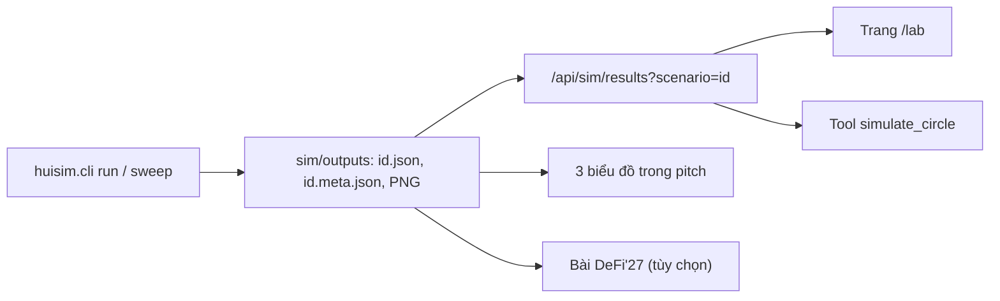

# 08. Phòng mô phỏng

**Mục đích và đọc khi nào.** Phòng mô phỏng tạo bằng chứng định lượng cho một câu hỏi: với cùng một hành vi bỏ đóng, người hốt sau mất bao nhiêu ở hụi truyền thống, ở hụi on-chain "ngây thơ" và ở HụiSafe? Kết quả dùng cho trang `/lab`, tool `simulate_circle` của trợ lý, biểu đồ trong pitch và bài DeFi'27 (tùy chọn). Đọc khi viết code trong `sim/`, khi trích số vào slide, và khi kiểm câu trả lời của trợ lý về rủi ro. Ngẫu nhiên chỉ có ở đây, chạy ngoại tuyến, có seed (ADR-11); sản phẩm không có yếu tố ngẫu nhiên nào. Mọi tham số hành vi là **giả định** và phải được nói rõ là giả định khi trình bày. Schema cấu hình và kết quả ở [05](05-cau-truc-du-lieu-va-api.md), mục 11. Luật kế toán ở [03](03-dac-ta-giao-thuc.md).

---

## 1. Câu hỏi nghiên cứu

1. **Q1.** HụiSafe giảm tổn thất của người hốt sau bao nhiêu so với hụi truyền thống và hụi on-chain ngây thơ?
2. **Q2.** Cần tỷ lệ giữ lại α và ký quỹ bao nhiêu để tổn thất gần 0 với xác suất cao? Đường Chỉ số bảo chứng (CI) = 100% có đúng là ngưỡng không? Ký quỹ cần tăng thế nào theo N?
3. **Q3.** Khi có cú sốc chung (nhiều người cùng bỏ) hoặc nhiều người chưa hốt cùng bị đóng băng, ký quỹ có đủ thanh khoản không, và thiếu hụt tạm thời xảy ra thường đến đâu?

Phương pháp: Monte Carlo dựa trên tác nhân (agent-based). Mỗi kịch bản mô phỏng hàng nghìn dây độc lập. Mỗi dây chạy đúng luật kế toán của 03 bằng số nguyên theo đơn vị nhỏ nhất của USDC, dùng `huisim/math.py` khớp từng đơn vị với `HuiMath`.

---

## 2. Mô hình

### 2.1. Tác nhân và trạng thái

| Tác nhân | Trạng thái | Hành vi ngẫu nhiên |
|---|---|---|
| Thành viên i | `joinIndex`, `received`, `receivedRound`, `defaulted`, `holdback`, `debt`, `lateCount`, kiểu rủi ro (tùy chọn) | Bỏ đóng; bỏ thăm |
| Chủ hụi | Ký quỹ (HụiSafe), ngân sách bù và tiền đang cầm (truyền thống) | Bỏ trốn (truyền thống) |
| Dây | N, C, P, kỳ hiện tại k, quỹ dự phòng, tiền công escrow, các khoản đòi | Cú sốc chung |

Trạng thái thành viên suy ra như 05 mục 2: Live, Dead, Frozen, DefaultedDead.

### 2.2. Bỏ đóng và cách hiệu chỉnh

- **Người đã hốt (Dead).** Mỗi kỳ, trước khi kéo tiền, bỏ đóng với xác suất `deadDefaultHazardPerRound.early` nếu đã hốt ở kỳ `receivedRound ≤ ⌊N/2⌋`, hoặc `.late` nếu hốt muộn hơn. Cách chia sớm/muộn theo nửa dây là giả định của nhóm.
- **Người chưa hốt (Live).** Mỗi kỳ bỏ đóng với xác suất `liveDefaultHazardPerRound` (mặc định 0,003, giả định). Bỏ thì thành Frozen theo 03 mục 6.6.
- **Hấp thụ.** Đã bỏ thì không đóng nữa. Bản đầu không mô hình hóa việc trả trễ trong ân hạn hay trả nợ về sau; đây là giả định bi quan.

**Mốc hiệu chỉnh.** Klonner & Rai (2008), dữ liệu chit fund ở Chennai trước khi áp trần giá thăm năm 1993: người hốt sớm bỏ đóng 2,04%, người hốt muộn 0,59%. Anderson, Baland & Moene (2009) giải thích vì sao: người hốt đầu có động cơ bỏ mạnh nhất, và không có chế tài xã hội thì ROSCA không bền. Hai con số này là tỷ lệ trên mỗi khoản vay (mỗi người hốt) trong cả vòng đời dây, **không phải** xác suất mỗi kỳ.

Cấu hình mẫu ở 05 mục 11.1 đặt `deadDefaultHazardPerRound = { "early": 0.0204, "late": 0.0059 }` và mô phỏng hiểu đó là xác suất **mỗi kỳ**. Dùng nguyên số này là một kịch bản bi quan: với N = 10, người hốt kỳ 1 còn 9 kỳ phải đóng, nên xác suất bỏ trong cả vòng đời là 1 − (1 − 0,0204)^9 ≈ 16,9%, gấp khoảng 8,3 lần mốc 2,04%. Vì vậy có thêm kịch bản `baseline_calibrated`, cùng schema, với hazard quy đổi:

```
h = 1 − (1 − p)^(1/m)          p = tỷ lệ bỏ đóng trọn đời của nhóm, m = số kỳ còn phải đóng trung bình của nhóm
N = 10: sớm m = 7  → h ≈ 0,00294 ;  muộn m = 2 → h ≈ 0,00295
```

Sau quy đổi, hazard mỗi kỳ của hai nhóm gần bằng nhau. Nghĩa là chênh lệch 2,04% so với 0,59% có thể chủ yếu đến từ việc người hốt sớm còn nhiều kỳ phải đóng hơn. Đây là quan sát từ phép quy đổi của nhóm, không phải kết luận của Klonner & Rai; khi trình bày phải nói như vậy. Hàm `calibrate_kr(N, p_early, p_late)` trong `scenarios.py` tính h cho từng N.

### 2.3. Cú sốc chung

Mỗi kỳ, với xác suất `correlatedShock.prob`, mọi hazard của kỳ đó nhân `correlatedShock.multiplier` (chặn trên ở 1). Cú sốc mô tả các sự kiện kéo nhiều người cùng lúc: dịch bệnh, thiên tai, mất việc hàng loạt, mùa Tết. Mặc định prob = 0,02, multiplier = 5 (giả định).

### 2.4. Bỏ thăm dưới trần

- Người đủ điều kiện bỏ thăm: sống, không đóng băng, không còn khoản thiếu (03 mục 6.1).
- Trần mỗi kỳ: `cap = min(maxBid(k), C − 1)` tính bằng `math.max_bid` với `payers` là số người sống phải trả kỳ đó.
- `bidModel = "uniform_fraction_of_cap"` (mặc định ở 05): mỗi người đủ điều kiện bỏ thăm `b = ⌊u · cap⌋`, u ~ U(0, 1).
- `bidModel = "adverse_selection"` (tùy chọn): mỗi thành viên có kiểu rủi ro ẩn; kiểu rủi ro cao vừa có hazard nhân hệ số vừa bỏ thăm cao hơn. Mô hình này tái hiện điều Klonner & Rai ghi nhận: người rủi ro cao trả giá cao để hốt sớm.
- Chọn người hốt tất định như 03 mục 6.4: thăm cao nhất; hòa thì ít lần trễ hơn; vẫn hòa thì commit sớm hơn. Mô phỏng coi thứ tự commit là thứ tự `joinIndex`. Không ai thăm thì người sống có `joinIndex` nhỏ nhất hốt với b = 0. Còn một người sống thì người đó hốt với b = 0.
- Chỉ mô phỏng dây Bỏ thăm. Dây Fixed để sau.

### 2.5. Chủ hụi trong hụi truyền thống

- **Giữ tiền.** Tiền góp vào tay chủ hụi rồi mới chi.
- **Bỏ trốn.** Mỗi kỳ, trước khi chi, bỏ trốn với xác suất `organizerAbscondProbPerRound` (mặc định 0,005, giả định không có số đo). Bỏ trốn thì cầm pot kỳ đó và dây chấm dứt. Người chưa hốt mất phần đã góp; người đã hốt thôi đóng.
- **Bù vỡ nợ.** Nếu `organizerCoversDefaults`, chủ hụi bù khoản thiếu bằng tiền túi, cộng dồn tối đa `organizerCapacityRatio · O_max` (mặc định 0,3). Vượt mức này thì người hốt nhận thiếu. Đây là cách mô hình hóa "khả năng bù có hạn" của NĐ 19 Điều 18 khoản 4 trong thực tế.
- **Tiền công.** Dùng cùng `feeBps` với HụiSafe để so sánh công bằng, nhưng không có escrow: tiền công luôn trả, kể cả kỳ có vỡ nợ.
- Không mô hình hóa việc đòi nợ ngoài chuỗi, cho cả ba thiết kế.

### 2.6. Ba thiết kế

| Thiết kế | Ai giữ tiền giữa các kỳ | Bảo lãnh | Holdback | Quỹ dự phòng | Tiền công |
|---|---|---|---|---|---|
| `traditional` | Chủ hụi | Ngân sách bù hữu hạn, có thể bỏ trốn | Không | Không | Luôn trả |
| `naive_onchain` | Không ai (kéo và chi trong một giao dịch) | Không | α = 0 | 0 | 0 |
| `huisafe` | Không ai, trừ các khoản bị khóa theo luật | Ký quỹ B = `bondRatio` · O_max khóa trong contract | α = `alphaBps` | `reserveBps` | `feeBps`, giữ trong escrow, mất khi có vỡ nợ |

`naive_onchain` chạy đúng luật kế toán của 03 với α = 0, B = 0, `reserveBps` = 0, `feeBps` = 0. So sánh như vậy cô lập đúng giá trị của ba lớp bảo đảm (holdback, ký quỹ, quỹ dự phòng). Biến thể HụiSafe: α ∈ {0, 1000, 2000, 3000, 5000} bps và `bondRatio` ∈ {0; 0,2; 0,4; 0,6; 0,8; 1,0}. Với R = 0, CI = α + `bondRatio` (chặn ở 100%).

---

## 3. Chỉ số

Tên trường đúng 05 mục 11.2. Quy ước:

- **Người trung thực:** không bỏ đóng trong dây đó.
- **Người hốt sau:** hốt ở kỳ k > ⌊N/2⌋.
- **Phần đã góp** `Contrib_i`: tổng tiền i thực sự đã trả vào dây (không tính cọc mở thăm, vì mô phỏng coi mọi người commit đều reveal).
- **Tổn thất** `Loss_i`: phần `uncovered` ở kỳ i hốt mà tới khi kết thúc vẫn chưa được trả lại, cộng phần mất do chủ hụi bỏ trốn (chỉ truyền thống). `LossPct_i = 100 · Loss_i / Contrib_i`.

| Trường | Định nghĩa |
|---|---|
| `lateReceiverExpectedLossPct` | Trung bình `LossPct_i` trên mọi người hốt sau trung thực, mọi dây |
| `lateReceiverP95LossPct` | Phân vị 95 của `LossPct_i` trên cùng tập đó |
| `circleFailureProb` | Tỷ lệ dây có ít nhất một người trung thực nhận thiếu tại lúc chi (kể cả thiếu tạm, sau được trả lại), hoặc có chủ hụi bỏ trốn |
| `uncoveredMeanUsdc` | Trung bình theo dây của tổng `uncovered` còn tồn tại khi kết thúc, tính bằng USDC |
| `bondUsageMeanPct` | HụiSafe: trung bình của mức ký quỹ đã dùng cao nhất trong dây chia cho B. Truyền thống: mức ngân sách bù đã dùng chia cho ngân sách. Naive: không áp dụng |
| `organizerNetReturnPct` | HụiSafe: (tiền công nhận được − ký quỹ không được hoàn) / B. Truyền thống: (tiền công + tiền cầm khi bỏ trốn − tiền đã bù) / ngân sách bù. Naive: không áp dụng |

Trường không áp dụng ghi `null` (quy ước ở 05 mục 11.2). Mỗi tỷ lệ kèm khoảng tin cậy 95% trong file meta (mục 6), vì schema kết quả không có chỗ cho khoảng tin cậy.

---

## 4. Thí nghiệm

| Mã | Kịch bản (file trong `sim/scenarios/`) | Khác baseline ở đâu | Trả lời | Đầu ra chính |
|---|---|---|---|---|
| E1 | `baseline` | Đúng mẫu 05 mục 11.1: N = 10, C = 100, P = 30 ngày, 10.000 dây, seed 42, ba thiết kế | Q1 | `baseline.json`, `baseline_loss.png` (cột tổn thất trung bình và P95 của ba thiết kế) |
| E1b | `baseline_calibrated` | Hazard quy đổi theo mục 2.2 | Q1, giả định sát Klonner & Rai hơn | như E1 |
| E2 | Lưới `grid_N10_a{α}_b{bond}` | α × `bondRatio` = 5 × 6 điểm, N = 10 | Q2 | 30 file JSON; `sweep_alpha_bond_heatmap.png` có vẽ đường α + `bondRatio` = 1 |
| E3 | Lưới `grid_N{N}_a2000_b80` | N ∈ {5, 10, 15, 20, 30}, α = 20%, `bondRatio` = 0,8 | Q2 theo quy mô | `sweep_n_lines.png`; kèm bảng O_max = ⌊N/2⌋·⌈N/2⌉·C |
| E4 | `stress_shock_m5`, `_m10`, `_m20` | `correlatedShock.prob` = 0,1; multiplier 5, 10, 20 | Q3 | `stress_shock.png` |
| E5 | `frozen_liquidity_h1`, `_h3`, `_h5` | `liveDefaultHazardPerRound` 0,01; 0,03; 0,05; hazard người đã hốt = 0 | Q3: thiếu thanh khoản tạm thời khi nhiều người chưa hốt bị đóng băng | `circleFailureProb` (thiếu tạm), `bondUsageMeanPct` |

Mỗi file cấu hình có một bộ tham số, đúng schema 05. Thí nghiệm quét được sinh bằng lệnh `sweep`, mỗi điểm lưới ra một file kết quả riêng cùng schema. `bondRatio` trong tên file nhân 100 và làm tròn (0,8 thành `b80`).

**Giả thuyết cần kiểm (chưa phải kết quả):**

- H1. Khi chỉ người đã hốt bỏ đóng, HụiSafe với CI = 100% có `uncoveredMeanUsdc` = 0 và tổn thất người hốt sau bằng 0 (03 mục 7.3, INV-08).
- H2. Dưới đường α + `bondRatio` = 1, tổn thất tăng dần khi đi xa đường đó; trên đường, tổn thất bằng 0 nếu người chưa hốt không bỏ.
- H3. `naive_onchain` dồn gần hết tổn thất lên người hốt sau.
- H4. Ở `traditional`, rủi ro lớn nhất của người hốt sau là chủ hụi bỏ trốn, không phải người hốt trước bỏ đóng.

Không đưa số nào lên slide trước khi chạy xong và qua mục 7.

---

## 5. Mã nguồn

### 5.1. Bố cục

| File | Việc |
|---|---|
| `sim/huisim/math.py` | `HuiMath` bằng `int`: `exposure`, `max_exposure`, `holdback_for`, `release_per_round`, `coverage_index_bps`, `max_bid`, `late_fee`, `bps_of`. Cùng thứ tự nhân chia và cùng chiều làm tròn với Solidity |
| `sim/huisim/model.py` | `simulate_circle(cfg, design, draws) -> CircleOutcome`: kéo, thác bù, chi, nhả holdback (03 mục 6.5), Frozen (mục 6.6), kết thúc (mục 5.3) |
| `sim/huisim/policies.py` | `Design` cho ba thiết kế, `BidModel`, `OrganizerPolicy` |
| `sim/huisim/scenarios.py` | Đọc và kiểm JSON theo 05 mục 11.1, `calibrate_kr`, sinh lưới quét |
| `sim/huisim/metrics.py` | Gom `CircleOutcome` thành 6 chỉ số và khoảng tin cậy |
| `sim/huisim/cli.py` | Lệnh `run`, `sweep`, `vectors`; ghi `outputs/<id>.json`, `<id>.meta.json`, PNG |
| `sim/tests/` | `test_math.py`, `test_worked_example.py`, `test_sanity.py`, `test_vectors.py`, `test_reproducible.py` |

Python 3.11+ có type hint đầy đủ; numpy, pandas, matplotlib, pytest. Nếu bật Mesa thì cần Python 3.12 (mục 10), nên ghim 3.12 cho cả `sim/` (CI ở 04 mục 5.2 đã dùng 3.12).

### 5.2. Lệnh

```bash
cd sim
python -m huisim.cli run --scenario baseline --seed 42
python -m huisim.cli run --scenario baseline --seed 42 --circles 500 --out-dir outputs/ci     # chạy nhỏ trong CI
python -m huisim.cli sweep --base baseline --alpha 0,1000,2000,3000,5000 --bond 0,0.2,0.4,0.6,0.8,1.0 --N 10 --seed 42
python -m huisim.cli sweep --base baseline --alpha 2000 --bond 0.8 --N 5,10,15,20,30 --seed 42
python -m huisim.cli vectors --seed 7 --out ../contracts/test/vectors/huimath.json
pytest -q
```

`--seed` trên dòng lệnh ghi đè `seed` trong file cấu hình; seed thực dùng ghi vào file meta.

### 5.3. Vòng lặp lõi (giả mã)

```python
def simulate_circle(cfg: Scenario, design: Design, draws: Draws) -> CircleOutcome:
    N, C = cfg.N, cfg.C * USDC                 # USDC = 1_000_000, mọi số tiền là int
    P = cfg.period_days * DAY
    st = State.new(N, C, design)                # huisafe: bond = bondRatio·O_max; traditional: budget
    for k in range(1, N + 1):
        mult = cfg.shock.multiplier if draws.shock[k] < cfg.shock.prob else 1.0
        # 1) Bỏ đóng trước khi kéo tiền kỳ k (hấp thụ)
        for m in st.not_defaulted():
            h = st.hazard(m, k, cfg) * mult     # Dead: early/late theo receivedRound; Live: liveDefaultHazard
            if draws.default[k, m.join_index] < min(h, 1.0):
                st.mark_default(m, k)           # Live -> Frozen, Dead -> DefaultedDead
        # 2) Truyền thống: chủ hụi có thể bỏ trốn trước khi chi
        if design.kind == "traditional" and draws.abscond[k] < cfg.trad.abscond_prob:
            st.abscond(k)                       # người chưa hốt mất phần đã góp
            break
        # 3) Chọn người hốt, tất định như 03 mục 6.4
        cap = min(max_bid(st.cap_bps, N, k, C, P, st.payers(k)), C - 1)
        bids = design.bid_model.bids(st.eligible_bidders(), cap, draws.bid[k])
        w, b = st.choose_winner(k, bids)
        # 4) Kéo và bù như 03 mục 6.5, số nguyên
        pot = 0
        for j in st.members_except(w):
            due = st.due(j, b)                  # C - b nếu sống, C nếu đã hốt
            if st.pays(j):                      # chưa bỏ đóng
                pot += due
                st.mark_on_time(j, k)
            else:                               # bỏ đóng hoặc Frozen: không kéo
                pot += st.cover(j, due, k)      # holdback(j) -> bond/budget -> reserve; phần còn lại là uncovered
        fee = bps_of(pot, design.fee_bps)
        premium = bps_of(pot, design.reserve_bps)
        H = 0 if st.is_frozen(w) else min(holdback_for(design.alpha_bps, N, k, C), pot - fee - premium)
        repay = st.frozen_repayment(w, pot - fee - premium)   # chỉ khi w Frozen, 03 mục 6.6
        payout = pot - fee - premium - H - repay
        st.pay_winner(w, payout, H, fee, premium, k)
        st.release_holdbacks(k, w)              # min(holdback[d], α·C) cho người đã hốt đóng đủ, đúng hạn
    st.finalize()                               # 03 mục 5.3
    return st.outcome()                         # Loss_i, Contrib_i, uncovered, dùng ký quỹ, tiền công
```

Hai quy tắc về người bị đóng băng, đã chốt ở 03 mục 6.6 và 6.8; mô phỏng làm đúng như vậy:

1. Khi pot rơi vào người bị đóng băng f, `frozen_repayment` đi qua các khoản thiếu của f từ kỳ cũ đến kỳ mới, mỗi khoản theo thứ tự hoàn: phần `uncovered` trả cho người hốt kỳ đó trước, rồi quỹ dự phòng, rồi ký quỹ. Hết gốc mới tới lãi chậm góp; phần còn lại về f. Pot không đủ thì dừng ở chỗ hết tiền, phần còn lại thành khoản đòi.
2. Lãi chậm góp của f tính bằng `late_fee` với thời gian trễ là số kỳ danh nghĩa từ kỳ có khoản thiếu tới kỳ f hốt, nhân P.

---

## 6. Tái lập

1. **Một luồng số ngẫu nhiên cho mỗi dây.** `np.random.SeedSequence(seed).spawn(circles)`, mỗi con tạo `np.random.default_rng(child)`.
2. **Rút trước toàn bộ số ngẫu nhiên.** Với mỗi dây, rút sẵn các mảng có kích thước cố định: `default[k, i]`, `bid[k, i]`, `shock[k]`, `abscond[k]`. Ba thiết kế dùng chung đúng các mảng đó (common random numbers). Nhờ vậy cùng một người bỏ đóng ở cùng kỳ trong cả ba thiết kế, và khác biệt giữa thiết kế là do thiết kế, không do nhiễu. Đường đi khác nhau (ví dụ dây truyền thống dừng sớm vì chủ hụi bỏ trốn) cũng không làm lệch số của các thiết kế khác.
3. **Ghim môi trường.** Ghim phiên bản trong `pyproject.toml`; matplotlib dùng backend `Agg`.
4. **File meta.** Kết quả giữ đúng schema 05 mục 11.2. Thông tin còn lại ghi vào `outputs/<id>.meta.json`: seed thực dùng, sha256 của file cấu hình, git commit, phiên bản Python và numpy, số dây, thời gian chạy, khoảng tin cậy 95% của từng chỉ số (Wilson cho xác suất, bootstrap cho trung bình và P95).
5. **Kiểm tái lập.** Chạy lại cùng seed, cùng phiên bản phải ra file JSON giống hệt, trừ `generatedAt` (`test_reproducible.py`).

---

## 7. Kiểm chứng mô hình

1. **Unit test cho `math.py`:** các giá trị chạy tay của 03, ví dụ `max_bid` kỳ 1..4 của dây N = 5 là 6.575.342; 4.931.506; 3.287.671; 1.643.835 đơn vị nhỏ nhất; `late_fee(100 USDC, 1000, 1 ngày danh nghĩa)` = 27.397.
2. **Differential với `HuiMath`:** lệnh `vectors` sinh khoảng 2.000 bộ đầu vào có seed cùng kết quả của Python vào `contracts/test/vectors/huimath.json`. Test Solidity và test TS đọc cùng file và phải ra đúng từng đơn vị (09, mục 6). CI sinh lại file và báo lỗi nếu khác bản đã commit.
3. **Ví dụ chạy tay:** `test_worked_example.py` dựng đúng dây của 03 mục 8 với thăm và người bỏ đóng được cài sẵn, không ngẫu nhiên, rồi so từng con số với bảng kỳ vọng ở 09 mục 5 (cùng bảng mà `WorkedExample.t.sol` dùng). Đây là bằng chứng mô phỏng và contract tính tiền như nhau.
4. **Kiểm tra hợp lý (`test_sanity.py`):**

| Mã | Điều kiện | Kỳ vọng |
|---|---|---|
| S1 | Không ai bỏ đóng | Mọi tổn thất bằng 0; tổng tiền vào bằng tổng tiền ra khi kết thúc |
| S2 | α + `bondRatio` ≥ 1, chỉ người đã hốt bỏ (`liveDefaultHazardPerRound` = 0) | `uncovered` = 0 ở mọi kỳ của mọi dây (INV-08); tổn thất người hốt sau = 0 |
| S3 | `naive_onchain`, hazard người đã hốt > 0 | Tổn thất > 0 và dồn về người hốt sau |
| S4 | Tăng `bondRatio`, giữ seed | `lateReceiverExpectedLossPct` không tăng |
| S5 | Không ai bỏ đóng | Tổng holdback sau kỳ m bằng α·O(m), sai số ≤ N đơn vị (INV-06 khi mọi người đóng đúng hạn) |
| S6 | Mọi dây | Sổ cái khớp ở mọi kỳ, như INV-01 |
| S7 | `traditional` với xác suất bỏ trốn 0 và ngân sách ≥ O_max | Tổn thất người trung thực = 0 khi chỉ người đã hốt bỏ |
| S8 | Tăng số dây gấp 4 | Sai số chuẩn của tổn thất trung bình giảm khoảng một nửa |

Kết quả nào trượt một kiểm tra thì không được dùng.

---

## 8. Kết quả đi đâu



- **Trang `/lab`:** đọc JSON qua `GET /api/sim/results?scenario=<id>` (05 mục 8.5). Hiện biểu đồ PNG, bảng số và một khung "Giả định" luôn mở: hazard, xác suất bỏ trốn, ngân sách bù, nguồn Klonner & Rai, seed, số dây. Nhãn cố định: "Kết quả mô phỏng với tham số giả định, không phải dự báo."
- **Tool `simulate_circle(N, alphaBps, bondRatio)` của trợ lý:** server đọc file `grid_N{N}_a{alphaBps}_b{round(bondRatio·100)}.json`. Chỉ khớp đúng điểm lưới; không có file thì trả `no_results` (07 mục 3.3). Bộ chạy tool chỉ giữ các trường của 05 mục 11.2. Trợ lý đọc nguyên số và nói rõ đây là mô phỏng với giả định. Giao diện gợi ý các điểm lưới có sẵn để chủ hụi chọn.
- **Pitch:** ba biểu đồ. (1) Tổn thất người hốt sau của ba thiết kế (E1, kèm E1b). (2) Bản đồ nhiệt α × ký quỹ có đường CI = 100% (E2). (3) Ký quỹ cần và tổn thất theo N (E3). Mỗi biểu đồ có dòng chú thích giả định và seed.
- **Bài DeFi'27 (tùy chọn):** workshop tại FC 2027; đăng ký tóm tắt 16/11/2026, nộp bài đầy đủ 23/11/2026, 23:59 AoE; định dạng LNCS, tối đa 15 trang không kể tài liệu tham khảo và phụ lục, phản biện ẩn danh hai chiều. Chủ đề có "auction design in adversarial settings" và MEV. Phần phương pháp lấy từ mục 2 đến 7 của file này; báo cáo khoảng tin cậy; công bố code và seed sau khi hết ẩn danh. Lịch chi tiết ở [11](11-ke-hoach-trien-khai.md).

---

## 9. Giới hạn

1. Hazard là giả định. Klonner & Rai đo chit fund do công ty điều hành ở Chennai, có người bảo lãnh và kiện tụng; không phải hụi Việt Nam.
2. Phép quy đổi "trọn đời sang mỗi kỳ" và cách chia sớm/muộn là giả định của nhóm.
3. Không mô hình hóa hành vi chiến lược (bỏ khi có lợi), chế tài xã hội, uy tín giữa các dây, trả trễ trong ân hạn, hay đòi nợ ngoài chuỗi.
4. Xác suất chủ hụi bỏ trốn (0,5% mỗi kỳ) và ngân sách bù (30% O_max) không có số đo; chỉ dùng để so sánh tương đối.
5. Mỗi dây độc lập: không có "hụi chồng hụi" hay lây lan giữa các dây của cùng chủ hụi.
6. Mô hình thăm đơn giản; mọi người commit đều reveal; USDC giữ giá; không có rủi ro hợp đồng hay vận hành.
7. Kết quả là so sánh giữa các thiết kế dưới cùng giả định, không phải dự báo tổn thất thực tế.

---

## 10. Mesa (tùy chọn)

Mesa là framework mô hình dựa trên tác nhân bằng Python. Bản 3.5.2 (28/10/2026) cần Python ≥ 3.12. Lõi `huisim` không cần Mesa: vòng lặp thuần Python với mảng numpy rút sẵn đã đủ và dễ kiểm hơn. Chỉ dùng Mesa nếu còn thời gian và muốn trực quan hóa từng tác nhân:

- `Member(mesa.Agent)` với `__init__(self, model)`; `CircleModel(mesa.Model)` gọi `super().__init__(seed=seed)`; tạo thành viên bằng `Member.create_agents(model=self, n=N)`.
- Không dùng `self.agents.shuffle_do(...)` để quyết thứ tự kéo hay chi tiền, vì luật của sản phẩm tất định. Số ngẫu nhiên vẫn lấy từ các mảng rút sẵn ở mục 6 để giữ common random numbers.
- Kết quả vẫn ghi ra đúng schema 05 mục 11.2.

---

## Nguồn

- Klonner, S. & Rai, A. S. (2008), *Adverse Selection in Credit Markets: Evidence from a Policy Experiment*, working paper: <https://web.williams.edu/Economics/rai/adverse-08-9-1.pdf> (qua ghi chú `rosca_economics_onchain.md`, 05/11/2026).
- Anderson, S., Baland, J.-M. & Moene, K. O. (2009), "Enforcement in informal saving groups", *Journal of Development Economics* 90(1): 14–23: <https://ideas.repec.org/a/eee/deveco/v90y2009i1p14-23.html>
- Mesa trên PyPI, bản 3.5.2 ngày 28/10/2026, Python ≥ 3.12 (xem 06/11/2026): <https://pypi.org/project/Mesa/>; hướng dẫn mô hình đầu tiên: <https://mesa.readthedocs.io/stable/tutorials/0_first_model.html>
- DeFi'27 workshop tại FC 2027 (xem 06/11/2026): <https://fc27.ifca.ai/defi/>
- 05 mục 11 (schema), 03 mục 6 và 7 (luật kế toán, bất biến), 00 (tổng quan) và ADR-11 ở 04.
