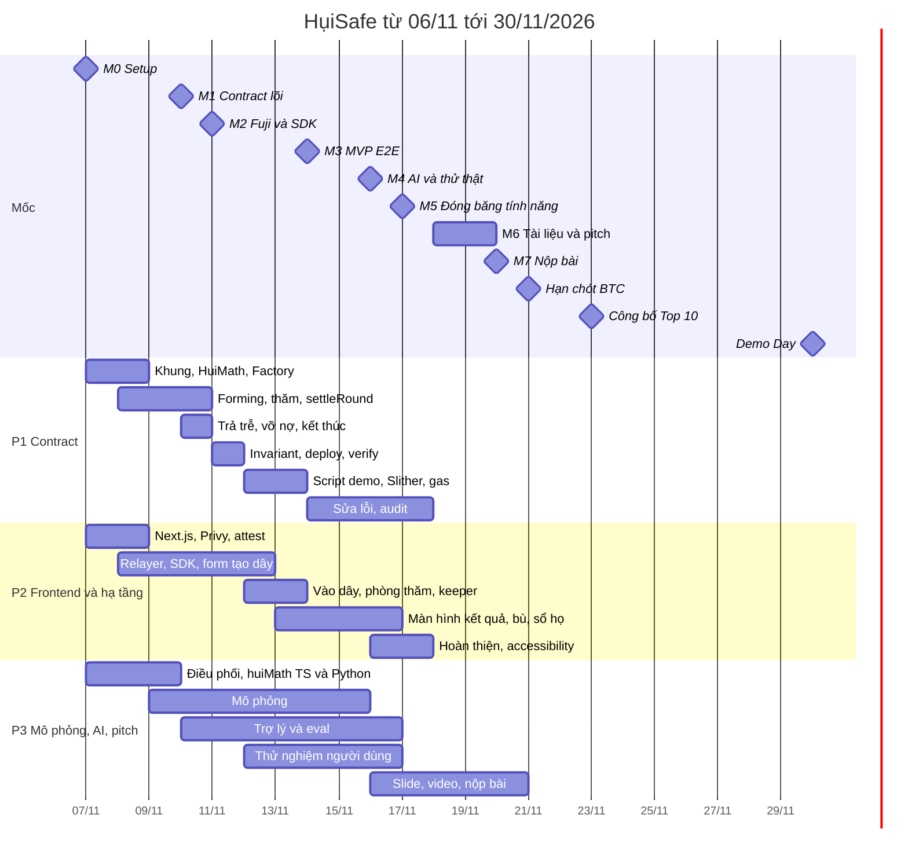

# 11. Kế hoạch triển khai: từ tối 06/11 tới nộp bài và chung kết

**Mục đích và đọc khi nào.** File này là lịch làm việc của đội 3 người từ tối thứ Sáu 06/11/2026 tới Demo Day 30/11/2026: mốc, việc từng ngày, việc từng người, định nghĩa xong, rủi ro, danh sách cắt, Builder Pass, thử nghiệm người dùng và checklist nộp bài. Đọc mỗi tối khi họp nhanh, và mỗi khi định thêm tính năng. Mốc và ngày ở đây là bản chuẩn; muốn đổi thì sửa file này trước, rồi sửa bảng mốc trong `.claude/hooks/session-start.sh` cho khớp. Phạm vi sản phẩm ở [02-dac-ta-san-pham.md](02-dac-ta-san-pham.md) mục 9; kịch bản pitch, demo, nộp bài ở [12-pitch-demo-nop-bai.md](12-pitch-demo-nop-bai.md).

**Giả định năng lực** (cần kiểm tra với lịch học, thi của từng người): mỗi người khoảng 6 giờ ngày thường, 10 giờ cuối tuần. Ước tính giờ dưới đây đã tính việc dùng Claude Code, chưa tính họp.

---

## 1. Mốc chốt

| Mốc | Ngày | Việc phải xong |
|---|---|---|
| M0 Setup | T7 07/11 | Repo khung, CLAUDE.md + `.claude`, ví Fuji có AVAX + USDC testnet, Builder Pass cả đội |
| M1 Contract lõi | T3 10/11 | FIXED + BIDDING, kéo tiền, thác bù, holdback, ký quỹ, quỹ dự phòng; unit + fuzz xanh |
| M2 Fuji + SDK | T4 11/11 | Deploy + verify trên Fuji, ABI vào sdk; invariant xanh; workshop 20:00 |
| M3 MVP E2E | T7 14/11 | Tạo dây, vào dây, thăm, chi, bù vỡ nợ chạy trên Fuji qua web; relayer + keeper |
| M4 AI + thử thật | T2 16/11 | Trợ lý chủ hụi, mô phỏng xong; 5–10 người dùng thật thử trên Fuji |
| M5 Đóng băng tính năng | T3 17/11 | Chỉ sửa lỗi; Slither sạch mức cao; workshop 20:00 |
| M6 Tài liệu + pitch | T4–T5 18–19/11 | README, slide, kịch bản, video v1; office hours 19/11 |
| M7 Nộp | T6 20/11 | Video cuối, nộp trước 22:00; 21/11 dự phòng, kiểm link bằng tab ẩn danh |
| (tùy chọn) Paper | T2 23/11 | Workshop DeFi'27 tại FC 2027: đăng ký tóm tắt 16/11, bài đầy đủ 23/11, giờ AoE (UTC−12), tức 17/11 và 24/11 lúc 18:59 giờ VN ([DeFi'27](https://fc27.ifca.ai/defi/)) |
| Chung kết | 23/11 công bố; T2 30/11 Demo Day 09:00–11:30 | Hội trường tầng 3, tòa Cộng Hòa Garden, Greenwich Việt Nam, 20 Cộng Hòa |

Hạn chót của BTC: **23:59 thứ Bảy 21/11/2026**, hệ thống khóa đúng giờ. Đội nộp 20/11, giữ 21/11 làm ngày dự phòng.

## 2. Gantt



## 3. Kế hoạch từng ngày

| Ngày | P1 Contract | P2 Frontend, ví, relayer, keeper | P3 Mô phỏng, AI, pitch, điều phối | Sự kiện |
|---|---|---|---|---|
| T6 06/11 tối | Đọc 03, 05; tạo ví deployer, attester | Đọc 02, 04, 05; tạo app Privy; tạo ví relayer, keeper | Builder Pass cả đội; bảng Projects; đăng ký Luma; lịch xin faucet | **Builder Pass** |
| T7 07/11 | C1, C2 | W1, W2 | T0; CLAUDE.md, `.claude`, CI; xin USDC | **M0** |
| CN 08/11 | C3, C4 | W3, W4 (trên anvil) | T1 | |
| T2 09/11 | C5, C6 | W6 | T1 xong, T2 | |
| T3 10/11 | C7, C8 | W6, W5 khung | T3, T4 | **M1** |
| T4 11/11 | C9, C10 | `/sync-abi`, W5 | T2, T3 | **M2**, workshop 20:00 |
| T5 12/11 | C11, C12 | W4 trên Fuji, W8, W10 | T5; tuyển người thử | |
| T6 13/11 | C12, sửa lỗi | W7, W9 | T5; tài liệu thử nghiệm (T7) | |
| T7 14/11 | Chạy dây demo nhánh B qua web; sửa lỗi | E2E trên Fuji | Eval lần 1; tập thử nội bộ | **M3** |
| CN 15/11 | Sửa lỗi | W9, W11 | Buổi thử 1 (3–5 người); biểu đồ mô phỏng | |
| T2 16/11 | `/audit`, sửa lỗi | W12; T6 cùng P3 | Buổi thử 2; eval đạt ngưỡng; mô phỏng xong | **M4** |
| T3 17/11 | Slither sạch mức cao | Accessibility, banner demo | Tổng hợp thử nghiệm; nếu làm paper: đăng ký tóm tắt trước 18:59 | **M5**, workshop 20:00 |
| T4 18/11 | README phần contract | README phần app | Slide v1, kịch bản, video v1 | **M6** |
| T5 19/11 | Dựng dây demo, nạp ví | Tập demo và dự phòng | Office hours 20:00; sửa slide, video | Office hours |
| T6 20/11 | Kiểm Fuji, ví demo | Kiểm app, relayer, keeper | Video cuối; form nháp trước 18:00; **Submit trước 22:00** | **M7**, office hours 20:00 |
| T7 21/11 | Trực sửa lỗi | Trực sửa lỗi | Kiểm mọi link bằng tab ẩn danh, điện thoại 4G | Hạn chót 23:59 |
| CN 22/11 – T2 23/11 | Nghỉ | Nghỉ | (tùy chọn) paper, nộp trước 24/11 18:59 | 23/11 công bố Top 10 |
| 24–29/11 | Nạp lại ví; dựng dây demo | Tập demo, dự phòng | Tập pitch, hỏi đáp | Nếu vào Top 10 |
| T2 30/11 | Vận hành máy demo phụ | Vận hành điện thoại demo | Thuyết trình | Demo Day 09:00–11:30 |

## 4. Việc từng người (ước tính)

| Mã | Việc | Giờ | Phụ thuộc |
|---|---|---|---|
| **P1** | | **66** | |
| C1 | Khung Foundry, pin Solidity, OpenZeppelin 5.x, `HuiTypes`, interfaces | 3 | |
| C2 | `HuiMath` + unit, fuzz | 4 | C1 |
| C3 | `HuiFactory` (clone EIP-1167, config, `activeCirclesOf`), `MockUSDC` | 5 | C1 |
| C4 | Forming: `depositBond`, `join` (attestation, permit trong `try`), `leave`, `activate`, `cancel`, `withdrawBond` | 6 | C2, C3 |
| C5 | `commitBid`, `revealBid`, chọn người hốt tất định | 5 | C4 |
| C6 | `settleRound`: kéo tiền, thác bù, tiền công, quỹ dự phòng, holdback, chi, nhả, `claimable` | 8 | C5 |
| C7 | `payLate`, `markDefault`, `repayDebt`, đóng băng, `finalize`, pause, `emergencyUnwind`, ReputationRegistry | 8 | C6 |
| C8 | `test/integration/WorkedExample.t.sol` hai nhánh, đúng số 03 mục 8 | 3 | C7 |
| C9 | Invariant: `Handler.sol`, INV-01..INV-10 | 6 | C7 |
| C10 | `Deploy.s.sol` + `ERC2771Forwarder`, verify, `deployments/fuji.json` | 3 | C7 |
| C11 | `CreateDemoCircle.s.sol`: dựng dây demo với `joinDeadline` dài | 3 | C10 |
| C12 | Slither, gas report `settleRound` (N = 5 và 30), sửa | 4 | C9 |
| C13 | Sửa lỗi từ E2E và `/audit` (dự phòng) | 8 | M3 |
| **P2** | | **70** | |
| W1 | Next.js 15, Tailwind, shadcn/ui, wagmi, viem, `packages/config` | 3 | |
| W2 | Privy (starter code BTC): Google, email, Fuji, `createOnLogin` | 3 | W1 |
| W3 | `/api/attest` | 4 | W2 |
| W4 | `/api/relay` + ví relayer + cảnh báo số dư < 1 AVAX | 5 | C10 (làm trước trên anvil) |
| W5 | SDK: `readCircle`, events, `signPermit`, `relay`, salt IndexedDB, `commitHash` | 6 | C10 |
| W6 | S03 Tạo dây + đồng hồ chỉ số + khung NĐ 19 | 6 | T1 |
| W7 | S04, S05: gom người, mời, vào dây | 6 | W3, W4, W5 |
| W8 | S06 Phòng bỏ thăm, sao lưu thăm | 6 | W5 |
| W9 | S07–S10: kết quả, khoản thiếu, bảo chứng, tiền giữ lại | 8 | W5 |
| W10 | `apps/keeper`: settle, markDefault, finalize, cancel; quét 15 giây (demo) | 5 | C10 |
| W11 | S11 Sổ họ, `/api/circles/[address]/so-ho` JSON, PDF | 5 | W5 |
| W12 | S12, banner demo, accessibility, chữ tiếng Việt | 5 | W9 |
| W13 | Sửa lỗi, đánh bóng (dự phòng) | 8 | M3 |
| **P3** | | **68** | |
| T0 | Điều phối: bảng, Builder Pass, Luma, lịch faucet | 2 | |
| T1 | `huiMath.ts` (bigint) + `sim/huisim/math.py` + bộ vector chung với P1 | 5 | C2 |
| T2 | Mô phỏng: 3 thiết kế, kịch bản baseline và độ nhạy, biểu đồ ([08](08-phong-mo-phong.md)) | 10 | T1 |
| T3 | Server trợ lý: 6 tool, dữ kiện tính sẵn, bộ lọc, bộ kiểm | 8 | T1 |
| T4 | Văn bản `explain_rule` (10 topic), mẫu thông báo UBND | 3 | |
| T5 | System prompt, 30 ca eval, harness | 6 | T3 |
| T6 | Ngăn kéo trợ lý + chế độ máy tính (cùng P2) | 4 | T3, W6 |
| T7 | Thử nghiệm người dùng (mục 11) | 10 | M3 |
| T8 | Slide, kịch bản, hỏi đáp, chữ cho form | 8 | M3 |
| T9 | Video v1 (18/11), video cuối (20/11) | 8 | M3 |
| T10 | README chung, checklist nộp, kiểm link | 4 | M6 |

## 5. Định nghĩa xong từng mốc

- **M0:** cấu trúc repo đúng [04-kien-truc.md](04-kien-truc.md) mục 4; `CLAUDE.md`, `.claude/` (agents, skills, commands, hooks) chạy được; CI chạy `forge build` và `pnpm -r build`; 4 ví vai trò tách riêng (deployer, relayer, attester, keeper; 04 ADR-21) có AVAX; 6 ví demo (chủ hụi, M1..M5); đã bắt đầu gom USDC; app Privy đã tạo; Builder Pass 3/3 người; đã đăng ký Luma các buổi.
- **M1:** đủ các việc của M1 ở mục 1; thêm `WorkedExample.t.sol` hai nhánh xanh với đúng số 03 mục 8 (M4 nhận 288,48; M1 nhận 323,18; ký quỹ còn 160 ở nhánh B).
- **M2:** contract đã verify trên Snowtrace; `deployments/fuji.json` đã commit; `pnpm --filter sdk generate` sinh ABI; INV-01..INV-10 xanh; cả đội dự workshop.
- **M3:** trên Fuji, qua web, không cần AVAX: tạo dây, vào dây (Privy, attest, permit, relay), nộp và mở thăm, chi kỳ, bù khoản thiếu, đánh dấu vỡ nợ, kết thúc; keeper tự chốt kỳ; dây demo nhánh B chạy trọn ít nhất một lần.
- **M4:** trợ lý chạy trong S03 với 6 tool; eval đạt ngưỡng ở [07-ai-agentic.md](07-ai-agentic.md) mục 6.2 hoặc ghi rõ ca trượt; `sim/outputs/` có JSON và biểu đồ; 5–10 người thật đã thử, có số đo và ảnh (có đồng ý).
- **M5:** không nhận tính năng mới; Slither không còn mức high; `security-auditor` không còn Critical, High; banner demo và accessibility đạt US-10, mục 7 của 02.
- **M6:** README đủ (bài toán, kiến trúc, cách chạy, cách chạy test, số test, địa chỉ contract); slide v1; kịch bản demo đã tập 3 lần; video v1; góp ý office hours đã ghi lại.
- **M7:** form đủ mọi trường, đã bấm Submit trước 22:00 20/11; ảnh chụp xác nhận; 21/11 kiểm link lần hai.

## 6. Sổ rủi ro

| # | Rủi ro | Xác suất | Tác động | Giảm thiểu | Người giữ |
|---|---|---|---|---|---|
| R1 | Cám dỗ làm passkey, tự build ERC-4337, EIP-7702 | TB | Cao | ADR-03: BTC dặn không tự build 4337, C-Chain chưa nhận 7702. Passkey chỉ là bonus, chỉ mở khi M4 đạt; sau M5 cấm | P2 (P3 chặn) |
| R2 | Cấu hình Privy sai: phương thức đăng nhập, chain, domain, tạo ví | TB | Cao | Checklist M0: bật Google, email ở dashboard và `loginMethods`; `supportedChains`, `defaultChain` = Fuji; `embeddedWallets.ethereum.createOnLogin: 'users-without-wallets'` (chỉ chạy khi đăng nhập qua modal Privy); thêm mọi domain (localhost, preview, production) vào danh sách được phép (cần kiểm tra tên mục trong dashboard); `landingHeader` ≤ 35 ký tự, `loginMessage` ≤ 100 ký tự; thử trên Android và iOS | P2 |
| R3 | Relayer hết AVAX | TB | Cao | Faucet BTC 0,05 AVAX/lần, mỗi ví 24 giờ một lần và chỉ khi ví < 0,05 AVAX: xin bằng nhiều ví rồi gom; faucet Core với coupon `avalanche-academy`; nhắn Telegram BTC. Cảnh báo < 1 AVAX (05); rate limit 30 request/giờ mỗi ví; `/demo-check` đọc số dư | P2 |
| R4 | RPC Fuji công khai bị giới hạn | TB | TB | Avalanche xác nhận API công khai có rate limit, "quite high" ([support.avax.network, 15/10/2025](https://support.avax.network/en/articles/6159007-what-apis-are-available-on-avalanche)). Keeper quét 15 giây (demo), 5 phút (thật); `getLogs` theo khoảng block nhỏ, có cache; transport `fallback` với `FUJI_RPC_URL_FALLBACK` của nhà cung cấp khác (04 mục 8; nhà cung cấp cần kiểm tra) | P2 |
| R5 | Faucet USDC chỉ 20 USDC mỗi 2 giờ cho mỗi ví, mỗi mạng ([faucet.circle.com](https://faucet.circle.com/)) | Cao | Cao | Một dây demo cần tới 5 × 404 + 480 = 2.500 USDC (cận trên), Demo Day cần ≥ 2 dây. Gom từ M0: mỗi người xin cho mọi ví mỗi 2 giờ khi thức; dây thử nghiệm dùng C = 5 USDC; sau mỗi lần tập chuyển USDC về đúng ví; hỏi BTC; cuối cùng mới dùng `MockUSDC` (ADR-02) và nói rõ khi pitch | P3, P1 |
| R6 | Phình phạm vi | Cao | Cao | Phạm vi ở 02 mục 9; thẻ mới vào Backlog, P3 duyệt; sau 17/11 chỉ nhận lỗi; danh sách cắt (mục 7) | P3 |
| R7 | Câu hỏi pháp lý: cách hiểu Điều 21, Điều 14, chia hòa Điều 20, tiền mã hóa | TB | TB | Chỉ testnet; slide pháp lý theo đúng chữ BTC; ghi "cần luật sư xác nhận"; hỏi mentor 19/11; [10-phap-ly-va-tuan-thu.md](10-phap-ly-va-tuan-thu.md) | P3 |
| R8 | Lỗi contract ở luồng tiền | TB | Rất cao | Unit, fuzz, invariant, WorkedExample, differential `HuiMath`, Slither, `security-auditor`, người review | P1 |
| R9 | Demo live hỏng (RPC, relayer, keeper, Wi-Fi) | TB | Cao | Kế hoạch dự phòng ở 12; đoạn quay sẵn; hotspot 4G | P2 |
| R10 | Người thử mất salt, mất cọc | TB | Thấp | Hộp cảnh báo, sao lưu (US-03); nhắc trong buổi thử | P2 |
| R11 | Trợ lý sai số, API lỗi, hết hạn mức | TB | TB | Bộ kiểm đầu ra, chế độ máy tính, eval ([07](07-ai-agentic.md)) | P3 |
| R12 | Trùng lịch học, thi | Cao | TB | Báo lịch bận trong họp nhanh; làm việc khó sớm; 21/11 dự phòng | Cả đội |
| R13 | Link không mở được lúc chấm (bị loại) | Thấp | Rất cao | Kiểm tab ẩn danh 20/11 và 21/11 | P3 |
| R14 | Gas `settleRound` với N = 30 vượt dự kiến | Thấp | TB | Đo ở C12; demo dùng N = 5 | P1 |
| R15 | Lỡ dùng `Multicall` cùng `ERC2771Context` | Thấp | Rất cao | ADR-06; review; test | P1 |
| R16 | Etherscan ngừng hỗ trợ API cho Fuji từ 15/11/2026: deploy lại sau ngày này không verify được theo cách cũ | TB | TB | Verify xong ở M2 (11/11); deploy lại thì dùng verifier Routescan (04 ADR-16, [06](06-avalanche-va-blockchain.md) mục 6); `/demo-check` mở link Snowtrace của mọi contract | P1 |

## 7. Danh sách cắt khi trễ (cắt theo thứ tự)

1. Paper DeFi'27.
2. "Đấu thăm hộ".
3. Bot nhắc hụi Telegram.
4. Bonus còn lại: `MockYieldVault`, ERC-5192, Ponder, passkey, EIP-3009.
5. PDF sổ họ phía server: thay bằng trang HTML in được, giữ JSON.
6. Giao diện dây Fixed: contract vẫn hỗ trợ và có test; demo chỉ dùng Bỏ thăm.
7. Kịch bản mô phỏng độ nhạy: giữ baseline.
8. Trợ lý: ẩn tool chưa đạt eval, giữ chế độ máy tính. Phải sửa 05 và eval cho khớp.
9. Thử nghiệm còn 5 người thay vì 10.

**Không bao giờ cắt:** test luồng tiền; deploy và verify Fuji; luồng demo (tạo, vào, thăm, chi, bù vỡ nợ); khai báo dev toggle; slide pháp lý và 3 câu hỏi; checklist nộp.

## 8. Họp nhanh hằng ngày (22:00, 15 phút, online)

```text
Họp nhanh dd/mm. Còn N ngày tới M_x. Còn N ngày tới 20/11.
P1: Xong: ... (link PR) | Hôm nay: ... | Vướng: ...
P2: Xong: ... | Hôm nay: ... | Vướng: ...
P3: Xong: ... | Hôm nay: ... | Vướng: ...
Số đo: test xanh x/y | invariant xanh? | lỗi mở n (Critical, High: n)
       USDC Fuji đã gom n | AVAX relayer n | người thử đã hẹn n
Rủi ro mới, thay đổi phạm vi: ...
Quyết định cần chốt (ai, hạn): ...
```

## 9. Bảng GitHub Projects

- **Cột:** Backlog → Sẵn sàng (có đặc tả, có ước tính) → Đang làm (tối đa 2 thẻ mỗi người) → Chờ review (PR mở, CI xanh) → Kiểm trên Fuji → Xong.
- **Trường:** Người làm (P1, P2, P3); Mốc (M0..M7); Ước tính (giờ); Mức (Bắt buộc, Nên có, Bonus; không dùng chữ "P0, P1" để khỏi lẫn với tên người); Khu vực.
- **Nhãn:** `area/contracts`, `area/web`, `area/keeper`, `area/sdk`, `area/sim`, `area/ai`, `area/pitch`, `type/bug`, `type/feature`, `money-path` (bắt buộc P1 review và có test), `cut-candidate`.
- **Luật:** sau 17/11 chỉ nhận thẻ `type/bug`; P3 sắp thứ tự mỗi tối sau họp.

## 10. Builder Pass: cả 3 người, hạn ngay tối nay 06/11

Khoảng 15 phút mỗi người. Thiếu một nhiệm vụ là mất suất bốc thăm (50 người × 10 USD, công bố 30/11). Mỗi người một email Google đã xác minh. Ví nhận thưởng là địa chỉ Avalanche C-Chain `0x…` của ví cá nhân, không dùng ví deployer, relayer, attester; gửi nhầm không lấy lại được; BTC ghi "cách trả có thể thay đổi".

| # | Nhiệm vụ | Cách làm | P1 | P2 | P3 |
|---|---|---|---|---|---|
| 1 | Tham gia Avalanche Builder Hub | `go.team1.network/vietnam-builder` → `build.avax.network`, đăng ký sự kiện, nhập email hoặc username Builder Hub vào trang Builder Pass | [ ] | [ ] | [ ] |
| 2 | Vào nhóm Telegram Builders | `t.me/Team1VNbuilders`, nhập @username | [ ] | [ ] | [ ] |
| 3 | Follow @Team1VN trên X | Nhập @handle | [ ] | [ ] | [ ] |
| 4 | Đăng ký sự kiện trên Luma | `luma.com/Team1VN`, nhập email đã dùng | [ ] | [ ] | [ ] |
| 5 | Chia sẻ thẻ Builder Pass | Đăng lên X, Facebook hoặc LinkedIn, dán link bài | [ ] | [ ] | [ ] |

Cùng lúc đăng ký Luma: workshop 11/11 (`luma.com/6npfwtlu`), workshop 17/11 (`luma.com/c0wr5w8c`), office hours 19/11 (`luma.com/wir0pia0`) và 20/11 (`luma.com/l35ii81l`), Demo Day (`luma.com/dar03gfl`). Nguồn: bản tóm tắt cho trưởng nhóm, 06/11/2026.

## 11. Thử nghiệm với người dùng thật (15–16/11)

1. **Mục tiêu:** người không rành crypto có tự vào dây được không; có hiểu "tiền giữ lại", "chỉ số bảo chứng" không; chỗ nào làm họ kẹt.
2. **Người tham gia:** 5–10 người từ đủ 18 tuổi: 2–3 người lớn tuổi từng chơi hụi (người nhà của đội), 3–5 sinh viên, 1–2 người trong cộng đồng Team1. Không ai bỏ tiền thật.
3. **Thiết lập dây:** chế độ demo, N = 5, C = 5 USDC (vì faucet 20 USDC mỗi 2 giờ), kỳ danh nghĩa 30 ngày, giữ lại 20%, ký quỹ 24 USDC (rủi ro đỉnh 30, nên bảo chứng 100%). Mỗi người cần cho phép trích 20,2 USDC; đội chuyển sẵn 25 USDC testnet vào ví mỗi người sau khi họ đăng nhập. Một ghế do thành viên đội giữ để diễn tình huống bỏ đóng; báo trước với người thử.
4. **Đồng ý:** phiếu đồng ý (giấy hoặc Google Form) ghi: mục đích; testnet, tiền không có giá trị; dữ liệu thu (thời gian thao tác, câu trả lời khảo sát, địa chỉ ví testnet, ảnh màn hình không có mặt, không có tên); quyền rút lui bất cứ lúc nào; xóa dữ liệu thô sau 30/11. Không thu số giấy tờ, không ghi âm.
5. **Kịch bản 40 phút:** 5 phút giới thiệu; 5 phút đăng nhập và vào dây (đo giờ); khoảng 17 phút chạy đủ 5 kỳ, có một khoản thiếu và ân hạn; 5 phút xem, xuất sổ họ; 8 phút khảo sát và phỏng vấn ngắn.
6. **Đo:**

| Chỉ số | Cách đo |
|---|---|
| Thời gian từ mở link tới "Đã vào dây" | Bấm giờ, ghi theo người |
| Tỷ lệ tự làm được (vào dây, nộp thăm, mở thăm, trả trễ) | Người quan sát đánh dấu |
| Số lần cần giúp, chỗ kẹt | Ghi nguyên văn |
| Hiểu khái niệm | 3 câu hỏi: tiền giữ lại là gì; chỉ số 100% nghĩa là gì; ai cầm tiền giữa các kỳ |
| Tin tưởng | Điểm 1–5 trước và sau buổi thử |
| Lỗi kỹ thuật | Relayer lỗi, mở thăm lỗi, mất salt (log + quan sát) |

7. **Ảnh chụp cho pitch** (có đồng ý): S03 đồng hồ chỉ số, S06 phòng thăm, S07 kết quả kỳ, S09 thác bù, S11 sổ họ, ảnh nhóm chỉ khi mọi người đồng ý.
8. **Sau buổi:** điền bảng tổng hợp; chỉ dùng số thật đo được trên slide; ghi 3 phát hiện và việc đã sửa.

## 12. Checklist nộp bài cuối

Gộp checklist mục 17 của bản tóm tắt cho trưởng nhóm với yêu cầu riêng của HụiSafe.

**Repo và code**
- [ ] Repo `github.com/Towfienes/T1VN_Unihack` public, hoặc private và đã mời `tuantqse90` làm collaborator.
- [ ] README: bài toán, kiến trúc, cách chạy, cách chạy test, số test và độ phủ, địa chỉ contract, ghi công starter code của BTC.
- [ ] Contract đã deploy và verify trên Fuji, có link Snowtrace; `contracts/deployments/fuji.json` đã commit.
- [ ] `forge test` xanh (unit, fuzz, invariant); CI xanh trên commit cuối; Slither không còn mức high.
- [ ] Không có bí mật trong repo.

**Video và slide**
- [ ] Video demo 2–3 phút, YouTube hoặc Loom công khai, mở không cần đăng nhập; câu khai báo dev toggle ở đầu video.
- [ ] Slide Canva hoặc Google Slides, ai có link cũng xem được; slide 1 có khai báo dev toggle.
- [ ] Slide trả lời 3 câu: vì sao on-chain, vì sao Avalanche, tiền hoặc lãi đến từ đâu.
- [ ] Slide luật Việt Nam: 4 điểm của BTC, NĐ 19, giới hạn USDC.
- [ ] Nếu có lãi giả lập: nói nguồn lãi thật.

**Tuân thủ**
- [ ] Không dữ liệu cá nhân on-chain; không nhận tiền thật; không bán token.

**Form trên team1vn.xyz**
- [ ] Project name ≤ 100 ký tự; What it does ≤ 800 ký tự; Anything else ≤ 800 ký tự (dán đúng bản ở 12, dạng NFC).
- [ ] Điền đủ Live app, Contract address (link Snowtrace của HuiFactory), Anything else.
- [ ] Mở thử mọi link bằng tab ẩn danh và trên điện thoại dùng 4G.
- [ ] Ví demo đủ USDC, relayer ≥ 1 AVAX, keeper đang chạy.
- [ ] Builder Pass: 3/3 người đủ 5 nhiệm vụ.
- [ ] **Bấm Submit**, không chỉ lưu nháp; chụp màn hình xác nhận.
