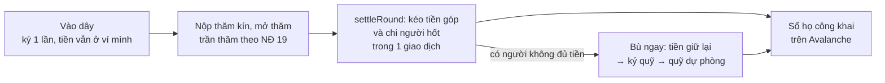

# 12. Pitch, demo và bộ nộp bài

**Mục đích và đọc khi nào.** File này là bộ đồ nghề để kể HụiSafe cho giám khảo: câu khai báo dev toggle, cấu trúc pitch 12 slide có lời nói, kịch bản demo live 3 phút khớp ví dụ ở [03-dac-ta-giao-thuc.md](03-dac-ta-giao-thuc.md) mục 8, kế hoạch dự phòng, storyboard video, bản nháp form nộp bài (tiếng Việt và tiếng Anh, đã đếm ký tự), 20 câu hỏi đáp, go-to-market và đường đi sau hackathon. Đọc khi làm slide, quay video, điền form (M6, M7 ở [11-ke-hoach-trien-khai.md](11-ke-hoach-trien-khai.md)) và trước Demo Day. Mọi số mô phỏng, số test, số người thử là **chỗ trống** cho tới khi đội đo thật; không điền số đoán.

---

## 1. Câu khai báo dev toggle

Đọc nguyên văn ở giây đầu tiên của pitch và của video; in ở góc slide 1. Luật BTC: "If a demo uses a dev toggle (simulated time, location or yield), declare it to the judges at the very start of the pitch" ([topics.json](https://team1vn.xyz/topics.json), truy cập 06/11/2026).

> **Tiếng Việt:** "Trước khi bắt đầu, chúng em xin khai báo dev toggle: bản demo chạy ở chế độ demo trên Avalanche Fuji testnet. Thời gian được tua nhanh: mỗi kỳ hụi 3 phút thay vì 30 ngày, ân hạn 2 phút thay vì 48 giờ; trần lãi và lãi chậm góp vẫn tính như kỳ 30 ngày. Tiền trong demo là USDC thử nghiệm, không có giá trị, và sản phẩm không sinh lãi."

> **English:** "Before we start, we declare our dev toggle: the demo runs in demo mode on Avalanche Fuji testnet. Time is fast-forwarded: each hụi round is 3 minutes instead of 30 days, and the grace period is 2 minutes instead of 48 hours; the interest cap and late fee are still computed on a 30-day period. The money is testnet USDC with no value, and the product generates no yield."

Chỉ khi bật bonus `MockYieldVault`, đọc thêm: "Lãi trên ký quỹ hiển thị là lãi giả lập; trên mainnet, lãi thật sẽ đến từ cho vay blue-chip Aave v3."

## 2. Pitch 12 slide

Thời lượng mỗi đội ở chung kết chưa công bố (10 đội trong 09:00–11:30; cần hỏi BTC sau 23/11). Các slide không tính demo dài 4:00. Bản đủ: demo live 3:00, tổng 7:00. Bản 5 phút: slide 6 là clip 1:00. Bản 3 phút: giữ slide 1, 2, 3, 6 (clip 0:40), gộp 8–10 thành một slide "3 câu hỏi", 11, 12.

**Slide 1. HụiSafe: Chơi hụi không sợ vỡ** (0:25)
- Trên slide: "Hụi bỏ thăm on-chain trên Avalanche. Chủ hụi không cầm tiền, nhưng vẫn phải bảo lãnh." Tên đội, 3 vai. Track Social finance, đề #01 nâng cấp. Hộp nhỏ: khai báo dev toggle.
- Lời nói: đọc câu khai báo ở mục 1, rồi câu chốt.

**Slide 2. Vỡ hụi là chuyện có thật** (0:25)
- Trên slide: Bình Thuận: hơn 100 tỷ đồng, 167 người bị hại (Báo Pháp luật, 20/09/2024). Trà Vinh: hụi Zalo, khống 157 phần hụi, 12 năm tù (VOV, 13/03/2025). Tây Ninh: tài khoản Zalo ảo bỏ thăm và hốt, gần 500 triệu (VietnamPlus, 06/10/2026). Phía thành viên: người hốt sớm bỏ đóng 2,04%, hốt muộn 0,59% (Klonner & Rai 2008).
- Lời nói: "Ba vụ, một điểm chung: một người cầm tiền của cả dây. Và ngay cả khi chủ hụi tử tế, người hốt sớm vẫn có thể bỏ đóng, người hốt sau gánh lỗ."

**Slide 3. Chủ hụi có hai vai** (0:20)
- Trên slide: hai cột. Giữ tiền: gốc của ôm tiền, hụi ảo, hụi chồng hụi. Bảo lãnh: bù khi người đã hốt bỏ đóng (NĐ 19 Điều 18 khoản 4). Bản on-chain thường: bỏ cả hai. HụiSafe: bỏ giữ tiền, giữ bảo lãnh.
- Lời nói: "Các bản hụi on-chain trước đây bỏ luôn người chủ hụi, nên không còn ai bù cho người hốt sau. Chúng em giữ lại đúng phần tốt của chủ hụi."

**Slide 4. Giải pháp** (0:20)
- Trên slide: (1) tiền nằm trong ví từng người, mỗi kỳ hợp đồng kéo và chi trong một giao dịch; (2) chủ hụi ký quỹ; (3) người hốt sớm bị giữ lại một phần; (4) quỹ dự phòng 1%; (5) luật NĐ 19 trong code; (6) chỉ số bảo chứng hiện trước khi vào dây.
- Lời nói: "Dây 5 người, 100 USDC: rủi ro lớn nhất là 600 USDC. Giữ lại 20% cộng ký quỹ 480 là 100%."

**Slide 5. Một kỳ chạy thế nào** (0:20)



- Lời nói: "Không ai bốc thăm, không ai bấm chi. Đến giờ là hợp đồng tự chạy, ai gọi cũng được."

**Slide 6. Demo live** (3:00, hoặc clip 1:00): theo mục 3.

**Slide 7. Bằng chứng** (0:20)
- Trên slide: 3 thiết kế (truyền thống, on-chain đơn giản, HụiSafe) × chỉ số 05 mục 11.2 (tổn thất kỳ vọng và p95 của người hốt sau, xác suất vỡ dây, mức dùng ký quỹ, lợi nhuận chủ hụi). **Số: [chờ `sim/outputs/baseline.json`]**. Ghi rõ giả định: tỷ lệ bỏ đóng mỗi kỳ 2,04% và 0,59% lấy cảm hứng từ Klonner & Rai; sốc tương quan 2% × 5. Kỹ thuật: [x] test, INV-01..INV-10 [?], Slither mức cao [?], gas `settleRound` N = 5 [đo].
- Lời nói: chỉ đọc số đã có thật.

**Slide 8. Câu 1: Vì sao on-chain?** (0:20)
- Trên slide: không ai cầm tiền giữa các kỳ; luật không đổi sau khi dây bắt đầu, kể cả với HụiSafe (INV-09); ký quỹ khóa công khai; sổ họ không sửa được, có mã giao dịch (NĐ 19 Điều 12, 13, 25); một người một ví.
- Lời nói: "Bài toán của hụi là niềm tin vào người giữ tiền. Database chỉ đổi người giữ tiền từ chủ hụi sang chúng em."

**Slide 9. Câu 2: Vì sao Avalanche?** (0:25)

| Phần điểm Avalanche (5 × 5) | HụiSafe cho thấy |
|---|---|
| Dùng Avalanche có ý nghĩa | Tiền hốt chi trong một giao dịch; luật NĐ 19 thực thi trên C-Chain; USDC native của Circle có permit |
| Smart contract thật | `HuiFactory`, `HuiCircle` (clone EIP-1167), `ReputationRegistry`, `HuiMath`; deploy và verify trên Fuji |
| Hạ tầng phù hợp | Fuji C-Chain, USDC của Circle, `ERC2771Forwarder` + relayer (không cần AVAX), Privy (có trong danh sách tích hợp của Avalanche), Snowtrace |
| Chất lượng tích hợp | Invariant INV-01..INV-10, differential test 3 ngôn ngữ, Slither, không `Multicall` cùng `ERC2771Context`, domain permit đọc lúc chạy, `claimable` cho ví bị chặn |
| Giá trị khi xây trên Avalanche | Finality dưới 1 giây trên C-Chain (theo Avalanche). Một kỳ N = 5 có ngân sách ≤ 600.000 gas ([04](04-kien-truc.md) mục 7.1), khoảng 0,0015 AVAX ≈ 0,013 USD (2,5 nAVAX, 8,73 USD/AVAX ngày 05/11/2026; suy ra, cần đo), nên relayer trả thay được. Sau này: L1 riêng từng hội, passkey P-256 |

- Lời nói: dẫn câu BTC viết cho đề Hụi: "Low transaction fees mean a group of 10-20 people paying weekly does not lose the pot to fees. Native USDC on the C-Chain."

**Slide 10. Câu 3: Tiền và lãi đến từ đâu?** (0:20)
- Trên slide: tiền hốt là tiền góp của chính thành viên, không in token. Tiền thăm: người hốt sớm trả người hốt sau, trần 20%/năm. Tiền công 1% mỗi kỳ, chỉ trả kỳ không bị mất. Quỹ dự phòng chia đều cuối dây. Lãi trên tiền khóa: MVP không có; mainnet dùng Aave v3. HụiSafe kiếm tiền sau này: một phần tiền công chủ hụi, gói cho hội nhóm.
- Lời nói: "Không có đồng nào từ trên trời rơi xuống."

**Slide 11. Pháp luật Việt Nam** (0:25)
- Bốn điểm BTC yêu cầu, nguyên văn topics.json: "crypto is not legal tender; salaries must be paid in VND; paid legal or financial advice requires a licence; tokenized stocks are geoblocked by their issuers." Tiếng Việt: tiền mã hóa không phải phương tiện thanh toán hợp pháp; lương phải trả bằng VND; tư vấn pháp lý hoặc tài chính có thu phí cần giấy phép; cổ phiếu token hóa bị chính đơn vị phát hành chặn theo khu vực.

| Điểm | HụiSafe |
|---|---|
| Tiền mã hóa không phải phương tiện thanh toán | Chỉ USDC testnet, không nhận tiền thật. NQ 05/2025/NQ-CP: giao dịch, thanh toán tài sản mã hóa bằng VND; NĐ 284/2026/NĐ-CP phạt giao dịch ngoài tổ chức được cấp phép (theo ghi chú nghiên cứu). Hướng thật: chế độ VND |
| Lương trả bằng VND | Không áp dụng: HụiSafe không trả lương |
| Tư vấn có phí cần giấy phép | Trợ lý chỉ cho thông tin miễn phí, có trích dẫn và câu miễn trừ, không xưng luật sư |
| Cổ phiếu token hóa bị chặn | Không áp dụng: không có cổ phiếu, không có token |

- NĐ 19/2019 trong code: Điều 5–6 (đủ 18 tuổi), Điều 4 khoản 8 (hoa hồng chỉ ở họ hưởng hoa hồng), Điều 12–13 (sổ họ, biên nhận), Điều 14 (cảnh báo, mẫu thông báo UBND cấp xã), Điều 18 khoản 4 (ký quỹ), Điều 21 (trần thăm), Điều 22 (lãi chậm 10%/năm). Điều 20 quy định bằng thăm thì bốc thăm; luật cuộc thi cấm ngẫu nhiên nên HụiSafe chia hòa tất định, ghi vào luật dây (cần luật sư xác nhận, như cách hiểu Điều 21).
- Lời nói: "Hụi hợp pháp. Tiền mã hóa làm phương tiện thanh toán thì không. Nên hôm nay chỉ có USDC testnet."

**Slide 12. Lộ trình, đội, đề nghị** (0:20)
- Lộ trình (kế hoạch): 12/2026 thử testnet với 3–5 nhóm; ý kiến luật sư về Điều 14, 20, 21; chế độ VND; rồi L1 riêng cho hội, mainnet với Safe multisig; kiều bào sau khi có ý kiến pháp lý.
- Đội: P1 contract, P2 frontend và hạ tầng, P3 mô phỏng, AI, pitch.
- Đề nghị: mentor pháp lý; giới thiệu 3 nhóm hụi hoặc CLB thử nghiệm; hướng dẫn nộp Team1 Mini Grant.

## 3. Kịch bản demo live 3 phút

### 3.1. Chuẩn bị (từ 30 phút trước)

1. **"Demo Hoàn Tất"**: chạy trọn nhánh B của 03 mục 8 sáng cùng ngày (khoảng 17 phút), bằng `script/CreateDemoCircle.s.sol`. Sau kỳ 1, ví M4 chuyển hết USDC sang ví phụ để giả lập bỏ đóng.
2. **"Demo Sống"**: 5/5 người, ký quỹ 480, chưa bắt đầu; `joinDeadline` đặt +24 giờ vì mặc định demo chỉ +30 phút. Thêm 2 bản dự phòng.
3. **"Demo Mời"**: 4/5 người, để người thứ 5 vào live.
4. Thiết bị: Laptop A chiếu (chủ hụi, thêm cửa sổ ẩn danh); Điện thoại B là M4, phản chiếu màn hình; Laptop C là M2, P1 cầm, không chiếu.
5. `/demo-check`: RPC chính và dự phòng, relayer ≥ 1 AVAX, keeper chạy, Privy đăng nhập được trên mạng hội trường (có hotspot 4G), Snowtrace mở được. Câu hỏi trợ lý đã hỏi sẵn.

### 3.2. Bấm giờ (T = lúc bấm "Bắt đầu dây" của "Demo Sống")

Cửa sổ của kỳ 1: nộp thăm [0:00, 1:30), mở thăm [1:30, 2:30), chốt từ 3:00, keeper chi trong ≤ 2 chu kỳ quét (≤ 30 giây, 04 mục 7.2).

| Thời điểm | Màn hình, người làm | Lời nói | Trên chuỗi |
|---|---|---|---|
| 0:00–0:10 | Laptop A, S04 "Demo Sống"; P3 bấm "Bắt đầu dây" | "Dây 5 người, mỗi kỳ 100 USDC. Cô Tư ký quỹ 480. Chỉ số bảo chứng 100% nghĩa là ký quỹ chịu được cú sốc lớn nhất: mọi người đã hốt cùng bỏ đóng một lúc." | `activate` |
| 0:10–0:40 | Điện thoại B, S06; P2 nhập 6, nộp thăm kín, bấm "Sao lưu thăm" | "Trần thăm kỳ này 6,575342 USDC, đúng trần lãi 20%/năm. Thắng với thăm 6 thì nhận 288,48, giữ lại 80." | `commitBid` của M4, cọc 1 USDC. P1 nộp thăm 4 cho M2 trên Laptop C trước 1:00 |
| 0:40–1:05 | Laptop A, S03; P3 | "Tạo dây mới: gõ ký quỹ 480 là đồng hồ lên 100%. Đây là dây thứ hai đang chạy của cô, nên app nhắc thông báo UBND cấp xã theo Điều 14. Trợ lý trả lời 480 và dẫn Điều 18 khoản 4." | Không gửi giao dịch |
| 1:05–1:30 | Laptop A, cửa sổ ẩn danh, S05 "Demo Mời"; P3 | "Thành viên mới: đăng nhập Google, tick đủ 18 tuổi, ký một lần. Không AVAX, không seed phrase." | `join` qua relayer |
| 1:30–1:50 | Điện thoại B, S06; P2 bấm "Mở thăm" (P1 mở thăm M2) | "Hết giờ nộp. Mọi người mở thăm. Không bốc thăm: thăm cao nhất thắng." | `revealBid`: M4 = 6, M2 = 4 |
| 1:50–2:40 | Laptop A, "Demo Hoàn Tất": S07 kỳ 2 → S09 → S11 | "Dây này chạy trọn sáng nay. Kỳ 2, M4 đã hốt nhưng không đóng 100 USDC. Hệ thống bù ngay: 80 từ tiền giữ lại của M4, 20 từ ký quỹ. M1 vẫn nhận đủ 323,18. Quá ân hạn, M4 bị ghi vỡ nợ; ký quỹ bù các kỳ sau: 460, 360, 260, 160. Ở kịch bản này người góp trung thực nhận đủ. Đây là sổ họ, dòng nào cũng có mã giao dịch." | Chỉ đọc event |
| 2:40–3:00 | Laptop A, "Demo Sống" S07 | "Quay lại dây vừa chạy: kỳ 1 chốt lúc 3:00, keeper chi trong vài giây: M4 thắng với thăm 6, nhận 288,48." Chưa hiện thì: "Kết quả sẽ hiện trong lúc chúng em trả lời câu hỏi." | `settleRound` do keeper gọi |

### 3.3. Ví nạp sẵn

| Ví | Cần có |
|---|---|
| Chủ hụi, mỗi dây demo | 480 USDC (ký quỹ = 0,8 × 600) |
| M1..M5, mỗi dây | Tối đa 404 USDC (cận trên) và ít AVAX để "Gửi trực tiếp" khi relayer lỗi |
| Relayer, keeper | Relayer ≥ 1 AVAX (05 mục 8.2); keeper có AVAX, ví riêng (04 ADR-21) |

Faucet Circle chỉ cho 20 USDC mỗi 2 giờ mỗi ví ([faucet.circle.com](https://faucet.circle.com/)), nên gom từ M0 (R5 ở 11). Mỗi lần chạy nhánh B, ký quỹ mất 320 USDC sang người khác: chuyển trả lại sau mỗi lần tập.

Không gom đủ thì chạy đúng kịch bản này với C = 10 USDC, như 03 mục 8. Mọi số chia 10:

- ký quỹ 48 USDC;
- mỗi thành viên tối đa 40,4 USDC;
- M4 nhận 28,848 USDC;
- M1 nhận 32,318 USDC;
- ký quỹ còn 16 USDC ở nhánh B.

Câu khai báo đầu pitch thêm vế "demo thu nhỏ 10 lần vì giới hạn faucet"; slide vẫn dùng số 100 USDC.

## 4. Kế hoạch dự phòng

| Sự cố | Dấu hiệu | Làm ngay |
|---|---|---|
| RPC Fuji chậm, lỗi | Không có receipt sau 10 giây | Transport chuyển sang `FUJI_RPC_URL_FALLBACK`; vẫn lỗi thì phát đoạn quay sẵn tương ứng; mở ảnh chụp, PDF Snowtrace của "Demo Hoàn Tất" |
| Relayer lỗi | `/api/relay` báo lỗi | Bấm "Gửi trực tiếp" từ ví demo có AVAX (04 mục 8) |
| Keeper không chốt | Quá 3:30 chưa có kết quả | P1 bấm "Chốt kỳ" (`SettleButton`) trên Laptop C |
| Privy không đăng nhập (Wi-Fi chặn) | Popup Google lỗi | Chuyển hotspot 4G; dùng phiên đã đăng nhập; bỏ đoạn vào dây, phát clip |
| Bị gọi lên sớm hoặc muộn | "Demo Sống" đã qua kỳ 1 | Dùng bản dự phòng; P3 nói câu mở demo rồi mới bấm "Bắt đầu dây" |
| Fuji sập lâu | Mọi giao dịch lỗi | Demo trên Anvil local (04 mục 8), nói rõ là local; hoặc phát video |

Đoạn quay sẵn (MP4 trên laptop, USB và cloud): tạo dây và chỉ số (20 giây); vào dây bằng Google (25 giây); kỳ 1 nộp, mở, chốt (40 giây, đồng hồ thật trên màn hình); kỳ 2 thiếu, bù, vỡ nợ (40 giây); sổ họ và Snowtrace (15 giây).

## 5. Storyboard video 2–3 phút

Mục tiêu 2:50. YouTube công khai hoặc không công khai, hoặc Loom; mở không cần đăng nhập. Phụ đề tiếng Việt và tiếng Anh. Không dùng nhạc có bản quyền. Đoạn nào tua nhanh ghi rõ trên màn hình.

| # | Thời gian | Hình | Lời | Chữ trên hình |
|---|---|---|---|---|
| 1 | 0:00–0:15 | Logo, dải băng chế độ demo | Câu khai báo dev toggle (mục 1) | "Chế độ demo: 1 kỳ = 3 phút. USDC testnet." |
| 2 | 0:15–0:30 | Thẻ chữ ba vụ vỡ hụi | Ba vụ ở slide 2 | Nguồn và ngày |
| 3 | 0:30–0:45 | Hoạt họa hai vai của chủ hụi | Luận điểm slide 3 | "Không cầm tiền. Vẫn bảo lãnh." |
| 4 | 0:45–1:05 | Quay màn hình S03 và trợ lý | Tạo dây, chỉ số 100%, cảnh báo Điều 14 | "Ký quỹ 480 → 100%" |
| 5 | 1:05–1:20 | Điện thoại, S05 | Vào dây bằng Google | "1 chữ ký, 0 AVAX" |
| 6 | 1:20–1:45 | S06 → S07, tua nhanh | Thăm kín, M4 thắng thăm 6, nhận 288,48 | "Tua nhanh ×4" |
| 7 | 1:45–2:10 | S07 kỳ 2 → S09 | M4 bỏ đóng: 80 + 20; ký quỹ 460 → 160 | "Kịch bản này: người trung thực nhận đủ" |
| 8 | 2:10–2:20 | S11 và Snowtrace | Sổ họ theo NĐ 19, mã giao dịch | Link Snowtrace |
| 9 | 2:20–2:35 | `forge test`, biểu đồ `/lab` | Chỉ số thật đã đo | Số thật hoặc "chưa có" |
| 10 | 2:35–2:50 | Slide 3 câu hỏi, pháp lý | Ba câu trả lời ngắn | Link repo, app |

## 6. Bản nháp form nộp bài

Đếm bằng Python theo điểm mã Unicode dạng NFC (bằng độ dài UTF-16 với các chữ này). **Dán đúng bản dưới đây.** Gõ lại bằng bộ gõ tổ hợp (NFD) làm số ký tự tăng: tên tiếng Việt lên 101, "What it does" tiếng Việt lên 903, đều vượt giới hạn. Thay `[địa chỉ HuiFactory]` bằng địa chỉ 42 ký tự làm tổng tăng 22, cộng độ dài handle Telegram. Câu "Đang chạy trên Fuji…" chỉ giữ những gì đã chạy thật lúc nộp.

**Project name** (≤ 100). Tiếng Việt, 84 ký tự:

```text
HụiSafe: hụi bỏ thăm on-chain trên Avalanche, chủ hụi không cầm tiền mà vẫn bảo lãnh
```

English, 97 ký tự:

```text
HụiSafe: bidding hụi (ROSCA) on Avalanche where the organiser holds no money but still guarantees
```

**What it does** (≤ 800). Tiếng Việt, 715 ký tự:

```text
Hụi (họ) là cách người Việt tiết kiệm và vay nhau, nhưng vỡ hụi xảy ra liên tục: chủ hụi cầm tiền rồi bỏ trốn, lập hụi viên ảo trên Zalo, hoặc người hốt sớm bỏ đóng khiến người hốt sau mất tiền. HụiSafe dành cho chủ hụi và các nhóm hụi gia đình, tiểu thương, sinh viên. Tiền nằm trong ví từng người; mỗi kỳ smart contract kéo tiền góp và chi cho người hốt trong cùng một giao dịch. Chủ hụi không cầm tiền nhưng phải ký quỹ để bù khi người đã hốt bỏ đóng; người hốt sớm bị giữ lại một phần; có quỹ dự phòng nhỏ. Trần lãi, lãi chậm góp, sổ họ theo Nghị định 19/2019 chạy trong code. Đang chạy trên Fuji: tạo dây có chỉ số bảo chứng, đăng nhập Google, không cần AVAX, bỏ thăm kín, chi kỳ và tự bù khi có người bỏ đóng.
```

English, 787 ký tự:

```text
Hụi is how Vietnamese families, market traders and students save and lend to each other, but collapses are common: organisers run off with the money or invent fake members on Zalo, and early receivers stop paying so late receivers lose. HụiSafe is a bidding hụi run by smart contracts on Avalanche Fuji. Money stays in each member's wallet; each round the contract pulls contributions and pays the winner in one transaction. The organiser never holds the pot but posts a bond that covers members who stop paying after receiving; early receivers have part of their payout held back; a small reserve adds a buffer. Decree 19/2019 rules (interest cap, late fees, ledger) run in code. Live on Fuji: Coverage Index, Google login, no AVAX needed, sealed bids, payouts, automatic default cover.
```

**Anything else for the judges** (≤ 800). Tiếng Việt, 652 ký tự trước khi thay chỗ trống:

```text
Khai báo dev toggle: demo chạy chế độ tua nhanh (1 kỳ = 3 phút, ân hạn 2 phút); trần lãi và lãi chậm góp vẫn tính theo kỳ 30 ngày. Chỉ dùng USDC testnet trên Fuji: không nhận tiền thật, không có token, không có dữ liệu cá nhân on-chain. Nên xem theo thứ tự: (1) video; (2) app, dây "Demo Hoàn Tất": 5 người × 100 USDC, ký quỹ 480 (bảo chứng 100%), M4 bỏ đóng sau khi hốt, ký quỹ bù đủ; (3) sổ họ của dây đó, không cần đăng nhập; (4) README: kiến trúc và cách chạy test (unit, fuzz, invariant). Muốn tự thử: đăng nhập Google, ví tự tạo; lấy USDC Fuji tại faucet.circle.com. Contract đã verify trên Snowtrace: [địa chỉ HuiFactory]. Hỏi nhanh: [Telegram].
```

English, 701 ký tự trước khi thay chỗ trống:

```text
Dev toggle: the demo runs in fast-forward mode (1 round = 3 minutes, grace = 2 minutes); the interest cap and late fee still use a 30-day nominal period. Fuji testnet USDC only: no real money, no token, no personal data on-chain. Suggested order: (1) the video; (2) the app, circle "Demo Hoàn Tất": 5 members × 100 USDC, bond 480 (100% coverage), M4 stops paying after receiving and the bond covers in full; (3) that circle's ledger (sổ họ), no login needed; (4) README: architecture and how to run tests (unit, fuzz, invariant). To try it: log in with Google, a wallet is created for you; get Fuji USDC at faucet.circle.com. Contracts verified on Snowtrace: [HuiFactory address]. Contact: [Telegram].
```

Các trường còn lại: GitHub repository `github.com/Towfienes/T1VN_Unihack`; Pitch slides (link Canva hoặc Google Slides, quyền xem cho mọi người); Demo video; Live app; Contract address (link Snowtrace của `HuiFactory`).

## 7. Hỏi đáp: 20 câu

Chức danh giám khảo lấy từ team1vn.xyz; điều họ có thể quan tâm là suy đoán của ghi chú nghiên cứu (competition_judges_winners.md, 05/11/2026). Không bao giờ nói về tokenomics hay bán token.

| Giám khảo | Góc nhìn có thể có | Chuẩn bị |
|---|---|---|
| Tu Nguyen, Country Lead, Team1 Vietnam | Hệ sinh thái, đội có xây tiếp không | Câu 6, 7 |
| Tuan Tran, DevRel, Team1 Vietnam (GitHub `tuantqse90`; app senpai của anh cũng dùng relayer trả gas) | Độ sâu kỹ thuật, starter code, relayer | Câu 1–5 |
| TS. Lê Trần Hữu Phúc, Academic Head of IT, Greenwich Việt Nam | Chặt chẽ, kiểm chứng | Câu 8–10 |
| Jenny Nguyen, Head of Marketing, Strategic Partners, MEXC Ventures | Thị trường, doanh thu, khả năng mở rộng | Câu 11–14 |
| Kha Rostenkowski-Ngo, CEO Herond Labs (trình duyệt, ví) | Trải nghiệm ví, riêng tư, AI có thật sự cần | Câu 15–18 |
| Julley Thai, Founder & Builder, Julley Labs | Cái gì đã chạy, học được gì | Câu 19, 20 |

1. **Tiền nằm ở đâu giữa các kỳ?** Trong ví từng người. `settleRound` kéo bằng `transferFrom` và chi trong cùng giao dịch. Contract chỉ giữ ký quỹ, tiền giữ lại, quỹ dự phòng, tiền công chờ, cọc mở thăm, tất cả khóa theo luật; không hàm nào chuyển tiền cho admin (INV-07).
2. **Sao relayer ERC-2771 mà không ERC-4337, EIP-7702? Relayer có bị lạm dụng?** BTC dặn không tự build 4337; C-Chain chưa nhận giao dịch 7702. Relayer chỉ chuyển request có chữ ký người dùng, kiểm đích, selector, `value = 0`, gas ≤ 3.000.000, 30 request/giờ mỗi ví, mô phỏng trước khi gửi. Relayer từ chối thì người dùng gọi trực tiếp. Không `Multicall` cùng `ERC2771Context`.
3. **Người đã hốt rút hết tiền hoặc thu hồi quyền trích thì sao?** Kéo thất bại trong `try`, thành khoản thiếu, bù ngay: tiền giữ lại của chính họ → ký quỹ → quỹ dự phòng. Ví dụ kỳ 2: 80 + 20, người hốt vẫn nhận đủ 323,18.
4. **Commit-reveal: không mở thăm, hay chạy trước giao dịch?** Không mở thì mất cọc 1% và bị ghi trễ. Lúc nộp không ai thấy thăm của ai, nên chạy trước không cho thông tin gì. Chia hòa theo số lần trễ rồi thứ tự nộp, không theo thứ tự mở.
5. **Gas một kỳ 30 người?** Ngân sách ≤ 3.000.000 gas (04 mục 7.1), số đo thật: [điền]. Ở 2,5 nAVAX là khoảng 0,0075 AVAX, chưa tới 0,07 USD theo giá 05/11/2026 (suy ra).
6. **Vì sao Avalanche?** Finality dưới 1 giây theo Avalanche, phí đủ thấp để relayer trả thay cả dây, USDC native của Circle có permit. Hướng sau: L1 riêng cho từng hội, passkey P-256.
7. **Sau hackathon có làm tiếp không?** Có: thử testnet với 3–5 nhóm, xin ý kiến luật sư, làm chế độ VND, nộp Team1 Mini Grant (mục 8).
8. **Chỉ số 100% bảo đảm gì? Có phải "không bao giờ mất tiền" không?** Không, và đừng nói vậy. Chỉ số bảo chứng 100% nghĩa là ký quỹ chịu được cú sốc lớn nhất: mọi người đã hốt cùng bỏ đóng một lúc. Chứng minh ở 03 mục 7.3: nếu mọi người đã hốt cùng bỏ ngay sau kỳ rủi ro đỉnh, phần thiếu là O(m) ≤ O_max; tiền giữ lại che α·O(m), phần còn lại (1 − α)·O(m) ≤ B. Test INV-08 fuzz đúng điều này. Giới hạn nói thẳng: nếu họ bỏ đóng lần lượt qua các kỳ (N = 5: tổng thiếu 1000 so với O_max 600) thì ký quỹ 480 không đủ, kỳ cuối thiếu 304; bù đủ cần B_seq = (1 − α)·N(N − 1)/2·C = 800, tùy chọn ở roadmap. Người chưa hốt bị đóng băng chỉ dùng tạm thanh khoản ký quỹ.
9. **Mô phỏng dựa trên giả định gì?** 10.000 dây mỗi kịch bản, seed cố định, 3 thiết kế. Tỷ lệ bỏ đóng là tham số giả định lấy cảm hứng từ Klonner & Rai, nói rõ là giả định; có sốc tương quan. Kết quả: [điền sau khi chạy].
10. **Làm sao biết ba bản `HuiMath` khớp?** Vector JSON do mô phỏng sinh, có commit; Solidity và TS cùng đọc và so từng đơn vị trong CI.
11. **Thị trường bao lớn?** Chưa có khảo sát quốc gia về số người chơi hụi, chúng em không bịa số. Tín hiệu: các vụ vỡ tới hơn 100 tỷ đồng; tòa vẫn xử tranh chấp hụi năm 2026; Findex 2025: 71% người lớn có tài khoản nhưng chỉ 16% tiết kiệm, 13% vay ở tổ chức chính thức (theo ghi chú nghiên cứu).
12. **Ai trả tiền?** Giả thuyết: một phần tiền công chủ hụi, và gói cho hội nhóm thu bằng VND. Không lấy phí trên tiền góp.
13. **Có token không, có định niêm yết không?** Không. Luật BTC cấm bán token; sản phẩm không cần token.
14. **Vì sao chủ hụi chịu ký quỹ?** NĐ 19 Điều 18 khoản 4 vốn đã bắt chủ hụi bù; HụiSafe giới hạn trách nhiệm đó bằng đúng ký quỹ, công khai trước. Dây 10 người × 100 USDC cần 2.000 USDC cho 100%, trên 9.000 USDC tiền góp cả dây. Tiền công chỉ trả cho kỳ không bị mất.
15. **Người lớn tuổi dùng ví sao nổi?** Đăng nhập Google, ví tự tạo, không seed phrase, không AVAX, chữ ≥ 18 px. Số đo thử nghiệm: [điền].
16. **Ai biết tôi chơi hụi?** Trên chuỗi chỉ có địa chỉ ví và mã băm attestation; biệt danh chỉ trên máy chủ hụi; trợ lý không nhận dữ liệu cá nhân. Địa chỉ ví vẫn công khai, nên chỉ là ẩn danh một phần.
17. **Ký một lần cho dây trích 404 USDC có nguy hiểm?** Chỉ cho đúng một contract dây đã verify, đúng (N − 1)·(C + cọc), không vô hạn; mỗi kỳ chỉ kéo đúng phần góp (INV-04). Thu hồi được, khi đó đi luồng khoản thiếu.
18. **AI có cần không?** Trợ lý giúp chọn ký quỹ và hiểu NĐ 19; số do hàm tất định tính; không có tool chuyển tiền. Eval 30 ca: [kết quả]. Tắt AI thì luồng chính vẫn chạy.
19. **Hôm nay cái gì chạy thật?** Liệt kê đúng những gì đã chạy trên Fuji lúc nộp; nói rõ cái chưa có: lãi, passkey, chế độ VND, mainnet.
20. **Người dùng thử nói gì?** [3 phát hiện thật từ buổi thử và việc đã sửa]. Chưa thử thì nói chưa thử.

## 8. Go-to-market, doanh thu, sau hackathon

**Go-to-market (thật thà):**
1. Tới 12/2026: người dùng đầu từ cộng đồng Team1 Vietnam, CLB sinh viên, nhóm hụi gia đình của đội; chỉ testnet. Tiền không giá trị làm hành vi khác tiền thật, nên đây là thử trải nghiệm, chưa phải bằng chứng thị trường.
2. 1–3 tháng sau: ý kiến luật sư; chế độ VND (tiền qua ngân hàng, chuỗi làm sổ họ và luật) thử với 1–2 nhóm tiểu thương qua một chủ hụi quen.
3. Sau đó: kiều bào, chỉ khi có ý kiến pháp lý ở nước sở tại.

Kênh chính là chủ hụi: mỗi người mang theo 3–30 thành viên. Chỉ số: số chủ hụi kích hoạt dây, số dây hoàn tất, north-star ở [02](02-dac-ta-san-pham.md).

**Doanh thu (giả thuyết cần kiểm):** một phần tiền công chủ hụi (cần kiểm tra pháp lý: phí phần mềm khác hoa hồng của chủ họ); gói cho hội đồng hương, hội tiểu thương, CLB thu bằng VND. Không token, không phí trên tiền góp, không lấy lãi trên tiền người dùng. Chi phí biến đổi: gas (slide 9), trợ lý khoảng 0,01–0,03 USD mỗi câu ([07](07-ai-agentic.md) mục 7).

**Sau hackathon:** Team1 Mini Grants tới 10.000 USD, đơn mở; Accelerator Grants tới 30.000 USD, không nhận đơn mở, do hội đồng đề cử, dự án mạnh có thể đi thẳng ([team1.network/grants](https://www.team1.network/grants), truy cập 06/11/2026). Retro9000 và Codebase là đường tiếp theo (theo ghi chú nghiên cứu). Paper DeFi'27 là tùy chọn (11, mục 1).

## 9. Nguồn (truy cập 06/11/2026 trừ khi ghi khác)

- Luật cuộc thi, chấm điểm, đề Hụi: [team1vn.xyz/topics.json](https://team1vn.xyz/topics.json) (generatedAt 2026-11-06T09:50Z)
- Vụ vỡ hụi: [Báo Pháp luật, 20/09/2024](https://baophapluat.vn/khoi-to-bat-tam-giam-loat-chu-hui-chiem-doat-tai-san-post526051.html); [VOV, 13/03/2025](https://vov.vn/phap-luat/12-nam-tu-cho-doi-tuong-mo-day-hui-khong-chiem-doat-tai-san-post1161016.vov); [VietnamPlus, 06/10/2026](https://www.vietnamplus.vn/tay-ninh-khoi-to-chu-hui-dung-tai-khoan-ao-chiem-doat-gan-500-trieu-dong-post1140315.amp)
- Klonner & Rai (2008): [PDF](https://web.williams.edu/Economics/rai/adverse-08-9-1.pdf)
- Finality C-Chain: [Avalanche performance](https://docs.avax.network/solutions/performance) (trang không ghi ngày); giá gas, AVAX 05/11/2026: ghi chú nghiên cứu `avalanche_stack_2026.md`
- Faucet USDC: [faucet.circle.com](https://faucet.circle.com/)
- Team1 grants: [team1.network/grants](https://www.team1.network/grants)
- Pháp lý chi tiết: [10-phap-ly-va-tuan-thu.md](10-phap-ly-va-tuan-thu.md); danh mục nguồn: [13-tai-lieu-tham-khao.md](13-tai-lieu-tham-khao.md)
