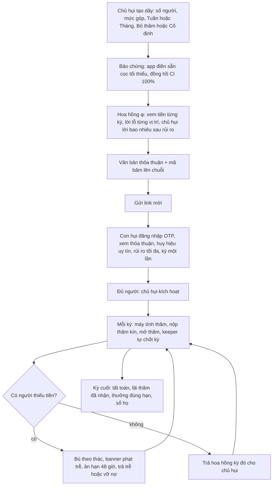

# Báo cáo gửi leader (09/11/2026): phản hồi HụiSafe v1.2 và tối ưu dòng tiền

| Mục | Nội dung |
|---|---|
| Người gửi | Towfienes (soạn cùng Claude Code) |
| Trạng thái | Đề xuất. Các thay đổi contract ở mục 11 chờ leader duyệt; sửa tài liệu trước (03 rồi 05), code sau |
| Nguồn số liệu | Máy tính số nguyên `tools/hui-economics/`, đã kiểm khớp từng đơn vị với các con số mà test contract `WorkedExample.t.sol` khẳng định (mục 3). Chạy lại được bằng 4 lệnh ở README của thư mục đó |
| Quy ước | Tiền VND minh họa với mức góp 1 triệu/kỳ, tính bằng số nguyên đồng, làm tròn xuống như contract. Trên Fuji, demo thu nhỏ 1 triệu ↔ 10 USDC. Dấu phẩy là dấu thập phân |

---

## 0. Tóm tắt một trang

1. **v1.2 đi đúng hướng.** Đồng ý ADR-22 (cọc 100%), ADR-24 (thưởng đúng hạn), ADR-26 (Safe 2/3), ADR-27 (băm thỏa thuận), ADR-28 (giao diện bám MVP), ADR-29 (attestation Team1). Đề xuất **bỏ ADR-23** (chủ hụi hốt kỳ đầu) khỏi bản thi. **ADR-25** (lãi trên cọc) để làm sau cùng nếu còn thời gian.
2. **Bốn chỗ cần sửa trong v1.2:**
   - Câu "người góp trung thực không mất tiền ở mọi dây, không còn điều kiện" **sai khi chủ hụi dùng 2 ví ảo**. Chủ hụi lời 41,47 USDC, người hốt cuối thiếu 55,43 USDC (mục 4.2).
   - Mã lỗi `InvalidParams(14)` **đã dùng** cho lỗi ân hạn ≥ thời lượng kỳ (sửa audit A4). Phải dời thành 15 và 16.
   - Vector V1 **lệch 1 đơn vị** vì contract tính lãi chậm góp riêng từng phần.
   - Lịch v1.2 tính là C5–C6 đang làm, thực tế **M1 đã xong và đã audit từ 08/11**. Các ADR đụng contract là mở lại code đã khóa, nên gom thành **một gói A9**.
3. **Phát hiện chính về tiền:** trần thăm của Điều 21 **tỷ lệ thuận với độ dài kỳ**. Hụi tuần chỉ được thăm khoảng 1/4 hụi tháng. Nên dùng chung một mức hoa hồng (1% hay 3%) cho mọi chu kỳ là sai: ở hụi tuần, hoa hồng cố định làm cả người để dành tới cuối cũng bị lỗ.
4. **Đề xuất hoa hồng mới: "hoa hồng nằm trong trần lãi"** (mục 5.4). Mỗi kỳ, chủ hụi nhận tối đa **φ = 50% số lãi mà luật cho phép người hốt kỳ đó trả**, và không quá 3% tiền hốt. Phần còn lại là chỗ để con hụi bỏ thăm. Cách này cho 4 lợi ích:
   - **Luôn trong trần Điều 21, kể cả khi tòa coi hoa hồng là lãi.**
   - Tự co giãn theo tuần hay tháng, theo số người và theo kỳ thứ mấy, không cần bảng tra.
   - Người để dành ở 1/3 cuối dây không bao giờ lỗ, và hốt càng muộn càng lời nhiều.
   - Ở dây từ 8 người, người hốt sớm chịu lãi thực thấp nhất trong các cách tính đã so.
5. **Lợi ích hai bên** (hụi tháng, sau khi trừ rủi ro bỏ đóng):
   - Chủ hụi lời khoảng **5%/năm trên tiền cọc** (dây 5 đến 12 người).
   - Người hốt cuối luôn lời.
   - Người hốt sớm chịu lãi thực 21–34%/năm. Lãi thực tính cả phần tiền bị giữ lại, nên cao hơn trần 20%/năm của Điều 21 (mục 5.2).
   - **Hụi tuần:** chủ hụi chỉ lời khi dây từ 12 người trở lên, hoặc khi chọn được người chơi rủi ro thấp. App phải nói thẳng điều này với chủ hụi.
6. **Mức góp lớn hay nhỏ không đổi tỷ lệ lời.** Mọi khoản tiền tỷ lệ thuận với mức góp. Chỉ có 2 thứ không tỷ lệ:
   - **Ngưỡng báo UBND** (Điều 14): dây có N·C ≥ 100 triệu mỗi kỳ.
   - **Tiền cọc là vốn thật** của chủ hụi: 10 người × 10 triệu cần cọc 200 triệu.
7. **Không ai giữ tiền, kể cả chủ hụi uy tín.** Đây là ràng buộc của đề thi. Uy tín chỉ mở khóa cọc thấp hơn, dây to hơn (roadmap), không bao giờ cho cầm tiền.
8. **Phải làm ngay:**
   - Chuyển repo sang **private** rồi mới push, sau đó mời `tuantqse90`.
   - Tạo **Safe 2/3** (hướng dẫn ở mục 10).
   - Tạo app Privy.
   - **Chốt danh sách đội (tối đa 3 người theo luật UniHack)**, vì đang có thêm 2 người góp PR.

---

## 1. Mục tiêu

- **Đạt giải UniHack, Topic 1:** đủ MVP bắt buộc (tạo dây, góp và hốt, phạt trễ tự động, tất toán và trả lãi thăm, dashboard, chế độ Fixed); có đường cho các bonus (thăm kín, sinh lãi phần chưa giải ngân, mời bằng link, chống tài khoản ảo); trả lời được 3 câu pitch; nêu đủ 4 điểm luật Việt Nam.
- **Lời hứa của đề:** *"so an organiser can no longer run off with the money"*. Không ai cầm tiền, contract kéo tiền và chi trong cùng một giao dịch.
- **Lợi ích rõ cho hai bên:**
  - Chủ hụi có lời thật, sạch, không lấy tiền của ai.
  - Con hụi cần tiền sớm có tiền với giá biết trước.
  - Con hụi để dành tới cuối không lỗ và được bảo đảm.
- **Đúng luật:** Nghị định 19/2019 (trần lãi Điều 21, lãi chậm góp Điều 22, hoa hồng Điều 4 khoản 8, thông báo UBND Điều 14), không dữ liệu cá nhân trên chuỗi.

## 2. Tiến độ (09/11)

| Mốc | Hạn | Tình trạng |
|---|---|---|
| M0 Setup | 07/11 | Xong |
| M1 Contract lõi | 10/11 | **Xong 08/11**: 536 test, 44 test bất biến, Slither không có High, audit không có Critical hay High |
| M2 Fuji + SDK | 11/11 | Đang làm (A8: script dây demo, `/api/relay`, `/api/attest`, keeper, chạy trọn trên anvil). Deploy chờ Safe, khóa, app Privy |
| M3 MVP E2E | 14/11 | Giao diện 6 màn xong (dữ liệu mẫu). Chưa nối ví và contract |
| M4 AI + thử thật | 16/11 | Mô phỏng 3 thiết kế xong; `/api/copilot` xong (9router/Gemini hoặc Anthropic), chưa chạy eval thật |

Chi tiết từng ngày ở `docs/TIEN-DO.md`.

## 3. Phương pháp và kiểm chứng

- **Máy tính số nguyên** `tools/hui-economics/hui_engine.py` mô phỏng `settleRound`, `payLate`, `markDefault`, `finalize` đúng theo docs/03.
- **Kiểm chứng:** chạy đúng ví dụ docs/03 mục 8. Mọi con số khớp từng đơn vị với các khẳng định của test contract:

| Con số | Test contract | Máy tính |
|---|---|---|
| Kỳ 1: M4 nhận | 288,480000 | 288,480000 |
| Kỳ 2: M1 nhận, cọc còn | 323,180000; 460 | 323,180000; 460 |
| Nhánh A: lãi chậm góp 1 ngày (phần 20 và phần 80 tính riêng) | 0,027396 | 0,027396 |
| Nhánh A: chủ hụi nhận | 480 + 19,67 | 499,670000 |
| Nhánh A: quỹ dự phòng chia đều | M1 3,939480; còn lại 3,939479 | khớp |
| Nhánh B: cọc 460 → 360 → 260 → 160; chủ hụi nhận | 160 + 15,76 | 175,760000 |
| Nhánh B: M1, M2, M3, M5 mỗi người | 5,895000 | 5,895000 |

- **Đối chiếu với mô phỏng B4** (10.000 dây, hụi tháng, 10 người, hoa hồng 1%):
  - B4: chủ hụi được **+2,07% mỗi dây** với tỷ lệ bỏ đóng đã quy đổi, **−8,60%** với tỷ lệ bi quan.
  - Máy tính này: **+1,24% mỗi dây**, nằm giữa, hơi thận trọng.
- **Giả định dùng trong mục 5:**
  - Người thắng mỗi kỳ thăm bằng **50% mức được phép**.
  - **Rủi ro bỏ đóng theo Klonner & Rai:** 2,04% mỗi người hốt nửa đầu, 0,59% nửa sau, bỏ **ngay sau khi hốt** (trường hợp gây thiệt nhất cho chủ hụi).
  - "%/năm" của chủ hụi = lời ròng chia tiền cọc, quy ra năm theo cách đơn giản (không lãi kép).
  - "Lãi thực" của người hốt đầu tính trên toàn bộ dòng tiền, gồm cả tiền bị giữ lại và quỹ dự phòng.

## 4. Phản hồi v1.2

### 4.1. Giữ, sửa, bỏ

| Ý của v1.2 | Quyết định | Ghi chú |
|---|---|---|
| ADR-22 Cọc tối thiểu 100% | **Giữ** | Đúng, nhưng sửa câu cam kết (mục 4.2). Là mức của chủ hụi mới; bậc uy tín cao được giảm cọc ở roadmap (mục 6.12) |
| ADR-23 Chủ hụi hốt kỳ đầu | **Bỏ khỏi bản thi** | Dây chính là hụi hoa hồng. Dây 5 người thì người hốt cuối gần như hết lời. Điều 20 chưa chắc. Chuyển thành quyền của bậc "lâu năm" ở roadmap |
| ADR-24 Chia quỹ dự phòng theo số kỳ đúng hạn | **Giữ** (gói A9) | Làm phạt trễ thấy được: trong mô phỏng tuần (mục 9), người trễ 1 lần nhận ít hơn mỗi người đúng hạn 10.518đ, gấp khoảng 38 lần lãi chậm góp 273đ |
| ADR-25 Lãi trên cọc | **Làm sau cùng (P2)** | Lãi trên Fuji là giả lập, phải khai báo đầu pitch và nói nguồn lãi thật |
| ADR-26 Safe 2/3 | **Giữ** | Người ký: Towfienes, Minh, một ví dự phòng tạm (đổi sau, địa chỉ Safe không đổi). Hướng dẫn ở mục 10.3 |
| ADR-27 Băm thỏa thuận | **Giữ** (gói A9) | Đưa thêm φ hoa hồng, mức giữ lại, thứ tự dự phòng vào văn bản |
| ADR-28 Giao diện bám MVP | **Giữ** + thêm 4 màn | Máy tính trước khi bỏ thăm, đồng hồ công bằng, bảng rủi ro tối đa, huy hiệu uy tín |
| ADR-29 Attestation Team1 | **Giữ, nâng lên làm lời giải chính cho ví ảo** | Cùng với đăng nhập bằng OTP số điện thoại: một số điện thoại một ví |
| Repo private, mời `tuantqse90` | **Làm ngay, trước khi push** | `main` đang hơn GitHub 59 commit gồm toàn bộ contract, web, mô phỏng |

### 4.2. Sửa: hai ví ảo vẫn lời khi cọc 100%

Dây demo (5 người × 100 USDC, α 20%, cọc 480). Tính bằng máy tính đã kiểm:

| Kịch bản | Chủ hụi (gộp các ví ảo) | Tổng tiền không bù được | Người hốt kỳ 5 nhận |
|---|---|---|---|
| 1 ví ảo hốt kỳ 1 rồi bỏ, cọc 100% | **lỗ 18,038354** (khớp V4 của v1.2) | 0 | 392,000000 |
| **2 ví ảo** hốt kỳ 1 và kỳ 2 rồi cùng bỏ, cọc 100% | **lời 41,472772** | **56,558906** | **336,572274** |
| 1 ví ảo, cọc 50% (luật v1.1) | lời 120,756588 | 120,505645 | 297,682223 |

**Đề xuất sửa câu:** "Cọc 100% chặn được chủ hụi dùng một ví ảo: làm vậy chủ hụi tự lỗ. Dùng nhiều ví ảo thì bị chặn bằng xác thực mỗi người một tài khoản (OTP, attestation), và mọi người thấy trước rủi ro tối đa của mình." Câu trình bày của docs/03 mục 7.3 vẫn giữ: "Chỉ số bảo chứng 100% nghĩa là ký quỹ chịu được cú sốc lớn nhất: mọi người đã hốt cùng bỏ đóng một lúc."

### 4.3. Sửa: mã lỗi, vector V1, lịch

- **Mã lỗi:** `InvalidParams(14)` đang là "graceSeconds ≥ roundDuration". Thêm mới dùng mã **15** (`organizerTakesFirst` không có `organizerIsMember`, nếu sau này làm) và **16** (`termsHash` = 0).
- **Vector V1 (đúng theo contract):**
  - Quỹ dự phòng **19.697.396** (v1.2 ghi 19.697.397).
  - Chia theo đúng hạn: M1 **4.146.821** (v1.2 ghi 4.146.822); M2, M3, M5 mỗi người 4.146.820; M4 3.110.115.
  - Chia đều: M1 3.939.480 (v1.2 ghi 3.939.481); còn lại 3.939.479.
- **Lịch:** M1 xong từ 08/11. Các thay đổi contract gom vào gói A9 (mục 11): một lần sửa tài liệu, một lần code, một lần chạy test bất biến và audit.
- **Tây Ninh:** tiền thảo khoảng 2,6% là con số **suy từ phiếu chi**. Bản án không bàn mức thảo, nên không dùng nó như "tòa đã chấp nhận".

---

## 5. Tối ưu dòng tiền

### 5.1. Bài toán

- **Các bên:**
  - Chủ hụi: bỏ công và khóa cọc, nhận hoa hồng.
  - Con hụi hốt sớm: người cần tiền, trả lãi qua tiền thăm.
  - Con hụi hốt muộn: người để dành, nhận lãi thăm.
- **Ràng buộc:**
  1. *Luật:* thăm không vượt trần Điều 21 (contract chặn); lãi chậm góp 10%/năm (Điều 22); hoa hồng theo thỏa thuận (Điều 4 khoản 8), nhóm tự đặt trần 3% mỗi kỳ; báo UBND khi một kỳ ≥ 100 triệu (Điều 14).
  2. *UniHack:* không ai giữ tiền; cọc 100%; admin sau multisig; không ngẫu nhiên.
  3. *Công bằng:* người hốt ở 1/3 cuối dây không lỗ; người hốt sau lời nhiều hơn người hốt trước.
- **Mục tiêu:** chủ hụi lời nhiều nhất (đã trừ rủi ro phải bù), trong khi giữ đủ 3 ràng buộc trên.

### 5.2. Ba sự thật quyết định cách tối ưu

1. **Trần thăm tỷ lệ với độ dài kỳ P.** `maxBid(k) = 20%/năm × C × (N − k) × P / 365`. Dây 5 người góp 1 triệu: tuần đầu tối đa **15.342đ**, tháng đầu tối đa **65.753đ**. Tiền lời của người để dành đến từ tiền thăm, nên hụi tuần có ít "lãi" để chia hơn hẳn.
2. **Mọi khoản tiền tỷ lệ thuận với mức góp C:** tiền thăm, hoa hồng, quỹ dự phòng, tiền giữ lại, tiền cọc. Nên tỷ lệ lời (%) **không đổi** dù góp 500 nghìn hay 10 triệu. Chỉ có 2 ngưỡng không tỷ lệ: Điều 14 (N·C ≥ 100 triệu mỗi kỳ thì phải báo UBND) và vốn cọc của chủ hụi (mục 5.6, bảng D).
3. **Lãi thực của người hốt sớm cao hơn con số 20%/năm.** Trần Điều 21 tính trên tổng nợ còn lại nhân thời gian còn lại (cách nhóm hiểu, chờ luật sư), cộng thêm tiền bị giữ lại được trả dần. Không bao giờ nói "lãi tối đa 20%/năm" trong pitch (đồng ý với V10 của v1.2).

### 5.3. So sánh 4 cách tính hoa hồng

Hụi tháng, góp 1 triệu, thăm 50% mức được phép, rủi ro theo Klonner & Rai:

| Dây | Cách tính | Chủ hụi thu | Sau rủi ro (%/năm trên cọc) | Người hốt đầu (lãi thực) | Người hốt cuối | 1/3 cuối không lỗ | Trong trần kể cả khi tính hoa hồng là lãi |
|---|---|---|---|---|---|---|---|
| 5 người | Cố định 1% (đang làm) | 198k | 67k (3,4%) | −169k (31%/năm) | +42k | có | **không** |
| 5 người | Giảm dần 3% → 0 | 294k | 162k (8,2%) | −247k (49%/năm) | +82k | có | **không** |
| 5 người | Trong trần φ = 33% | 164k | 34k (1,7%) | −175k (32%/năm) | +54k | có | có |
| 5 người | **Trong trần φ = 50%** | 233k | **102k (5,2%)** | −183k (34%/năm) | +41k | có | **có** |
| 10 người | Cố định 1% | 877k | 247k (1,5%) | −745k (32%/năm) | +278k | có | không |
| 10 người | Giảm dần 3% → 0 | 1.295k | 657k (4,0%) | −911k (41%/năm) | +368k | có | không |
| 10 người | Trong trần φ = 33% | 1.277k | 639k (3,9%) | −698k (29%/năm) | +245k | có | có |
| 10 người | **Trong trần φ = 50%** | 1.504k | **862k (5,2%)** | **−591k (24%/năm)** | +184k | có | **có** |

Hụi tuần cho thấy vì sao hoa hồng cố định là sai:

| Dây tuần | Cách tính | Chủ hụi sau rủi ro | Người hốt cuối | Trong trần chặt |
|---|---|---|---|---|
| 5 người | Cố định 1% | 69k | **−21k (người để dành bị lỗ)** | không |
| 5 người | Giảm dần 3% → 0 | 167k | +19k | không |
| 5 người | Trong trần φ = 50% | −71k | +10k | có |
| 10 người | Cố định 1% | 265k | **−4k** | không |
| 10 người | Giảm dần 3% → 0 | 699k | +86k | không |
| 10 người | Trong trần φ = 50% | −79k | +43k | có |

**Đọc bảng:**
- **Cố định 1%:** ở hụi tuần, người để dành tới cuối bị lỗ. Không ai chịu chờ, nên dây không chạy.
- **Giảm dần 3% → 0:** chủ hụi lời nhất, nhưng vượt trần Điều 21 nếu tòa coi hoa hồng là lãi, và người hốt sớm chịu lãi thực cao nhất.
- **Trong trần φ = 50%:** an toàn với mọi cách đọc luật. Từ 8 người trở lên ở hụi tháng, chủ hụi lời hơn các cách khác và người hốt sớm chịu nhẹ nhất. Ở dây 5 người, cách "giảm dần" cho chủ hụi nhiều hơn và cách "cố định 1%" nhẹ hơn cho người hốt sớm. Đổi lại người để dành nhận ít hơn, và hụi tuần thì chủ hụi lỗ khi rủi ro cao.

### 5.4. Đề xuất: hoa hồng nằm trong trần lãi

**Công thức** (kỳ k, L_k = số hụi sống phải trả kỳ đó):

```text
room_k  = maxBid(k) × L_k                     tổng lãi tối đa luật cho người hốt kỳ k trả
fee_k   = min(φ × room_k, 3% × pot_k)          hoa hồng của chủ hụi (φ do chủ hụi chọn, 0 đến 50%)
bid_k   ≤ (1 − φ) × maxBid(k)                  thăm được phép (contract và giao diện cùng chặn)
=> bid_k × L_k + fee_k ≤ room_k                người hốt không bao giờ trả quá trần Điều 21
```

**Vì sao chọn cách này:**
1. **Pháp lý chắc nhất:** dù luật sư kết luận hoa hồng là khoản riêng (Điều 4 khoản 8) hay bị tính gộp vào lãi (Điều 21), người hốt vẫn trong trần. Câu pitch: *"Tiền thăm cộng hoa hồng không bao giờ vượt trần lãi của Nghị định 19."*
2. **Tự co giãn theo tuần hay tháng, theo số người, theo kỳ thứ mấy.** Kỳ đầu (người hốt được lợi nhiều nhất) trả nhiều, kỳ cuối trả 0, không cần bảng tra cho từng loại dây.
3. **Công bằng có thể nói thành lời:** "Phần lãi luật cho phép được chia: chủ hụi tối đa một nửa, nửa còn lại để con hụi bỏ thăm." Ở mọi cấu hình trong mục 5.5, người để dành ở 1/3 cuối không bao giờ lỗ, và lời lỗ tăng dần theo vị trí hốt.
4. **Chặn 3% mỗi kỳ** để hoa hồng không bao giờ "căng" so với mức ngoài đời (khoảng 2,6% suy từ vụ Tây Ninh). Dây đông người ở hụi tháng sẽ chạm mức chặn này ở các kỳ đầu.

**Mặc định đề xuất:** φ = 50%. Chủ hụi chọn thấp hơn nếu muốn hút người. Giao diện đổi φ thành **số tiền từng kỳ** cho dễ hiểu, ví dụ hụi tuần 5 người: kỳ 1 khoảng 30.684đ, kỳ 2 khoảng 17.259đ, kỳ 5 bằng 0.

**Phương án B, nếu luật sư xác nhận hoa hồng không tính vào trần lãi:** thêm chế độ "giảm dần 3% → 0" cho chủ hụi lời hơn ở hụi tuần. Chưa làm cho bản thi.

### 5.5. Bảng cấu hình đề xuất theo chu kỳ (φ = 50%, giữ lại 20%, góp 1 triệu)

| Chu kỳ | Số người | Cọc | Chủ hụi thu | Sau rủi ro | Nếu rủi ro chỉ bằng 1/2 | Người hốt đầu (lãi thực) | Người hốt cuối |
|---|---|---|---|---|---|---|---|
| Tuần | 5 | 4,8 triệu | 58k | −71k | −7k | −46k (36%/năm) | +10k |
| Tuần | 8 | 12,8 triệu | 268k | −122k | +73k (3,7%/năm) | −141k (41%/năm) | +27k |
| Tuần | 10 | 20 triệu | 547k | −79k | +234k (6,1%/năm) | −233k (42%/năm) | +43k |
| Tuần | 12 | 28,8 triệu | 970k | +53k (0,8%/năm) | +512k (7,7%/năm) | −347k (43%/năm) | +63k |
| Tuần | 15 | 44,8 triệu | 1.947k | +528k (4,1%/năm) | +1.237k (9,6%/năm) | −563k (45%/năm) | +100k |
| **Tháng** | **5** | 4,8 triệu | 233k | **+102k (5,2%/năm)** | +168k (8,5%/năm) | −183k (34%/năm) | +41k |
| Tháng | 8 | 12,8 triệu | 862k | +461k (5,5%/năm) | +661k (7,9%/năm) | −404k (27%/năm) | +114k |
| Tháng | 10 | 20 triệu | 1.504k | +862k (5,2%/năm) | +1.183k (7,2%/năm) | −591k (24%/năm) | +184k |
| Tháng | 12 | 28,8 triệu | 2.347k | +1.406k (4,9%/năm) | +1.876k (6,6%/năm) | −809k (23%/năm) | +269k |
| Tháng | 15 | 44,8 triệu | 3.983k | +2.532k (4,6%/năm) | +3.257k (5,9%/năm) | −1.196k (21%/năm) | +429k |

**Đề xuất cho flow tạo dây:**
- **Hụi tháng:** mặc định. Chủ hụi lời khoảng 5%/năm sau rủi ro, hai bên con hụi đều rõ lợi ích.
- **Hụi tuần:** cho chọn, nhưng app hiện cảnh báo *"Dây tuần dưới 12 người: chủ hụi chỉ có lời nếu biết rõ người chơi"* kèm con số dự kiến. Hụi tuần là dịch vụ **xoay vốn nhanh**; con hụi lời ít, đổi lại có tiền ngay.
- **Hụi năm và hụi ngày:** không làm. Hụi năm ít người chơi, và contract giới hạn mỗi kỳ tối đa 31 ngày. Hụi ngày có trần thăm quá nhỏ.

### 5.6. Độ nhạy

**C. Mức giữ lại α** (φ = 50%):

| Dây | α | Cọc | Người hốt kỳ 1 cầm ngay (bị giữ) | Chủ hụi sau rủi ro | Lãi thực người hốt đầu |
|---|---|---|---|---|---|
| Tháng, 5 người | 20% | 4,80 triệu | 2.977k (800k) | 102k (5,2%/năm) | 34%/năm |
| Tháng, 5 người | 25% | 4,50 triệu | 2.777k (1.000k = 1 kỳ góp) | 110k (6,0%/năm) | 37%/năm |
| Tháng, 5 người | 30% | 4,20 triệu | 2.577k (1.200k) | 119k (6,9%/năm) | 40%/năm |
| Tháng, 10 người | 20% | 20,00 triệu | 6.520k (1.800k) | 862k (5,2%/năm) | 24%/năm |
| Tháng, 10 người | 30% | 17,50 triệu | 5.620k (2.700k) | 939k (6,5%/năm) | 28%/năm |
| Tuần, 10 người | 30% | 17,50 triệu | 5.978k (2.700k) | −2k (−0,1%/năm) | 50%/năm |

Giữ lại nhiều hơn: chủ hụi cần ít cọc hơn và ít rủi ro hơn, nhưng người hốt sớm cầm ít tiền hơn và chịu lãi thực cao hơn. **Demo giữ 20%**, vì mọi số trong docs/03 và test đang tính theo mức này. Giao diện cho chọn 20–50%, có nút "giữ đúng 1 kỳ góp".

**D. Mức góp** (hụi tháng, 10 người, φ = 50%):

| Góp mỗi kỳ | Giá trị một kỳ N·C | Cọc | Chủ hụi sau rủi ro | Ghi chú |
|---|---|---|---|---|
| 0,5 triệu | 5 triệu | 10 triệu | 431k | |
| 1 triệu | 10 triệu | 20 triệu | 862k | |
| 2 triệu | 20 triệu | 40 triệu | 1.723k | |
| 5 triệu | 50 triệu | 100 triệu | 4.308k | |
| 10 triệu | 100 triệu | 200 triệu | 8.616k | **Phải báo UBND (Điều 14)**; app soạn sẵn mẫu thông báo |

Tỷ lệ lời giữ nguyên 5,2%/năm. Góp lớn thì lời tuyệt đối lớn, nhưng chủ hụi cần nhiều vốn cọc hơn.

### 5.7. Lợi ích rõ ràng cho từng bên

| Bên | Được gì | Trả gì |
|---|---|---|
| Chủ hụi | Hoa hồng sạch (khoảng 5%/năm trên cọc ở hụi tháng, sau rủi ro); lấy lại cọc khi dây suôn sẻ; uy tín ghi trên chuỗi; không phải thu tiền, ghi sổ, đòi nợ | Khóa cọc; bù khi có người bỏ đóng; mất hoa hồng của kỳ có người vỡ nợ |
| Con hụi hốt sớm | Có cục tiền ngay, giá biết trước, không quá trần luật | Tiền thăm và hoa hồng; bị giữ lại một phần, đóng đúng hạn thì được trả dần |
| Con hụi hốt muộn | Lời từ tiền thăm; được bảo đảm bằng cọc và tiền giữ lại; nhận lại quỹ dự phòng | Chờ tới lượt |
| Cả dây | Không ai ôm tiền chạy được; sổ họ công khai không sửa được; luật chạy bằng code | 1% mỗi kỳ vào quỹ dự phòng (cuối dây nhận lại) |

---

## 6. Toàn bộ ý đã brainstorm và quyết định

1. **Kiểu chơi:** hụi hoa hồng (Nghị định 19, Điều 4 khoản 8). Người hốt trả hoa hồng ngay kỳ đó, contract trừ thẳng vào tiền hốt.
2. **Không ai giữ tiền, kể cả chủ hụi uy tín.** Ngoài đời, vỡ hụi thường đến từ chính chủ hụi uy tín lâu năm gom dây lớn rồi bỏ trốn ("nuôi uy tín").
3. **Bỏ thăm kín:** thăm cao nhất thắng; hòa thì ít trễ hơn thắng, vẫn hòa thì nộp phong bì trước thắng. Không ngẫu nhiên (luật cứng của dự án; ngẫu nhiên trên chuỗi cũng bị lách được).
4. **Không ai muốn hốt:** ai chịu hốt thì bỏ **thăm 0đ**. Không ai bỏ thì theo **thứ tự dự phòng công khai** (thứ tự vào dây), ghi trong thỏa thuận (Điều 20 cho phép). Chủ hụi **không** được chọn người hốt.
5. **Máy tính trước khi bỏ thăm:** gõ thử số thăm là thấy cầm ngay bao nhiêu, nhận dần bao nhiêu, trả lãi bao nhiêu, hoa hồng kỳ đó, quy ra lãi %/tháng, và lịch sử các thăm thắng trước. Chỉ đưa số, không khuyên thăm bao nhiêu.
6. **Hoa hồng:** "nằm trong trần lãi" (mục 5.4), hiển thị bằng tiền từng kỳ.
7. **Đồng hồ công bằng** trên màn tạo dây: lời lỗ từng vị trí hốt, chủ hụi lời bao nhiêu sau rủi ro, cảnh báo khi dây khó chạy (ví dụ hụi tuần ít người).
8. **Cọc 100%** cho mọi dây (ADR-22). Hết dây chủ hụi lấy lại, chỉ mất phần đã bù.
9. **Quỹ dự phòng:**
   - Trích 1% mỗi lần hốt, cộng tiền phạt chảy vào (lãi chậm góp, cọc mở thăm bị mất, hoa hồng của kỳ có vỡ nợ).
   - Là lớp bù thứ 3, sau tiền giữ lại và cọc.
   - Cuối dây chia lại **theo số kỳ đóng đúng hạn** (ADR-24). Không phải tiền của chủ hụi hay của HụiSafe.
10. **Tiền giữ lại:** mặc định 20%, chọn được 20–50%.
11. **Chống bỏ chạy (5 lớp):** tiền giữ lại → cọc của chủ hụi → xác thực mỗi người một tài khoản → nợ có bằng chứng (sổ họ có chữ ký, mang ra tòa được) → mất uy tín công khai. Tiền chỉ chặn được một phần; **chủ hụi gánh rủi ro nên phải tự chọn người đàng hoàng**, như ngoài đời.
12. **Bậc uy tín (roadmap):**
    - Mới: cọc 100%, dây ≤ 10 người.
    - Tin cậy: cọc 80%, dây ≤ 20 người.
    - Lâu năm: cọc 60%, dây ≤ 30 người, được hốt kỳ đầu.
    - Con hụi có lịch sử tốt thì bị giữ lại ít hơn.
    - Không bậc nào được cầm tiền. Cọc dưới 100% chỉ mở khi có màn cam kết "bạn có thể mất tối đa X".
    - Bản thi chỉ làm **huy hiệu uy tín**.
13. **Chủ hụi chơi một chân:** được (contract đã hỗ trợ `organizerIsMember`). Chân đó đóng tiền và bỏ thăm như người thường; bỏ đóng thì cọc của chính chủ hụi bù. Đề xuất: **chân của chủ hụi hốt thì kỳ đó không thu hoa hồng**.
14. **Một người nhiều chân:** ngoài đời có. Đưa vào roadmap (mỗi chân một ví con, chủ hụi duyệt, công khai "cùng một người", tối đa 2 chân). Hỏi thêm ban giám khảo (mục 12).
15. **Xác thực:** **OTP số điện thoại qua Privy**, một số một ví (bonus chống tài khoản ảo, cần kiểm gói Privy). CCCD/eKYC để roadmap (cần đối tác, Nghị định 13/2023). Không đưa dữ liệu cá nhân lên chuỗi.
16. **Bảng rủi ro tối đa** cho từng vị trí: "dây chịu được X người hốt rồi bỏ; trường hợp xấu nhất bạn mất tối đa Y".
17. **Demo dựng quanh cảnh "chủ hụi gian lận thất bại":** ví ảo hốt rồi bỏ → tiền giữ lại và cọc bù → người hốt cuối vẫn nhận đủ → sổ uy tín ghi tên.
18. **Thiếu sót mới phát hiện:** hoa hồng hiện **nằm trong escrow tới cuối dây** mới trả chủ hụi (ngoài đời nhận mỗi kỳ). Đề xuất: kỳ nào không có ai thiếu thì trả hoa hồng ngay lúc chốt kỳ; kỳ có người thiếu thì giữ tới khi người đó trả hoặc bị đánh dấu vỡ nợ.

## 7. Flow tối ưu



## 8. Phạm vi

| Nhóm | Mục |
|---|---|
| **Làm cho bản thi** | Cọc 100%; Safe 2/3; giao diện ADR-28 (form 4 ô, Fixed chạy được, bảng chi phí, banner phạt trễ, màn tất toán); 4 màn mới (máy tính thăm, đồng hồ công bằng, bảng rủi ro tối đa, huy hiệu uy tín); gói contract A9 (mục 11); OTP số điện thoại nếu Privy cho miễn phí; mô phỏng thêm `organizer_sybil` và `organizer_economics`; trợ lý trên web; repo private |
| **Roadmap (nói trên slide)** | Bậc uy tín; chủ hụi hốt kỳ đầu cho bậc cao; một người nhiều chân; CCCD/eKYC; chế độ "giảm dần 3% → 0" nếu luật sư cho phép; bảo chứng toàn phần (cọc B_seq); sang phần; chế độ VND; mainnet |
| **Làm nếu còn thời gian (P2)** | Lãi trên cọc (ADR-25, giả lập trên Fuji) |
| **Không làm** | Chủ hụi giữ tiền dưới mọi hình thức; ngẫu nhiên; hụi năm, hụi ngày; token; tiền thật |

---

## 9. Mô phỏng: 1 chủ hụi, 5 con, chơi theo tuần, mỗi tuần 1 triệu

**Thiết lập:**
- Con hụi A, B, C, D, E (thứ tự vào dây). Chủ hụi không chơi chân nào.
- Cọc **4.800.000đ** (bảo chứng 100%). Giữ lại 20%. Quỹ dự phòng 1%.
- Hoa hồng nằm trong trần, φ = 50%, chặn 3%. Quỹ dự phòng cuối dây chia theo số kỳ đúng hạn.
- Ân hạn 48 giờ.
- "Trần thăm luật / được bỏ": cột đầu là trần Điều 21, cột sau là mức con hụi được bỏ sau khi chừa phần hoa hồng.

### 9.1. Dây chạy bình thường (có một tuần hòa thăm, một tuần không ai thăm, một người trả trễ)

| Tuần | Trần thăm luật / được bỏ | Thăm | Người hốt | Tổng tiền hốt | Hoa hồng | Quỹ 1% | Giữ lại | **Nhận ngay** | Trả lại tiền giữ | Cọc còn |
|---|---|---|---|---|---|---|---|---|---|---|
| 1 | 15.342 / 7.671 | A thăm 5.000đ, B thăm 7.000đ → **B** (thăm cao hơn) | B | 3.972.000 | 30.684 | 39.720 | 800.000 | **3.101.596** | - | 4.800.000 |
| 2 | 11.506 / 5.753 | C và D cùng thăm 5.000đ, chưa ai trễ → **D** (nộp phong bì trước) | D | 3.985.000 | 17.259 | 39.850 | 600.000 | **3.327.891** | B +200.000 | 4.800.000 |
| 3 | 7.671 / 3.835 | Không ai thăm → **A** theo thứ tự dự phòng. C thiếu tiền, cọc ứng trước 1.000.000 | A | 4.000.000 | 7.671 | 40.000 | 400.000 | **3.552.329** | B +200.000, D +200.000 | 3.800.000 |
| | | C trả trễ 1 ngày (trong ân hạn): 1.000.000đ + lãi chậm góp 273đ. Cọc được hoàn đủ, lãi vào quỹ dự phòng | | | | | | | | 4.800.000 |
| 4 | 3.835 / 1.917 | E thăm 1.000đ, C không thăm → **E** | E | 3.999.000 | 1.917 | 39.990 | 200.000 | **3.757.093** | A, B, D mỗi người +200.000 | 4.800.000 |
| 5 | 0 / 0 | Chỉ còn C → **C** hốt, không thăm | C | 4.000.000 | 0 | 40.000 | 0 | **3.960.000** | A, B, D, E mỗi người +200.000 | 4.800.000 |

**Kết thúc dây:**
- Quỹ dự phòng **199.833đ**, chia theo số kỳ đúng hạn (trọng số A 4, B 4, **C 3** vì trễ 1 lần, D 4, E 4): A 42.071, B 42.070, **C 31.552**, D 42.070, E 42.070. C nhận ít hơn mỗi người đúng hạn 10.518đ, gấp khoảng 38 lần lãi chậm góp.
- Chủ hụi: hoa hồng **57.531đ**, nhận lại cọc **4.800.000đ** (đủ).

| Người | Hốt tuần | Tổng góp | Tổng nhận | Kết quả |
|---|---|---|---|---|
| B | 1 | 4.000.000 | 3.943.666 | chịu 56.334 (giá của việc cầm tiền sớm nhất) |
| D | 2 | 3.993.000 | 3.969.961 | chịu 23.039 |
| A | 3 | 3.988.000 | 3.994.400 | lời 6.400 |
| E | 4 | 3.988.000 | 3.999.163 | lời 11.163 |
| C | 5 | 3.987.273 | 3.991.552 | lời 4.279 (nếu không trễ: lời 12.912) |

Kiểm sổ: tiền vào (góp + cọc) **24.756.273đ** = tiền ra (con hụi nhận + trả chủ hụi) **24.756.273đ**.

**Nhận xét:** hụi tuần là chuyện **xoay vốn**. Mọi người lời lỗ chỉ vài chục nghìn, vì luật chỉ cho thăm rất thấp. Chủ hụi thu khoảng 57 nghìn trong 5 tuần trên 4,8 triệu cọc. Nếu trừ rủi ro theo Klonner & Rai thì chủ hụi lỗ (mục 5.5). Đây là lý do app khuyên hụi tuần nên đông người hoặc chơi với người quen.

### 9.2. Biến thể: B hốt tuần 1 rồi bỏ chạy

| Tuần | Diễn biến | Người hốt | Nhận ngay | Cọc còn |
|---|---|---|---|---|
| 1 | B thắng với thăm 7.000đ | B | 3.101.596 | 4.800.000 |
| 2 | B không đóng 1.000.000: bù 800.000 từ tiền B bị giữ, 200.000 từ cọc. Có người bị đánh dấu vỡ nợ nên hoa hồng tuần 2 (17.259đ) chuyển vào quỹ dự phòng | D | 3.327.891 (đủ) | 4.600.000 |
| 3 | B không đóng: cọc bù 1.000.000 | A | 3.552.329 (đủ) | 3.600.000 |
| 4 | B không đóng: cọc bù 1.000.000 | E | 3.757.093 (đủ) | 2.600.000 |
| 5 | B không đóng: cọc bù 1.000.000 | C | 3.960.000 (đủ) | 1.600.000 |

**Kết quả:**
- **Người trung thực nhận đủ mọi kỳ.** Quỹ dự phòng 216.819đ chia cho A, C, D, E, mỗi người khoảng 54.200đ. B không được gì.
- Chủ hụi nhận lại 1.600.000đ cọc, cộng 40.272đ hoa hồng, tức **lỗ khoảng 3,16 triệu**.
- B ôm 3.101.596đ nhưng bị ghi vỡ nợ công khai, và còn khoản nợ có bằng chứng.
- Kiểm sổ: 20.756.000đ vào = 20.756.000đ ra.

Đây là lý do **chủ hụi phải chọn người**, và lý do cần xác thực mỗi người một tài khoản.

### 9.3. So sánh: cùng 5 người chơi theo tháng

| Tháng | Trần luật / được bỏ | Thăm | Người hốt | Hoa hồng | Nhận ngay |
|---|---|---|---|---|---|
| 1 | 65.753 / 32.876 | A 20.000đ, B 30.000đ → B | B | 116.400 (chạm mức chặn 3%) | 2.924.800 |
| 2 | 49.315 / 24.657 | C và D cùng 20.000đ → D (nộp trước) | D | 73.972 | 3.226.628 |
| 3 | 32.876 / 16.438 | Không ai thăm → A; C trả trễ 1 ngày | A | 32.876 | 3.527.124 |
| 4 | 16.438 / 8.219 | E 4.000đ → E | E | 8.219 | 3.747.821 |
| 5 | 0 / 0 | C | C | 0 | 3.960.000 |

**Kết quả:**
- Chủ hụi: hoa hồng **231.467đ** (gấp khoảng 4 lần hụi tuần), cọc nhận lại đủ.
- Con hụi: B chịu 233.425, D chịu 101.597, A lời 18.901, E lời 39.596, C lời 45.058.
- Kiểm sổ: 24.616.273đ = 24.616.273đ.

**Hụi tháng có nhiều "lãi" để chia hơn**, nên cả chủ hụi lẫn người để dành đều có lợi rõ hơn.

---

## 10. Hướng dẫn tạo ví theo luật UniHack

### 10.1. Luật UniHack liên quan

- **Chỉ testnet** (Avalanche Fuji, chainId 43113). Không nhận tiền thật, không bán token.
- **Quỹ gom chung phải nằm sau multisig** → admin là Safe 2/3.
- **Repo** public, hoặc private nhưng mời `tuantqse90`, nếu không sẽ bị loại.
- **Đội tối đa 3 người.** Đang có thêm `khanhle1406`, `yuutosolonely` góp PR: cần chốt ai đứng tên đội, và hỏi BTC người ngoài đội góp code có được không.
- **Mọi dev toggle** (chế độ demo 3 phút mỗi kỳ, lãi giả lập) phải khai báo đầu pitch.

### 10.2. Bốn ví vai trò của dự án (ADR-21: mỗi vai một ví)

| Ví | Dùng để | Cần nạp |
|---|---|---|
| Deployer | Deploy contract, là admin của ReputationRegistry (chỉ để nối với factory một lần) | khoảng 0,03 AVAX; USDC nếu dùng làm ví chủ hụi demo |
| Relayer | Trả gas thay người dùng (`/api/relay`) | ít nhất 1 AVAX (app cảnh báo khi dưới 1) |
| Keeper | Tự chốt kỳ, đánh dấu vỡ nợ, kết thúc dây | khoảng 0,1 AVAX |
| Attester | Ký xác nhận thành viên (`/api/attest`) | không cần AVAX |

- Khóa riêng **chỉ** nằm trong `.env.local` do người tự điền, không commit, không gửi qua chat. Agent không đọc các file này.
- Nơi lấy tiền testnet:

| Faucet | Cấp gì | Điều kiện |
|---|---|---|
| `https://team1vn.xyz/faucet.html` (BTC) | 0,05 AVAX mỗi lần | Ví đang dưới 0,05 AVAX; mỗi ví 24 giờ một lần |
| `https://core.app/tools/testnet-faucet` | AVAX Fuji, coupon `avalanche-academy` | Kiểm lượng cấp |
| Builder Console faucet | AVAX test | Cần tài khoản Builder Hub (cả đội đã có Builder Pass) |
| `https://faucet.circle.com` | 20 USDC testnet, chọn Avalanche Fuji | Mỗi địa chỉ 2 giờ một lần |
| Telegram `t.me/Team1VNbuilders` | BTC gửi giúp | Khi các faucet đều lỗi |

### 10.3. Ví admin: Safe 2/3 trên Fuji (leader làm, khoảng 20 phút, trước khi deploy)

**Vì sao:**
- Admin của factory **không đổi được sau khi deploy**, nên phải tạo Safe trước.
- Người ký bên trong Safe thì đổi được về sau.
- Admin chỉ có quyền tạm dừng, mở lại và trả tiền theo sổ, **không có hàm rút tiền** của ai.

| Mục | Giá trị |
|---|---|
| Người ký 1 | Towfienes |
| Người ký 2 | Minh |
| Người ký 3 | Ví dự phòng tạm (Towfienes hoặc Minh giữ). Khi chọn được thành viên đóng góp tốt nhất thì thay bằng ví người đó |
| Ngưỡng | 2 trên 3 |

**Các bước:**
1. **Mỗi người ký tạo một ví testnet riêng** bằng Core hoặc MetaMask, chỉ dùng để ký Safe.
   - Không dùng lại ví deployer, relayer, keeper, attester.
   - Thêm mạng Fuji. Người bấm tạo Safe cần một ít AVAX.
   - Chỉ gửi **địa chỉ ví** (công khai). Không bao giờ gửi cụm từ khôi phục hay khóa riêng.
2. **Tạo Safe** theo hướng dẫn Avalanche Academy: <https://docs.avax.network/academy/avalanche-l1/permissioned-l1s/06-multisig-setup/03-create-safe-wallet>
   - Mở Ash Wallet <https://wallet.ash.center>, kết nối ví, chọn **Avalanche Fuji**.
   - Tạo Safe mới (tên ví dụ `HuiSafe Admin`), thêm 3 địa chỉ người ký, ngưỡng **2 trên 3**.
   - Ký giao dịch tạo Safe, rồi chép **địa chỉ Safe**.
   - Nếu Ash Wallet lỗi trên Fuji thì báo Towfienes, agent sẽ dùng Protocol Kit của Safe.
3. **Kiểm tra:**
   - Địa chỉ Safe trên <https://testnet.snowtrace.io> phải là một contract.
   - Có đúng 3 người ký, ngưỡng 2.
   - Thử một lệnh: một người tạo, người thứ hai ký thì lệnh mới chạy.
4. **Gửi địa chỉ Safe cho Towfienes.** Agent ghi vào `packages/config` và `contracts/deployments/fuji.json`, deploy factory với admin là Safe và sàn bảo chứng 100%, thêm bước kiểm `factory.admin()` vào `/demo-check`. Lệnh deploy luôn chờ người duyệt.
5. **Thay người ký thứ 3 về sau:** trong Ash Wallet thay ví dự phòng bằng ví người mới, 2 người ký xác nhận. Địa chỉ Safe không đổi, không phải deploy lại.

Câu pitch: *"Tiền nằm trong contract không có hàm rút. Quyền khẩn cấp duy nhất là tạm dừng và trả theo sổ, và quyền đó nằm sau Safe 2/3."*

### 10.4. Ví của người dùng

- **Ví nhúng Privy:** đăng nhập bằng email, Google, hoặc **OTP số điện thoại** (một số một ví). Không có cụm từ khôi phục để làm mất, **không cần AVAX** vì relayer trả gas.
- Vào dây chỉ cần **ký một lần** (permit USDC) cho số tiền tối đa (N − 1) × (mức góp + cọc mở thăm). Chủ hụi kiêm thành viên thì ký tổng của tiền góp và tiền cọc.
- **Demo trên Fuji:** mỗi dây demo (5 người, 10 USDC/kỳ, cọc 48) cần tối đa khoảng **250 USDC** (5 × 40,4 + 48). Faucet Circle chỉ cấp 20 USDC mỗi 2 giờ mỗi ví, nên phải gom dần từ bây giờ. Demo Day cần ít nhất 2 dây, cộng 1 dây Fixed chạy sẵn.

---

## 11. Việc cần làm

| Ai | Việc | Hạn |
|---|---|---|
| Towfienes | Chuyển repo sang private → push `main` → mời `tuantqse90`, Minh, member | 09/11 |
| Leader | Tạo Safe 2/3 (mục 10.3), gửi địa chỉ | 10/11 |
| Towfienes / Minh | App Privy (bật SMS nếu có), điền khóa vào `.env.local`, đổi khóa 9router (đã lộ trong chat), gom USDC | 10/11 |
| Leader | Duyệt các quyết định ở mục 12 | 10/11 |
| Agent `contracts` | Xong A8 → deploy Fuji (M2): admin = Safe, `minCoverageBps` = 10.000 | 11/11 |
| Agent `contracts` | **Gói A9** (sau khi leader duyệt, tài liệu trước): (1) hoa hồng nằm trong trần (tham số φ; `revealBid` chặn thăm ≤ (1 − φ) × trần); (2) chia quỹ dự phòng theo đúng hạn (ADR-24); (3) chân của chủ hụi không tự thu hoa hồng; (4) `termsHash` (ADR-27); (5) tùy chọn: trả hoa hồng ngay khi kỳ không có ai thiếu. Kèm unit, fuzz, invariant, audit; sửa vector V1; thêm ví dụ số mới vào docs/03 mục 8 (giữ nguyên ví dụ cũ để không phá test) | 12–13/11 |
| Agent `sim-ai` | Nối web với ví và contract (W5); 4 màn mới; form 4 ô + Fixed + banner phạt trễ + tất toán; kịch bản mô phỏng ví ảo và kinh tế chủ hụi | 12–15/11 |
| Member | Slide, kịch bản pitch, rà văn bản luật của trợ lý, README | 15–19/11 |

## 12. Câu hỏi cần quyết

**Leader:**
1. Duyệt hoa hồng "nằm trong trần lãi" (φ tối đa 50%, chặn 3% mỗi kỳ) thay cho 1% cố định?
2. Duyệt bỏ ADR-23 khỏi bản thi?
3. Duyệt sửa câu cam kết về ví ảo (mục 4.2) và các sửa ở mục 4.3?
4. Duyệt gói A9 (mục 11), gồm cả tùy chọn trả hoa hồng mỗi kỳ?
5. Chốt danh sách đội 3 người.

**Luật sư:**
1. Hoa hồng (Điều 4 khoản 8) có bị tính vào trần lãi Điều 21 không? (Thiết kế đề xuất an toàn với cả hai cách hiểu. Nếu không bị tính, mở thêm chế độ "giảm dần".)
2. Cách tính trần Điều 21 (trên dư nợ còn lại × thời gian còn lại) có đúng không? Tiền giữ lại có bị tính vào lãi không?
3. Chia quỹ dự phòng theo số kỳ đúng hạn có cần ghi như một điều khoản phạt riêng không?
4. Mã băm thỏa thuận kèm chữ ký ví có đáp ứng yêu cầu văn bản và chữ ký (Điều 8, Điều 12) không?
5. Một người giữ nhiều phần họ trong một dây có hợp lệ không?

**BTC / ban giám khảo:**
1. Team1 có dịch vụ attestation nào để tích hợp không?
2. Quỹ nằm trong contract không có hàm rút, quyền tạm dừng đặt sau Safe 2/3: như vậy đã đạt yêu cầu multisig chưa?
3. Người ngoài đội 3 người góp PR có được không?
4. Ngoài đời có người chơi nhiều chân: ban giám khảo muốn thấy tính năng này trong bản thi hay chỉ cần nêu ở roadmap?

---

## Phụ lục. Công thức

```text
O_max     = ⌊N/2⌋·⌈N/2⌉·C
B_min     = ⌈(10.000 − α)·O_max / 10.000⌉                 cọc tối thiểu cho CI 100% (làm tròn lên)
maxBid(k) = 2000·(N−k)·C·(N−k)·P / (10.000·365 ngày·L_k)   trần thăm Điều 21 (cách nhóm hiểu)
room_k    = maxBid(k)·L_k
fee_k     = min(φ·room_k, 300·pot_k/10.000)                đề xuất; 0 nếu chân của chủ hụi hốt
bid_k     ≤ (10.000 − φ)·maxBid(k)/10.000                  đề xuất
H_k       = min(α·(N−k)·C, pot − fee − premium)            tiền giữ lại; nhả α·C mỗi kỳ đóng đúng hạn
premium   = 1%·pot                                          vào quỹ dự phòng
lateFee   = gốc·1000·số giây trễ / (10.000·365 ngày)       tính riêng từng phần gốc
w_i       = (N−1) − lateCount_i (vỡ nợ: 0)                  trọng số chia quỹ dự phòng; dư lẻ cho joinIndex nhỏ nhất có w > 0
```

Mọi phép chia làm tròn xuống, trừ B_min làm tròn lên. Số liệu tái tạo bằng `tools/hui-economics/` (README trong thư mục).
