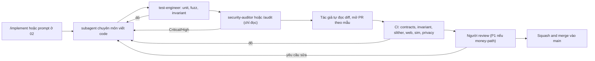

# Quy trình làm việc của đội với Claude Code

**Mục đích và đọc khi nào.** File này là luật chơi chung của đội 3 người khi làm HụiSafe cùng Claude Code: nhánh, commit, pull request, vòng review có subagent, CI, nhịp làm việc 14 ngày (07/11 tới 20/11/2026), giữ tài liệu đồng bộ, xử lý khi Claude làm sai, an toàn khóa và tiền testnet. Đọc một lần trước M0 (07/11), đọc lại mục 5 và 10 trước mỗi lần deploy. Lịch và mã việc (C1..C13, W1..W13, T0..T10) ở [../11-ke-hoach-trien-khai.md](../11-ke-hoach-trien-khai.md); cài đặt Claude Code ở [01-thiet-lap-claude-code.md](01-thiet-lap-claude-code.md); prompt mẫu ở [02-prompt-playbook.md](02-prompt-playbook.md).

---

## 1. Vai trò

| Người | Phụ trách | Review bắt buộc |
|---|---|---|
| P1 | Contract: Solidity, test, deploy, verify (C1..C13) | Mọi PR có nhãn `money-path` |
| P2 | Frontend, ví, relayer, attester, keeper, SDK (W1..W13) | PR đụng `apps/`, `packages/` |
| P3 | Mô phỏng, trợ lý AI, pitch, pháp lý, điều phối (T0..T10) | PR đụng `sim/`, `docs/`, `.claude/`, `CLAUDE.md` |

Mỗi PR cần ít nhất một người khác tác giả duyệt. PR có `money-path` thì P1 duyệt, kể cả khi P1 là người viết một phần (khi đó người còn lại duyệt thêm).

## 2. Nhánh

- `main` được bảo vệ: chỉ merge qua PR, CI xanh, có người duyệt, cấm force-push. Cài trong GitHub: Settings → Branches → branch protection cho `main`, bật "Require a pull request", "Require status checks" (các job `contracts`, `invariant`, `slither`, `web`, `sim`, `privacy`), "Require approvals: 1".
- Tên nhánh: `<loại>/<khu-vực>-<mô-tả-ngắn>`, ví dụ `feat/contracts-settle-round`, `fix/web-bid-panel-cap`, `test/contracts-invariant-ledger`, `docs/pitch-legal-slide`, `chore/claude-kit`.
- Nhánh sống tối đa 1 ngày; việc lớn thì cắt nhỏ. Cập nhật từ `main` bằng `git fetch && git rebase origin/main` trước khi mở PR.
- Mỗi phiên Claude Code làm trên một nhánh riêng; chạy song song thì mỗi phiên một worktree (01, mục 12).
- Merge bằng "Squash and merge"; tiêu đề squash theo quy ước commit ở mục 3.

## 3. Commit

Conventional Commits, tiếng Anh (ADR-15), thì hiện tại, ≤ 72 ký tự ở dòng đầu.

```text
<type>(<scope>): <mô tả ngắn bằng tiếng Anh>

<thân: vì sao, không phải làm gì; nhắc mã việc docs/11 và INV liên quan>
```

| type | Khi nào |
|---|---|
| `feat` | Tính năng mới |
| `fix` | Sửa lỗi |
| `test` | Thêm hoặc sửa test |
| `refactor` | Đổi cấu trúc, không đổi hành vi |
| `perf` | Tối ưu gas, tốc độ |
| `docs` | Tài liệu |
| `chore` | Việc vặt, sinh ABI, cấu hình |
| `ci` | GitHub Actions |

Scope: `contracts`, `sdk`, `config`, `web`, `keeper`, `sim`, `ai`, `docs`, `ci`, `claude`.

Ví dụ:

```text
feat(contracts): settle round with waterfall coverage (C6)
test(contracts): add INV-01 ledger invariant handler (C9)
fix(web): block bids above maxBid before commit (W8)
chore(sdk): regenerate ABI after Fuji deploy
docs(claude): add Fuji verify flags to foundry-fuji skill
```

Claude Code tự thêm dòng ghi công (attribution) vào commit theo cấu hình mặc định; đội có thể đổi bằng khóa `attribution` trong settings. Không bao giờ commit `.env*` (trừ `.env.example`), khóa, keystore, `contracts/deployments/local.json`.

## 4. Mẫu pull request

Lưu thành `.github/pull_request_template.md`:

```markdown
## Việc
- Mã việc (docs/11): <!-- C?, W?, T? -->  Mốc: <!-- M? -->
- Mô tả ngắn:

## Thay đổi chính
-

## Luồng tiền (bắt buộc nếu đụng contracts/, /api/relay, /api/attest, keeper, huiMath)
- [ ] Đã gắn nhãn `money-path`
- [ ] test-engineer: unit + fuzz (+ invariant nếu đổi trạng thái tiền). Kết quả:
- [ ] security-auditor: Critical 0, High 0. Tóm tắt báo cáo:
- [ ] Bất biến liên quan (INV-xx):

## Kiểm chứng
- Lệnh đã chạy và kết quả:
- Tx hash trên Fuji (nếu có):
- Ảnh màn hình ở bề rộng 360 px (nếu đổi UI):

## Definition of Done (CLAUDE.md)
- [ ] Đúng docs/03, docs/05; tài liệu đã cập nhật nếu hành vi đổi
- [ ] forge fmt --check, forge build, forge test (gồm invariant) xanh
- [ ] pnpm -r lint, pnpm -r typecheck, pnpm -r test xanh; pytest xanh nếu đụng sim/
- [ ] security-auditor không còn Critical/High; Slither sạch mức high
- [ ] Không bí mật trong diff; không địa chỉ hard-code ngoài packages/config và deployments/fuji.json
- [ ] UI tiếng Việt, mobile-first, số tiền kèm đơn vị
- [ ] Đã chạy /sync-abi nếu đổi interface hoặc event

## Ghi chú cho người review
- Phần do Claude Code viết, phần người viết tay, chỗ cần đọc kỹ:
```

## 5. Vòng review



1. **Implement.** Một đầu việc, một nhánh. `/implement <mã>` hoặc prompt ở 02; subagent đúng chuyên môn viết code.
2. **Test.** `test-engineer` thêm test cho đường vừa đổi. Test đỏ vì contract sai thì quay lại bước 1; không bao giờ nới test.
3. **Audit.** Đụng luồng tiền thì `/audit` (subagent `security-auditor`, chỉ đọc). Sửa hết Critical/High. Medium thì sửa hoặc ghi lý do chấp nhận trong PR.
4. **Tự đọc diff.** Tác giả đọc toàn bộ diff (`/diff` hoặc `git diff`) trước khi mở PR. Không mở PR cho code chưa đọc.
5. **CI.** Phải xanh cả 6 job.
6. **Người review.** Đọc theo thứ tự: đặc tả (docs/03, docs/05) → test → code. Hỏi "test nào sẽ đỏ nếu đoạn này sai?". Có thể dùng `/code-review` của Claude Code trên PR làm lượt đọc thứ hai, nhưng quyết định là của người.
7. **Merge** bằng squash; xóa nhánh; người viết báo trong họp 22:00.

## 6. CI (`.github/workflows/ci.yml`)

Khớp bảng job ở [../04-kien-truc.md](../04-kien-truc.md) mục 5.2 (bản đó rút gọn; đây là bản đầy đủ). Phiên bản action theo README ngày 06/11/2026: `actions/checkout@v7`, `actions/setup-node@v7`, `actions/setup-python@v7`, `pnpm/action-setup@v6`, `foundry-rs/foundry-toolchain@v1`, `crytic/slither-action@v0.4.2`.

```yaml
name: ci

on:
  push:
    branches: [main]
  pull_request:

permissions:
  contents: read

concurrency:
  group: ci-${{ github.ref }}
  cancel-in-progress: true

jobs:
  contracts:
    name: contracts (fmt, build, test, gas, coverage)
    runs-on: ubuntu-latest
    defaults:
      run:
        working-directory: contracts
    env:
      FOUNDRY_PROFILE: ci
    steps:
      - uses: actions/checkout@v7
        with:
          submodules: recursive
          persist-credentials: false
      - uses: foundry-rs/foundry-toolchain@v1
      - run: forge --version
      - run: forge fmt --check
      - run: forge build --sizes
      - run: forge test -vvv --no-match-path "test/invariant/*"
      - run: forge snapshot --check
      - run: forge coverage --report summary

  invariant:
    name: invariant (INV-01..INV-09)
    runs-on: ubuntu-latest
    defaults:
      run:
        working-directory: contracts
    env:
      FOUNDRY_PROFILE: ci
    steps:
      - uses: actions/checkout@v7
        with:
          submodules: recursive
          persist-credentials: false
      - uses: foundry-rs/foundry-toolchain@v1
      - run: forge test --match-path "test/invariant/*" -vvv

  slither:
    name: slither (fail on high)
    runs-on: ubuntu-latest
    steps:
      - uses: actions/checkout@v7
        with:
          submodules: recursive
          persist-credentials: false
      - uses: crytic/slither-action@v0.4.2
        with:
          target: contracts/
          fail-on: high

  web:
    name: web (sdk, lint, typecheck, test, build)
    runs-on: ubuntu-latest
    env:
      NEXT_PUBLIC_PRIVY_APP_ID: ${{ vars.NEXT_PUBLIC_PRIVY_APP_ID }} # biến công khai, đặt ở Settings > Variables
    steps:
      - uses: actions/checkout@v7
        with:
          submodules: recursive
          persist-credentials: false
      - uses: foundry-rs/foundry-toolchain@v1
      - name: Build contracts (ABI cho sdk)
        run: forge build
        working-directory: contracts
      - uses: pnpm/action-setup@v6 # phiên bản pnpm lấy từ trường packageManager trong package.json
      - uses: actions/setup-node@v7
        with:
          node-version: 22
          cache: pnpm
      - run: pnpm install --frozen-lockfile
      - name: ABI trong sdk khớp contract
        run: pnpm --filter sdk generate && git diff --exit-code packages/sdk/src/generated.ts
      - run: pnpm -r lint
      - run: pnpm -r typecheck
      - run: pnpm -r test
      - run: pnpm -r build

  sim:
    name: sim (pytest, baseline nhỏ, vector HuiMath)
    runs-on: ubuntu-latest
    defaults:
      run:
        working-directory: sim
    steps:
      - uses: actions/checkout@v7
        with:
          persist-credentials: false
      - uses: actions/setup-python@v7
        with:
          python-version: "3.12"
          cache: pip
          cache-dependency-path: sim/pyproject.toml
      - run: pip install -e ".[dev]"
      - run: pytest -q
      - run: python -m huisim.cli run --scenario baseline --seed 42 --circles 500 --out-dir outputs/ci
      - name: Vector HuiMath khớp bản đã commit
        run: |
          python -m huisim.cli vectors --seed 7 --out ../contracts/test/vectors/huimath.json
          git diff --exit-code ../contracts/test/vectors/huimath.json

  privacy:
    name: privacy (ABI không có string, không multicall, không file bí mật)
    runs-on: ubuntu-latest
    steps:
      - uses: actions/checkout@v7
        with:
          submodules: recursive
          persist-credentials: false
      - uses: foundry-rs/foundry-toolchain@v1
      - run: forge build
        working-directory: contracts
      - name: Quét ABI (INV-10, ADR-06)
        working-directory: contracts
        run: |
          set -euo pipefail
          files=(out/HuiCircle.sol/HuiCircle.json out/HuiFactory.sol/HuiFactory.json out/ReputationRegistry.sol/ReputationRegistry.json)
          strings=$(jq -r '.abi[] | select(.type == "event" or (.type == "function" and .stateMutability != "view" and .stateMutability != "pure")) | select([.inputs[]?.type] | index("string")) | .name' "${files[@]}")
          multicall=$(jq -r '.abi[] | select(.name == "multicall") | .name' "${files[@]}")
          if [ -n "$strings$multicall" ]; then echo "Vi phạm: $strings $multicall"; exit 1; fi
          echo "ABI OK"
      - name: Không có file bí mật bị commit
        run: |
          if git ls-files | grep -E '(^|/)\.env(\.|$)' | grep -v -E '\.env\.example$'; then echo "Có file .env bị commit"; exit 1; fi
          if git ls-files | grep -E '\.(pem|key)$|(^|/)keystores?/'; then echo "Có file khóa bị commit"; exit 1; fi
          echo "Không có file bí mật"
```

Ghi chú:
- `forge snapshot --check` cần `contracts/.gas-snapshot` đã commit: chạy `forge snapshot` một lần ở M1 rồi commit. Tăng gas có chủ ý thì chạy lại `forge snapshot` trong cùng PR và giải thích.
- `pnpm/action-setup@v6` không có `version` thì đọc trường `packageManager` (ví dụ `"packageManager": "pnpm@10.x.y"`) trong `package.json` gốc.
- Job `privacy` khớp yêu cầu ở `docs/09-kiem-thu-va-bao-mat.md` mục 8; nếu docs/09 quy định khác thì sửa job cho khớp docs/09.
- Workflow review PR bằng Claude (tùy chọn, tốn API) ở 01, mục 13.

## 7. Nhịp làm việc 14 ngày (07/11 tới 20/11)

### 7.1. Một ngày

| Giờ | Việc | Dùng Claude Code |
|---|---|---|
| Đầu buổi (15 phút) | Mở `claude` trong worktree của mình; đọc mốc và việc hôm nay do hook SessionStart in ra | Ngày bắt đầu mốc: `/plan-milestone M<n>`; ngày thường: plan mode cho việc đầu tiên |
| Khối làm việc 90 phút | Một việc, một nhánh, một phiên | `/implement <mã>`; `/clear` khi chuyển việc |
| Giữa ngày | `git fetch && git rebase origin/main`; xem CI | `/sync-abi` nếu ai đó vừa đổi interface |
| 20:00 - 22:00 | Mở PR, review chéo, merge | `/audit` cho PR `money-path`; `/code-review` làm lượt đọc thứ hai |
| 22:00 (15 phút) | Họp nhanh theo mẫu docs/11 mục 8 | Từ M3: P3 chạy `/demo-check` và dán bảng kết quả |
| Cuối ngày | Đóng phiên, xóa worktree đã merge | Ghi quyết định mới vào docs (không để trong lịch sử chat) |

### 7.2. Lịch 14 ngày (khớp docs/11 mục 3)

| Ngày | Mốc | P1 | P2 | P3 | Cổng kiểm cuối ngày |
|---|---|---|---|---|---|
| T7 07/11 | M0 | C1, C2 | W1, W2 | T0; chép bộ kit (01), CI | `bash .claude/hooks/test-hooks.sh` xanh; CI chạy `forge build` và `pnpm -r build`; 4 ví vai trò có AVAX |
| CN 08/11 | | C3, C4 | W3, W4 (anvil) | T1 | Unit factory và Forming xanh |
| T2 09/11 | | C5, C6 | W6 | T1 xong, T2 | Vector HuiMath chung đã commit |
| T3 10/11 | M1 | C7, C8 | W6, W5 khung | T3, T4 | `WorkedExample.t.sol` xanh; `/audit` contract lần 1 |
| T4 11/11 | M2 | C9, C10 | `/sync-abi`, W5 | T2, T3 | `/deploy-fuji` xong và đã verify (trước 15/11, rủi ro R16); invariant xanh; workshop 20:00 |
| T5 12/11 | | C11, C12 | W4 trên Fuji, W8, W10 | T5; tuyển người thử | Relay chạy trên Fuji; keeper chốt được kỳ |
| T6 13/11 | | C12, sửa lỗi | W7, W9 | T5; tài liệu thử nghiệm | Luồng vào dây qua web trên Fuji |
| T7 14/11 | M3 | Dây demo nhánh B qua web | E2E trên Fuji | Eval lần 1; tập thử nội bộ | `/demo-check` lần đầu |
| CN 15/11 | | Sửa lỗi | W9, W11 | Buổi thử 1; biểu đồ mô phỏng | Lỗi Critical/High = 0 |
| T2 16/11 | M4 | `/audit`, sửa lỗi | W12; T6 cùng P3 | Buổi thử 2; eval đạt ngưỡng; mô phỏng xong | Trợ lý chạy trong S03 |
| T3 17/11 | M5 | Slither sạch mức high | Accessibility, banner demo | Tổng hợp thử nghiệm | Đóng băng tính năng: từ đây chỉ nhận `type/bug`; workshop 20:00 |
| T4 18/11 | M6 | README phần contract | README phần app | Slide v1, kịch bản, video v1 | `pitch-writer` rà 3 câu hỏi, 4 điểm luật, dev toggle |
| T5 19/11 | | Dựng dây demo, nạp ví | Tập demo và dự phòng | Office hours 20:00; sửa slide, video | `/demo-check` toàn bộ |
| T6 20/11 | M7 | Kiểm Fuji, ví demo | Kiểm app, relayer, keeper | Video cuối; Submit trước 22:00 | Checklist docs/11 mục 12 tick đủ, ảnh xác nhận |

Ngày 21/11 là ngày dự phòng (hạn chót BTC 23:59): chỉ sửa lỗi chặn demo và kiểm link bằng tab ẩn danh.

## 8. Giữ tài liệu đồng bộ

- Đổi luật theo thứ tự: `docs/03` → `docs/05` → test → code (docs/03 cuối file). Không sửa code trước rồi "cập nhật docs sau".
- Đổi interface hay event: chạy `/sync-abi` trong cùng PR; CI job `web` chặn ABI lệch.
- `CLAUDE.md` nạp sẵn docs/03 và docs/05 bằng dòng `@`; các file khác (04, 11, ...) chỉ được trỏ tới theo mục, Claude mở khi cần. Đổi tên hay đánh lại số mục các file này thì sửa CLAUDE.md, skill và lệnh trỏ tới chúng trong cùng PR (`grep -rn "docs/0" CLAUDE.md .claude`).
- Skill là bản tóm tắt: đổi docs/03 thì P3 rà `.claude/skills/hui-protocol/SKILL.md`; đổi deploy hay mạng thì rà `foundry-fuji`; đổi màn hình, API thì rà `web3-frontend`; đổi pháp lý, pitch thì rà `vn-legal-pitch`.
- Đổi `.claude/` hay `CLAUDE.md` là PR riêng, scope `claude`, P3 duyệt; chạy lại `bash .claude/hooks/test-hooks.sh` khi đổi hook.
- Quyết định đưa ra trong chat với Claude phải được ghi vào docs (ADR mới ở docs/04, hay luật ở docs/03) trước khi merge; lịch sử chat không phải tài liệu.

## 9. Khi Claude làm sai

| Tình huống | Làm gì |
|---|---|
| Đang đi sai hướng | Bấm `Esc` để dừng; nói lại yêu cầu cụ thể hơn |
| Đã sửa file sai | `Esc` `Esc` (ô nhập trống) hoặc `/rewind` → "Restore code" hoặc "Restore code and conversation". Thay đổi do lệnh Bash và do subagent chạy nền không được rewind: dùng `git restore` / `git checkout` |
| Đặt tên khác docs/05, dùng `msg.sender` thay `_msgSender()`, hard-code địa chỉ, tự thêm biến môi trường | Yêu cầu sửa theo docs; lần thứ hai cùng lỗi thì thêm một dòng vào CLAUDE.md |
| Nới hay xóa test cho "xanh" | Từ chối diff; nhắc luật "không nới test"; giao lại `test-engineer` với yêu cầu tìm nguyên nhân |
| Sai lặp lại dù đã ghi CLAUDE.md | Biến luật thành thứ máy kiểm: test, invariant, job CI hoặc hook (hook chạy mỗi lần, không phụ thuộc Claude có "nhớ" hay không) |
| Ngữ cảnh rối sau phiên dài | `/compact <điều cần giữ>` hoặc `/clear` rồi bắt đầu lại với prompt rõ ràng |
| Claude đề xuất đổi luật tiền | Dừng; bàn trong đội; nếu đồng ý thì sửa docs/03 trước (mục 8) |
| Claude chạm vào bí mật (hook chặn) | Không tắt hook. Kiểm xem vì sao Claude cần nó; người tự làm phần cần bí mật |

Mỗi lỗi đáng kể ghi một dòng trong họp 22:00: lỗi gì, đã thêm luật, test hay hook nào để không lặp lại.

## 10. An toàn khóa và tiền testnet

- **Ví tách vai** (ADR-21): deployer (kiêm admin trên testnet), relayer, attester, keeper; cộng 6 ví demo (chủ hụi, M1..M5). Tất cả là ví testnet mới, không bao giờ dùng ví có tài sản thật, không dùng ví cá nhân nhận thưởng Builder Pass.
- **Tạo ví ngoài phiên Claude**: trong terminal riêng (`cast wallet new`) hoặc ví Core; hook chặn các lệnh in khóa trong phiên Claude. Lưu khóa trong trình quản lý mật khẩu của đội; chia sẻ qua kênh riêng tư, không qua chat nhóm hay chat với Claude.
- **Biến môi trường**: chỉ trong `.env.local` (gitignored). Người tự `set -a; source .env.local; set +a` rồi mới chạy `claude`. Không dán khóa vào prompt.
- **Lộ khóa**: khóa từng xuất hiện trong prompt, output, log, ảnh chụp hay commit đều coi như đã lộ (lịch sử phiên được lưu trên máy và gửi qua API). Xoay khóa theo runbook ở `docs/09-kiem-thu-va-bao-mat.md`: tạo ví mới, chuyển tiền testnet còn lại, cập nhật `.env.local` và biến môi trường nền tảng deploy; với attester thì cập nhật cấu hình factory cho dây mới.
- **Ngân sách testnet**: relayer giữ ≥ 1 AVAX (cảnh báo dưới mức này), rate limit 30 yêu cầu/giờ mỗi ví; theo dõi số dư bằng `/demo-check`. USDC: faucet khoảng 20 USDC mỗi 2 giờ mỗi ví (docs/11 R5), gom từ M0; dây thử dùng C nhỏ.
- **Ngắt khẩn cấp**: relayer lỗi hay bị lạm dụng thì tắt route `/api/relay` hoặc rút khóa relayer khỏi môi trường; contract có vấn đề thì admin gọi `factory.pauseCircle(circle)` (chỉ chặn, không rút được tiền ai); dây đã dừng liên tục 48 giờ thì admin mới gọi được `factory.unwindCircle(circle)` để trả tiền theo sổ (runbook ở docs/09 mục 13).
- **Mainnet**: không có trong phạm vi. Hook và quyền chặn broadcast ngoài Fuji; không ai tắt các lớp này.
